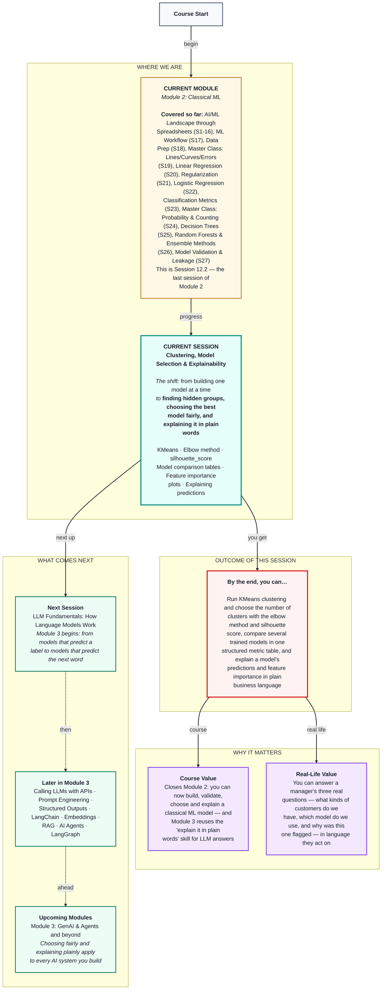

# Machine Learning: Clustering, Model Selection & Explainability
> **Pre-Read — Academic Session 12.2** | Module 2: Classical ML
---
## Mental Map


---

## What You'll Learn

In this pre-read, you'll discover:
- How KMeans finds natural groups in data that has no labels at all
- How the elbow method and the silhouette score help you choose the number of groups
- How to compare several trained models fairly in one metric table
- How to read a feature importance plot without over-reading it
- How to explain a model's prediction to a manager in plain business language

---

## A. KMeans Clustering

**💡 Analogy:** Swiggy wants to open three new hubs in Hyderabad so that every delivery partner lives as close as possible to one of them. You'd drop three pins on the map, assign each partner to the nearest pin, move each pin to the middle of its partners, and repeat until the pins stop moving. That is exactly what KMeans does.

**One-line definition: KMeans is an unsupervised algorithm that splits data into k groups (clusters) by repeatedly assigning each row to the nearest cluster centre and moving each centre to the average of its rows.**

```python
from sklearn.preprocessing import StandardScaler
from sklearn.cluster import KMeans

X_scaled = StandardScaler().fit_transform(df[["orders_last_30_days", "avg_rating", "months_active"]])
km = KMeans(n_clusters=3, n_init=10, random_state=42).fit(X_scaled)
df["segment"] = km.labels_
```

**Worked example:** Remember Session 17's split between supervised learning (there's a known label, like churned) and unsupervised learning (there isn't). The ops team has never labelled partner "types", so this is unsupervised. On our 300 synthetic partners, KMeans with k = 3 returns three segments. Averaging each one gives a profile: about 120 partners doing ~49 orders a month with 26 months on the platform and 15% churn; about 109 doing ~27 orders with 13 months and 23% churn; and about 71 doing ~7 orders with 3 months and 80% churn. KMeans only hands back the numbers 0, 1 and 2 — naming them "full-timers", "part-timers" and "new joiners" is our job.

**⚠️ Common trap:** Forgetting to scale. KMeans measures distance, so a feature measured in big numbers (orders, 0–60) would swamp one measured in small numbers (rating, 3–5). Unlike the decision trees in Session 25, KMeans needs scaled features — use the `StandardScaler` from Session 18 first.

---

## B. The Elbow Method

**💡 Analogy:** A hub that hires its first few support staff sees waiting times fall fast. Hire a tenth and the queue barely moves. The right number is where adding one more stops helping much — the "elbow" of the curve.

**One-line definition: The elbow method plots inertia — the total squared distance from each row to its cluster centre, stored in `km.inertia_` — for several values of k, and picks the k where the curve bends and starts to flatten.**

```python
inertias = []
for k in range(2, 9):
    km = KMeans(n_clusters=k, n_init=10, random_state=42).fit(X_scaled)
    inertias.append(km.inertia_)
```

**Worked example:** On our partner data, inertia falls from about 307 at k = 2 to about 180 at k = 3 — a drop of roughly 127. After that the drops shrink to about 34 (k = 4) and 32 (k = 5). The curve bends at k = 3: past that point, extra clusters only shave off a little distance.

**⚠️ Common trap:** Picking the k with the lowest inertia. Inertia always falls as k grows — with one cluster per partner it would be zero — so "lowest" is meaningless. You're looking for the bend, not the bottom.

---

## C. The Silhouette Score

**💡 Analogy:** At a family wedding, a guest seated at the right table is close to everyone at it and far from the next table over. A guest at the wrong table is closer to the people at the next table than to their own.

**One-line definition: The silhouette score compares, for every row, how close it is to its own cluster versus the nearest other cluster, and averages the result from −1 to 1 — near 1 means tight, well-separated clusters; near 0 means overlapping ones; negative means rows are probably in the wrong cluster.**

```python
from sklearn.metrics import silhouette_score

score = silhouette_score(X_scaled, km.labels_)
```

**Worked example:** On our data, the silhouette score is about 0.55 at k = 2, 0.51 at k = 3 and 0.43 at k = 4, then keeps falling. So the silhouette prefers k = 2 by a little, while the elbow pointed to k = 3. With two segments, part-timers and new joiners get lumped together — but they churn at very different rates (23% vs 80%) and need different actions. The three-segment answer scores almost as well and is far more useful, so we choose k = 3.

**⚠️ Common trap:** Treating the elbow or the silhouette score as the final answer. They're guides, and on real data they often disagree. Shortlist the k values both methods like, then let business sense decide: can the team actually act differently on each group?

---

## D. Model Comparison Tables

**💡 Analogy:** Choosing between three phones, you don't compare one phone's camera with another phone's battery. You put every phone in the same table, against the same specs, tested the same way.

**One-line definition: A model comparison table scores every candidate model on the same data, the same cross-validation folds and the same metrics, next to a do-nothing baseline, so the choice is based on evidence rather than habit.**

```python
from sklearn.model_selection import StratifiedKFold, cross_validate

cv = StratifiedKFold(n_splits=5, shuffle=True, random_state=42)
scores = cross_validate(model, X, y, cv=cv,
                        scoring=["accuracy", "precision", "recall", "f1", "roc_auc"])
```

**Worked example:** For churn on the same 300 partners and 5 stratified folds (Session 27), a baseline that always predicts "no churn" (Session 17's DummyClassifier) gets 0.67 accuracy but 0 recall — it never catches a single churner. Logistic regression scores 0.81 accuracy, 0.57 recall and 0.79 ROC-AUC. A depth-3 decision tree scores 0.78, 0.56 and 0.73. A random forest scores 0.79, 0.56 and 0.74. The simplest model, logistic regression, edges ahead on nearly every metric — and it's also the easiest to explain, so it wins here. (Your numbers may differ slightly with library versions.)

**⚠️ Common trap:** Two of them. Choosing by accuracy alone repeats Session 23's lesson: the baseline's 0.67 looks fine while it catches nobody, so pick the metric that matches the business cost — here, recall on churners matters. And assuming the fanciest model must win: the random forest didn't, which is exactly why you build the table instead of guessing.

---

## E. Feature Importance Plots

**💡 Analogy:** After a cricket win, the analyst ranks which players contributed most. The ranking tells you who mattered — not whether they scored runs or took wickets, and not that the win happened *because* of them alone.

**One-line definition: A feature importance plot is a bar chart of how much each feature contributed to a model's predictions — for a random forest, `feature_importances_` measures how much each feature reduced impurity across all its trees (Session 26).**

```python
import pandas as pd

rf.fit(X, y)
importance = pd.Series(rf.feature_importances_, index=X.columns).sort_values()
importance.plot.barh()
```

**Worked example:** For our random forest, `orders_last_30_days` has the highest importance (about 0.42), then `months_active` (about 0.32), then `avg_rating` (about 0.26). In plain words: the number of recent orders is the strongest signal the model uses to separate churners from non-churners, with tenure and rating also contributing.

**⚠️ Common trap:** Reading importance as direction or cause. The plot doesn't say whether *more* orders raise or lower churn risk, and it doesn't prove that orders *cause* churn — it's a pattern in historical data. Before spending money on "boost orders to stop churn", test the idea with a small pilot.

---

## F. Explaining Predictions to a Non-Technical Audience

**💡 Analogy:** A good doctor doesn't recite lab values to a patient. She says what she found, how sure she is, the two or three reasons that matter, and what to do next.

**One-line definition: Explaining a prediction in plain business language means stating what the model predicts, how confident it is, the top reasons in everyday words (compared with a typical case), and the recommended action — with no jargon.**

**Worked example:** For partner #250, the model gives a 73% chance of churning next month. The plain-language version for the ops manager: "Partner #250 is at high risk of leaving next month — about 3 in 4. The main reasons: only 8 orders in the last 30 days, compared with about 40 for a typical partner who stays; joined just a month ago, against about 22 months for a typical stayer; and a rating of 4.04, against about 4.44. Suggested action: call this week, offer peak-hour slots, and invite them to a rating-coaching session." For a single decision tree, the root-to-leaf path from Session 25 gives an even more direct "because".

**⚠️ Common trap:** Explaining the model instead of the decision. Words like "ROC-AUC", "impurity" or "probability threshold" lose a manager in seconds, and so does false precision like "72.84%". Say "about 3 in 4", name the reasons in business terms, and always end with an action.

---

## Quick Reference — Clustering, Choosing and Explaining

| Your situation | Use this | Because |
|---|---|---|
| You want natural groups, with no labels | KMeans on scaled features | Distance-based grouping needs equal scales |
| Choosing the number of clusters | Elbow method + silhouette score, then business sense | They're guides that often disagree |
| Choosing between trained models | One comparison table: same folds, same metrics, plus a baseline | A fair, evidence-based choice |
| Data with imbalanced classes | Look beyond accuracy — recall, precision, F1, ROC-AUC | Session 23's accuracy trap |
| Showing what drives a model | Feature importance plot | Which features matter — not direction or cause |
| Explaining one prediction to a manager | What, how sure, top reasons vs typical, action | Plain language leads to a decision |

---

## Practice Exercises

1. **Concept Detective** — A teammate runs KMeans on unscaled data and finds that the clusters split almost entirely by `orders_last_30_days`, ignoring rating. What happened, and how do you fix it?

2. **Spot the Error** — A report says: "We chose k = 8 because it had the lowest inertia." What's wrong with this reasoning?

3. **Pattern Recognition** — The elbow method suggests k = 4 and the silhouette score is highest at k = 3. What would you do next before deciding?

4. **Real-Life Application** — Your comparison table shows a random forest with 0.82 accuracy and 0.40 recall, and logistic regression with 0.79 accuracy and 0.62 recall, for spotting loan defaults at HDFC. Which would you recommend, and what's the business reason?

5. **Planning Ahead** — Write a four-sentence, jargon-free explanation for a manager of why a customer of a food app is predicted to stop ordering, using made-up but realistic numbers and ending with an action.

---

> ✅ **You're done!** You can now find natural groups with KMeans and choose k using the elbow method and silhouette score, compare trained models fairly in one table, read feature importance carefully, and explain a prediction in plain business language — the skills that close out Module 2.
>
> Next up: **Session 13.1 — LLM Fundamentals: How Language Models Work**, where Module 3 begins and we move from models that predict a label to models that predict the next word.
