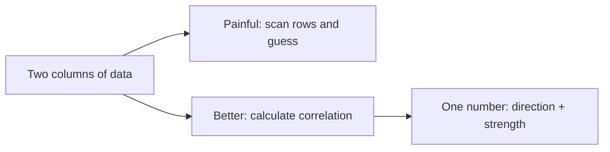
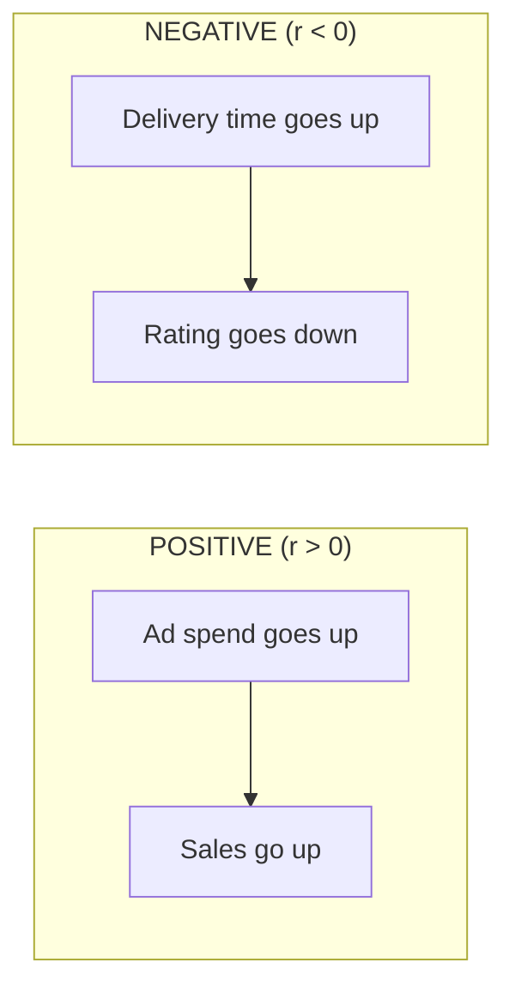
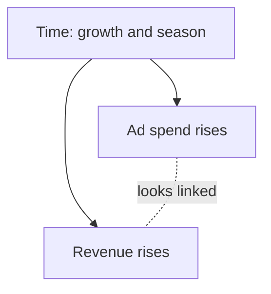

# Lecture Script: Statistics — Relationships in Data
**Session 12.1 · Module 4: GenAI for Analytics Workflows + Basic Python**
**Duration: 90 minutes · Audience: 40-60 learners · Prerequisite: pre-read for this session**

---

## Timing table

| # | Block | Minutes | Running total |
|---|-------|---------|---------------|
| 1 | Opening hook | 5 | 5 |
| 2 | From Known to New | 10 | 15 |
| 3 | A. Correlation: patterns between business variables | 15 | 30 |
| 4 | B. Positive and negative correlations | 12 | 42 |
| 5 | C. Weak vs. strong relationships | 13 | 55 |
| 6 | D. Correlation is not causation | 20 | 75 |
| 7 | Live practice: read it and challenge it | 10 | 85 |
| 8 | Wrap-up and bridge | 5 | 90 |
| | **Total** | **90** | |

**Running examples (same as pre-read), all from Kirana365 files in the `data` folder:** Jan to Aug 2026 ad spend, revenue from ads and push notifications (8 months); August 2026 daily average delay vs. rating (31 days); ice cream and sunburn.

**Board setup before you start:** put the 8-month ads table on a slide, and open both CSVs (`Kirana365_Ads_Notifications_Jan-Aug2026.csv`, `Kirana365_Delay_vs_Rating_Aug2026.csv`) in a sheet or notebook. Keep the mental map open in another tab.

---

## Block 1 · Opening hook (5 min)

**Say:**
> "Quick poll. Last quarter, a company doubled its ad spend. Sales went up 30%. Raise your hand if you think the ads worked."

*(Pause. Most hands go up.)*

> "Keep your hand up if you are *sure*. Now think: what if it was Diwali quarter? What if sales would have gone up 25% anyway? Suddenly 'sure' feels less sure, right?"

> "Today's session is about two skills. One: how to measure whether two things move together. Two: how to stop yourself, and your manager, from jumping to the wrong conclusion."

**Transition:** "Let's start with the problem we are solving."

---

## Block 2 · From Known to New (10 min)

**Hook:**
> "You all know how to look at two columns and say 'yeah, they look related.' Let's try that."

**Show the 8-month table (Kirana365_Ads_Notifications_Jan-Aug2026.csv):**

| Month | Ad spend (₹) | Revenue from ads (₹) | Push notifications sent |
|-------|--------------|----------------------|-------------------------|
| Jan | 30,000 | 96,000 | 100,000 |
| Feb | 32,000 | 1,00,800 | 95,000 |
| Mar | 34,000 | 1,13,900 | 1,15,000 |
| Apr | 36,000 | 1,18,800 | 1,00,000 |
| May | 38,000 | 1,25,400 | 1,25,000 |
| Jun | 40,000 | 1,40,000 | 1,05,000 |
| Jul | 45,000 | 1,75,500 | 1,20,000 |
| Aug | 50,000 | 2,10,000 | 1,10,000 |

**Ask:** "Does ad spend look related to revenue?" *(Everyone says yes.)* "And push notifications and revenue?" *(Mixed answers. That is the point.)*

**Say:**
> "Ad spend is easy: both columns climb. Notifications are harder: up, down, up. Now imagine 800 rows instead of 8. Can you still do it by eye? No. And even for ad spend, your answer is 'quite strong'. My answer is 'it's 0.989'. Which one can you put in a report?"



**Key line:** "Correlation turns a feeling into a number."

**Transition:** "Let's define that number."

---

## Block 3 · A. Correlation: patterns between business variables (15 min)

**Hook:**
> "Think of two friends walking down a road. If one turns left and the other always turns left too, you can predict one from the other. That is correlation. If they walk in random directions, you cannot."

**Teach (6 min):**
- Correlation measures how two variables move together.
- The number is called **r**, the correlation coefficient.
- r lives between **-1 and +1**.
  - +1: perfect lockstep upward
  - 0: no straight-line pattern
  - -1: perfect opposite

**Draw on the board:** a horizontal line from -1 to +1 with 0 in the middle.

**Connect to the running example:**
> "For Kirana365's eight months, r between ad spend and revenue from ads is +0.989. That is almost +1. They moved almost in lockstep."

**Business examples (2 min):** ad spend vs. sales, discount % vs. units sold, training hours vs. performance score, notifications sent vs. daily active users.

**Mini-activity (4 min):**
> "Turn to your neighbour. Give me one pair of numbers from your own work or life that you think move together. You have 90 seconds."

*(Take 3 answers. For each, ask: "Positive or negative? Strong or weak? Do you *know* or are you *guessing*?")*

**🔴 Trap:** "r is calculated from a formula, but the formula does not know what the columns *mean*. It will happily compute r between 'number of chai cups' and 'number of flight delays'. The number does not know if the pairing is sensible. You do."

**💬 Expect pushback:** *"Sir, do we need to calculate this by hand?"*
> "No. In Python or Excel it is one line. What matters is that you can read the result. We will peek at the Python later in this module."

**Optional peek (1 min, only if time permits):**
```python
df["Ad_Spend_INR"].corr(df["Revenue_From_Ads_INR"])
```
> "One line. That is it. Don't worry about the syntax today. We will build Python skills later in this module."

**Transition:** "So r is a number between -1 and +1. What does the sign tell us?"

---

## Block 4 · B. Positive and negative correlations (12 min)

**Hook:**
> "Think of a seesaw. When one end goes up, the other goes down. That is a negative correlation. Now, is a seesaw bad? No. It is just a direction."

**Teach (6 min):**
- **Positive (r > 0):** same direction. More ad spend, more sales.
- **Negative (r < 0):** opposite direction. Higher delivery time, lower rating.



**Say:**
> "A lot of people hear 'negative' and think 'bad'. Kirana365's August file gives r = -0.88 between average delay and rating across 31 days, and the team says 'great, now we know where to focus.' Sensible, because late days are low-rated days. Negative correlation is *information*, not *bad news*."

**Poll (3 min):** *Positive, negative, or none?*
1. Hours spent on a tutorial vs. test score → *(positive)*
2. Number of app crashes vs. customer satisfaction → *(negative)*
3. Employee's shoe size vs. salary → *(none)*
4. Discount % vs. profit per unit → *(negative)*

**🔴 Trap:** "The sign tells you direction only. It does **not** tell you how strong the link is. r = -0.9 and r = -0.1 are both negative. One is a strong relationship, one is nearly nothing."

**💬 Expect pushback:** *"If r is negative, can we just ignore the variable?"*
> "No. A strong negative relationship is just as useful as a strong positive one. Ignore *weak* ones, not negative ones."

**Transition:** "Which brings us to size. How strong is strong?"

---

## Block 5 · C. Weak vs. strong relationships (13 min)

**Hook:**
> "Imagine a crowd outside a stadium. If almost everyone is walking toward the gate, the pattern is strong. If only slightly more people walk toward the gate than away, the pattern is weak."

**Teach (7 min):** Put the table on screen.

| Size of r (ignore sign) | Reading |
|--------------------------|---------|
| 0.0 to 0.3 | Weak |
| 0.3 to 0.7 | Moderate |
| 0.7 to 1.0 | Strong |

**Place real results on the scale (3 min):** put this on screen and have the room read each row aloud.

| Pair | r | Reading |
|------|---|---------|
| Ad spend and revenue from ads (8 months) | +0.99 | Strong positive |
| Avg delay and avg rating (31 days) | -0.88 | Strong negative |
| Push notifications and revenue from ads (8 months) | +0.41 | Moderate positive, but only 8 points |
| Day of the month and avg rating (31 days) | -0.01 | None |

> "The last row is what 'no relationship' looks like. Knowing the date tells you nothing about the day's rating. And the 0.41: with only eight months, would you bet the notification budget on it?"

**Say:**
> "Look at the size, forget the sign. r = -0.85 is a *strong negative*. r = +0.15 is a *weak positive*. Which is the stronger relationship?" *(Take answers: -0.85.)*

**Key line:** "Size is strength. Sign is direction. Never mix them up."

**Two honest caveats (3 min):**
1. **Thresholds depend on the field.** "In physics, 0.7 might disappoint. In predicting human behaviour like customer churn, 0.3 can be valuable. Always ask: what is normal for this kind of data?"
2. **r only sees straight lines.** "If the data forms a curve, r can be near zero even with a clear pattern. That is why we *always* plot first."

**Quick-check (3 min):**
> "r between app load time and daily purchases is -0.72. Say it in one sentence."

*(Expected: "Strong negative: slower load times go with fewer purchases.")*

**🔴 Trap:** "Do not report a correlation without having looked at the scatter plot. A single outlier can push r up or down dramatically. The number can lie. The picture usually does not."

**💬 Expect pushback:** *"So 0.5 is good or bad?"*
> "It depends. For ad spend and sales, 0.5 might be disappointing. For something messy like employee engagement and retention, 0.5 could be a gold mine. The context decides."

**Transition:** "Now the part that matters most. Let's talk about what correlation does *not* tell you."

---

## Block 6 · D. Why correlation does not imply causation (20 min)

**Hook:**
> "Ice cream sales and sunburn cases rise together every summer. Should the government ban ice cream to reduce sunburn?"

*(Laughter. Let it land.)*

> "Obviously not. Hot sunny weather drives both. That hidden driver is called a **confounder**."

**Teach (12 min), three patterns:**

**Pattern 1: Hidden third factor (confounder)**
- Ice cream and sunburn → weather.

**Pattern 2: The time-trend trap (the main case)**
> "Kirana365's ad spend and revenue from ads have r = 0.989. Leadership says: 'ads drive revenue, double the budget!' Now number the months 1 to 8. Month number vs ad spend: r = 0.975. Month number vs revenue: r = 0.934. Both columns just climb with time as the business grows and the festive run-up nears. How much of that jump is the ads, and how much is time?"

> "Two more clues. Revenue per rupee of ads went from 3.2 in January to 4.2 in August, so something other than spend is lifting results. And 'revenue from ads' is credited to ads by the ad platform itself, so a high r is partly built into the measurement."



> "The correlation is real. The *causal story* might be partly wrong."

**Pattern 3: Reverse direction**
> "Stores with more staff have higher sales. Do more staff create sales? Or do busy, high-sales stores hire more staff?"

**Say:** "Correlation can show you where to *look*. It cannot tell you what to *do*."

**Four habits to avoid misleading conclusions (3 min):**
1. Ask what else could explain it.
2. Ask which way the arrow points.
3. Use careful wording: "is associated with", not "causes".
4. Beware of coincidence: with enough variables, some will line up by chance.

**How do we actually prove causation? (2 min)**
> "Run an experiment. For example, an A/B test: show ads to one random group and not to another, then compare sales. Randomness removes hidden factors. We won't build one today, but know that this is the gold standard."

**Mini-discussion (3 min):**
> "Your manager says: 'Employees who attend more training have higher performance ratings. Let's make training mandatory.' What questions would you ask before agreeing?"

*(Target answers: Do high performers choose to attend more training? Is motivation the hidden factor? Did anyone test it with a random group?)*

**🔴 Trap:** "The most dangerous sentence in analytics is: 'The data shows that X causes Y.' Check whether your data can actually show that."

**💬 Expect pushback:** *"But if the correlation is 0.99, it must be causal?"*
> "No. A very high r can still be driven by a hidden factor or coincidence. Strength of correlation is not strength of causation. They are different questions."

**Transition:** "Let's put all of this into practice."

---

## Block 7 · Live practice: read it and challenge it (10 min)

**Show three results on screen and ask the room to respond to each with: direction, strength, and one challenge.**

| Scenario | r | Expected response |
|----------|---|-------------------|
| Push notifications vs. revenue from ads (8 months) | +0.41 | Moderate positive. Challenge: only 8 points, and big-spend months may also send more notifications. |
| Avg delay vs. avg rating (31 days in Aug) | -0.88 | Strong negative. Challenge: plausible direction (late orders annoy), but a rush day could cause both a slow delivery and a bad rating. |
| Day of the month vs. avg rating (Aug) | -0.01 | None. Knowing the date tells you nothing about the rating. |

**Walk through each (about 3 min per row).** Cold-call two or three learners. Praise good challenges.

**Say:**
> "Notice what you just did: you did not just read the number, you *questioned* it. That is the skill."

---

## Block 8 · Wrap-up and bridge (5 min)

**Recap with the mental map open (2 min):**
- r goes from -1 to +1.
- Sign = direction. Size = strength.
- Plot before trusting r.
- Correlation is not causation.

**One-line takeaway:**
> "Correlation tells you that two things move together. It never tells you why."

**Bridge (1 min):**
> "Next session, 12.2, you will write GenAI prompts that summarise and compare data and turn it into a short report. Today's skill, questioning a number before you trust it, is exactly what you will need to check what GenAI tells you."

**Closing prompt (2 min):** "Before you leave, write down one number pair from your own work. Next time you see it in a report, ask: is this correlation, or is someone claiming causation?"

---

## Instructor quick-reference

- **Same numbers everywhere:** ad spend vs. revenue from ads r = +0.989 (8 months); notifications vs. revenue +0.41; delay vs. rating -0.88 (31 days); day vs. rating -0.01; month number vs. ad spend +0.975 and vs. revenue +0.934 (the time confounder).
- **If you are running long:** shorten Block 7 to two scenarios and skip the optional Python peek.
- **If you are running short:** extend the Block 6 discussion with the training-hours example.
- **Phrases to model:** "is associated with", "moves together with". Avoid "causes" and "drives".
