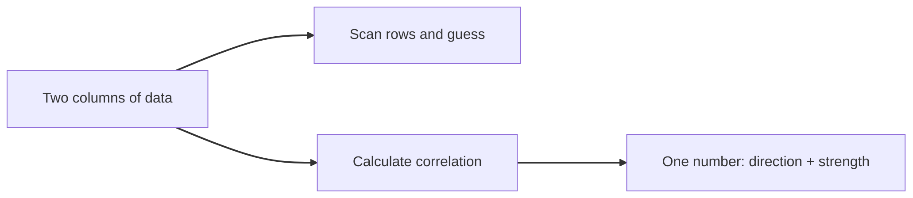
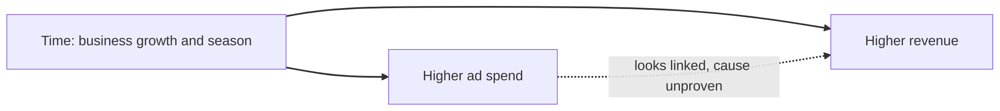

# Statistics: Relationships in Data
> Pre-Read — Academic Session 26 | Module 4: GenAI for Analytics Workflows + Basic Python
---

## Mental Map

```mermaid
%%{init: {'themeVariables': {'fontSize': '16px'}, 'flowchart': {'useMaxWidth': false, 'htmlLabels': true, 'nodeSpacing': 80, 'rankSpacing': 120, 'wrappingWidth': 620, 'padding': 20}}}%%
flowchart LR

START["<b>Course Start</b>"]

subgraph foundation[" WHERE WE ARE "]
direction LR
    CURMOD["<b>CURRENT MODULE</b><br/><i>Module 4: GenAI for Analytics Workflows + Basic Python</i><br/>&nbsp;<br/><b>Covered so far:</b> Modules 1–3 (earlier in the course)<br/>This is Session 26 of 41"]
    CURSES["<b>CURRENT SESSION</b><br/><b>Statistics: Relationships in Data</b><br/>&nbsp;<br/><i>The shift:</i> from <i>reading two columns of numbers by eye</i> to <b>using a correlation number to measure how business variables move together, and knowing why it never proves cause</b><br/>&nbsp;<br/>Correlation between business variables · Positive &amp; negative relationships<br/>Weak vs strong relationships · Correlation is not causation"]
end

subgraph outcome[" OUTCOME OF THIS SESSION "]
direction LR
    OUT["<b>By the end, you can…</b><br/>&nbsp;<br/>Read a correlation between two Kirana365 business variables such as ad spend and sales,<br/>say whether it is positive or negative and strong or weak,<br/>and explain why it does not prove that one causes the other"]
end

subgraph value[" WHY IT MATTERS "]
direction LR
    CVAL["<b>Course Value</b><br/>The habit of questioning a number before trusting it carries into every GenAI summary and report you will check in this module"]
    RVAL["<b>Real-Life Value</b><br/>Stopping a leadership meeting from concluding that more ad spend caused higher sales when a festive season may be driving both"]
end

subgraph future[" WHAT COMES NEXT "]
direction LR
    U0["<b>Next Session</b><br/>Summarise, Compare and Report with GenAI<br/><i>Now we use GenAI to turn figures like these into summaries and reports</i>"]
    U1["<b>Later in Module 4</b><br/>Breaking Down the Workflow · Multi-Step GenAI Workflows · Python Fundamentals I, II, III<br/>Python for APIs and GenAI Integration · pandas · Visualization · End-to-End Workflow"]
    U2["<b>Upcoming</b><br/>Capstone Project<br/><i>Judging evidence fairly is a skill the capstone assumes you already have</i>"]
end

START ==>|" begin "| CURMOD
CURMOD ==>|" progress "| CURSES
CURSES ==>|" you get "| OUT
OUT ==>|" course "| CVAL
OUT ==>|" real life "| RVAL
CURSES ==>|" next up "| U0
U0 -.->|" then "| U1
U1 -.->|" ahead "| U2

classDef startBox fill:#F7FAFC,stroke:#4A5568,stroke-width:2px,color:#1A202C
classDef curModBox fill:#FFF8E6,stroke:#B7791F,stroke-width:2px,color:#1A202C
classDef curSessBox fill:#E6FFFA,stroke:#0D9488,stroke-width:3px,color:#1A202C
classDef outBox fill:#FEF2F2,stroke:#DC2626,stroke-width:3px,color:#1A202C
classDef valueBox fill:#F3E8FF,stroke:#7C3AED,stroke-width:2px,color:#1A202C
classDef futureBox fill:#ECFDF5,stroke:#047857,stroke-width:2px,color:#1A202C

class START startBox
class CURMOD curModBox
class CURSES curSessBox
class OUT outBox
class CVAL,RVAL valueBox
class U0,U1,U2 futureBox

linkStyle default stroke-width:2px
```

## What You'll Learn
In this pre-read, you'll discover:
- How a single number (correlation) tells you whether two business variables move together
- How to tell a positive relationship from a negative one
- How to judge whether a relationship is weak or strong
- Why a strong correlation still does not prove that one thing causes the other

## A. Correlation — Spotting Patterns Between Business Variables

**💡 Analogy**: Think of two people walking side by side. If one speeds up and the other almost always speeds up too, they are moving together. Correlation is the number that says how closely two columns of data "walk together."

**Correlation measures how two variables move together, on a scale from −1 to +1.**

**Worked example**: Kirana365 tracked eight months of ad spend, the revenue credited to ads, and push notifications sent (file: `Kirana365_Ads_Notifications_Jan-Aug2026.csv`):

| Month | Ad spend (₹) | Revenue from ads (₹) | Push notifications sent |
|---|---|---|---|
| Jan | 30,000 | 96,000 | 100,000 |
| Feb | 32,000 | 1,00,800 | 95,000 |
| Mar | 34,000 | 1,13,900 | 1,15,000 |
| Apr | 36,000 | 1,18,800 | 1,00,000 |
| May | 38,000 | 1,25,400 | 1,25,000 |
| Jun | 40,000 | 1,40,000 | 1,05,000 |
| Jul | 45,000 | 1,75,500 | 1,20,000 |
| Aug | 50,000 | 2,10,000 | 1,10,000 |

With eight rows you can see that ad spend and revenue rise together. With 800 rows your eyes give up, so you calculate one number. The correlation (written *r*) between ad spend and revenue from ads is **0.989**, very close to +1.

**⚠️ Common trap**: Trusting your eyes on a long table. A pattern that looks obvious in 8 rows can be invisible, or imaginary, in 800. Calculate the number, and look at a scatter plot as well.

## B. Positive and Negative Relationships

**💡 Analogy**: Think of a seesaw and a pair of friends climbing a staircase. On the staircase both rise together (positive). On a seesaw, when one end goes up the other goes down (negative).

**A positive correlation means both variables rise together; a negative correlation means one rises as the other falls.**

**Worked example**: Positive: more ad spend, more revenue from ads (r = +0.989). Negative: Kirana365's August file (`Kirana365_Delay_vs_Rating_Aug2026.csv`) has one row per day with the average delivery delay and the average customer rating. A few days:

| Date | Avg delay (min) | Avg rating |
|---|---|---|
| 18 Aug | 4.0 | 4.85 |
| 28 Aug | 2.0 | 4.67 |
| 3 Aug | 17.8 | 3.95 |
| 4 Aug | 19.8 | 3.71 |
| 29 Aug | 22.7 | 3.74 |

On slow days the rating is lower. Across all 31 days the correlation is **−0.88**. The minus sign tells you the direction, not that the data is "bad."

**⚠️ Common trap**: Reading a negative correlation as a weak one. −0.88 is a very strong relationship that simply runs in the opposite direction. Strength is how far the number is from 0, and the sign is only the direction.

## C. Weak vs Strong Relationships

**💡 Analogy**: Think of a stadium crowd. When almost everyone cheers at the same moment, the crowd moves as one (strong). In a street where people do their own thing, you may spot a few cheers but no real pattern (weak).

**The closer r is to +1 or −1 the stronger the relationship; the closer to 0, the weaker.**

**Worked example**: A rough guide many analysts use: above 0.7 (or below −0.7) is strong, about 0.3 to 0.7 is moderate, and below 0.3 is weak. Placing Kirana365's results on that scale:

| Pair | r | Reading |
|---|---|---|
| Ad spend and revenue from ads (8 months) | +0.99 | Strong positive |
| Avg delay and avg rating (31 days) | −0.88 | Strong negative |
| Push notifications and revenue from ads (8 months) | +0.41 | Moderate positive |
| Day of the month and avg rating (31 days) | −0.01 | None |

The last row is what "no relationship" looks like: knowing the date tells you nothing about that day's rating.

**⚠️ Common trap**: Treating the rule of thumb as a law, and ignoring sample size. The 0.41 for notifications comes from only 8 months, so it could easily be chance. Also, r only captures straight-line patterns, so a curved relationship can have an r near 0.

## D. Correlation Is Not Causation

**💡 Analogy**: Ice-cream sales and sunburn cases both rise in summer. Nobody thinks ice cream causes sunburn. A hidden third thing, the sunny season, drives both.

**Two variables moving together does not prove that one causes the other; a hidden third factor may drive both.**

**Worked example**: Leadership sees r = 0.989 and says, "Ads drive our revenue, so double the budget." Look closer. Number the months 1 to 8: month number and ad spend have r = 0.975, and month number and revenue from ads have r = 0.934. Both columns simply climb with time as the business grows and the festive run-up nears. Revenue also grew faster than spend: revenue per rupee of ads went from 3.2 in January to 4.2 in August, so something other than spend is lifting results. And "revenue from ads" is credited to ads by the ad platform, so a high r is partly built into how it is measured. The honest statement is: "Ad spend and ad-attributed revenue moved together, and we cannot yet say the ads caused the rise." To test cause you would need a comparison, such as running ads in some cities and not in others.

The delay and rating link is more believable, since late orders plausibly annoy customers. Even so, a rush day could cause both a slow delivery and a bad rating.

**⚠️ Common trap**: Saying "because" after finding a correlation. The words "is linked to" or "moves with" are safe. The words "causes" or "leads to" need extra evidence. This habit also matters when you check GenAI summaries later in this module, since they love to write "because."

## Quick Reference — Reading a Relationship

| Your situation | Use this | Because |
|---|---|---|
| You want to know if two columns move together | Calculate the correlation (r) | One number gives direction and strength |
| r is close to +1 | Positive, strong | Both rise together tightly |
| r is close to −1 | Negative, strong | One rises as the other falls, tightly |
| r is near 0 | Weak or no straight-line link | The two do not move together in a straight line |
| Someone says "ads caused revenue to rise" | Ask what else could drive both | Correlation alone cannot prove cause |

## Practice Exercises

1. **Pattern Recognition**: In the weak-vs-strong table, which pair is the strongest and which the weakest? Say each in one sentence with its direction.

2. **Concept Detective**: A teammate reports "correlation of 0.41 between push notifications and ad revenue." Which word describes that strength, and what would you check about the data before trusting it?

3. **Real-Life Application**: List two other pairs of Kirana365 variables you would expect to be positively correlated and two negatively correlated.

4. **Spot the Error**: A report says: "Ad spend and revenue have r = 0.989, so ads cause revenue." What is wrong with this sentence, and how would you rewrite it?

5. **Planning Ahead**: Next session we use GenAI to summarise figures like these. If a GenAI summary says "ad spend drove the revenue jump," what is the first question you would ask it?

> ✅ **You're done!** You can now read a correlation, say whether it is positive or negative and strong or weak, and explain why it never proves cause on its own.
Next session, we start using GenAI to turn figures like these into summaries and comparisons, in **Summarise, Compare and Report with GenAI**. Bring the habit of questioning a number before trusting it.
