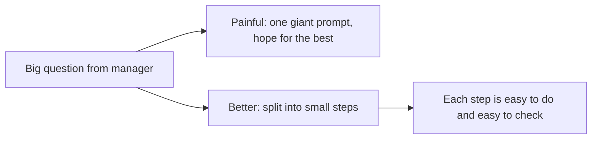
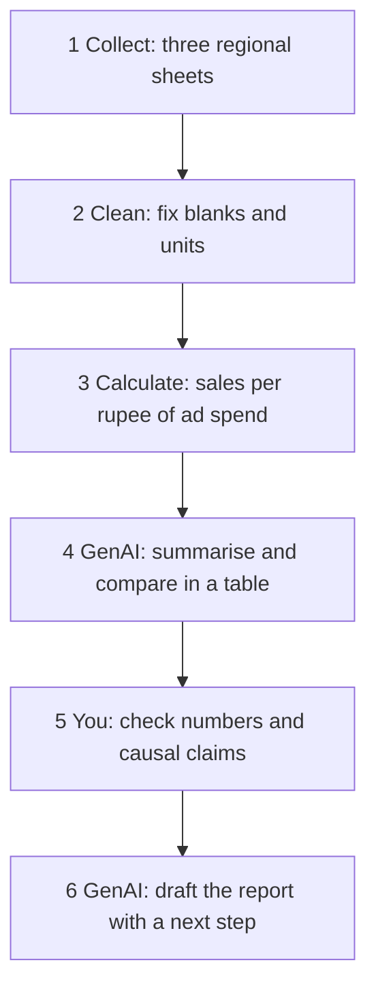

# Lecture Script: Breaking Down the Workflow
**Session 12.3 · Module 4: GenAI for Analytics Workflows + Basic Python**
**Duration: 90 minutes · Audience: 40-60 learners · Prerequisite: pre-read; 12.1 and 12.2**

---

## Timing table

| # | Block | Minutes | Running total |
|---|-------|---------|---------------|
| 1 | Opening hook | 5 | 5 |
| 2 | From Known to New | 10 | 15 |
| 3 | A. Breaking a problem into steps | 20 | 35 |
| 4 | B. Defining steps in an analytics workflow | 20 | 55 |
| 5 | C. Designing a GenAI-supported workflow | 18 | 73 |
| 6 | Live practice: design a workflow on paper | 12 | 85 |
| 7 | Wrap-up and bridge | 5 | 90 |
| | **Total** | **90** | |

**Running example (same as pre-read):** the store's monthly report for North, South, West (ad spend 6/8/4, sales 41/55/31, ₹ lakh) and the six-step workflow.

**Setup:** blank slide or whiteboard for drawing the workflow live.

---

## Block 1 · Opening hook (5 min)

**Say:**
> "Your manager sends one line: 'Prepare the monthly report for all regions and tell me where to invest more.' How many tasks is that? Count them in your head."

*(Take answers. Most say 1 to 3.)*

> "I count at least six. When you only see one, you will do it badly. When you see six, you can do each one well."

**Transition:** "Let's learn to see the six."

---

## Block 2 · From Known to New (10 min)

**Hook:**
> "Who has made biryani, or watched someone make it? Is it one action? Soak rice, fry onions, marinate, layer, dum. If you skip the marinating or do the dum first, you get a disaster. Order and steps matter."

**Ask:** "What happens if we hand the whole report to GenAI in one prompt?" *(Take 2-3 answers: wrong numbers, can't check, can't repeat.)*

**Key line:** "Small steps are not slower. They are how you know where it broke."

**Callback to 12.2:** "Last session I warned you: if your prompt becomes a wall of text, the task is too big. Today is the cure."

---

## Block 3 · A. Breaking a problem into steps (20 min)

**Hook:**
> "Think of a relay race. One runner cannot run the whole thing at full speed. Each runner covers one leg. And if the team is slow, you can see which leg was slow."

**Teach the four questions (6 min):** Write on board.
1. What is the final output?
2. Who is it for?
3. What goes in?
4. What must happen between?

**Say:** "Start from the *end*. Ask: to write that report, what do I need just before it? And before that? Keep asking backwards."

**Live demo (8 min):** Take the manager's question and work backwards on the board:
- Output: one-page report with a recommendation.
- Before it: a table and a summary.
- Before that: efficiency numbers per region.
- Before that: clean data.
- Before that: the three regional sheets.

Flip it around into a forward list.

**Activity (4 min):** Give a new question: "Which product should we stop selling?" In pairs, work backwards and list 4 steps. Take two answers.

**Quick check (2 min):** "Is 'analyse the data' a good step?" *(No: too big.)*

**🔴 Trap:** "Do not start at step 1 by feel. If you do not know the output, you will collect the wrong data and waste a day."

**💬 Expect pushback:** *"Sir, this feels obvious. Do we really need to write it down?"*
> "It feels obvious until you are at step 4 and realise you needed something from step 2. Writing takes two minutes. Redoing takes two hours."

**Transition:** "We have a rough list. How do we make each step precise?"

---

## Block 4 · B. Defining steps in an analytics workflow (20 min)

**Hook:**
> "A factory assembly line: each station does one thing. If a defective piece arrives, you know which station. If one worker does everything, you never find out."

**Teach the backbone (6 min):** Put the table on screen: Collect → Clean → Analyse → Summarise → Report → Check. Link each to a question.

**Teach input-action-output (5 min):** Pick one step and write it fully.

> "Step 3. Input: cleaned table of ad spend and sales. Action: calculate sales per ₹ of ad spend per region. Output: three numbers: ~6.8, ~6.9, ~7.8."

**The right-size test (3 min):** "One sentence to describe, one minute to check."

**Compare:** "Analyse the data" (too big) vs "Calculate sales per ₹ of ad spend for each region" (right size).

**Activity (4 min):** Give three steps (one too big, one too small, one right). Learners vote which is which.
- "Do analysis" → too big.
- "Click the file" → too small.
- "Remove duplicate rows from the sheet" → right.

**Callback to 12.1 (2 min):** "Where would correlation fit in this backbone?" *(Analyse.)* "And the warning about causation?" *(Check.)*

**🔴 Trap:** "Do not write steps like 'think about the data'. A step must produce an output you can *see*."

**💬 Expect pushback:** *"What if my steps change halfway?"*
> "They will. A workflow is a draft too. Update it. The point is to have something to update."

**Transition:** "Now: which of these steps should GenAI do?"

---

## Block 5 · C. Designing a GenAI-supported workflow (18 min)

**Hook:**
> "In your kitchen you use the mixer for batter and the stove for cooking. You would never blend on the stove. GenAI is one appliance. Use it where it is good."

**Teach the tool table (6 min):**
- Exact numbers → spreadsheet or Python.
- Summarising in words → GenAI.
- Comparing and phrasing → GenAI, with *your* data.
- Checking → you.

**Say:** "GenAI can write 'West has the best efficiency' beautifully. But the 7.8 itself should come from a calculation you can trust."

**Live demo (7 min):** Draw the full store workflow on the board.

Walk through each step: input, action, output, tool.

**Point out step 5:** "A human check, in the middle. Next session we make that sturdier."

**Activity (3 min):** "Which step would you never trust to GenAI alone, and why?" *(Calculating and checking.)*

**Quick check (2 min):** "What goes wrong if GenAI both calculates and writes in one prompt?" *(Numbers may be wrong inside fluent text; no way to inspect.)*

**🔴 Trap:** "Using GenAI for every step is not 'smart'. It is lazy. Some steps need exactness. Use the right tool."

**💬 Expect pushback:** *"But GenAI can do the calculation too."*
> "Sometimes. It can also be confidently wrong. For a number that goes in a report, I want a method I can repeat and check."

**Transition:** "Let's make you do this yourselves."

---

## Block 6 · Live practice: design a workflow on paper (12 min)

**Task (8 min):** In groups of 4, take this question:
> "Customer complaints rose this quarter. Find out why and recommend what to do."

Each group writes a workflow of 5-6 steps with input, action, output and tool for each. Must include one human check.

**Debrief (4 min):** Pick two groups. Ask the room: Are the steps right-sized? Which tool is used where? Where is the check?

**Say:** "Notice that none of you opened a tool yet. That is the point: design first, tools second."

---

## Block 7 · Wrap-up and bridge (5 min)

**Recap with the mental map open (2 min):**
- Break big questions into steps, working backwards.
- Backbone: Collect → Clean → Analyse → Summarise → Report → Check.
- Input, action, output; one sentence, one minute.
- Right tool for each step.

**One-line takeaway:**
> "Never solve a big question in one go. Split it into steps you can describe in a sentence and check in a minute."

**Bridge (1 min):**
> "You now have a workflow on paper. In 13.1 we connect the steps, use GenAI at different stages, and add validation steps so errors get caught before your manager sees them."

**Closing prompt (2 min):** "Take one task you do monthly. Write its steps tonight, with input, action, and output."

---

## Instructor quick-reference

- **Same numbers everywhere:** 6/8/4 ad spend, 41/55/31 sales, ~6.8/~6.9/~7.8.
- **If long:** shorten Block 6 debrief to one group.
- **If short:** add a second paper exercise on "Which product should we stop selling?"
- **Phrases to model:** "input, action, output", "design first, tools second".
