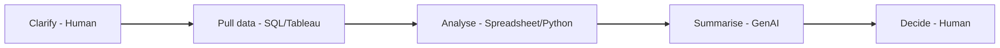

# Breaking Down the Workflow
> Pre-Read — Academic Session 28 | Module 4: GenAI for Analytics Workflows + Basic Python
---

## Mental Map

```mermaid
%%{init: {'themeVariables': {'fontSize': '16px'}, 'flowchart': {'useMaxWidth': false, 'htmlLabels': true, 'nodeSpacing': 80, 'rankSpacing': 120, 'wrappingWidth': 620, 'padding': 20}}}%%
flowchart LR

START["<b>Course Start</b>"]

subgraph foundation[" WHERE WE ARE "]
direction LR
    CURMOD["<b>CURRENT MODULE</b><br/><i>Module 4: GenAI for Analytics Workflows + Basic Python</i><br/>&nbsp;<br/><b>Covered so far:</b> Statistics: Relationships in Data · Summarise, Compare and Report with GenAI<br/>This is Session 28 of 41"]
    CURSES["<b>CURRENT SESSION</b><br/><b>Breaking Down the Workflow</b><br/>&nbsp;<br/><i>The shift:</i> from <i>prompting GenAI for one task at a time</i> to <b>breaking a whole analysis problem into steps, deciding what each step needs, and choosing where GenAI helps</b><br/>&nbsp;<br/>Breaking a problem into steps · Defining the steps of an analytics workflow<br/>Designing simple GenAI-supported workflows"]
end

subgraph outcome[" OUTCOME OF THIS SESSION "]
direction LR
    OUT["<b>By the end, you can…</b><br/>&nbsp;<br/>Take a vague Kirana365 business question and split it into<br/>a clear sequence of steps, with the input, action and output of each,<br/>and mark where GenAI fits"]
end

subgraph value[" WHY IT MATTERS "]
direction LR
    CVAL["<b>Course Value</b><br/>This is the planning skill behind the multi-step workflows, Python scripts and end-to-end project later in this module"]
    RVAL["<b>Real-Life Value</b><br/>Turning a manager's one-line request into a plan you can run, check and repeat, instead of one giant prompt"]
end

subgraph future[" WHAT COMES NEXT "]
direction LR
    U0["<b>Next Session</b><br/>Multi-Step GenAI Workflows<br/><i>Now we connect the steps into one workflow and add checks between them</i>"]
    U1["<b>Later in Module 4</b><br/>Python Fundamentals I, II, III · Python for APIs and GenAI Integration<br/>Getting Started with Python Data · Cleaning Data · Visualizing Data<br/>Connecting the Tools · End-to-End Analytics Workflow"]
    U2["<b>Upcoming</b><br/>Capstone Project<br/><i>Planning an analysis before touching a tool is how the capstone is expected to start</i>"]
end

START ==>|" begin "| CURMOD
CURMOD ==>|" progress "| CURSES
CURSES ==>|" you get "| OUT
OUT ==>|" course "| CVAL
OUT ==>|" real life "| RVAL
CURSES ==>|" next up "| U0
U0 -.->|" then "| U1
U1 -.->|" ahead "| U2

classDef startBox fill:#F7FAFC,stroke:#4A5568,stroke-width:2px,color:#1A202C
classDef curModBox fill:#FFF8E6,stroke:#B7791F,stroke-width:2px,color:#1A202C
classDef curSessBox fill:#E6FFFA,stroke:#0D9488,stroke-width:3px,color:#1A202C
classDef outBox fill:#FEF2F2,stroke:#DC2626,stroke-width:3px,color:#1A202C
classDef valueBox fill:#F3E8FF,stroke:#7C3AED,stroke-width:2px,color:#1A202C
classDef futureBox fill:#ECFDF5,stroke:#047857,stroke-width:2px,color:#1A202C

class START startBox
class CURMOD curModBox
class CURSES curSessBox
class OUT outBox
class CVAL,RVAL valueBox
class U0,U1,U2 futureBox

linkStyle default stroke-width:2px
```

## What You'll Learn
In this pre-read, you'll discover:
- How to split a vague business question into smaller steps
- How to define each step by its input, action, output and tool
- How to decide which steps suit GenAI and which do not
- How to sketch a simple GenAI-supported workflow before writing any prompt

## A. Breaking a Problem into Steps

**💡 Analogy**: Think of a train journey from Pune to Chennai. You do not plan it as "get to Chennai." You plan: reach the station, board the train, change at Renigunta, arrive. A big problem becomes a chain of small, checkable legs.

**Start by turning a vague request into one clear question, then list the steps needed to answer it.**

**Worked example**: A manager says: *"Our Pune numbers look off, please fix it."* "Off" compared to what? Off on revenue or on delivery ratings? Last month or last year? Step one is clarifying: *"Pune's revenue growth has slowed compared to the other three cities."* Only now can you plan the work.

**⚠️ Common trap**: Typing the vague request straight into GenAI. It will not refuse. It will guess, and a confident guess sounds just like an answer.

## B. Defining the Steps of an Analytics Workflow

**💡 Analogy**: Think of a recipe card. Each step names what goes in, what you do and what comes out, so anyone could follow it. A workflow step needs the same four things.

**Define every step by its input, action, output and tool.**

**Worked example**: For the Pune question:

| Step | Input | Action | Output | Tool |
|---|---|---|---|---|
| 1. Clarify | Manager's request | Turn into a precise question | One clear question | Human |
| 2. Pull data | The question | Get monthly Pune revenue | Table of revenue | SQL / Tableau |
| 3. Analyse | Table | Compare Pune's trend with other cities | Growth figures | Spreadsheet / Python |
| 4. Summarise | Growth figures | Write a short summary | 3-sentence summary | GenAI |
| 5. Decide | Summary | Choose the action | A decision | Human |

**⚠️ Common trap**: Leaving the output of a step undefined. If you cannot say what a step produces, the next step has nothing to start from.

## C. Designing Simple GenAI-Supported Workflows

**💡 Analogy**: Think of a hospital. The surgeon, the lab, the pharmacist each do the part they are best at. GenAI is a specialist too, and a good workflow gives it only the part it suits.

**Use GenAI for steps like summarising, rewording and drafting, and keep judgement and data-pulling with people and the right tools.**

**Worked example**: In the five-step table, GenAI owns exactly one box: the summary. Run on the numbers you gathered yourself (Pune +9%, Bengaluru +12%, Chennai −3%) it can write a focused three-sentence summary of whether Pune is a real concern. That works well precisely because you asked it to do only the step it is built for.

**⚠️ Common trap**: Putting GenAI in every box. It cannot pull your database, and it should not make the final business decision. A workflow with GenAI in all five steps is a longer way to guess.

## Quick Reference — Planning a Workflow

| Your situation | Use this | Because |
|---|---|---|
| A request is vague | Clarify it into one precise question first | A prompt cannot be better than the question |
| You are planning the work | List steps with input, action, output, tool | Every hand-off becomes visible |
| Deciding where GenAI fits | Give it summarising, rewording and drafting steps | These are what it does reliably |
| A step needs judgement or a decision | Keep it human | Responsibility cannot be handed to a tool |
| Not sure the workflow is ready | Check every box has a named tool | A box with no tool means the plan is incomplete |

## Practice Exercises

1. **Pattern Recognition**: Take the request "Sales dropped last week, why?" Write it as one precise question, naming what it is compared to.

2. **Concept Detective**: For the Pune workflow, pick one step and name its input, action, output and tool.

3. **Real-Life Application**: Break down this Kirana365 request into 4 or 5 steps: "Which city should get the next marketing budget?" Mark which step GenAI should handle.

4. **Spot the Error**: A teammate's workflow has GenAI in every step, including "pull the data from the database." What is wrong with this design?

5. **Planning Ahead**: Next session we connect steps like these into a running workflow with checks. Looking at the five Pune steps, where would you add a check before passing the result to the next step?

> ✅ **You're done!** You can now split a vague question into steps, define each by input, action, output and tool, and place GenAI only where it fits.
Next session, we make the steps run in **Multi-Step GenAI Workflows**, connecting them together and adding checks so errors are caught early.
