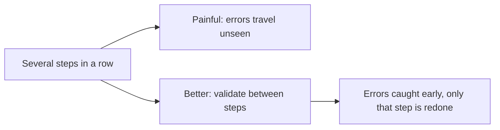
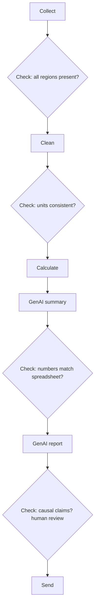
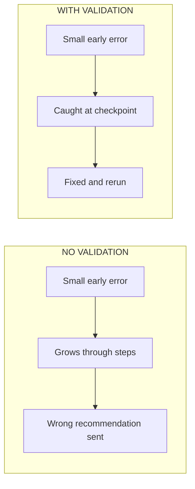

# Lecture Script: Multi-Step GenAI Workflows
**Session 13.1 · Module 4: GenAI for Analytics Workflows + Basic Python**
**Duration: 90 minutes · Audience: 40-60 learners · Prerequisite: pre-read; 12.1, 12.2, 12.3**

---

## Timing table

| # | Block | Minutes | Running total |
|---|-------|---------|---------------|
| 1 | Opening hook | 5 | 5 |
| 2 | From Known to New | 10 | 15 |
| 3 | A. Combining steps into a workflow | 17 | 32 |
| 4 | B. Using GenAI across stages | 16 | 48 |
| 5 | C. Adding validation steps | 22 | 70 |
| 6 | Live practice: find the planted error | 15 | 85 |
| 7 | Wrap-up and bridge | 5 | 90 |
| | **Total** | **90** | |

**Running example (same as pre-read):** store report, West 31 ÷ 4 ≈ 7.8; regions 6/8/4 ad spend, 41/55/31 sales (₹ lakh).

**Setup:** prepare a "planted error" report in advance (see Block 6): a short GenAI-written report where one number is wrong and one sentence claims causation.

---

## Block 1 · Opening hook (5 min)

**Say:**
> "Last session you designed a workflow on paper. Today it runs. Imagine an analyst who sends a report recommending a spending cut in one region. The recommendation rests on a number that was wrong from step two. Nobody noticed because the sentences sounded smooth."

> "How did a small mistake become a big decision? Because nothing checked it along the way."

**Transition:** "Today we run workflows and put checkpoints in them."

---

## Block 2 · From Known to New (10 min)

**Hook:**
> "Play the telephone game. First person whispers a sentence, each passes it on. If person one mishears one word, the whole line repeats it, and by the end it sounds perfectly sensible but is wrong."

**Quick demo (3 min):** Ask 5 learners to pass a short instruction in a row: "South sold 55 lakh on 8 lakh of ads." See what survives. *(If it comes out right, say so: "Good. Now imagine 50 numbers and 6 steps.")*

**Say:** "A multi-step workflow is that chain. The fix is not 'be more careful'. It is checkpoints."

**Key line:** "Errors don't stay put. They travel, and they get more convincing."

---

## Block 3 · A. Combining steps into a workflow (17 min)

**Hook:**
> "Pipes. Water flows from one pipe into the next. If the joint does not fit, you get a leak. The joint in our workflow is the *format* of the output."

**Teach (6 min):** Show the handover table:

| Step | Input | Output |
|------|-------|--------|
| Collect | Three regional sheets | One combined table |
| Clean | Combined table | No blanks, ₹ lakh |
| Calculate | Clean table | Plus efficiency column |
| GenAI summarise | Table with calculations | Bullets and comparison table |
| GenAI report | Bullets and table | Draft report |

**Say:** "Each output must be exactly what the next step expects."

**Live demo (7 min):** Run steps 4 and 5 as two separate prompts.
- Prompt 4: paste the table; ask for "three bullets under 20 words and a comparison table, using only the data given, figures in ₹ lakh."
- Copy the output into Prompt 5: "Write a one-page report for a sales manager using only the bullets and table below. Figures are in ₹ lakh. End with one next step."

**Point out:** the units were *repeated* in step 5. "GenAI does not remember what you did not tell it. Repeat the context."

**Quick check (2 min):** "Step 3 outputs a table. What do you tell GenAI in step 4?" *(Columns, units, use only this data.)*

**Activity (2 min):** Ask learners to name one handover that could leak in their own work.

**🔴 Trap:** "If you ask GenAI to 'continue' without pasting the previous output, it may fill the gap with something it invents."

**💬 Expect pushback:** *"Can't I just keep one long chat and let it remember?"*
> "You can, and often it works. But long chats drift, and you can no longer inspect each step cleanly. Separate steps with pasted outputs are easier to check."

**Transition:** "Each step needs a different kind of prompt. Let's look at the roles."

---

## Block 4 · B. Using GenAI across stages (16 min)

**Hook:**
> "A newsroom. Someone gathers facts, someone writes the story, and an editor checks it before printing. Same building, different jobs. GenAI can be the writer *and* the editor, but as two separate steps."

**Teach (6 min):** Roles table: Analysis → analyst; Summary → summariser; Report → writer; Review → reviewer. Show an example instruction for each.

**Live demo (6 min):** Run a **reviewer** prompt on the report produced in Block 3:
> "You are a careful reviewer. List every number in this report. For each, say whether it appears in the table below. Also list any claim that says one thing caused another."

Show what it returns.

**Say:** "Notice a different job gets a different prompt. The reviewer is asked to find problems, not to be nice."

**Activity (3 min):** In pairs, write a reviewer prompt for a report on customer complaints. Take one.

**Callback to 12.1 (1 min):** "Why did I ask it to flag 'caused'?" *(Correlation is not causation.)*

**🔴 Trap:** "One prompt that analyses, writes and reviews is the giant prompt again. Keep jobs separate."

**💬 Expect pushback:** *"If GenAI reviews itself, won't it just agree?"*
> "Often it does. Be specific: ask it to *list* numbers and check them against data. And remember, the reviewer can be wrong too. That's why you still check."

**Transition:** "Now the most important part: the checkpoints."

---

## Block 5 · C. Adding validation steps (22 min)

**Hook:**
> "A factory does not wait until the product is in the box to inspect it. A defect found early is cheap. Found late, it is a recall."

**Teach (8 min):** Put the validation table on screen: completeness, units, sense check, recalculate, claim check, human review, each with its placement.

**Worked example (6 min):** Do the recalculation live.
> "GenAI says West is best at about 7.8. We recalculate: 31 ÷ 4 = 7.75. Rounds to about 7.8. Matches. Now suppose it had said 8.5. What do we do?" *(Stop; go back to the step that produced it.)*

**Teach (4 min):** Where to put checks: after steps that create new numbers, after steps that transform data, always before output leaves you. If a check fails, go back **one step**.

**Contrast slide (2 min):**

**Quick check (2 min):** "Name two checks between Calculate and Send." *(Recalculate; claim check; human review.)*

**🔴 Trap:** "Do not put one check at the very end and call it validated. By then you cannot tell which step broke."

**💬 Expect pushback:** *"This seems like a lot of checking. Won't it slow me down?"*
> "Checking takes minutes. Sending a wrong recommendation costs days. And once your workflow is written down, the checks become routine."

**Transition:** "Let's test your checking skills."

---

## Block 6 · Live practice: find the planted error (15 min)

**Setup:** Show a short GenAI-written report (prepared earlier) with the store table beside it. Plant:
- one wrong number (e.g. says West sales per ₹ is 8.5),
- one causal sentence ("Extra ad spend caused West's growth"),
- one missing unit.

**Task (8 min):** In groups of 4, find all problems. For each, say **which checkpoint** would have caught it.

**Debrief (5 min):** Reveal errors. Map each to the checkpoint: wrong number → recalculate; causal sentence → claim check; missing unit → units check.

**Say:** "Would you have found the 8.5 by just reading? It sounded fine, didn't it? Checkpoints beat good eyes."

**Wrap (2 min):** Ask each group to add one checkpoint to the store workflow they would insert first.

---

## Block 7 · Wrap-up and bridge (5 min)

**Recap with the mental map open (2 min):**
- Output of one step is input of the next; fix the format.
- Different stage, different GenAI role and prompt.
- Validate after new numbers and before sending.
- If a check fails, go back one step.

**One-line takeaway:**
> "In a chain of steps, one early error travels to the end. Validation steps stop it."

**Bridge (1 min):**
> "So far the calculating steps were done in a spreadsheet. Next session, 13.2, we start Python: variables, data types, and if/elif/else. This is how we will automate the steps you designed, and even write some of the checks as code."

**Closing prompt (2 min):** "For a report you send regularly, write the one check that would most embarrass you if skipped."

---

## Instructor quick-reference

- **Same numbers everywhere:** 6/8/4 ad spend, 41/55/31 sales, West 31 ÷ 4 ≈ 7.8.
- **If long:** shorten Block 4 activity.
- **If short:** run a second planted-error report with different mistakes.
- **Phrases to model:** "output of one is input of the next", "go back one step".
