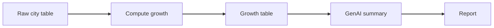

# Multi-Step GenAI Workflows
> Pre-Read — Academic Session 29 | Module 4: GenAI for Analytics Workflows + Basic Python
---

## Mental Map

```mermaid
%%{init: {'themeVariables': {'fontSize': '16px'}, 'flowchart': {'useMaxWidth': false, 'htmlLabels': true, 'nodeSpacing': 80, 'rankSpacing': 120, 'wrappingWidth': 620, 'padding': 20}}}%%
flowchart LR

START["<b>Course Start</b>"]

subgraph foundation[" WHERE WE ARE "]
direction LR
    CURMOD["<b>CURRENT MODULE</b><br/><i>Module 4: GenAI for Analytics Workflows + Basic Python</i><br/>&nbsp;<br/><b>Covered so far:</b> Statistics: Relationships in Data · Summarise, Compare and Report with GenAI · Breaking Down the Workflow<br/>This is Session 29 of 41"]
    CURSES["<b>CURRENT SESSION</b><br/><b>Multi-Step GenAI Workflows</b><br/>&nbsp;<br/><i>The shift:</i> from <i>a workflow drawn on paper</i> to <b>running connected steps, using GenAI at different stages, and adding validation so errors are caught early</b><br/>&nbsp;<br/>Combining multiple steps into a workflow · Using GenAI across analysis and reporting<br/>Adding validation steps"]
end

subgraph outcome[" OUTCOME OF THIS SESSION "]
direction LR
    OUT["<b>By the end, you can…</b><br/>&nbsp;<br/>Build a multi-step workflow for Kirana365 figures where each step feeds the next,<br/>GenAI plays a different role at each stage, and checkpoints<br/>catch wrong numbers before they reach a report"]
end

subgraph value[" WHY IT MATTERS "]
direction LR
    CVAL["<b>Course Value</b><br/>The validation habit carries into every Python and pandas step that follows"]
    RVAL["<b>Real-Life Value</b><br/>Sending a leadership report you can defend because each step was checked, not just the last one"]
end

subgraph future[" WHAT COMES NEXT "]
direction LR
    U0["<b>Next Session</b><br/>Python Fundamentals I<br/><i>Now we start writing the steps of a workflow as code</i>"]
    U1["<b>Later in Module 4</b><br/>Python Fundamentals II, III · Python for APIs and GenAI Integration<br/>pandas: loading, cleaning and plotting data"]
    U2["<b>Upcoming</b><br/>Capstone Project<br/><i>Checked, repeatable workflows are what the capstone is judged on</i>"]
end

START ==>|" begin "| CURMOD
CURMOD ==>|" progress "| CURSES
CURSES ==>|" you get "| OUT
OUT ==>|" course "| CVAL
OUT ==>|" real life "| RVAL
CURSES ==>|" next up "| U0
U0 -.->|" then "| U1
U1 -.->|" ahead "| U2

classDef startBox fill:#F7FAFC,stroke:#4A5568,stroke-width:2px,color:#1A202C
classDef curModBox fill:#FFF8E6,stroke:#B7791F,stroke-width:2px,color:#1A202C
classDef curSessBox fill:#E6FFFA,stroke:#0D9488,stroke-width:3px,color:#1A202C
classDef outBox fill:#FEF2F2,stroke:#DC2626,stroke-width:3px,color:#1A202C
classDef valueBox fill:#F3E8FF,stroke:#7C3AED,stroke-width:2px,color:#1A202C
classDef futureBox fill:#ECFDF5,stroke:#047857,stroke-width:2px,color:#1A202C

class START startBox
class CURMOD curModBox
class CURSES curSessBox
class OUT outBox
class CVAL,RVAL valueBox
class U0,U1,U2 futureBox

linkStyle default stroke-width:2px
```

## What You'll Learn
In this pre-read, you'll discover:
- How to connect steps so the output of one becomes the input of the next
- How GenAI can play different roles at different stages
- Where and how to add validation checks between steps
- Why a check at every stage beats one check at the end

## A. Combining Multiple Steps into a Workflow

**💡 Analogy**: Think of pipes joined together. Water flows from one pipe into the next, and if a joint does not fit, water leaks. In a workflow the joint is the format of the output: if step 3 produces a table, step 4 must expect a table.

**A workflow works when each step's output is in exactly the form the next step needs.**

**Worked example**: Kirana365 monthly report, three steps: (1) take the raw city table, (2) compute growth for each city, (3) ask GenAI to write a summary from the growth table. Step 2 must hand over a clean table with columns *City* and *Growth %*. If it hands over a paragraph instead, step 3 has nothing reliable to work from.

**⚠️ Common trap**: Passing along whatever the previous step produced. Decide the hand-off format in advance, and write it down: "this step outputs a table with these columns."

## B. Using GenAI Across Analysis and Reporting

**💡 Analogy**: Think of a newsroom. One person gathers facts, one writes the story, and an editor checks before printing. GenAI can play the writer and the editor, but you want them as separate steps with separate prompts.

**Give GenAI one role per step, such as extractor, writer or reviewer, instead of one giant prompt that does everything.**

**Worked example**: Three prompts, three roles:

1. *Extractor*: "From this note, list every figure with its city."
2. *Writer*: "Using only this table, draft a 3-sentence summary."
3. *Reviewer*: "Check each number in this summary against the table and list any that do not match."

The reviewer catches what the writer slipped on, because it has a different job.

**⚠️ Common trap**: Asking one prompt to extract, analyse, write and check all at once. If something is wrong you cannot tell which part failed.

## C. Adding Validation Steps

**💡 Analogy**: Think of quality checks on a production line. A factory does not wait until the product is boxed to inspect it, because a defect found early is cheap to fix and one found late is expensive.

**A validation step is a quick check placed between two steps to catch errors before they travel downstream.**

**Worked example**: Checks for the Kirana365 report:

| After step | Check | Example |
|---|---|---|
| Raw table | Totals match the source | Revenue 24 + 41 + 18 = ₹83 lakh |
| Growth | Values in a sensible range | Is anything +900%? |
| GenAI summary | Every number appears in the table | Pune +9% found, any number not in the table gets flagged |

If the total in step 1 is ₹83 lakh and the summary says ₹93 lakh, you stop right there.

**⚠️ Common trap**: Checking only the final report. By then the error is baked into charts, summaries and slides, and finding where it started is slow detective work.

## Quick Reference — Building a Checked Workflow

| Your situation | Use this | Because |
|---|---|---|
| Connecting two steps | Agree the exact output format first | Prevents the "leaky joint" |
| A prompt tries to do many jobs | Split into extractor, writer, reviewer | Each failure is easy to locate |
| A step produces numbers | Check the total against the source | Catches missing or duplicated rows |
| GenAI wrote a summary | Check every number against the table | It can reword numbers wrongly |
| Report is going to leadership | Show the checks you ran | Makes the result defensible |

## Practice Exercises

1. **Pattern Recognition**: In the three-step report workflow, what exact format should step 2 hand to step 3?

2. **Concept Detective**: A GenAI summary says "Total revenue was ₹93 lakh" but your table adds to ₹83 lakh. Which check caught it, and where in the workflow does it belong?

3. **Real-Life Application**: Design a 4-step workflow for "weekly city performance email". Name the role GenAI plays in each step it appears.

4. **Spot the Error**: Someone says "I'll check the final report once it is done." Using the production-line analogy, explain what is risky about this.

5. **Planning Ahead**: Next session we start writing workflow steps as Python code. Which of the checks in the table (total, range, summary numbers) do you think a few lines of code could do automatically?

> ✅ **You're done!** You can now connect steps into one workflow, give GenAI a separate role at each stage, and place checks that catch errors early.
Next session, we start writing the steps as code in **Python Fundamentals I**, beginning with variables and decisions.
