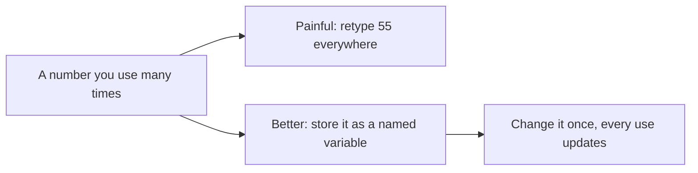
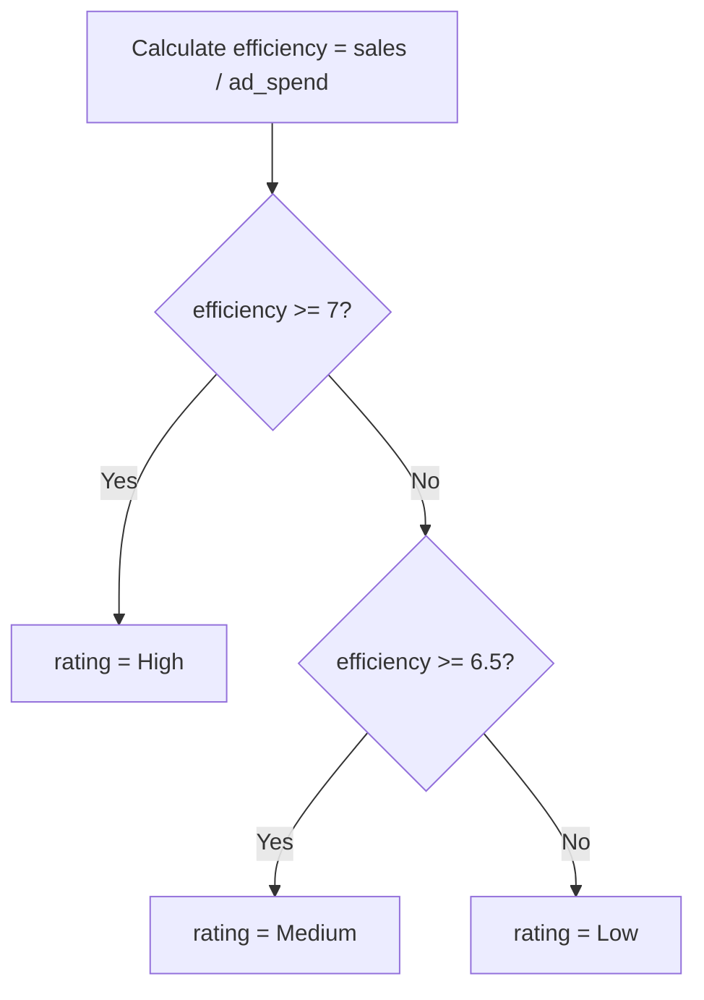

# Lecture Script: Python Fundamentals I
**Session 13.2 · Module 4: GenAI for Analytics Workflows + Basic Python**
**Duration: 90 minutes · Audience: 40-60 learners · Prerequisite: pre-read; no prior coding assumed**

---

## Timing table

| # | Block | Minutes | Running total |
|---|-------|---------|---------------|
| 1 | Opening hook | 5 | 5 |
| 2 | From Known to New | 8 | 13 |
| 3 | A1. Variables | 14 | 27 |
| 4 | A2. Data types and conversion | 17 | 44 |
| 5 | B. if / elif / else | 25 | 69 |
| 6 | Live coding: rate the regions | 16 | 85 |
| 7 | Wrap-up and bridge | 5 | 90 |
| | **Total** | **90** | |

**Running example (same as pre-read):** North 6/41, South 8/55, West 4/31 (ad spend / sales, ₹ lakh); efficiency 6.83, 6.88, 7.75; ratings Medium, Medium, High. Thresholds: High ≥ 7, Medium ≥ 6.5, else Low.

**Setup:** Python notebook (Colab or Jupyter) open on the projector, font large. Ask learners to open one too. Cells ready but empty.

---

## Block 1 · Opening hook (5 min)

**Say:**
> "In 13.1 we wrote a check: 'does this region's efficiency look sensible?' You did it with a calculator. Now your manager says: there are 300 regions, and I want it every Monday. Who is doing 300 calculations by hand?"

*(Laughter.)*

> "Python does it in a blink, and it never gets bored or makes a typing slip. But first, Python needs two things: somewhere to keep information, and a way to make decisions. That is today."

**Transition:** "You already know the first one."

---

## Block 2 · From Known to New (8 min)

**Hook:**
> "In a spreadsheet, a cell holds a value, and you refer to it as B2. Python's version: you give the cell a *name you choose*."

**Ask:** "Why is `sales` better than B2?" *(You can read it six months later.)*



**Reassure (1 min):** "Nobody here has to memorise syntax. If you can *read* the code and say what it does, you are on track. Typing comes with practice, and GenAI can help you write it, but only if you can read what it gives you."

---

## Block 3 · A1. Variables (14 min)

**Hook:**
> "A variable is a labelled box. You put something in, and you find it later by its label."

**Live code (8 min):** Type, run, and explain each cell.

```python
region = "South"
ad_spend = 8
sales = 55
print(region)
print(sales)
```

**Say:** "The `=` sign does not mean 'equals' like in maths. It means: *store the thing on the right into the name on the left*."

Change `sales` to 60 and rerun. **Ask:** "What changes in the output?"

**Teach (3 min):** Naming rules: lowercase, underscores, no spaces, no digit first, meaningful names. Show a bad name (`x1`) and a good one (`ad_spend`). Show comments with `#`.

**Activity (3 min):** "Create three variables for the North region and print them." Walk around. Pick one learner to show.

**🔴 Trap:** "Python is case sensitive. `Sales` and `sales` are different boxes. Mistype it and you get a `NameError`."

**💬 Expect pushback:** *"Sir, can't I just use Excel?"*
> "For three regions, yes. For 300 regions every Monday, or for something that needs to run without you, no. Python is how you stop doing the same task by hand."

**Transition:** "Now, what can go *inside* the box?"

---

## Block 4 · A2. Data types and conversion (17 min)

**Hook:**
> "A water bottle holds liquids. A lunchbox holds solids. Soup in a lunchbox is a mess. In Python, numbers and text are different kinds of content, and they behave differently."

**Teach (6 min):** The four types with the store example: int (`8`), float (`6.875`), str (`"South"`), bool (`True`). Use `type()` live for each.

**Calculation (3 min):**
```python
efficiency = sales / ad_spend
print(efficiency)
print(round(efficiency, 1))
```
> "The raw number has many decimals. `round` is for people reading it."

**The classic trap (5 min):**
```python
sales_text = "55"
print(sales_text + 1)        # error
print(int(sales_text) + 1)   # 56
```
**Say:** "That `55` in quotes is *text*. It looks like a number and is not. Data you read from files often arrives as text. Converting with `int()` or `float()` is a daily task."

Show the error. Read the **last line** aloud: "TypeError ... can only concatenate str". "Errors are not failure. They are Python telling you exactly what went wrong."

**Quick check (3 min):** "What type is `42`? `3.14`? `"West"`? `False`?" *(Poll the room.)*

**🔴 Trap:** "`True` and `"True"` are different. The first is a boolean, the second is text. You will meet this when reading data."

**💬 Expect pushback:** *"Why does it give 0.30000000000000004 for 0.1 + 0.2?"* (Someone will have tried it.)
> "Computers store decimals approximately in binary. It is a tiny difference. That is why we `round` when we show results."

**Transition:** "We can store and calculate. Now: can the code *decide*?"

---

## Block 5 · B. if / elif / else (25 min)

**Hook:**
> "A traffic signal checks a condition and picks an action. Red: stop. Green: go. Your code can do the same with your data."

**Teach conditions (6 min):** Comparison operators on the board: `>`, `<`, `>=`, `==`, `!=`. Live:
```python
print(sales > 50)
print(region == "West")
```
> "Notice the answers are `True` or `False`. That is the bool type, doing its job."

**Key line:** "One `=` stores. Two `==` compares."

**Teach the structure (8 min):**
```python
efficiency = sales / ad_spend

if efficiency >= 7:
    rating = "High"
elif efficiency >= 6.5:
    rating = "Medium"
else:
    rating = "Low"

print(region, rating)
```

Walk through: check the first; if True, take it and **skip the rest**; else check the next; else run the last.



**Two rules (2 min):** colon at the end of each `if`, `elif`, `else` line; indent the body by 4 spaces. **Deliberately remove a colon** and run it to show the error. Then fix.

**Activity (6 min):** "Change `sales` to 31 and `ad_spend` to 4. What rating do you predict? Run it." *(Expected: High, since 7.75 ≥ 7.)* Then: "Now try 28 and 5." *(5.6 → Low.)* Ask: "Was your prediction right?"

**Combining conditions (3 min):**
```python
if sales > 50 and efficiency >= 6.5:
    print("Strong region")
```
> "`and` means both must be True. `or` means at least one."

**🔴 Trap:** "Order matters in an if/elif chain. If you put `efficiency >= 6.5` first, then 7.75 gets 'Medium', because it passes the first test and Python stops. Check the strictest condition first."

**💬 Expect pushback:** *"Why elif? Can't I just write several ifs?"*
> "You can, but then more than one can run. `elif` says: only look here if nothing above matched. For ratings, we want exactly one answer."

**Transition:** "Let's put the two halves together."

---

## Block 6 · Live coding: rate the regions (16 min)

**Task (10 min):** Learners write code (you build alongside on screen) that, for a region, stores `region`, `ad_spend`, `sales`, calculates efficiency, and prints a line like `West High`.

Work through North, then South, then West by **changing the three variables** and rerunning.

**Stretch (4 min):** Add a fourth region, East, ad spend 5, sales 28 → efficiency 5.6 → Low.

**Debrief (2 min):** "What was annoying? Yes: we changed the values three times and reran. In 14.1 we will fix that with lists and loops, so one run rates every region."

**Say:** "You just wrote a validation check as code. This is the first piece of automating the workflow from 13.1."

---

## Block 7 · Wrap-up and bridge (5 min)

**Recap with the mental map open (2 min):**
- Variable = named box; `=` stores.
- int, float, str, bool; convert with `int()`, `float()`, `str()`.
- if / elif / else with colon and indentation.
- `=` stores, `==` compares.

**One-line takeaway:**
> "A variable stores a value. A condition lets your code choose what to do with it."

**Bridge (1 min):**
> "Today we handled one region at a time. Next, 14.1: lists, tuples and dictionaries to hold many values together, and loops to repeat an action. One run, all regions."

**Closing prompt (2 min):** "Write down one rule you use at work in the form 'if... otherwise if... otherwise...'."

---

## Instructor quick-reference

- **Same numbers everywhere:** 6/41, 8/55, 4/31; East 5/28 as the Low example; thresholds 7 and 6.5.
- **If long:** drop the `and`/`or` demo.
- **If short:** add an exercise with a third rating threshold or a bool variable `is_profitable`.
- **Phrases to model:** "read the last line of the error", "one equals stores, two equals compares".
