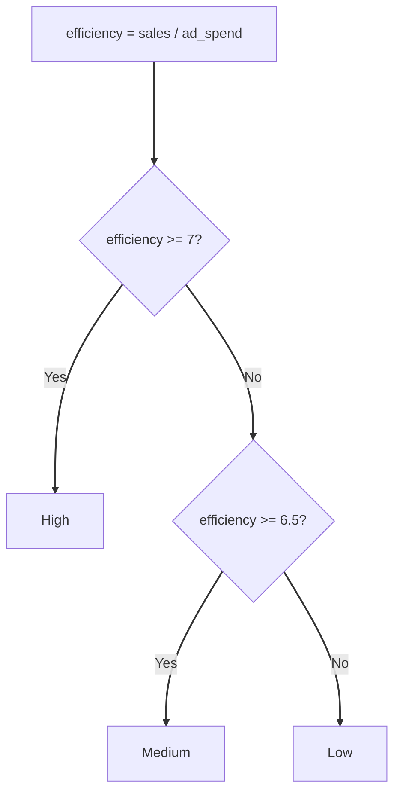

# Python Fundamentals I
> Pre-Read — Academic Session 30 | Module 4: GenAI for Analytics Workflows + Basic Python
---

## Mental Map

```mermaid
%%{init: {'themeVariables': {'fontSize': '16px'}, 'flowchart': {'useMaxWidth': false, 'htmlLabels': true, 'nodeSpacing': 80, 'rankSpacing': 120, 'wrappingWidth': 620, 'padding': 20}}}%%
flowchart LR

START["<b>Course Start</b>"]

subgraph foundation[" WHERE WE ARE "]
direction LR
    CURMOD["<b>CURRENT MODULE</b><br/><i>Module 4: GenAI for Analytics Workflows + Basic Python</i><br/>&nbsp;<br/><b>Covered so far:</b> Summarise, Compare and Report with GenAI · Breaking Down the Workflow · Multi-Step GenAI Workflows<br/>plus 1 earlier Module 4 session<br/>This is Session 30 of 41"]
    CURSES["<b>CURRENT SESSION</b><br/><b>Python Fundamentals I</b><br/>&nbsp;<br/><i>The shift:</i> from <i>doing calculations and checks by hand in a spreadsheet</i> to <b>writing them as Python: storing values in variables and letting code make decisions with if / elif / else</b><br/>&nbsp;<br/>Variables and basic data types · Integers, floats, strings, booleans<br/>Conditional statements: if / elif / else"]
end

subgraph outcome[" OUTCOME OF THIS SESSION "]
direction LR
    OUT["<b>By the end, you can…</b><br/>&nbsp;<br/>Store a Kirana365 city's figures in Python variables and<br/>write a small if / elif / else that rates how that city is performing"]
end

subgraph value[" WHY IT MATTERS "]
direction LR
    CVAL["<b>Course Value</b><br/>Variables and decisions are the building blocks of every loop, function and pandas step ahead"]
    RVAL["<b>Real-Life Value</b><br/>Replacing a repeated manual check with a few lines that apply the same rule the same way every time"]
end

subgraph future[" WHAT COMES NEXT "]
direction LR
    U0["<b>Next Session</b><br/>Python Fundamentals II<br/><i>Now we hold many values together and repeat an action over them</i>"]
    U1["<b>Later in Module 4</b><br/>Python Fundamentals III · Python for APIs and GenAI Integration<br/>Getting Started with Python Data · Cleaning Data · Visualizing Data"]
    U2["<b>Upcoming</b><br/>Capstone Project<br/><i>Reading and writing simple Python is assumed when you build the capstone</i>"]
end

START ==>|" begin "| CURMOD
CURMOD ==>|" progress "| CURSES
CURSES ==>|" you get "| OUT
OUT ==>|" course "| CVAL
OUT ==>|" real life "| RVAL
CURSES ==>|" next up "| U0
U0 -.->|" then "| U1
U1 -.->|" ahead "| U2

classDef startBox fill:#F7FAFC,stroke:#4A5568,stroke-width:2px,color:#1A202C
classDef curModBox fill:#FFF8E6,stroke:#B7791F,stroke-width:2px,color:#1A202C
classDef curSessBox fill:#E6FFFA,stroke:#0D9488,stroke-width:3px,color:#1A202C
classDef outBox fill:#FEF2F2,stroke:#DC2626,stroke-width:3px,color:#1A202C
classDef valueBox fill:#F3E8FF,stroke:#7C3AED,stroke-width:2px,color:#1A202C
classDef futureBox fill:#ECFDF5,stroke:#047857,stroke-width:2px,color:#1A202C

class START startBox
class CURMOD curModBox
class CURSES curSessBox
class OUT outBox
class CVAL,RVAL valueBox
class U0,U1,U2 futureBox

linkStyle default stroke-width:2px
```

<div style="overflow-x: scroll; max-width: 100%; display: block;">



</div>

## What You'll Learn
In this pre-read, you'll discover:
- How a variable stores a value, and why `=` means "store", not "equals"
- The four basic data types: integers, floats, strings and booleans
- How to turn a rule into code with if / elif / else
- The two rules Python is strict about: the colon and the indentation

## A. Variables — Naming and Storing Values

**💡 Analogy**: Think of a labelled box in a kitchen. The label says "sugar", the sugar is inside, and you can swap what is in the box without changing the label. A variable is a labelled box for a value.

**A variable is a name that points to a value; the `=` sign stores the value on the right into the name on the left.**

**Worked example**: Kirana365's South region, written as Python:

```python
region = "South"
ad_spend = 8
sales = 55
efficiency = sales / ad_spend
print(region, efficiency)   # South 6.875
print(round(efficiency, 1)) # 6.9
```

Change `sales` to 60 and every line that uses it gives a new answer. Names use lowercase words joined by underscores (`ad_spend`), no spaces, and anything after `#` is a comment for humans.

**⚠️ Common trap**: Reading `=` as "equals" the way maths does. In Python `=` stores and `==` compares. Mixing them up is the classic first error.

## B. Integers, Floats, Strings and Booleans

**💡 Analogy**: Think of containers: a water bottle holds liquid, a lunchbox holds solids. You would not put soup in a lunchbox. Every value has a type that decides what you can do with it.

**Python's four basic types are int (whole numbers), float (decimals), str (text in quotes) and bool (True or False).**

**Worked example**:

| Type | Example |
|---|---|
| int | `ad_spend = 8` |
| float | `efficiency = 6.875` |
| str | `region = "South"` |
| bool | `is_profitable = True` |

`type(ad_spend)` returns `<class 'int'>`. Data from files often arrives as text, so converting is a daily task:

```python
sales_text = "55"
print(int(sales_text) + 1)   # 56
```

**⚠️ Common trap**: Doing maths on text. `"55" + 1` is an error because `"55"` in quotes is text, not a number. Convert it first with `int()` or `float()`.

## C. Conditional Statements — if / elif / else

**💡 Analogy**: Think of a traffic signal. It checks a condition and picks one action: red stop, amber slow, green go. Your code can check a number and pick an action the same way.

**if / elif / else checks conditions in order and runs the first block whose condition is True.**

**Worked example**: Rating a region by efficiency (sales per unit of ad spend):

```python
efficiency = sales / ad_spend      # 6.875

if efficiency >= 7:
    rating = "High"
elif efficiency >= 6.5:
    rating = "Medium"
else:
    rating = "Low"

print(region, rating)    # South Medium
```

| Region | Ad spend | Sales | Efficiency | Rating |
|---|---|---|---|---|
| North | 6 | 41 | 6.83 | Medium |
| South | 8 | 55 | 6.88 | Medium |
| West | 4 | 31 | 7.75 | High |

Comparison operators: `>`, `<`, `>=`, `==` (equal), `!=` (not equal). Combine them with `and`, `or`, `not`.

**⚠️ Common trap**: Forgetting the colon at the end of `if`, `elif` and `else` lines, or getting the indentation wrong. Python uses the 4-space indent to know which lines belong to the decision.



## Quick Reference — Variables and Decisions

| Your situation | Use this | Because |
|---|---|---|
| You need to reuse a number | Store it in a named variable | Change it once, every use updates |
| Not sure what kind of value you have | `type(value)` | Types decide what operations work |
| A number arrived as text | `int()` or `float()` | Text cannot be added to numbers |
| You must pick one of 3 actions | if / elif / else | Runs the first True condition only |
| Comparing two values | `==`, not `=` | `=` stores, `==` compares |

## Practice Exercises

1. **Pattern Recognition**: What type is each of these: `42`, `3.14`, `"West"`, `False`?

2. **Concept Detective**: What does `print(int("12") + 3)` show? What happens with `print("12" + 3)`?

3. **Real-Life Application**: For `efficiency = 6.6`, which rating does the if / elif / else above give, and why?

4. **Spot the Error**: Find the mistake: `if efficiency = 7` followed by an indented line. What should the first line be?

5. **Planning Ahead**: Next session you will store many regions in one list and repeat the rating for each. Why would typing the if / elif / else three times be a poor approach?

> ✅ **You're done!** You can now store values in variables, recognise the four data types, and write an if / elif / else that rates a region.
Next session, we hold many values together and repeat actions over them in **Python Fundamentals II**, using lists, tuples, dictionaries and loops.
