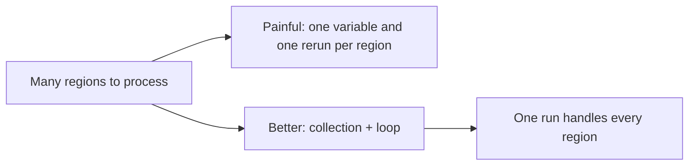
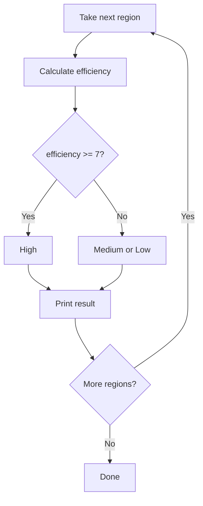

# Lecture Script: Python Fundamentals II
**Session 14.1 · Module 4: GenAI for Analytics Workflows + Basic Python**
**Duration: 90 minutes · Audience: 40-60 learners · Prerequisite: pre-read; 13.2 (variables, types, if/elif/else)**

---

## Timing table

| # | Block | Minutes | Running total |
|---|-------|---------|---------------|
| 1 | Opening hook | 5 | 5 |
| 2 | From Known to New | 7 | 12 |
| 3 | A1. Lists | 15 | 27 |
| 4 | A2. Tuples and dictionaries | 16 | 43 |
| 5 | B1. for loops | 17 | 60 |
| 6 | B2. while loops | 10 | 70 |
| 7 | Live coding: rate every region | 15 | 85 |
| 8 | Wrap-up and bridge | 5 | 90 |
| | **Total** | **90** | |

**Running example (same as pre-read):** regions North, South, West; ad spend 6/8/4; sales 41/55/31; total 127; ratings Medium, Medium, High. `while`: budget 20, spend 6 a month, 3 months, 2 left.

**Setup:** notebook open on projector. Last session's rating code pasted in one cell for the opening.

---

## Block 1 · Opening hook (5 min)

**Say:**
> "Remember last session? We rated North, then South, then West, by changing three variables and rerunning each time. Show of hands: how many of you thought 'there must be a better way'?"

*(Hands.)*

> "Now picture 300 regions. By the end of today, 300 regions and 3 regions need exactly the same amount of code."

**Transition:** "You already know the idea from spreadsheets."

---

## Block 2 · From Known to New (7 min)

**Hook:**
> "A column in a spreadsheet holds many values under one heading. And 'fill down' repeats a formula for every row. Python has both: a collection is the column, a loop is the fill-down."



**Key line:** "Collections store. Loops repeat. Together, they scale."

---

## Block 3 · A1. Lists (15 min)

**Hook:**
> "A shopping list: items in order, and you can add or cross things off."

**Live code (8 min):**
```python
regions = ["North", "South", "West"]
sales = [41, 55, 31]
print(regions[0])
print(regions[-1])
print(len(regions))
regions.append("East")
sales[1] = 60
print(regions[0:2])
```
Pause after each line and ask the room to predict the output before you run it.

**Teach (3 min):** Counting starts at 0. Slice `[0:2]` includes 0 and 1, **not** 2.

**Activity (4 min):** "Add a fourth sales value, 28, to `sales`. Then print the last item using a negative index." *(Expected: `sales.append(28)`; `sales[-1]`.)*

**🔴 Trap:** "Index 3 in a three-item list gives an `IndexError`. The last position is 2. Everyone makes this mistake. Read the last line of the error: 'list index out of range'."

**💬 Expect pushback:** *"Why does it start at 0? It's unnatural."*
> "It is a convention from how computers measure distance from the start. The first item is zero steps from the start. You will get used to it, and every language like this does the same."

**Transition:** "A list is good for a series. What if I want a label on each value?"

---

## Block 4 · A2. Tuples and dictionaries (16 min)

**Hook for tuples (4 min):**
> "A printed timetable. You read it, you do not scribble on it."

```python
report_period = ("Jan", "Jun")
print(report_period[0])
report_period[0] = "Feb"     # show the TypeError
```
**Say:** "Use a tuple when the value should not change by accident."

**Hook for dictionaries (3 min):**
> "Your phone's contacts. You don't remember 'contact 47', you look up a name and get a number."

**Live code (6 min):**
```python
ad_spend_by_region = {"North": 6, "South": 8, "West": 4}
print(ad_spend_by_region["South"])
ad_spend_by_region["East"] = 5
print(ad_spend_by_region)
```

**Teach (2 min):** Show the comparison table: list (position), tuple (position, fixed), dictionary (key).

**Quick check (1 min):** "Which would you use for region → sales?" *(Dictionary.)*

**🔴 Trap:** "Keys are case-sensitive. `"south"` is not `"South"`. That gives a `KeyError`."

**💬 Expect pushback:** *"When would I use a tuple at all?"*
> "For values that must not change, like a fixed date range or coordinates. It protects you from accidental edits. In practice you will use lists and dictionaries far more."

**Callback (Block 4 end):** "When we call an API in 15.1, the response will look like a dictionary. So today's skill is a down payment."

---

## Block 5 · B1. for loops (17 min)

**Hook:**
> "Imagine a teacher marking 40 papers. She does not invent a new method for each one. She repeats the same steps for each paper in the pile. That is a for loop."

**Live code (5 min):**
```python
for region in regions:
    print(region)
```
Explain: "For each `region` in `regions`, run the indented lines."

**Adding up (4 min):**
```python
sales = [41, 55, 31]
total_sales = 0
for s in sales:
    total_sales = total_sales + s
print(total_sales)
```
Trace aloud: 0 → 41 → 96 → 127.

**Loop over a dictionary (6 min):**
```python
ad_spend_by_region = {"North": 6, "South": 8, "West": 4}
sales_by_region = {"North": 41, "South": 55, "West": 31}

for region in sales_by_region:
    efficiency = sales_by_region[region] / ad_spend_by_region[region]
    if efficiency >= 7:
        rating = "High"
    elif efficiency >= 6.5:
        rating = "Medium"
    else:
        rating = "Low"
    print(region, round(efficiency, 2), rating)
```

**Say:** "This is last week's code, inside a loop. Add East to both dictionaries and rerun. No other change."



**Quick check (2 min):** "How many times does `for i in range(4):` run?" *(4: 0, 1, 2, 3.)*

**🔴 Trap:** "Indentation decides what is *inside* the loop. A `print` one level out prints once at the end, not for every region."

**💬 Expect pushback:** *"Can't I do this faster with Excel fill-down?"*
> "For this size, yes. But when the logic has ratings, conditions and later file reading and API calls, Python scales and Excel gets awkward. And Python can be rerun by itself on a schedule."

---

## Block 6 · B2. while loops (10 min)

**Hook:**
> "A for loop says 'do this for each of these'. A while loop says 'keep doing this until I say stop'. Like walking until you reach the gate. You do not count steps in advance."

**Live code (5 min):**
```python
budget = 20
monthly_spend = 6
months = 0
while budget >= monthly_spend:
    budget = budget - monthly_spend
    months = months + 1
print(months, budget)
```
Trace: 20 → 14 (1) → 8 (2) → 2 (3), then 2 < 6, stop. Output `3 2`.

**Teach (2 min):** for = known collection or count; while = repeat until something changes.

**Demo the danger (1 min):** Show the loop with the `budget = ...` line commented out, but **do not run it**: "This never stops. If it happens, press the interrupt button."

**Quick check (2 min):** "What makes the loop stop?" *(Budget falls below the monthly spend.)*

**🔴 Trap:** "Before running a while loop, ask: what makes this stop? If you cannot answer, do not run it."

**💬 Expect pushback:** *"Will I use while much?"*
> "Less than for. It matters when you wait on something, such as retrying until an API responds. We will keep it in the toolbox."

---

## Block 7 · Live coding: rate every region (15 min)

**Task (10 min):** Learners build, from scratch, the two dictionaries with four regions (North, South, West, East 5/28), then a loop that prints each region, its efficiency rounded to 2, and its rating. Also compute the **total sales** with a loop.

Expected output for East: efficiency 5.6, Low. Total sales with East at 28 is 155.

**Stretch (3 min):** Count how many regions are rated High, using a counter variable.

**Debrief (2 min):** "Last week: three reruns. Today: one run. And adding East took one line per dictionary."

---

## Block 8 · Wrap-up and bridge (5 min)

**Recap with the mental map open (2 min):**
- List `[ ]`, tuple `( )`, dictionary `{ }`.
- Counting starts at 0.
- for = once per item; while = until the condition changes.

**One-line takeaway:**
> "A collection holds many values. A loop does the same thing to each one."

**Bridge (1 min):**
> "Right now we typed the data into the code. In 14.2 we learn to wrap code in functions we can reuse, and to read and write files like CSV, so the data can come from a file."

**Closing prompt (2 min):** "Think of a list you keep at work. What would you loop over it to do?"

---

## Instructor quick-reference

- **Same numbers everywhere:** 6/8/4 and 41/55/31; East 5/28 (efficiency 5.6, Low); total sales 127, or 155 with East.
- **If long:** skip tuples activity and the High-count stretch.
- **If short:** add a `for` loop with `range(len(regions))` and index.
- **Phrases to model:** "what makes this stop?", "predict before you run".
