# Python Fundamentals II
> Pre-Read — Academic Session 31 | Module 4: GenAI for Analytics Workflows + Basic Python
---

## Mental Map

```mermaid
%%{init: {'themeVariables': {'fontSize': '16px'}, 'flowchart': {'useMaxWidth': false, 'htmlLabels': true, 'nodeSpacing': 80, 'rankSpacing': 120, 'wrappingWidth': 620, 'padding': 20}}}%%
flowchart LR

START["<b>Course Start</b>"]

subgraph foundation[" WHERE WE ARE "]
direction LR
    CURMOD["<b>CURRENT MODULE</b><br/><i>Module 4: GenAI for Analytics Workflows + Basic Python</i><br/>&nbsp;<br/><b>Covered so far:</b> Breaking Down the Workflow · Multi-Step GenAI Workflows · Python Fundamentals I<br/>plus 2 earlier Module 4 sessions<br/>This is Session 31 of 41"]
    CURSES["<b>CURRENT SESSION</b><br/><b>Python Fundamentals II</b><br/>&nbsp;<br/><i>The shift:</i> from <i>handling one value and one run at a time</i> to <b>holding many values together and repeating an action over all of them</b><br/>&nbsp;<br/>Lists, tuples and dictionaries · for loops and while loops<br/>Iterating over lists, ranges and dictionaries"]
end

subgraph outcome[" OUTCOME OF THIS SESSION "]
direction LR
    OUT["<b>By the end, you can…</b><br/>&nbsp;<br/>Store several Kirana365 cities in a list or dictionary and<br/>loop over them to rate every city in a single run"]
end

subgraph value[" WHY IT MATTERS "]
direction LR
    CVAL["<b>Course Value</b><br/>Collections and loops are what pandas later does for you at scale, so knowing them explains what it is doing"]
    RVAL["<b>Real-Life Value</b><br/>Processing 300 cities with exactly the same code that processes three"]
end

subgraph future[" WHAT COMES NEXT "]
direction LR
    U0["<b>Next Session</b><br/>Python Fundamentals III<br/><i>Now we wrap logic in functions and read and write files</i>"]
    U1["<b>Later in Module 4</b><br/>Python for APIs and GenAI Integration · Getting Started with Python Data<br/>Cleaning Data · Visualizing Data"]
    U2["<b>Upcoming</b><br/>Capstone Project<br/><i>Working with groups of records is how real capstone data arrives</i>"]
end

START ==>|" begin "| CURMOD
CURMOD ==>|" progress "| CURSES
CURSES ==>|" you get "| OUT
OUT ==>|" course "| CVAL
OUT ==>|" real life "| RVAL
CURSES ==>|" next up "| U0
U0 -.->|" then "| U1
U1 -.->|" ahead "| U2

classDef startBox fill:#F7FAFC,stroke:#4A5568,stroke-width:2px,color:#1A202C
classDef curModBox fill:#FFF8E6,stroke:#B7791F,stroke-width:2px,color:#1A202C
classDef curSessBox fill:#E6FFFA,stroke:#0D9488,stroke-width:3px,color:#1A202C
classDef outBox fill:#FEF2F2,stroke:#DC2626,stroke-width:3px,color:#1A202C
classDef valueBox fill:#F3E8FF,stroke:#7C3AED,stroke-width:2px,color:#1A202C
classDef futureBox fill:#ECFDF5,stroke:#047857,stroke-width:2px,color:#1A202C

class START startBox
class CURMOD curModBox
class CURSES curSessBox
class OUT outBox
class CVAL,RVAL valueBox
class U0,U1,U2 futureBox

linkStyle default stroke-width:2px
```

<div style="overflow-x: scroll; max-width: 100%; display: block;">



</div>

## What You'll Learn
In this pre-read, you'll discover:
- How lists and tuples hold many values in order
- How a dictionary looks values up by name
- How a for loop repeats an action for every item
- When a while loop is the better choice

## A. Lists and Tuples — Many Values in Order

**💡 Analogy**: A list is a shopping list: items in order, and you can add, remove or change them. A tuple is a printed timetable: once printed you read from it, you do not edit it.

**A list (square brackets) can change; a tuple (round brackets) is fixed once created.**

**Worked example**:

```python
regions = ["North", "South", "West"]
print(regions[0])       # North  (counting starts at 0)
print(len(regions))     # 3
regions.append("East")  # lists can grow

pair = (8, 55)          # a tuple: (ad spend, sales)
print(pair[1])          # 55
```

**⚠️ Common trap**: Counting from 1. The first item is position 0, so `regions[3]` on a three-item list is an error, not the third city.

## B. Dictionaries — Lookup by Name

**💡 Analogy**: Think of your phone's contacts. You do not remember "contact number 47", you look up a name and get the number. A dictionary stores key and value pairs the same way.

**A dictionary (curly brackets) maps each key to a value, so you find data by name instead of position.**

**Worked example**:

```python
data = {
    "North": (6, 41),
    "South": (8, 55),
    "West": (4, 31),
}
print(data["South"])         # (8, 55)
data["East"] = (5, 33)       # add a new key
print("West" in data)        # True
```

Each value here is a tuple of (ad spend, sales). Dictionaries are the shape JSON data takes, which you meet in 15.1.

**⚠️ Common trap**: Asking for a key that is not there. `data["Delhi"]` gives a KeyError. Check with `in` first, or use `data.get("Delhi")`, which returns nothing instead of crashing.

## C. for Loops — Repeating Over Every Item

**💡 Analogy**: Think of a postman delivering letters street by street. He does the same action for each house, and he stops when the bag is empty. A for loop does one action for every item in a collection.

**A for loop runs the indented block once for each item, so three cities or 300 need the same code.**

**Worked example**: Rating all three regions in one run:

```python
for region, (ad, sales) in data.items():
    efficiency = sales / ad
    if efficiency >= 7:
        rating = "High"
    elif efficiency >= 6.5:
        rating = "Medium"
    else:
        rating = "Low"
    print(region, round(efficiency, 2), rating)
```

Output (with North, South and West only):

```
North 6.83 Medium
South 6.88 Medium
West 7.75 High
```

`range(3)` gives 0, 1, 2 when you just need to repeat something a set number of times.

**⚠️ Common trap**: Forgetting the indent. Only the indented lines repeat. A line pulled back to the left runs once, after the loop ends.

## D. while Loops and Choosing the Right Loop

**💡 Analogy**: A for loop is delivering to every house on the list. A while loop is "keep stirring until the sugar dissolves." You do not know how many stirs, you only know the stop condition.

**Use for when you know what to loop over; use while when you repeat until a condition changes.**

**Worked example**:

```python
month = 1
while month <= 3:
    print("Report for month", month)
    month = month + 1
```

The loop prints months 1, 2 and 3, then stops because `month` becomes 4. Looping over a dictionary: `for region in data` gives keys, `data.values()` gives values, `data.items()` gives both.

**⚠️ Common trap**: A while loop whose condition never becomes False. If you forget `month = month + 1`, the loop runs forever. Always check the line that moves it toward the stop.

## Quick Reference — Collections and Loops

| Your situation | Use this | Because |
|---|---|---|
| Ordered items you may change | List `[ ]` | Add, remove, update freely |
| Fixed pair or record | Tuple `( )` | Cannot be changed by accident |
| Look values up by name | Dictionary `{ }` | No need to remember positions |
| Same action for every item | for loop | Same code for 3 or 300 items |
| Repeat until something changes | while loop | Stop condition decides the count |

## Practice Exercises

1. **Pattern Recognition**: Given `regions = ["North", "South", "West"]`, what do `regions[0]` and `regions[2]` return?

2. **Concept Detective**: What is the difference between a list and a tuple, and which would you use for a fixed (ad spend, sales) pair?

3. **Real-Life Application**: Write the dictionary line that adds `"East": (5, 33)` to `data`, then say how you would check it was added.

4. **Spot the Error**: Find the bug: a for loop whose print line is not indented. Does it print once or for every city?

5. **Planning Ahead**: Next session you will wrap this rating logic in a function and read the numbers from a file. What parts of the loop above would you want to move into a function?

> ✅ **You're done!** You can now store several regions in a list or dictionary and loop over them to rate every one in a single run.
Next session, we wrap logic in reusable functions and read and write files in **Python Fundamentals III**.
