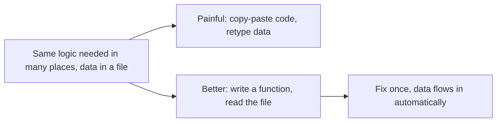

# Lecture Script: Python Fundamentals III
**Session 14.2 · Module 4: GenAI for Analytics Workflows + Basic Python**
**Duration: 90 minutes · Audience: 40-60 learners · Prerequisite: pre-read; 13.2 and 14.1**

---

## Timing table

| # | Block | Minutes | Running total |
|---|-------|---------|---------------|
| 1 | Opening hook | 5 | 5 |
| 2 | From Known to New | 7 | 12 |
| 3 | A1. Defining and calling functions | 18 | 30 |
| 4 | A2. return vs print, defaults | 10 | 40 |
| 5 | B. Reading and writing files | 20 | 60 |
| 6 | C. CSV and text formats | 12 | 72 |
| 7 | Live coding: read, rate, write | 13 | 85 |
| 8 | Wrap-up and bridge | 5 | 90 |
| | **Total** | **90** | |

**Running example (same as pre-read):** `regions.csv` with North 6/41, South 8/55, West 4/31; functions `calculate_efficiency` and `rate_region`; output `ratings.txt`.

**Setup:** `regions.csv` pre-uploaded to the notebook environment (share with learners beforehand or paste a cell that creates it using `open(..., "w")`). Notebook open on projector.

---

## Block 1 · Opening hook (5 min)

**Say:**
> "Last session we typed the data into the code. In real life, someone emails you a CSV file on Monday morning. Are you going to retype 300 rows?"

*(No.)*

> "And remember the rating logic. If your colleague wants the same rule in another script, you copy-paste it. Then the threshold changes from 7 to 7.5, and you fix one copy and forget the other. Now two reports disagree."

> "Today fixes both problems: functions, and files."

---

## Block 2 · From Known to New (7 min)

**Hook:**
> "`SUM(B2:B4)` in a spreadsheet: you give it input, it gives you a result, and you never saw inside. You have used Python functions already: `print`, `len`, `round`, `int`. Today you write your own."



**Key line:** "Write once, fix once, reuse everywhere."

---

## Block 3 · A1. Defining and calling functions (18 min)

**Hook:**
> "A recipe card. You write the steps once with blanks for ingredients. Whenever you cook, you fill in the blanks."

**Live code (7 min):**
```python
def calculate_efficiency(sales, ad_spend):
    return sales / ad_spend

result = calculate_efficiency(55, 8)
print(result)
```
Label each part aloud: `def`, name, parameters, colon, indentation, `return`. Then **call** it.

**Say:** "Parameters are the blanks. Arguments are what you put in them."

**Show that defining is not running (1 min):** Define a function, run the cell: nothing prints. "Nothing happens until you call it."

**Second function (5 min):**
```python
def rate_region(efficiency):
    if efficiency >= 7:
        return "High"
    elif efficiency >= 6.5:
        return "Medium"
    else:
        return "Low"

print(rate_region(7.75))
print(rate_region(calculate_efficiency(41, 6)))
```
> "Notice the second line: the result of one function goes straight into the next. That is the output-of-one-is-input-of-the-next idea from 13.1."

**Activity (5 min):** "Write a function `total_sales(a, b, c)` that returns the sum of three sales values. Call it with 41, 55, 31." *(Expected: 127.)*

**🔴 Trap:** "Most common beginner mistake: writing the function and never calling it. Everything looks fine, and nothing happens."

**💬 Expect pushback:** *"Sir, for a one-time task, isn't a function extra work?"*
> "For a one-time task, yes. For anything you run again or share, you will be glad you wrote it. And it makes your code readable. `rate_region(eff)` tells a story."

**Transition:** "There's a subtle thing about how functions give answers back."

---

## Block 4 · A2. return vs print, defaults (10 min)

**Hook:**
> "A vending machine: you put money in and a snack *comes out* where you can take it. If it just *showed* you a picture of the snack, you would be hungry."

**Live code (5 min):**
```python
def double_print(x):
    print(x * 2)

def double_return(x):
    return x * 2

a = double_print(5)
b = double_return(5)
print(a)    # None
print(b)    # 10
```
**Say:** "`print` shows. `return` hands over. In a workflow, the next step needs the value, so you almost always want `return`."

**Defaults (2 min):** `def calculate_efficiency(sales, ad_spend=1):`. "Use defaults for values that are usually the same. Not for everything."

**Quick check (3 min):** "A teammate's function prints the efficiency but you cannot use it in a calculation. What is wrong?" *(Uses print, not return.)*

**🔴 Trap:** "`None` showing up in your output usually means a function with no `return`."

**💬 Expect pushback:** *"Why not always print so I can see it?"*
> "Print is fine for checking. But when you want to pass the result on, only `return` works. You can do both: return the value, and print it where you need to see it."

---

## Block 5 · B. Reading and writing files (20 min)

**Hook:**
> "A notebook: open it, read or write, close it. Python's `with` closes it for you, so you never forget."

**Live code, reading (8 min):**
```python
with open("regions.csv", "r") as f:
    content = f.read()
print(content)
```
Show the output: one block of text. Then:
```python
with open("regions.csv", "r") as f:
    lines = f.readlines()
print(lines)
```
Show the list of strings with `\n` at the end of each.

**Say:** "`read()` gives you the whole file as one piece of text. `readlines()` gives a list, one item per line."

**Live code, writing (6 min):**
```python
with open("report.txt", "w") as f:
    f.write("Store report\n")
    f.write("West had the best efficiency.\n")
```
Open the file to show it. Then run the same cell again with different text to show it **erased** the previous content. Then demo `"a"`.

**Mode table (2 min):** `"r"` read, `"w"` write (erases), `"a"` append.

**Quick check (2 min):** "You want to add today's line to an existing log. Which mode?" *(`"a"`.)*

**Demo an error (2 min):** Open `"regionz.csv"` to show `FileNotFoundError`. "Wrong name or wrong folder. Always check the name and where the notebook is looking."

**🔴 Trap:** "Opening an important file with `"w"` wipes it instantly, with no undo. Be careful, and keep a copy of raw data."

**💬 Expect pushback:** *"Why not just open it in Excel?"*
> "For one file, fine. When the file arrives every week, or there are 50 of them, Python reads them all the same way each time."

---

## Block 6 · C. CSV and text formats (12 min)

**Hook:**
> "A CSV is just a table written as plain text: one row per line, values separated by commas. Your spreadsheet shows it as a grid. Python sees the text underneath."

**Teach (4 min):** Show `regions.csv` as text. Name the header line and the data lines. Compare text (.txt, no structure) versus CSV (a pattern).

**Live code (6 min):**
```python
with open("regions.csv", "r") as f:
    lines = f.read().strip().split("\n")

for line in lines[1:]:
    region, ad_spend, sales = line.split(",")
    print(region, ad_spend, sales)
```

Then show what happens without converting:
```python
print(sales / ad_spend)    # TypeError: strings
```
and fix with `float(sales) / float(ad_spend)`.

**Say:** "Everything coming out of a file is text. This is the `"55"` versus `55` trap from 13.2, now in real data."

**Quick check (2 min):** "Why `lines[1:]`?" *(Skip the header.)*

**🔴 Trap:** "If you forget to skip the header, you get `ValueError: could not convert string to float: 'sales'`. Read the last line of the error."

**💬 Expect pushback:** *"Is there an easier way to read CSV?"*
> "Yes. In 15.2 we meet pandas, which loads the whole file in one line. But now you know what it saves you from, which will help when something goes wrong."

---

## Block 7 · Live coding: read, rate, write (13 min)

**Task (10 min):** Learners combine everything into one script:
1. Define `calculate_efficiency` and `rate_region`.
2. Read `regions.csv`.
3. Loop through the data lines, convert text to numbers, call both functions.
4. Write `region,efficiency,rating` lines into `ratings.txt`.

Reference solution on screen only after attempts:

```python
with open("ratings.txt", "w") as out:
    for line in lines[1:]:
        region, ad_spend, sales = line.split(",")
        eff = calculate_efficiency(float(sales), float(ad_spend))
        out.write(f"{region},{round(eff, 2)},{rate_region(eff)}\n")
```

Introduce the **f-string** briefly: "Text with `{}` slots that Python fills in."

Expected `ratings.txt`:
```
North,6.83,Medium
South,6.88,Medium
West,7.75,High
```

**Stretch (3 min):** Add East 5/28 to `regions.csv` and rerun with no code change. East should appear as Low (5.6).

**Say:** "Read, process, write. That is the shape of almost every data script."

---

## Block 8 · Wrap-up and bridge (5 min)

**Recap with the mental map open (2 min):**
- Functions: `def`, parameters, `return`; call to run.
- `return` hands over, `print` shows.
- `with open`, modes `r`, `w` (erases), `a`.
- CSV = text table; convert text to numbers; skip the header.

**One-line takeaway:**
> "Wrap logic in functions to reuse it. Read and write files so data flows in and results flow out."

**Bridge (1 min):**
> "Data does not only live in files on your laptop. A lot of it lives on servers you ask over the internet. That is an API. In 15.1 you will send requests, read the response, and call the OpenAI API from Python, which brings together the files, functions and loops you have built."

**Closing prompt (2 min):** "Pick a weekly file you open. What function would you write to process it?"

---

## Instructor quick-reference

- **Same numbers everywhere:** North 6/41, South 8/55, West 4/31; East 5/28 (5.6, Low); thresholds 7 and 6.5.
- **If long:** skip defaults and the `"a"` demo.
- **If short:** add a function `write_report(path, lines)` as an extension.
- **Phrases to model:** "defining is not running", "everything from a file is text".
