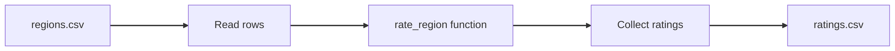

# Python Fundamentals III
> Pre-Read — Academic Session 32 | Module 4: GenAI for Analytics Workflows + Basic Python
---

## Mental Map

```mermaid
%%{init: {'themeVariables': {'fontSize': '16px'}, 'flowchart': {'useMaxWidth': false, 'htmlLabels': true, 'nodeSpacing': 80, 'rankSpacing': 120, 'wrappingWidth': 620, 'padding': 20}}}%%
flowchart LR

START["<b>Course Start</b>"]

subgraph foundation[" WHERE WE ARE "]
direction LR
    CURMOD["<b>CURRENT MODULE</b><br/><i>Module 4: GenAI for Analytics Workflows + Basic Python</i><br/>&nbsp;<br/><b>Covered so far:</b> Multi-Step GenAI Workflows · Python Fundamentals I · Python Fundamentals II<br/>plus 3 earlier Module 4 sessions<br/>This is Session 32 of 41"]
    CURSES["<b>CURRENT SESSION</b><br/><b>Python Fundamentals III</b><br/>&nbsp;<br/><i>The shift:</i> from <i>typing data straight into the code</i> to <b>wrapping logic in reusable functions and reading data from, and writing results to, files</b><br/>&nbsp;<br/>Defining and calling functions · Parameters and return values<br/>Reading and writing files · CSV and text formats"]
end

subgraph outcome[" OUTCOME OF THIS SESSION "]
direction LR
    OUT["<b>By the end, you can…</b><br/>&nbsp;<br/>Write a function that rates a city, read Kirana365 figures from a CSV file,<br/>and save the results to a new file"]
end

subgraph value[" WHY IT MATTERS "]
direction LR
    CVAL["<b>Course Value</b><br/>Functions and file handling are the backbone of the API script and the pandas work that follow"]
    RVAL["<b>Real-Life Value</b><br/>A script you can rerun on next month's file instead of redoing the work by hand"]
end

subgraph future[" WHAT COMES NEXT "]
direction LR
    U0["<b>Next Session</b><br/>Python for APIs and GenAI Integration<br/><i>Now we call GenAI from inside a script instead of a chat window</i>"]
    U1["<b>Later in Module 4</b><br/>Getting Started with Python Data · Cleaning Data with Pandas<br/>Visualizing Data with Python"]
    U2["<b>Upcoming</b><br/>Capstone Project<br/><i>Reusable, file-driven code is what a capstone project is built from</i>"]
end

START ==>|" begin "| CURMOD
CURMOD ==>|" progress "| CURSES
CURSES ==>|" you get "| OUT
OUT ==>|" course "| CVAL
OUT ==>|" real life "| RVAL
CURSES ==>|" next up "| U0
U0 -.->|" then "| U1
U1 -.->|" ahead "| U2

classDef startBox fill:#F7FAFC,stroke:#4A5568,stroke-width:2px,color:#1A202C
classDef curModBox fill:#FFF8E6,stroke:#B7791F,stroke-width:2px,color:#1A202C
classDef curSessBox fill:#E6FFFA,stroke:#0D9488,stroke-width:3px,color:#1A202C
classDef outBox fill:#FEF2F2,stroke:#DC2626,stroke-width:3px,color:#1A202C
classDef valueBox fill:#F3E8FF,stroke:#7C3AED,stroke-width:2px,color:#1A202C
classDef futureBox fill:#ECFDF5,stroke:#047857,stroke-width:2px,color:#1A202C

class START startBox
class CURMOD curModBox
class CURSES curSessBox
class OUT outBox
class CVAL,RVAL valueBox
class U0,U1,U2 futureBox

linkStyle default stroke-width:2px
```

<div style="overflow-x: scroll; max-width: 100%; display: block;">



</div>

## What You'll Learn
In this pre-read, you'll discover:
- How to write a function that takes inputs and returns a result
- What parameters and return values are
- How to read from and write to files in Python
- How CSV and plain text files differ and when to use each

## A. Defining and Calling Functions

**💡 Analogy**: Think of a recipe card. You write the steps once with blanks for the ingredients, and whenever you cook you hand over the ingredients and follow the card.

**A function is a named block of code you define once with `def` and run whenever you call it.**

**Worked example**:

```python
def rate_region(ad_spend, sales):
    efficiency = sales / ad_spend
    if efficiency >= 7:
        return "High"
    elif efficiency >= 6.5:
        return "Medium"
    else:
        return "Low"

print(rate_region(4, 31))   # High
print(rate_region(8, 55))   # Medium
```

The rating rule now lives in one place. Fix it there and every call benefits.

**⚠️ Common trap**: Defining a function and never calling it. `def` only writes the recipe card; nothing happens until you write `rate_region(...)`.

## B. Parameters and Return Values

**💡 Analogy**: Think of a vending machine. Money and a choice go in, a snack comes out. You do not need to know what is inside, only what to put in and what you get back.

**Parameters are the inputs a function receives; the return value is the answer it hands back.**

**Worked example**: In `rate_region(ad_spend, sales)`, `ad_spend` and `sales` are parameters. `return "High"` sends the rating back so you can store or print it:

```python
rating = rate_region(6, 41)
print("North is", rating)    # North is Medium
```

A function that prints but does not return gives you nothing to reuse later.

**⚠️ Common trap**: Confusing `print` with `return`. `print` shows a value on screen and it is gone. `return` gives the value back to your code, so you can use it in the next step.

## C. Reading and Writing Files

**💡 Analogy**: Think of opening a notebook. You open it, read or write, and close it when done. The `with` block closes it for you.

**Use `open(filename, mode)` inside a `with` block: `"r"` to read, `"w"` to write.**

**Worked example**:

```python
with open("notes.txt", "w") as f:
    f.write("Kirana365 monthly check\n")

with open("notes.txt", "r") as f:
    text = f.read()
print(text)
```

**⚠️ Common trap**: Opening with `"w"` on a file that already has data. Write mode wipes the old content first. Use `"a"` (append) if you want to add to the end.

## D. CSV and Text Formats

**💡 Analogy**: A text file is a handwritten page. A CSV is a ruled table where every column is separated by a comma. Both are plain text, but only the CSV has rows and columns you can read back.

**CSV (comma-separated values) stores a table as text, one row per line; Python's `csv` module reads and writes it.**

**Worked example**: `regions.csv`:

```
region,ad_spend,sales
North,6,41
South,8,55
West,4,31
```

```python
import csv

results = []
with open("regions.csv", "r") as f:
    for row in csv.DictReader(f):
        rating = rate_region(float(row["ad_spend"]), float(row["sales"]))
        results.append((row["region"], rating))

with open("ratings.csv", "w", newline="") as f:
    writer = csv.writer(f)
    writer.writerow(["region", "rating"])
    writer.writerows(results)
```

Run it next month on a new file and you get new ratings without redoing any work.

**⚠️ Common trap**: Forgetting that everything read from a CSV is text. `row["sales"]` is `"41"`, not 41. Convert with `float()` or `int()` before doing maths.



## Quick Reference — Functions and Files

| Your situation | Use this | Because |
|---|---|---|
| You repeat the same logic | Wrap it in a `def` function | Fix once, works everywhere |
| You need an answer back | `return` it | `print` only shows it |
| Reading a file safely | `with open(name, "r") as f` | The file closes automatically |
| Saving results | `open(name, "w")` or `csv.writer` | Creates or replaces the file |
| Numbers read from CSV | Convert with `float()` / `int()` | Everything arrives as text |

## Practice Exercises

1. **Pattern Recognition**: In `def rate_region(ad_spend, sales):`, which words are parameters?

2. **Concept Detective**: What is the difference between `print("High")` and `return "High"` inside a function?

3. **Real-Life Application**: What happens if you open an existing file with mode `"w"` and write one line?

4. **Spot the Error**: Find the bug: `sales = row["sales"]` then `sales / 2`. Why does this fail on data read from a CSV?

5. **Planning Ahead**: Next session a script will send these ratings to GenAI over an API. What would you want to be true about the ratings file before you send it anywhere?

> ✅ **You're done!** You can now write a function that rates a region, read figures from a CSV, and save the results to a new file.
Next session, we call GenAI from inside a script in **Python for APIs and GenAI Integration**.
