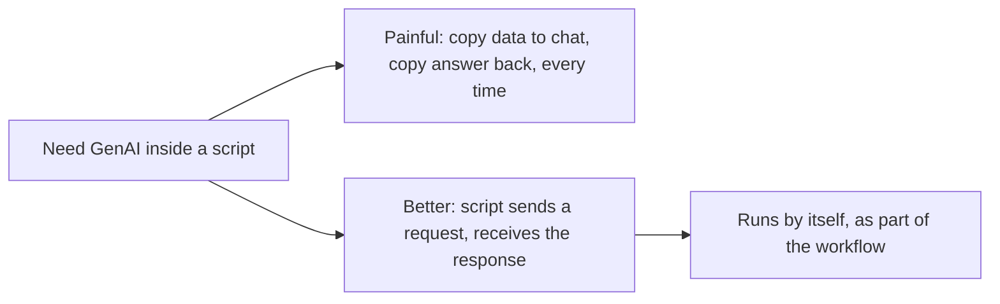
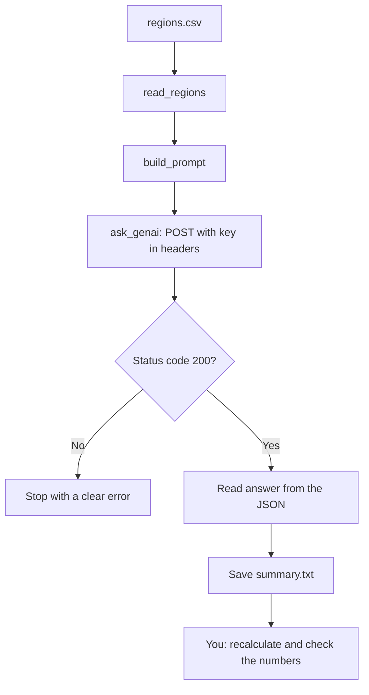

# Lecture Script: Python for APIs and GenAI Integration
**Session 15.1 · Module 4: GenAI for Analytics Workflows + Basic Python**
**Duration: 90 minutes · Audience: 40-60 learners · Prerequisite: pre-read; 14.1 (dictionaries), 14.2 (functions, files)**

---

## Timing table

| # | Block | Minutes | Running total |
|---|-------|---------|---------------|
| 1 | Opening hook | 5 | 5 |
| 2 | From Known to New | 7 | 12 |
| 3 | A. HTTP requests with `requests` | 16 | 28 |
| 4 | B. API structure: endpoints, headers, JSON | 17 | 45 |
| 5 | C. Calling the OpenAI API | 18 | 63 |
| 6 | D. Live build: file + functions + API | 17 | 80 |
| 7 | Common mistakes and safety | 5 | 85 |
| 8 | Wrap-up and bridge | 5 | 90 |
| | **Total** | **90** | |

**Running example (same as pre-read):** `regions.csv` with North 6/41, South 8/55, West 4/31; prompt for a three-bullet efficiency comparison; verify West 31 ÷ 4 ≈ 7.8.

**Setup (do before class):**
- Notebook with `requests` installed.
- A **class API key** set as the environment variable `OPENAI_API_KEY`, or a shared sandbox the programme provides. Never display the key on screen.
- The model name to use, shared with learners (model names change, so replace `MODEL_NAME`).
- Backup: a saved sample response (a dictionary pasted in a cell) in case the network or key fails.

---

## Block 1 · Opening hook (5 min)

**Say:**
> "In 13.1 you designed a workflow with a GenAI step in the middle. Quick question: how does a script, running at 7 am while you are asleep, type into a chat window?"

*(It cannot.)*

> "So how does the GenAI step run? Through an API. Today you stop being someone who uses GenAI and become someone whose *code* uses GenAI."

**Transition:** "Let's start with a restaurant."

---

## Block 2 · From Known to New (7 min)

**Hook:**
> "You do not walk into a restaurant kitchen. You order from the waiter, the waiter goes to the kitchen, and brings the dish back. The waiter is the API."

Map it on the board: you = your code, waiter = API, kitchen = server, order = request, dish = response.



**Key line:** "An API is a way for programs to talk to programs."

---

## Block 3 · A. HTTP requests with `requests` (16 min)

**Hook:**
> "Your browser makes requests all day. Every time you open a page it asks a server for something. The `requests` library lets Python do the same."

**Teach (4 min):** GET asks, POST sends. "GET: show me the menu. POST: here is my order."

**Live code (6 min):**
```python
import requests

response = requests.get("https://jsonplaceholder.typicode.com/todos/1")
print(response.status_code)
print(response.json())
```
Run it. Show `200` and the dictionary. "This is a practice service made for exactly this."

Then print `type(response.json())` to show it is a **dict**. "That is why we learned dictionaries in 14.1."

**Status codes (3 min):** Show 200, 401, 404, 429, 500. Trigger a 404 on purpose:
```python
r = requests.get("https://jsonplaceholder.typicode.com/todos/99999")
print(r.status_code)
```
Explain: "Check the status before using the answer."

**Quick check (3 min):** "Which code means 'your key was wrong'?" *(401.)* "'Slow down'?" *(429.)*

**🔴 Trap:** "A response object is not your data. `response.json()` is. People print `response` and see `<Response [200]>`, and think it failed."

**💬 Expect pushback:** *"Do we need internet inside the notebook?"*
> "Yes, for live calls. That is why I have a saved sample response as a backup, which behaves the same way."

**Transition:** "Let's open up the request and see its parts."

---

## Block 4 · B. API structure: endpoints, headers, JSON (17 min)

**Hook:**
> "Think of the order ticket in the kitchen. It has a counter number, who ordered, and what they ordered. A request has the same parts."

**Teach (6 min):** Table on screen: endpoint (the address), method (GET or POST), headers (who you are, what format), body (the data you send).

**JSON (6 min):** Show JSON text beside a Python dictionary. "Almost identical. `false` versus `False` is one small difference, and `.json()` handles the conversion."

**Live (3 min):** Take a nested dictionary pasted in a cell:
```python
data = {"choices": [{"message": {"content": "West leads on efficiency."}}]}
print(data["choices"][0]["message"]["content"])
```
Read it left to right aloud. "Take `choices`, the first item, then `message`, then `content`."

**Activity (2 min):** "How would you read `content` if `choices` had two items and you wanted the second?" *(`[1]`.)*

**API keys (included):** "A key is like a password and a credit card in one. It identifies you and tracks cost. Never paste it into code you share. Read it from an environment variable."

```python
import os
api_key = os.environ["OPENAI_API_KEY"]
```

**🔴 Trap:** "If you push code with your key to a public page, bots find it within minutes and run up a bill on your account."

**💬 Expect pushback:** *"Why headers? Why not put the key in the URL?"*
> "Headers keep the key out of web addresses that get logged and shared. It is the standard place for credentials."

**Transition:** "Now the real thing."

---

## Block 5 · C. Calling the OpenAI API (18 min)

**Hook:**
> "In 12.2 you wrote a prompt with a role, task, data and format. We send exactly that, but as a dictionary."

**Live code (9 min):** Build the call piece by piece, running it at the end:

```python
import os
import requests

url = "https://api.openai.com/v1/chat/completions"
headers = {
    "Authorization": f"Bearer {os.environ['OPENAI_API_KEY']}",
    "Content-Type": "application/json",
}
body = {
    "model": "MODEL_NAME",
    "messages": [
        {"role": "system", "content": "You are a business analyst."},
        {"role": "user", "content": "Summarise: West has 31 sales on 4 ad spend."},
    ],
}

response = requests.post(url, headers=headers, json=body, timeout=60)
print(response.status_code)
data = response.json()
print(data["choices"][0]["message"]["content"])
```

Explain each piece: system message = role; user message = task and data; `json=body`; `timeout`.

**Show the full raw response (3 min):** `print(data)`. "Lots of fields. Only one matters to us: the content. That is why we know the path."

**Break it on purpose (3 min):** Remove `Bearer ` or change a character in the key (do this with a dummy value, **never** the real key on screen) and show the 401. "Read the status. It tells you."

**Quick check (3 min):** "Why POST and not GET?" *(We are sending a prompt.)* "Where does the model's answer live?" *(`choices[0].message.content`.)*

**🔴 Trap:** "Do not print the whole response in a shared notebook if it includes anything private. And do not send confidential data to an outside service unless your organisation allows it."

**💬 Expect pushback:** *"It gave a different answer than when I tried in chat."*
> "Different settings, different system message, and some randomness. The same prompt can give slightly different wording each time. This is another reason we check the numbers."

**Transition:** "Now we combine everything from the last three weeks."

---

## Block 6 · D. Live build: file + functions + API (17 min)

**Hook:**
> "This is the 13.1 workflow in miniature: collect, prepare, GenAI step, validate, check."

**Build in four functions, one at a time (12 min):**

1. `read_regions(path)` returns a list of dictionaries from the CSV. Run and print.
2. `build_prompt(rows)` turns the rows into a prompt with the table and "figures are in INR lakh... use only this data".
3. `ask_genai(prompt)` makes the POST call, **raises an error if the status is not 200**, and returns the answer text.
4. Main part: call the three, save `summary.txt`, print.



Point out: functions from 14.2, dictionaries from 14.1, loops from 14.1, files from 14.2, validation from 13.1.

**Verify together (3 min):** Read the output. Recalculate West: 31 ÷ 4 = 7.75. Does the summary say West is best on efficiency? Does it say "caused"? "The GenAI call is a step in a workflow, and the human check is another."

**Stretch (2 min):** Add East 5/28 to the CSV and rerun with no code change.

**🔴 Trap:** "Do not send the whole table of 10,000 rows in a prompt. There are size limits, and cost. Summarise or sample first. Pandas helps with this in 15.2."

**💬 Expect pushback:** *"What if the API is down?"*
> "Then the status code is not 200 and our function raises a clear error, instead of crashing later with something confusing. Real scripts also retry. We keep it simple today."

---

## Block 7 · Common mistakes and safety (5 min)

Rapid-fire on screen:
- Key in shared code → keep in environment variable.
- Missing `Bearer ` → 401.
- No status check → crash later.
- Wrong JSON path → `KeyError`.
- No `timeout` → script hangs.
- Too many fast requests → 429.
- Trusting the answer → check it.

**Ask:** "Which of these would be hardest to notice in a script that runs overnight?" *(Trusting the answer; no status check.)*

---

## Block 8 · Wrap-up and bridge (5 min)

**Recap with the mental map open (2 min):**
- GET asks, POST sends.
- Endpoint, method, headers, body; JSON is dictionaries and lists.
- Key in an environment variable; check the status.
- Answer at `["choices"][0]["message"]["content"]`.

**One-line takeaway:**
> "An API lets your script ask another service for something, and the answer comes back as a dictionary."

**Bridge (1 min):**
> "Our `read_regions` function took a page of code to read a tiny CSV. Next session, 15.2, you meet pandas, which loads and inspects a whole table in a line or two. It is the tool that makes everything you hand-wrote today much shorter."

**Closing prompt (2 min):** "Name one repeated step at work you would hand to GenAI through a script, and what would you check afterwards."

---

## Instructor quick-reference

- **Same numbers everywhere:** North 6/41, South 8/55, West 4/31; West 31 ÷ 4 = 7.75 ≈ 7.8; East 5/28 stretch.
- **If long:** skip the break-it-on-purpose demo; trim Block 7.
- **If short:** show a second prompt that asks for a table and parse it.
- **Safety:** never show the real API key; use the backup sample response if the network fails.
- **Phrases to model:** "check the status first", "the key is a password".
