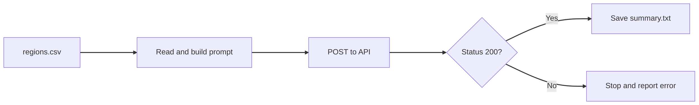

# Python for APIs and GenAI Integration
> Pre-Read — Academic Session 33 | Module 4: GenAI for Analytics Workflows + Basic Python
---

## Mental Map

```mermaid
%%{init: {'themeVariables': {'fontSize': '16px'}, 'flowchart': {'useMaxWidth': false, 'htmlLabels': true, 'nodeSpacing': 80, 'rankSpacing': 120, 'wrappingWidth': 620, 'padding': 20}}}%%
flowchart LR

START["<b>Course Start</b>"]

subgraph foundation[" WHERE WE ARE "]
direction LR
    CURMOD["<b>CURRENT MODULE</b><br/><i>Module 4: GenAI for Analytics Workflows + Basic Python</i><br/>&nbsp;<br/><b>Covered so far:</b> Python Fundamentals I · Python Fundamentals II · Python Fundamentals III<br/>plus 4 earlier Module 4 sessions<br/>This is Session 33 of 41"]
    CURSES["<b>CURRENT SESSION</b><br/><b>Python for APIs and GenAI Integration</b><br/>&nbsp;<br/><i>The shift:</i> from <i>using GenAI by typing into a chat window</i> to <b>calling GenAI from code through an API, as one step inside your own script</b><br/>&nbsp;<br/>HTTP requests with the requests library · API structure: endpoints, headers, JSON<br/>Calling the OpenAI API from Python<br/>A script combining file reading, functions and API calls"]
end

subgraph outcome[" OUTCOME OF THIS SESSION "]
direction LR
    OUT["<b>By the end, you can…</b><br/>&nbsp;<br/>Run a Python script that reads Kirana365 figures from a file,<br/>sends them to GenAI through an API, and saves the summary it returns,<br/>checking the response before using it"]
end

subgraph value[" WHY IT MATTERS "]
direction LR
    CVAL["<b>Course Value</b><br/>This is how the GenAI step of an automated workflow runs with nobody typing"]
    RVAL["<b>Real-Life Value</b><br/>Generating a weekly summary automatically instead of copying data into a chat window each time"]
end

subgraph future[" WHAT COMES NEXT "]
direction LR
    U0["<b>Next Session</b><br/>Getting Started with Python Data<br/><i>Now we load and inspect whole tables with pandas instead of reading files by hand</i>"]
    U1["<b>Later in Module 4</b><br/>Cleaning Data with Pandas · Visualizing Data with Python<br/>Connecting the Tools"]
    U2["<b>Upcoming</b><br/>Capstone Project<br/><i>Putting GenAI inside a workflow is a pattern the capstone can build on</i>"]
end

START ==>|" begin "| CURMOD
CURMOD ==>|" progress "| CURSES
CURSES ==>|" you get "| OUT
OUT ==>|" course "| CVAL
OUT ==>|" real life "| RVAL
CURSES ==>|" next up "| U0
U0 -.->|" then "| U1
U1 -.->|" ahead "| U2

classDef startBox fill:#F7FAFC,stroke:#4A5568,stroke-width:2px,color:#1A202C
classDef curModBox fill:#FFF8E6,stroke:#B7791F,stroke-width:2px,color:#1A202C
classDef curSessBox fill:#E6FFFA,stroke:#0D9488,stroke-width:3px,color:#1A202C
classDef outBox fill:#FEF2F2,stroke:#DC2626,stroke-width:3px,color:#1A202C
classDef valueBox fill:#F3E8FF,stroke:#7C3AED,stroke-width:2px,color:#1A202C
classDef futureBox fill:#ECFDF5,stroke:#047857,stroke-width:2px,color:#1A202C

class START startBox
class CURMOD curModBox
class CURSES curSessBox
class OUT outBox
class CVAL,RVAL valueBox
class U0,U1,U2 futureBox

linkStyle default stroke-width:2px
```

<div style="overflow-x: scroll; max-width: 100%; display: block;">



</div>

## What You'll Learn
In this pre-read, you'll discover:
- How Python sends a request to a web service with the `requests` library
- The parts of an API call: endpoint, method, headers, body and JSON
- How to call the OpenAI chat API from Python and read the answer
- How to combine files, functions and an API call into one script

## A. HTTP Requests with the requests Library

**💡 Analogy**: Think of a restaurant. GET is asking the waiter for the menu; POST is placing an order. The `requests` library lets your code talk to the waiter.

**`requests.get()` asks for information and `requests.post()` sends information for the server to act on; the status code tells you how it went.**

**Worked example**:

```python
import requests

response = requests.get("https://jsonplaceholder.typicode.com/todos/1")
print(response.status_code)   # 200
print(response.json())        # a Python dictionary
```

| Code | Meaning |
|---|---|
| 200 | Success |
| 401 | Bad or missing key |
| 404 | Address not found |
| 429 | Too many requests, slow down |
| 500 | Server problem |

**⚠️ Common trap**: Using the response without checking `status_code`. A 401 or 429 response still comes back as an object, and your script will happily try to read an answer that is not there.

## B. API Structure — Endpoints, Headers and JSON

**💡 Analogy**: Think of a courier parcel. The endpoint is the delivery address, the headers are the labels on the box (who it is from), and the body is what is inside.

**An API call has an endpoint (URL), a method, headers (who you are) and a body (your data), and the reply comes back as JSON.**

**Worked example**: JSON looks almost exactly like a Python dictionary:

```json
{"userId": 1, "id": 1, "title": "delectus aut autem", "completed": false}
```

`response.json()` turns it into a dictionary, and you reach nested values step by step:

```python
data["choices"][0]["message"]["content"]
```

Read it left to right: from `data`, take `"choices"`, then the first item, then `"message"`, then `"content"`. Your API key is a password. Keep it in an environment variable:

```python
import os
api_key = os.environ["OPENAI_API_KEY"]
```

**⚠️ Common trap**: Typing your API key into the code. A key pasted in a script that is shared or uploaded can be used by anyone, and you pay the bill.

## C. Calling the OpenAI API from Python

**💡 Analogy**: Think of a phone call to a very capable colleague. You dial the number (endpoint), introduce yourself (headers), say your request (body), and then listen to the reply.

**You POST your key in the headers and your prompt in the body, then read the answer from the JSON.**

**Worked example**:

```python
import os
import requests

api_key = os.environ["OPENAI_API_KEY"]
url = "https://api.openai.com/v1/chat/completions"
headers = {
    "Authorization": f"Bearer {api_key}",
    "Content-Type": "application/json",
}
body = {
    "model": "MODEL_NAME",   # use the model name shared in class
    "messages": [
        {"role": "system", "content": "You are a business analyst."},
        {"role": "user", "content": "Summarise: West has 31 sales on 4 ad spend."},
    ],
}
response = requests.post(url, headers=headers, json=body, timeout=60)
if response.status_code == 200:
    print(response.json()["choices"][0]["message"]["content"])
else:
    print("Problem:", response.status_code)
```

The "system" message sets the role, like the role line in your prompts from 12.2.

**⚠️ Common trap**: Trusting the model output without a check. The API returns text that sounds right. Your validation habit from 13.1 still applies: compare any numbers in the reply with your source.

## D. Putting It Together — File + Function + API

**💡 Analogy**: Think of an assembly line. One station reads the raw material, one shapes it, one packs it. Your script is a line of stations you already built.

**A script that reads a file, calls a function, sends the result to GenAI and saves the reply is just the earlier skills joined.**

**Worked example**:

```python
def read_regions(path):
    ...                   # from 14.2: returns a list of (region, ad, sales)

def summarise(text):
    ...                   # POSTs to the API, returns the reply or None

rows = read_regions("regions.csv")
text = "; ".join(f"{r}: ad {a}, sales {s}" for r, a, s in rows)
summary = summarise("Summarise in 2 sentences: " + text)
if summary:
    with open("summary.txt", "w") as f:
        f.write(summary)
```

Run it every Monday with a new file and nobody has to copy data into a chat window.

**⚠️ Common trap**: Letting the script save a failed call as if it were a summary. Check the status code (and that `summary` is not empty) before writing anything to disk.



## Quick Reference — Calling an API from Python

| Your situation | Use this | Because |
|---|---|---|
| You want to fetch information | `requests.get(url)` | GET asks for data |
| You want to send a prompt | `requests.post(url, headers=..., json=...)` | POST sends data to act on |
| A call just returned | Check `status_code` | 200 means it worked |
| Reading the JSON reply | `data["choices"][0]["message"]["content"]` | Follows the nesting of the response |
| Handling your API key | Environment variable, never in code | Keys are passwords |

## Practice Exercises

1. **Pattern Recognition**: What is the difference between GET and POST? Give a restaurant example.

2. **Concept Detective**: A response has `status_code` 401. What does it most likely mean, and what would you check?

3. **Real-Life Application**: Write the path to read the reply text from a chat response stored in `data`.

4. **Spot the Error**: Spot the error: `api_key = "sk-abc123"` written inside a script you plan to share. What should you do instead?

5. **Planning Ahead**: Next session we load whole tables with pandas. Looking at the script above, which part (reading `regions.csv` by hand) do you expect pandas to make much shorter?

> ✅ **You're done!** You can now call GenAI from a script, check the response, and combine file reading, functions and an API call into one workflow step.
Next session, we leave single values behind and load whole tables in **Getting Started with Python Data**, using pandas.
