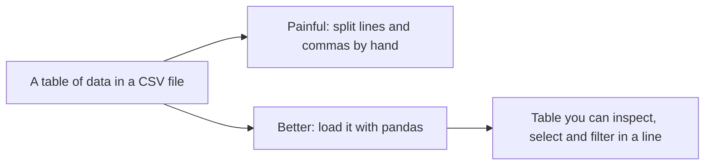
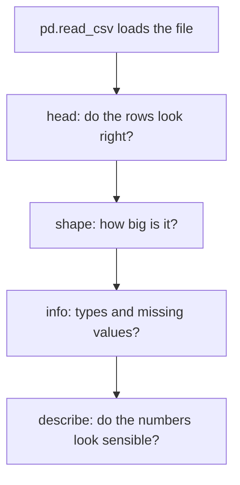

# Lecture Script: Getting Started with Python Data
**Session 15.2 · Module 4: GenAI for Analytics Workflows + Basic Python**
**Duration: 90 minutes · Audience: 40-60 learners · Prerequisite: pre-read; 13.2, 14.1, 14.2, 15.1**

---

## Timing table

| # | Block | Minutes | Running total |
|---|-------|---------|---------------|
| 1 | Opening hook | 5 | 5 |
| 2 | From Known to New | 7 | 12 |
| 3 | A. How Python is used for data analysis | 10 | 22 |
| 4 | B. Loading with pandas | 10 | 32 |
| 5 | C. Viewing and inspecting | 18 | 50 |
| 6 | D1. Selecting columns | 10 | 60 |
| 7 | D2. Filtering rows | 15 | 75 |
| 8 | Live practice: answer questions with the table | 10 | 85 |
| 9 | Wrap-up and bridge | 5 | 90 |
| | **Total** | **90** | |

**Running example (same as pre-read):** `orders.csv`, 6 rows, 5 columns. Total units 21; South orders 101 and 103; units ≥ 4 are 102, 105, 106; North Headphones is 105.

**Setup:** share `orders.csv` with learners beforehand (or paste a cell that writes it). `pandas` installed. Notebook on projector.

---

## Block 1 · Opening hook (5 min)

**Say:**
> "Remember 14.2? To read a three-row CSV, we wrote a function, split lines, split commas, skipped the header and converted every number. Now imagine a 50,000-row file with 30 columns. Show of hands: who wants to write that function again?"

*(Nobody.)*

> "Today, one line. And then we learn the thing that separates careful analysts from reckless ones: look at the data *before* you trust it."

---

## Block 2 · From Known to New (7 min)

**Hook:**
> "A spreadsheet has rows, columns, headers, and a filter dropdown. pandas gives you all of that inside Python."

Draw the mapping: sheet = DataFrame, column = Series, dropdown filter = one line.



**Key line:** "pandas is the mixer-grinder for tables."

---

## Block 3 · A. How Python is used for data analysis (10 min)

**Hook:**
> "Python alone is like a bare kitchen. Libraries are the appliances other people already built."

**Teach (5 min):** pandas = tables (today and 16.1); matplotlib = charts (16.2). Show `import pandas as pd` and explain the nickname.

**Why Python and not only a spreadsheet (3 min):** size, repeatability, automation, traceability. "The code is a record of exactly what you did. A spreadsheet with ten clicks cannot say that."

**Quick poll (2 min):** "What is the biggest file you have opened in Excel before it struggled?" *(Collect answers.)*

**🔴 Trap:** "Python being 'better' is not the point. A spreadsheet is great for small, one-off tasks. Python wins when you repeat, scale or automate."

**💬 Expect pushback:** *"Do I need to learn all of pandas?"*
> "No. A small set of moves does most of the daily work: load, inspect, select, filter, and in the next sessions clean and plot. That is what we cover."

---

## Block 4 · B. Loading with pandas (10 min)

**Live code (6 min):**
```python
import pandas as pd
df = pd.read_csv("orders.csv")
print(df)
```
Show the table output. Point out: column names came from the header; numbers are numbers.

**Say:** "Compare that with the page of code in 14.2. One line. And notice we did not convert anything to numbers, pandas did."

**Teach (2 min):** `df` is a DataFrame, the standard name. Mention `pd.read_excel` exists too.

**Callback (2 min):** "Remember `read_regions` in 15.1? Now try `pd.read_csv("regions.csv")`." Run it. "That function is now one line."

**🔴 Trap:** "If `FileNotFoundError`, the file is not where the notebook is looking. Check the name and the folder."

**💬 Expect pushback:** *"So the 14.2 work was a waste?"*
> "No. Now you know what pandas saves you from, which tells you what went wrong when a file loads strangely."

---

## Block 5 · C. Viewing and inspecting (18 min)

**Hook:**
> "A doctor examines the patient before treatment. We examine the data before analysis."

**Live code, one command at a time (10 min):**
```python
df.head()
df.head(3)
df.tail(2)
df.shape
df.columns
df.info()
df.describe()
```
For each, ask first: "What do you expect to see?"

**Read `info()` in detail (5 min):** Rows and columns; non-null counts; dtypes. "If a column has fewer non-nulls than the rows, values are missing. If a number column shows as object, it was read as text. Both are problems to fix in 16.1."



**Callback (1 min):** "This is the sense-check validation from 13.1, now on real data."

**Quick check (2 min):** "A column shows 5 non-null in a 6-row table. What does that mean?" *(One missing value.)*

**🔴 Trap:** "`describe()` only summarises number columns by default. A text column will not appear. Do not conclude 'nothing there'."

**💬 Expect pushback:** *"Why look at everything? I just need one number."*
> "Because the one number can be wrong if the data is wrong. A missing value or a text-typed column silently changes the answer."

---

## Block 6 · D1. Selecting columns (10 min)

**Hook:**
> "In a spreadsheet you hide the columns you do not need. Selecting is the same."

**Live code (6 min):**
```python
df["units"]
df[["region", "units"]]
df["units"].sum()
df["units"].mean()
```
Show the single column printing as a Series, the double-bracket version as a table. Results: sum 21, mean 3.5.

**Teach (2 min):** "Single brackets for one column. For several, a **list inside** the brackets, hence two pairs."

**Activity (2 min):** "Select the `product` and `price` columns together." *(Expected: `df[["product", "price"]]`.)*

**🔴 Trap:** "`df["region", "units"]` with single brackets gives a `KeyError`. Everyone does this once."

**💬 Expect pushback:** *"Why double brackets, really?"*
> "The inner brackets are a Python list of names. The outer brackets are the pandas selector. List inside selector."

---

## Block 7 · D2. Filtering rows (15 min)

**Hook:**
> "Clicking the dropdown filter in Excel: 'show me only South'. In pandas, one line."

**Live code (7 min):**
```python
df[df["region"] == "South"]
df[df["units"] >= 4]
```
First show the condition alone: `df["region"] == "South"` gives a column of True/False. "The filter keeps the rows where that is True."

Expected: South gives orders 101 and 103; units ≥ 4 gives 102, 105, 106.

**Combining conditions (4 min):**
```python
df[(df["region"] == "North") & (df["product"] == "Headphones")]
df[(df["region"] == "West") | (df["units"] > 5)]
```
Expected: first gives 105. Second gives 104, 106.

**Say:** "`&` for both, `|` for either, each condition in brackets. Not `and` and `or`."

**Selecting and filtering at once (2 min):**
```python
df.loc[df["units"] >= 4, ["order_id", "units"]]
```

**Quick check (2 min):** "How would you find orders where the product is Charger?" *(`df[df["product"] == "Charger"]`.)*

**🔴 Trap:** "A single `=` in a filter overwrites data. `df["region"] = "South"` turns every row into South. Use `==` to compare."

**💬 Expect pushback:** *"Why can't I use `and`?"*
> "`and` works on one True/False. A column is many True/False values. `&` works across the whole column row by row."

---

## Block 8 · Live practice: answer questions with the table (10 min)

**Task (8 min):** In pairs, answer these using code, not by eye:
1. How many orders are in the table? *(6)*
2. How many units were sold in total? *(21)*
3. Which orders were for Headphones in the West? *(104)*
4. Which orders have more than 3 units? *(102, 105, 106)*
5. Show only `region` and `units` for South orders. *(101 → 3, 103 → 2)*

**Debrief (2 min):** Pick two pairs. Ask: "Which command did you start with?" *(Ideally `head()` or `info()`.)*

**Say:** "Notice you answered questions without a single loop. The condition runs over the whole column."

---

## Block 9 · Wrap-up and bridge (5 min)

**Recap with the mental map open (2 min):**
- `pd.read_csv` gives a DataFrame.
- Inspect first: `head`, `shape`, `info`, `describe`.
- Select columns: single or double brackets.
- Filter rows with conditions; `&`, `|`, brackets.

**One-line takeaway:**
> "pandas turns a file into a table you can inspect, select and filter in a line. Always look before you analyse."

**Bridge (1 min):**
> "Today our data was tidy. Real data is not: missing values, duplicates, wrong entries, columns in the wrong type. `info()` shows you the problems. In 16.1 you will fix them."

**Closing prompt (2 min):** "Think of a file at work. What is the first thing you would check with `info()`?"

---

## Instructor quick-reference

- **Same numbers everywhere:** 6 orders; total units 21, mean 3.5; South 101/103; units ≥ 4 are 102/105/106; North Headphones 105; West or units > 5 gives 104/106.
- **If long:** drop `loc` and the tail demo.
- **If short:** add `df["region"].value_counts()` as an extension.
- **Phrases to model:** "look before you analyse", "list inside the brackets".
