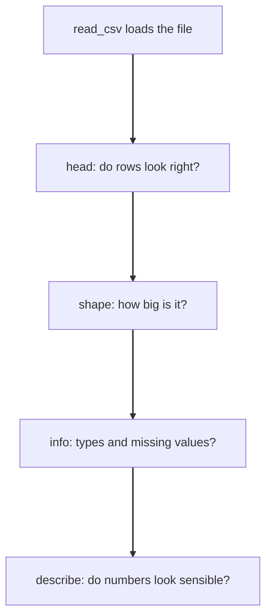

# Getting Started with Python Data
> Pre-Read — Academic Session 34 | Module 4: GenAI for Analytics Workflows + Basic Python
---

## Mental Map

```mermaid
%%{init: {'themeVariables': {'fontSize': '16px'}, 'flowchart': {'useMaxWidth': false, 'htmlLabels': true, 'nodeSpacing': 80, 'rankSpacing': 120, 'wrappingWidth': 620, 'padding': 20}}}%%
flowchart LR

START["<b>Course Start</b>"]

subgraph foundation[" WHERE WE ARE "]
direction LR
    CURMOD["<b>CURRENT MODULE</b><br/><i>Module 4: GenAI for Analytics Workflows + Basic Python</i><br/>&nbsp;<br/><b>Covered so far:</b> Python Fundamentals II · Python Fundamentals III · Python for APIs and GenAI Integration<br/>plus 5 earlier Module 4 sessions<br/>This is Session 34 of 41"]
    CURSES["<b>CURRENT SESSION</b><br/><b>Getting Started with Python Data</b><br/>&nbsp;<br/><i>The shift:</i> from <i>reading a CSV by hand, line by line</i> to <b>loading a whole table with pandas and inspecting, selecting and filtering it in a line or two</b><br/>&nbsp;<br/>How Python is used for data analysis · Loading datasets with pandas<br/>Viewing and inspecting with head and info<br/>Selecting and filtering rows and columns in a DataFrame"]
end

subgraph outcome[" OUTCOME OF THIS SESSION "]
direction LR
    OUT["<b>By the end, you can…</b><br/>&nbsp;<br/>Load a Kirana365 orders file into pandas, inspect it,<br/>and pull out just the cities, columns and rows you need"]
end

subgraph value[" WHY IT MATTERS "]
direction LR
    CVAL["<b>Course Value</b><br/>Every cleaning, charting and end-to-end step that follows starts from a pandas table"]
    RVAL["<b>Real-Life Value</b><br/>Answering a quick question about a large file in seconds without opening it in a spreadsheet"]
end

subgraph future[" WHAT COMES NEXT "]
direction LR
    U0["<b>Next Session</b><br/>Cleaning Data with Pandas<br/><i>Now we fix the missing values and duplicates that info() reveals</i>"]
    U1["<b>Later in Module 4</b><br/>Visualizing Data with Python · Connecting the Tools<br/>End-to-End Analytics Workflow"]
    U2["<b>Upcoming</b><br/>Capstone Project<br/><i>Comfort with pandas tables is assumed from the first day of the capstone</i>"]
end

START ==>|" begin "| CURMOD
CURMOD ==>|" progress "| CURSES
CURSES ==>|" you get "| OUT
OUT ==>|" course "| CVAL
OUT ==>|" real life "| RVAL
CURSES ==>|" next up "| U0
U0 -.->|" then "| U1
U1 -.->|" ahead "| U2

classDef startBox fill:#F7FAFC,stroke:#4A5568,stroke-width:2px,color:#1A202C
classDef curModBox fill:#FFF8E6,stroke:#B7791F,stroke-width:2px,color:#1A202C
classDef curSessBox fill:#E6FFFA,stroke:#0D9488,stroke-width:3px,color:#1A202C
classDef outBox fill:#FEF2F2,stroke:#DC2626,stroke-width:3px,color:#1A202C
classDef valueBox fill:#F3E8FF,stroke:#7C3AED,stroke-width:2px,color:#1A202C
classDef futureBox fill:#ECFDF5,stroke:#047857,stroke-width:2px,color:#1A202C

class START startBox
class CURMOD curModBox
class CURSES curSessBox
class OUT outBox
class CVAL,RVAL valueBox
class U0,U1,U2 futureBox

linkStyle default stroke-width:2px
```

<div style="overflow-x: scroll; max-width: 100%; display: block;">



</div>

## What You'll Learn
In this pre-read, you'll discover:
- Why analysts add libraries like pandas to Python for data work
- How to load a CSV into a pandas DataFrame in one line
- How `head`, `shape`, `info` and `describe` let you inspect a dataset
- How to select columns and filter rows with a condition

## A. How Python Is Used for Data Analysis

**💡 Analogy**: Think of a kitchen. You could grind masala on a stone, or use a mixer-grinder that does it in seconds. pandas is the mixer-grinder for tables.

**Python becomes a data tool when you add libraries: pandas for tables and matplotlib for charts.**

**Worked example**: A spreadsheet sheet becomes a **DataFrame**, a single column becomes a **Series**, and "filter by region" becomes one line of code. Analysts choose Python for four reasons: it handles far more rows, you can rerun the same steps next month, it fits scripted workflows like 15.1, and the code is a record of exactly what you did.

```python
import pandas as pd
```

`pd` is the standard nickname everyone uses.

**⚠️ Common trap**: Thinking pandas replaces thinking. It is faster than a spreadsheet, but it will just as happily summarise bad data. You still inspect the data before trusting any answer.

## B. Loading Datasets with pandas

**💡 Analogy**: Think of a moving company. You used to carry every box yourself (open file, split lines, split commas, convert numbers). With pandas you tell the movers where the file is, and the table arrives set up.

**`pd.read_csv("file.csv")` loads a whole table, with column names and number types, in one line.**

**Worked example**: `orders.csv`:

```
order_id,region,product,units,price
101,South,Headphones,3,1500
102,North,Charger,5,500
103,South,Charger,2,500
104,West,Headphones,1,1500
105,North,Headphones,4,1500
106,West,Charger,6,500
```

```python
df = pd.read_csv("orders.csv")
```

`df` is the standard name for a DataFrame. The first line becomes the column names, and numbers are converted to numbers for you. Other formats work the same way, for example `pd.read_excel("file.xlsx")`.

**⚠️ Common trap**: Misspelling the file name or running from the wrong folder. A `FileNotFoundError` means Python cannot find that file where it is looking, not that the file is damaged.

## C. Viewing and Inspecting a Dataset

**💡 Analogy**: Think of a health check before treatment. A doctor examines the patient before prescribing anything. You examine the data before analysing it.

**Always look at a new dataset with `head`, `shape`, `info` and `describe` before doing any analysis.**

**Worked example**:

| Command | What it shows | On our data |
|---|---|---|
| `df.head(3)` | First 3 rows | Orders 101 to 103 |
| `df.shape` | (rows, columns) | `(6, 5)` |
| `df.columns` | Column names | order_id, region, product, units, price |
| `df.info()` | Types and non-empty counts | 6 non-null in every column |
| `df.describe()` | Count, mean, min, max of numbers | Quick summary |

Reading `info()`: *Non-Null Count* shows how many values are present, so 5 non-null in a 6-row table means one value is missing. *Dtype* shows the type: `int64` whole numbers, `float64` decimals, `object` text. If a number column shows as text, something is wrong.

**⚠️ Common trap**: Skipping inspection because the file "looks fine" in a spreadsheet. Missing values and wrong types are exactly what `info()` reveals, and you will fix them in the next session.



## D. Selecting and Filtering Rows and Columns

**💡 Analogy**: Think of a spreadsheet dropdown filter. You pick "South" and only the South rows remain. In pandas the dropdown is a condition written in code.

**Select columns by name in brackets; filter rows by putting a True/False condition inside the brackets.**

**Worked example**:

```python
df["units"]                   # one column
df[["region", "units"]]       # several columns: double brackets
df["units"].sum()             # 21
df["units"].mean()            # 3.5

df[df["region"] == "South"]   # South orders: 101 and 103
df[df["units"] >= 4]          # orders 102, 105, 106
df[(df["region"] == "North") & (df["product"] == "Headphones")]   # order 105
```

Read the filter as: *from df, keep the rows where region equals South.* Use `&` for both, `|` for either, `~` for not, and put each condition in brackets.

**⚠️ Common trap**: Using `and` / `or` between conditions. These work on a single True/False value, not a whole column. In pandas use `&` and `|` with brackets around each condition.

## Quick Reference — Loading and Looking at Data

| Your situation | Use this | Because |
|---|---|---|
| A CSV file to analyse | `pd.read_csv("file.csv")` | One line replaces a page of code |
| Seeing the first rows | `df.head()` | Check the file loaded correctly |
| How big is the table | `df.shape` | Rows and columns at a glance |
| Missing values or wrong types | `df.info()` | Shows non-null counts and dtypes |
| Only some rows | `df[df["col"] == value]` | A condition keeps the True rows |

## Practice Exercises

1. **Pattern Recognition**: What does `df.shape` return for our orders file, and what do the two numbers mean?

2. **Concept Detective**: A table has 6 rows. `info()` shows 5 non-null for `units`. What does that tell you?

3. **Real-Life Application**: Write the pandas line that keeps only orders with 4 or more units. Which orders remain?

4. **Spot the Error**: Find the error: `df[(df["region"] == "West") and (df["units"] > 5)]`. What should connect the conditions?

5. **Planning Ahead**: Next session we fix missing values and duplicates. Why is it important to inspect with `info()` before cleaning anything?

> ✅ **You're done!** You can now load a CSV with pandas, inspect it, and pull out just the columns and rows you need.
Next session, we fix what inspection reveals in **Cleaning Data with Pandas**: duplicates, missing values and messy entries.
