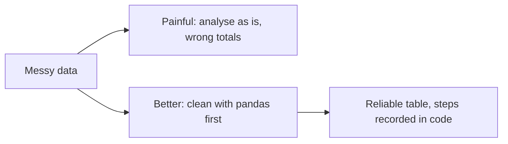
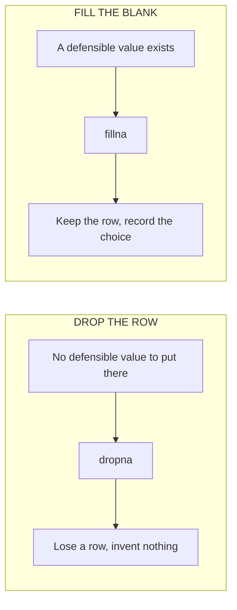

# Lecture Script: Cleaning Data with Pandas
**Session 16.1 · Module 4: GenAI for Analytics Workflows + Basic Python**
**Duration: 90 minutes · Audience: 40-60 learners · Prerequisite: pre-read; 13.1 (validation), 15.2 (pandas basics)**

---

## Timing table

| # | Block | Minutes | Running total |
|---|-------|---------|---------------|
| 1 | Opening hook | 5 | 5 |
| 2 | From Known to New | 7 | 12 |
| 3 | A. Diagnose the problems | 13 | 25 |
| 4 | B. Duplicates | 8 | 33 |
| 5 | C. Missing values | 17 | 50 |
| 6 | D. Modify columns and values | 12 | 62 |
| 7 | E. Simple transformations | 10 | 72 |
| 8 | Live practice: clean it end to end | 13 | 85 |
| 9 | Wrap-up and bridge | 5 | 90 |
| | **Total** | **90** | |

**Running example (same as pre-read):** `orders_messy.csv`, 7 rows. Problems: duplicate 104; missing units (103); missing price (106); `"north "` (105). Clean result: 5 rows, revenue 4,500 / 2,500 / 1,500 / 6,000 / 3,000, total 17,500; by region North 8,500, South 4,500, West 4,500.

**Setup:** share `orders_messy.csv` with learners beforehand (or a cell that writes it). Keep an untouched copy of the raw file.

---

## Block 1 · Opening hook (5 min)

**Say:**
> "Imagine a dashboard that shows North region with half the sales of South. The head of sales is about to restructure the North team. Then someone notices: the data had 'North', 'north', and 'North ' with a space, and pandas counted them as three different regions. North was never small. It was *split*."

> "Dirty data does not announce itself. It gives you a confident, wrong answer. Today you learn to catch it."

**Transition:** "You already clean data. You just do it with a mouse."

---

## Block 2 · From Known to New (7 min)

**Hook:**
> "In a spreadsheet you delete the duplicate row, fix the typo, type something in the blank. Same jobs. In pandas, there are two upgrades: it works on thousands of rows at once, and it is *written down*. Next month, you rerun the same cleaning on the new file."

**Show `orders_messy.csv` on screen.** Ask: "Spot the problems." *(Give 2 minutes. Aim for four: duplicate 104, missing units on 103, missing price on 106, `"north "` on 105.)*



**Key line:** "Clean data is not a luxury. It is the validation step that comes before everything else."

---

## Block 3 · A. Diagnose the problems (13 min)

**Hook:**
> "A mechanic diagnoses before touching anything. So do we."

**Live code (8 min):**
```python
import pandas as pd
df = pd.read_csv("orders_messy.csv")
df.shape
df.info()
df.isna().sum()
df.duplicated().sum()
df["region"].unique()
```
For each, predict first, then run. Expected: `(7, 5)`; units and price 6 non-null; missing 1 and 1; duplicates 1; regions include `'north '`.

**Teach (3 min):** What each command catches. "`unique()` is how you catch spelling variants."

**Quick check (2 min):** "Which command would reveal that 'north ' and 'North' both exist?" *(`unique()`.)*

**🔴 Trap:** "`df.isna().sum()` only finds *empty* cells. A value like 'N/A' or 'missing' typed as text will not be counted. Look at `unique()` as well."

**💬 Expect pushback:** *"Can't I see this by looking at the table?"*
> "With 7 rows, yes. With 70,000, you rely on these commands."

---

## Block 4 · B. Duplicates (8 min)

**Hook:**
> "If order 104 is counted twice, its revenue is double-counted. Nobody will complain about extra sales. That is why duplicates are dangerous: they flatter you."

**Live code (4 min):**
```python
df = df.drop_duplicates()
df.shape
```
Expected: `(6, 5)`.

**Teach (2 min):** Keeps the first copy. Must assign back. "Without `df =`, nothing changes."

**Show (1 min):** Run `df.drop_duplicates()` without assigning, then `df.shape`. Still the old size.

**Say (1 min):** "A real duplicate is a fully identical row. Two real orders can look similar. If you have an ID, use `subset=["order_id"]`."

**🔴 Trap:** "Dropping 'duplicates' that are really separate valid orders destroys real sales. Check before you remove."

**💬 Expect pushback:** *"What if rows differ slightly, like one has a typo?"*
> "Then they are not exact duplicates. Fix the text first, then check duplicates again. Order matters."

---

## Block 5 · C. Missing values (17 min)

**Hook:**
> "A form with a blank page. You can send it back. Or, if you *know* the answer for certain, you can fill it in. What you must not do is invent."

**Teach the choice (5 min):** Drop vs. fill table. Spend time on the principle: "Pick on purpose. Record why."

**Live code (7 min):**
```python
df = df.dropna(subset=["units"])
df["price"] = df["price"].fillna(500)
df.shape
```
Explain the two decisions:
- Order 103, units: no basis for a number, so drop.
- Order 106, price: Chargers are 500 in every other order, so 500 is defensible.

**Group discussion (4 min):** "What if we had filled the missing units with the average of the column? What happens to the revenue?" *(We would invent sales that may never have happened.)* "When *is* filling with a mean or median acceptable?" *(When the missing values are few, the column is numeric, and an average is a reasonable stand-in, and you say so.)*

**Say (1 min):** "Always answer: how many rows did I lose? If cleaning removes 40% of the data, that is a finding."



**🔴 Trap:** "Filling every blank with 0 is the most common silent error. Zero is a *value*, not 'unknown'. It drags averages down."

**💬 Expect pushback:** *"My manager just wants the report. Can't I just fill and move on?"*
> "You can, but you carry the risk. A one-line note, 'filled one price using the standard Charger price', protects both of you."

---

## Block 6 · D. Modify columns and values (12 min)

**Hook:**
> "The region column has 'north ' with a space. To a human it is North. To the computer it is a different word."

**Live code (7 min):**
```python
df["region"] = df["region"].str.strip().str.title()
df["region"].unique()
df["units"] = df["units"].astype(int)
df.info()
```
Explain `.str` ("apply the text tool to every value"), `strip`, `title`, and why `astype(int)` is needed (NaN made units a float).

**Demo (2 min):** Run `df.groupby("region")["units"].sum()` on a copy *before* the text fix to show North split into two groups. Then after. "This is the story from the opening."

**Teach (2 min):** `rename`, `replace`, `.str.lower()`.

**Quick check (1 min):** "Why did `units` turn into decimals?" *(NaN is a decimal-type value.)*

**🔴 Trap:** "Fix text *before* checking duplicates and grouping. 'North' and 'north ' will not match until they are cleaned."

**💬 Expect pushback:** *"Why `.str`?"*
> "A column is not one string. `.str` says: apply this text operation to every string in the column."

---

## Block 7 · E. Simple transformations (10 min)

**Hook:**
> "In a spreadsheet you write a formula and drag it down. In pandas you write it once, for the whole column."

**Live code (6 min):**
```python
df["revenue"] = df["units"] * df["price"]
df
df["revenue"].sum()
df.groupby("region")["revenue"].sum()
```
Expected: revenue 4,500 / 2,500 / 1,500 / 6,000 / 3,000; total 17,500; North 8,500, South 4,500, West 4,500.

**Say:** "North is 8,500 only because we cleaned `'north '`. Cleaning changed the answer."

**Save (2 min):**
```python
df.to_csv("orders_clean.csv", index=False)
```
"Raw file untouched. Clean file saved under a new name."

**Quick check (2 min):** "What does `index=False` do?" *(Stops pandas writing its own row numbers as a column.)*

**🔴 Trap:** "Do not overwrite the raw file. Raw data is evidence."

**💬 Expect pushback:** *"Can't I do all this in Excel?"*
> "You can, for small data. But Excel cleaning is clicks nobody can replay. Here the steps are the documentation."

---

## Block 8 · Live practice: clean it end to end (13 min)

**Task (9 min):** Give learners a **second messy file** (prepare beforehand, 8 rows, with a missing region, a negative price entered by mistake, a repeated order and 'SOUTH' capitalised). In pairs, they must:
1. Diagnose, listing the problems found.
2. Fix each, deciding drop vs. fill and noting why.
3. Report how many rows were removed and changed.
4. Add a `revenue` column and print the total.

**Debrief (4 min):** Compare totals between pairs. If they differ, discuss which choice caused it. "Same data, different decisions, different answers. That is why you document."

**Say:** "Notice you had to *decide*, not just run commands. Cleaning is judgement."

---

## Block 9 · Wrap-up and bridge (5 min)

**Recap with the mental map open (2 min):**
- Diagnose before fixing.
- `drop_duplicates`, `dropna` / `fillna`, `str.strip().str.title()`, `astype`.
- New columns from old ones.
- Keep raw, count changes, recheck.

**One-line takeaway:**
> "Diagnose first, fix on purpose, record what you changed. Dirty data gives confident wrong answers."

**Bridge (1 min):**
> "Clean data is the input to a picture. In 16.2 you will draw line, bar and scatter charts with matplotlib, plot straight from a DataFrame, and compare Python plotting with Tableau."

**Closing prompt (2 min):** "Write one cleaning decision you made today and the sentence you would put in a report to justify it."

---

## Instructor quick-reference

- **Same numbers everywhere:** 7 rows becoming 5; revenue 4,500 / 2,500 / 1,500 / 6,000 / 3,000; total 17,500; North 8,500, South 4,500, West 4,500.
- **If long:** shorten the Block 8 file to 6 rows.
- **If short:** add `value_counts()` and `df.describe()` before and after.
- **Phrases to model:** "diagnose first", "assign back", "record the choice".
