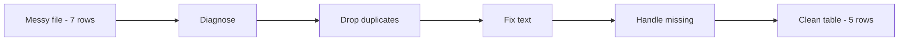

# Cleaning Data with Pandas
> Pre-Read — Academic Session 35 | Module 4: GenAI for Analytics Workflows + Basic Python
---

## Mental Map

```mermaid
%%{init: {'themeVariables': {'fontSize': '16px'}, 'flowchart': {'useMaxWidth': false, 'htmlLabels': true, 'nodeSpacing': 80, 'rankSpacing': 120, 'wrappingWidth': 620, 'padding': 20}}}%%
flowchart LR

START["<b>Course Start</b>"]

subgraph foundation[" WHERE WE ARE "]
direction LR
    CURMOD["<b>CURRENT MODULE</b><br/><i>Module 4: GenAI for Analytics Workflows + Basic Python</i><br/>&nbsp;<br/><b>Covered so far:</b> Python Fundamentals III · Python for APIs and GenAI Integration · Getting Started with Python Data<br/>plus 6 earlier Module 4 sessions<br/>This is Session 35 of 41"]
    CURSES["<b>CURRENT SESSION</b><br/><b>Cleaning Data with Pandas</b><br/>&nbsp;<br/><i>The shift:</i> from <i>analysing data exactly as it arrives</i> to <b>cleaning it first: fixing duplicates, missing values and messy entries so the results can be trusted</b><br/>&nbsp;<br/>Cleaning data with pandas · Modifying columns and values<br/>Handling missing values and duplicates<br/>Simple transformations on datasets"]
end

subgraph outcome[" OUTCOME OF THIS SESSION "]
direction LR
    OUT["<b>By the end, you can…</b><br/>&nbsp;<br/>Take a messy Kirana365 orders file and produce a clean table,<br/>recording what you removed, filled or changed, and why"]
end

subgraph value[" WHY IT MATTERS "]
direction LR
    CVAL["<b>Course Value</b><br/>Clean data is the input to the charts, workflow and conclusions in the sessions ahead"]
    RVAL["<b>Real-Life Value</b><br/>Preventing a leadership dashboard from showing wrong totals because of duplicate or mistyped rows"]
end

subgraph future[" WHAT COMES NEXT "]
direction LR
    U0["<b>Next Session</b><br/>Visualizing Data with Python<br/><i>Now we turn the clean table into charts</i>"]
    U1["<b>Later in Module 4</b><br/>Connecting the Tools · End-to-End Analytics Workflow<br/>Statistics: Distributions; Insights and Drawing Conclusions"]
    U2["<b>Upcoming</b><br/>Capstone Project<br/><i>Documented, defensible cleaning is expected in the capstone</i>"]
end

START ==>|" begin "| CURMOD
CURMOD ==>|" progress "| CURSES
CURSES ==>|" you get "| OUT
OUT ==>|" course "| CVAL
OUT ==>|" real life "| RVAL
CURSES ==>|" next up "| U0
U0 -.->|" then "| U1
U1 -.->|" ahead "| U2

classDef startBox fill:#F7FAFC,stroke:#4A5568,stroke-width:2px,color:#1A202C
classDef curModBox fill:#FFF8E6,stroke:#B7791F,stroke-width:2px,color:#1A202C
classDef curSessBox fill:#E6FFFA,stroke:#0D9488,stroke-width:3px,color:#1A202C
classDef outBox fill:#FEF2F2,stroke:#DC2626,stroke-width:3px,color:#1A202C
classDef valueBox fill:#F3E8FF,stroke:#7C3AED,stroke-width:2px,color:#1A202C
classDef futureBox fill:#ECFDF5,stroke:#047857,stroke-width:2px,color:#1A202C

class START startBox
class CURMOD curModBox
class CURSES curSessBox
class OUT outBox
class CVAL,RVAL valueBox
class U0,U1,U2 futureBox

linkStyle default stroke-width:2px
```

<div style="overflow-x: scroll; max-width: 100%; display: block;">



</div>

## What You'll Learn
In this pre-read, you'll discover:
- How to find duplicates, missing values and messy entries before fixing them
- How to drop duplicates and decide between dropping and filling missing values
- How to fix text, data types and column names
- How to make a new column and record every change you made

## A. Finding the Problems First

**💡 Analogy**: Think of a mechanic. A good mechanic diagnoses the car before touching a spanner. You diagnose the data before fixing it.

**Run checks that count missing values, duplicates and spelling variants before changing anything.**

**Worked example**: `orders_messy.csv`:

```
order_id,region,product,units,price
101,South,Headphones,3,1500
102,North,Charger,5,500
103,South,Charger,,500
104,West,Headphones,1,1500
104,West,Headphones,1,1500
105,north ,Headphones,4,1500
106,West,Charger,6,
```

Four problems: order 104 appears twice, order 103 has no units, order 106 has no price, and order 105 has region `"north "` (lowercase with a trailing space).

```python
df = pd.read_csv("orders_messy.csv")
df.shape               # (7, 5)
df.isna().sum()        # units: 1, price: 1
df.duplicated().sum()  # 1
df["region"].unique()  # South, North, West, 'north '
```

**⚠️ Common trap**: Fixing by feel. If you do not count what is wrong first, you cannot say afterwards how much your cleaning changed.

## B. Handling Duplicates

**💡 Analogy**: Think of a guest list where one friend is written twice. If you order food for the list, you buy a plate too many.

**`drop_duplicates()` removes repeated rows and keeps the first copy.**

**Worked example**:

```python
df = df.drop_duplicates()
print(df.shape)       # (6, 5)
```

Seven rows become six. Order 104 is now counted once instead of twice, so its sales are not doubled. If you suspect repeats of a key, use `df.drop_duplicates(subset=["order_id"])`.

**⚠️ Common trap**: Assuming similar rows are duplicates. Two real orders for the same product in the same region on different days are not duplicates, which is why an ID column matters.

## C. Handling Missing Values

**💡 Analogy**: Think of a form with a blank box. You can send it back (drop it), or, if you know the answer for certain, fill it in. You never just invent an answer.

**Drop a row when you cannot defend a value; fill a blank only when you have a defensible rule, and record which you chose.**

**Worked example**:

| Case | Choice | Why |
|---|---|---|
| Order 103, units missing | Drop the row | We have no idea how many units. Guessing would invent sales |
| Order 106, price missing | Fill with 500 | Every other Charger order is priced at 500 |

```python
df = df.dropna(subset=["units"])
df["price"] = df["price"].fillna(500)
```

These methods return a new table, so assign the result back (`df = ...`).

**⚠️ Common trap**: Not asking "how many rows did I lose?" If cleaning removes 40% of your data, that is a finding in itself, not a footnote.

## D. Modifying Columns and Values

**💡 Analogy**: Think of tidying a bookshelf. Same books, but spelled and shelved consistently so you can find them.

**Standardise text with `.str.strip().str.title()`, fix types with `astype`, and rename with `rename`.**

**Worked example**:

```python
df["region"] = df["region"].str.strip().str.title()   # 'north ' -> 'North'
df["units"] = df["units"].astype(int)                 # back to whole numbers
df = df.rename(columns={"units": "units_sold"})
```

`.str` tells pandas to apply the text tool to every value in the column. A column with a missing value turns into decimals, so after dropping the blank row you convert `units` back to whole numbers.

**⚠️ Common trap**: Skipping the text clean. Without it "North" and "north " count as two regions and your group totals are split.

## E. Simple Transformations

**💡 Analogy**: Think of a spreadsheet formula copied down a column. One formula, every row calculated.

**A transformation creates a new column from existing ones, row by row, without a loop.**

**Worked example**:

```python
df["revenue"] = df["units"] * df["price"]
df["revenue"].sum()                    # 17500
df.groupby("region")["revenue"].sum()  # North 8500, South 4500, West 4500
```

North is correct only because we cleaned `"north "` first. Cleaned, 7 rows became 5. Keep a note of the steps: removed 1 duplicate, dropped 1 row with missing units, filled 1 price with 500, fixed 1 region spelling.

**⚠️ Common trap**: Forgetting to record the changes. The notes are what let someone else trust, and repeat, your clean table.



## Quick Reference — Cleaning Moves

| Your situation | Use this | Because |
|---|---|---|
| Not sure what is wrong | `isna().sum()`, `duplicated().sum()`, `unique()` | Diagnose before you fix |
| Repeated rows | `drop_duplicates()` | Stops double counting |
| Blank cell, no defensible value | `dropna(subset=[...])` | Do not invent data |
| Blank cell, clear rule | `fillna(value)` | Keep the row with a justified value |
| "North" vs "north " | `.str.strip().str.title()` | Groups must match to add up |

## Practice Exercises

1. **Pattern Recognition**: In the messy file, how many rows and columns does `df.shape` show before cleaning, and after `drop_duplicates()`?

2. **Concept Detective**: Order 106 has no price and order 103 has no units. Why do we fill one and drop the other?

3. **Real-Life Application**: Write the pandas line that makes `"north "` into `"North"`.

4. **Spot the Error**: Spot the error: a teammate writes `df.dropna()` on its own line, then prints `df` and sees the blanks are still there. Why?

5. **Planning Ahead**: Next session we turn the clean table into charts. What mistake would a chart of the messy file's region totals have shown?

> ✅ **You're done!** You can now diagnose a messy table, remove duplicates, handle missing values, fix text, and keep a record of what you changed and why.
Next session, we turn the clean table into charts in **Visualizing Data with Python**.
