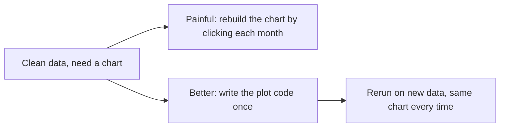
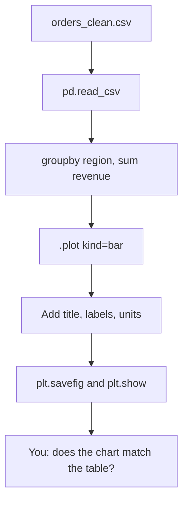

# Lecture Script: Visualizing Data with Python
**Session 16.2 · Module 4: GenAI for Analytics Workflows + Basic Python**
**Duration: 90 minutes · Audience: 40-60 learners · Prerequisite: pre-read; 12.1 (scatter, correlation), 15.2 and 16.1 (pandas)**

---

## Timing table

| # | Block | Minutes | Running total |
|---|-------|---------|---------------|
| 1 | Opening hook | 5 | 5 |
| 2 | From Known to New | 7 | 12 |
| 3 | A. Choosing the chart by the question | 10 | 22 |
| 4 | B. Basic plots with matplotlib | 18 | 40 |
| 5 | C. Customising: titles, labels, colours | 15 | 55 |
| 6 | D. Plotting from pandas | 12 | 67 |
| 7 | E. Python vs. Tableau | 10 | 77 |
| 8 | Live practice: three charts, three questions | 8 | 85 |
| 9 | Wrap-up and bridge | 5 | 90 |
| | **Total** | **90** | |

**Running example (same as pre-read):** six months, ad spend 2, 3, 4, 5, 6, 8 and sales 20, 26, 31, 38, 41, 55 (₹ lakh), r ≈ 0.997; revenue by region from `orders_clean.csv`: North 8,500, South 4,500, West 4,500.

**Setup:** notebook with matplotlib and pandas; `orders_clean.csv` from 16.1 available. Set `%matplotlib inline` if needed. Have a pre-made Tableau view of the same regional data ready to show in Block 7.

---

## Block 1 · Opening hook (5 min)

**Say:**
> "Two slides. Slide one: a table with six rows of numbers. Slide two: a line climbing steadily upward. Same data. Which one does your manager understand in three seconds?"

*(Show both.)*

> "Remember 12.1: I told you to plot before trusting a correlation number. You did not have the tool then. You do now."

**Transition:** "You already make charts. Let's see what changes."

---

## Block 2 · From Known to New (7 min)

**Hook:**
> "In a spreadsheet: select cells, insert chart, pick a type, edit titles. Fine once. Now do it again next month, and the month after. Clicking is not repeatable. Code is."



**Key line:** "Write the chart once, rerun forever."

---

## Block 3 · A. Choosing the chart by the question (10 min)

**Hook:**
> "A bicycle for a short ride, a train for a long journey. You choose the vehicle by the journey. You choose the chart by the question."

**Teach (4 min):** Show the three-row table: over time → line; compare categories → bar; two numbers related → scatter.

**Activity (4 min):** Show five questions; learners call the chart type:
1. How did sales change across the year? *(line)*
2. Which region earned the most revenue? *(bar)*
3. Do days with more ad spend have more sales? *(scatter)*
4. How did website visits change week by week? *(line)*
5. How many orders did each product get? *(bar)*

**Say (2 min):** "If you cannot say the question in one sentence, you are not ready to choose a chart."

**🔴 Trap:** "A line chart implies a connection between points in order. Joining unordered categories, like three regions, with a line suggests a trend that does not exist."

**💬 Expect pushback:** *"A pie chart looks nicer for regions."*
> "Pies are hard to compare when slices are similar. Our South and West are both 4,500: on a bar chart, the equal bars are obvious. On a pie it is a squint."

---

## Block 4 · B. Basic plots with matplotlib (18 min)

**Hook:**
> "matplotlib is Python's standard charting library. Three commands cover most of what you will do."

**Live code, line (6 min):**
```python
import matplotlib.pyplot as plt

months = [1, 2, 3, 4, 5, 6]
sales = [20, 26, 31, 38, 41, 55]

plt.plot(months, sales)
plt.show()
```
Run. "A steady climb." Ask: "What is missing?" *(Title, labels, units.)* "We will fix that in a moment."

**Live code, bar (4 min):**
```python
regions = ["North", "South", "West"]
revenue = [8500, 4500, 4500]

plt.bar(regions, revenue)
plt.show()
```
Point out: "North is the clear leader. This is the 'north ' story from 16.1: it only looks right because we cleaned the data."

**Live code, scatter (6 min):**
```python
ad_spend = [2, 3, 4, 5, 6, 8]

plt.scatter(ad_spend, sales)
plt.show()
```
**Say:** "Dots climbing from bottom-left to top-right: strong positive. That is our r ≈ 0.997 from 12.1, now visible. And what is the caution?" *(Association, not causation: season may be driving both.)*

**Quick check (2 min):** "Which command makes the chart appear?" *(`plt.show()`.)*

**🔴 Trap:** "In a script, nothing appears until `plt.show()`. In some notebooks it shows automatically, which hides this habit."

**💬 Expect pushback:** *"Why `plt`?"*
> "It is the standard nickname for `matplotlib.pyplot`, like `pd` for pandas. Everyone uses it, and so will every example you find."

---

## Block 5 · C. Customising: titles, labels, colours (15 min)

**Hook:**
> "A road sign with no words is useless. A chart with no title, no axis labels and no units is the same."

**Live code (8 min):** Rebuild the line chart properly:
```python
plt.figure(figsize=(6, 4))
plt.plot(months, sales, color="green", marker="o")
plt.title("Monthly sales")
plt.xlabel("Month")
plt.ylabel("Sales (₹ lakh)")
plt.show()
```
Add one thing at a time and show the effect. Then show `plt.savefig("sales.png")`: **before** `plt.show()`.

**Teach good habits (4 min):**
- One chart, one message.
- Units on axes.
- Bars start at zero.
- Few colours, with a reason (highlight one bar, grey the others).

**Demo (2 min):** Show a bar chart whose y-axis starts at 4,000 using `plt.ylim(4000, 9000)`. "North looks nine times South. It is barely twice. Truncated axes mislead." Then reset to zero.

**Quick check (1 min):** "What is wrong with a bar chart that starts at 4,000?" *(Exaggerates differences.)*

**🔴 Trap:** "`plt.savefig` after `plt.show()` often saves a blank image. Save first."

**💬 Expect pushback:** *"My manager likes bright colours."*
> "Colour should carry meaning. If every bar is a different colour, the eye has no focus. Use colour to point at the thing you want them to see."

---

## Block 6 · D. Plotting from pandas (12 min)

**Hook:**
> "You do not have to pull columns out into lists. pandas draws straight from the table, using matplotlib underneath."

**Live code (8 min):**
```python
import pandas as pd

df = pd.DataFrame({
    "month": [1, 2, 3, 4, 5, 6],
    "ad_spend": [2, 3, 4, 5, 6, 8],
    "sales": [20, 26, 31, 38, 41, 55],
})

df.plot(x="month", y="sales", kind="line", marker="o", title="Monthly sales")
plt.ylabel("Sales (₹ lakh)")
plt.show()
```
Then the full pipeline from 16.1:
```python
orders = pd.read_csv("orders_clean.csv")
revenue_by_region = orders.groupby("region")["revenue"].sum()
revenue_by_region.plot(kind="bar", color="steelblue", title="Revenue by region")
plt.ylabel("Revenue (₹)")
plt.show()
```



**Say:** "Load, clean, summarise, plot. A short script you rerun on next month's file."

**Quick check (2 min):** "What does `groupby("region")["revenue"].sum()` give us before the plot?" *(North 8,500, South 4,500, West 4,500.)*

**Callback to 13.1 (2 min):** "Last step in the flow: does the chart match the table? That is your validation check."

**🔴 Trap:** "Plotting before cleaning. If `'north '` is still there, you will see four bars instead of three and a short North bar."

**💬 Expect pushback:** *"Is `df.plot` the same as `plt.plot`?"*
> "Same engine underneath. `df.plot` is a shortcut that takes labels from the table. For finer control you can combine both, as we did with `plt.ylabel`."

---

## Block 7 · E. Python vs. Tableau (10 min)

**Hook:**
> "A home kitchen and a restaurant counter. At home you cook anything, your way. A counter serves many people fast from a ready menu. Neither is better. They are for different jobs."

**Teach (6 min):** Show the comparison table. Then show the pre-made Tableau view of the same regional data for 60 seconds, with a filter and a hover.

**Say:** "Python: repeatable, automated, inside a script, fully customised. Tableau: fast, interactive, easy to hand to non-technical people. Many analysts clean in Python and present in Tableau."

**Discussion (3 min):** "A manager wants an interactive dashboard with filters by region and month, today. Which tool?" *(Tableau.)* "A report that must refresh itself every Monday and email a chart. Which?" *(Python.)*

**Quick check (1 min):** "Which tool fits inside the pipeline with cleaning and API steps?" *(Python.)*

**🔴 Trap:** "Do not argue about which is 'better'. Pick by the job: interactivity and speed versus repeatability and automation."

**💬 Expect pushback:** *"Why learn Python plotting if Tableau is easier?"*
> "Because sometimes the chart is one step in an automated chain, and nobody is there to drag and drop. You are choosing tools, not loyalties."

---

## Block 8 · Live practice: three charts, three questions (8 min)

**Task (6 min):** In pairs, using the store data, produce:
1. A **line** chart of sales by month, with title, labels with units, and markers.
2. A **bar** chart of revenue by region, with the three bars in one colour and North highlighted.
3. A **scatter** chart of ad spend vs sales, titled so the message is clear.

**Debrief (2 min):** Show two pairs' charts. Ask the room: "What is the one-sentence message of each chart?" and "Could a stranger read it without you?"

---

## Block 9 · Wrap-up and bridge (5 min)

**Recap with the mental map open (2 min):**
- Question first, chart second: line, bar, scatter.
- Title, axis labels with units, bars from zero.
- `df.plot` after `groupby`.
- Python for repeatable, Tableau for interactive.

**One-line takeaway:**
> "Pick the chart by the question, label it so it can be read without you, and plot from clean data."

**Bridge (1 min):**
> "You now have tools scattered across the programme: spreadsheets, SQL, Tableau, Python. In 17.1 we stop treating them separately and connect them into one workflow."

**Closing prompt (2 min):** "Think of a chart you made recently. What question did it answer, and could a stranger tell?"

---

## Instructor quick-reference

- **Same numbers everywhere:** ad spend 2, 3, 4, 5, 6, 8; sales 20, 26, 31, 38, 41, 55; r ≈ 0.997; revenue North 8,500, South 4,500, West 4,500.
- **If long:** drop the truncated-axis demo and shorten Block 7.
- **If short:** have learners add a second line (ad spend) to the line chart.
- **Phrases to model:** "what is the question?", "could a stranger read it?"
