# Visualizing Data with Python
> Pre-Read — Academic Session 36 | Module 4: GenAI for Analytics Workflows + Basic Python
---

## Mental Map

```mermaid
%%{init: {'themeVariables': {'fontSize': '16px'}, 'flowchart': {'useMaxWidth': false, 'htmlLabels': true, 'nodeSpacing': 80, 'rankSpacing': 120, 'wrappingWidth': 620, 'padding': 20}}}%%
flowchart LR

START["<b>Course Start</b>"]

subgraph foundation[" WHERE WE ARE "]
direction LR
    CURMOD["<b>CURRENT MODULE</b><br/><i>Module 4: GenAI for Analytics Workflows + Basic Python</i><br/>&nbsp;<br/><b>Covered so far:</b> Python for APIs and GenAI Integration · Getting Started with Python Data · Cleaning Data with Pandas<br/>plus 7 earlier Module 4 sessions<br/>This is Session 36 of 41"]
    CURSES["<b>CURRENT SESSION</b><br/><b>Visualizing Data with Python</b><br/>&nbsp;<br/><i>The shift:</i> from <i>tables of numbers</i> to <b>charts: choosing line, bar or scatter by the question, and labelling them so they can be read on their own</b><br/>&nbsp;<br/>Line, bar and scatter plots with matplotlib · Titles, labels and colours<br/>Plotting directly from pandas DataFrames<br/>Python-based visualization vs Tableau"]
end

subgraph outcome[" OUTCOME OF THIS SESSION "]
direction LR
    OUT["<b>By the end, you can…</b><br/>&nbsp;<br/>Draw a clear chart of Kirana365 city performance from a cleaned table,<br/>and say when Python or Tableau is the better tool for the job"]
end

subgraph value[" WHY IT MATTERS "]
direction LR
    CVAL["<b>Course Value</b><br/>Charts are how the final insights in the end-to-end workflow and the distributions session are shown"]
    RVAL["<b>Real-Life Value</b><br/>Turning a table into a chart a manager understands in seconds, and rerunning it every month"]
end

subgraph future[" WHAT COMES NEXT "]
direction LR
    U0["<b>Next Session</b><br/>Connecting the Tools<br/><i>Now we link spreadsheets, SQL, Tableau and Python into one workflow</i>"]
    U1["<b>Later in Module 4</b><br/>End-to-End Analytics Workflow<br/>Statistics: Distributions; Insights and Drawing Conclusions"]
    U2["<b>Upcoming</b><br/>Capstone Project<br/><i>Clear, honest charts are part of presenting the capstone</i>"]
end

START ==>|" begin "| CURMOD
CURMOD ==>|" progress "| CURSES
CURSES ==>|" you get "| OUT
OUT ==>|" course "| CVAL
OUT ==>|" real life "| RVAL
CURSES ==>|" next up "| U0
U0 -.->|" then "| U1
U1 -.->|" ahead "| U2

classDef startBox fill:#F7FAFC,stroke:#4A5568,stroke-width:2px,color:#1A202C
classDef curModBox fill:#FFF8E6,stroke:#B7791F,stroke-width:2px,color:#1A202C
classDef curSessBox fill:#E6FFFA,stroke:#0D9488,stroke-width:3px,color:#1A202C
classDef outBox fill:#FEF2F2,stroke:#DC2626,stroke-width:3px,color:#1A202C
classDef valueBox fill:#F3E8FF,stroke:#7C3AED,stroke-width:2px,color:#1A202C
classDef futureBox fill:#ECFDF5,stroke:#047857,stroke-width:2px,color:#1A202C

class START startBox
class CURMOD curModBox
class CURSES curSessBox
class OUT outBox
class CVAL,RVAL valueBox
class U0,U1,U2 futureBox

linkStyle default stroke-width:2px
```

<div style="overflow-x: scroll; max-width: 100%; display: block;">



</div>

## What You'll Learn
In this pre-read, you'll discover:
- How to choose a line, bar or scatter chart from the question you are asking
- How to draw each one with matplotlib
- How to add titles, axis labels and colours so the chart explains itself
- When Python is the better tool and when Tableau is

## A. Line, Bar and Scatter Plots with matplotlib

**💡 Analogy**: Think of choosing a vehicle: a bicycle for a short ride, a train for a long journey. Each chart type suits a type of question.

**Use a line for change over time, a bar to compare categories, and a scatter for the relationship between two numbers.**

**Worked example**:

```python
import matplotlib.pyplot as plt

# Bar: compare regions
regions = ["North", "South", "West"]
sales = [41, 55, 31]
plt.bar(regions, sales)
plt.show()

# Line: sales over six months
plt.plot([1, 2, 3, 4, 5, 6], [20, 26, 31, 38, 41, 55])
plt.show()

# Scatter: ad spend vs sales (the 12.1 data)
plt.scatter([2, 3, 4, 5, 6, 8], [20, 26, 31, 38, 41, 55])
plt.show()
```

| Question | Chart |
|---|---|
| How did sales change month to month? | Line |
| Which region sold the most? | Bar |
| Do ad spend and sales move together? | Scatter |

**⚠️ Common trap**: Picking a chart because it looks nice. Start from the question, then choose the chart that answers it.

## B. Titles, Labels and Colours

**💡 Analogy**: Think of a road sign. A sign with no words is useless. A chart with no title, axis names or units is the same.

**Every chart should say what it shows, what each axis means, and in what unit.**

**Worked example**:

```python
plt.bar(regions, sales, color="steelblue")
plt.title("Sales by region, last month")
plt.xlabel("Region")
plt.ylabel("Sales (₹ lakh)")
plt.show()
```

Use one colour to show something and a second colour only to highlight (for example West in orange). More colours than meanings becomes noise.

**⚠️ Common trap**: Starting the y-axis above zero on a bar chart. A small gap can look huge. Bars should start at zero so their lengths are honest.

## C. Plotting Directly from pandas

**💡 Analogy**: Think of a printer attached to your computer. The table is already there, so you just press print instead of copying data across by hand.

**A DataFrame has its own `.plot()` method, so a cleaned table becomes a chart in one line.**

**Worked example**:

```python
import pandas as pd

df = pd.DataFrame({
    "region": ["North", "South", "West"],
    "ad_spend": [6, 8, 4],
    "sales": [41, 55, 31],
})
df.plot(x="region", y="sales", kind="bar", title="Sales by region")
df.plot(x="ad_spend", y="sales", kind="scatter")
plt.show()
```

This fits straight onto the cleaning steps from 16.1: clean, then plot.

**⚠️ Common trap**: Plotting the messy file. A chart built on duplicates and spelling variants looks professional but shows wrong totals.

## D. Python-Based Visualization vs Tableau

**💡 Analogy**: Think of a home kitchen and a restaurant counter. At home you cook exactly what you want, in your own way (Python). A counter serves many people quickly from a ready menu (Tableau).

**Python suits repeatable, scripted charts that sit inside a workflow; Tableau suits interactive dashboards that other people explore.**

**Worked example**:

| Need | Better tool |
|---|---|
| A chart regenerated automatically every Monday inside a script | Python |
| A dashboard where a manager filters by city themselves | Tableau |
| Quick one-off exploration while cleaning data | Python |
| Sharing a polished, interactive view with many stakeholders | Tableau |

Many teams use both: Python to prepare and check the data, Tableau to present it.

**⚠️ Common trap**: Treating it as a contest. The honest question is "who will use this chart and how often?" not "which tool is better?"

## Quick Reference — Choosing and Drawing a Chart

| Your situation | Use this | Because |
|---|---|---|
| Change over time | Line (`plt.plot`) | Shows the trend |
| Compare categories | Bar (`plt.bar`) | Lengths compare easily |
| Relationship between two numbers | Scatter (`plt.scatter`) | Shows how points cluster |
| Chart will be read without you | Title, axis labels, units | It must explain itself |
| Data is already a DataFrame | `df.plot(kind=...)` | Fewer lines, same chart |

## Practice Exercises

1. **Pattern Recognition**: Which chart type would you choose for "how did Pune's orders change over six months?" and why?

2. **Concept Detective**: What three things should every chart have so it can be read on its own?

3. **Real-Life Application**: Write the line that draws a scatter of ad spend against sales from a DataFrame `df`.

4. **Spot the Error**: Spot the error: a bar chart whose y-axis starts at 50 makes North (41 vs 55) look tiny. What should you check?

5. **Planning Ahead**: Next session we connect Python with SQL, spreadsheets and Tableau. For a monthly leadership dashboard, which parts would you do in Python and which in Tableau?

> ✅ **You're done!** You can now draw a clear line, bar or scatter chart from a cleaned table, label it properly, and say when Python or Tableau fits better.
Next session, we link all the tools together in **Connecting the Tools**.
