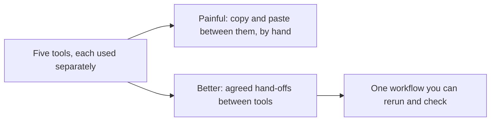
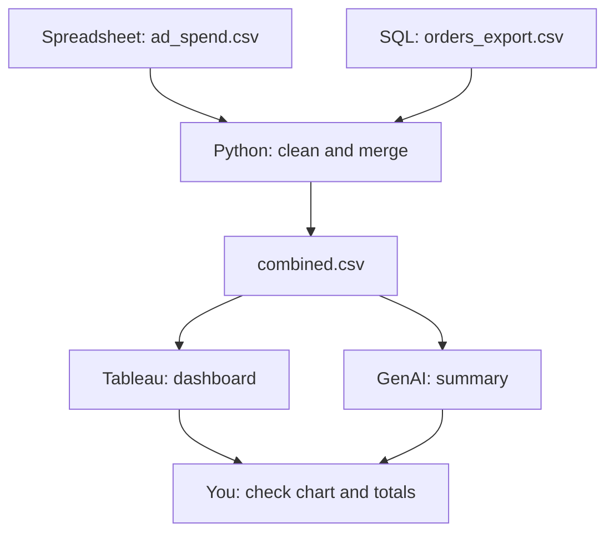

# Lecture Script: Connecting the Tools
**Session 17.1 · Module 4: GenAI for Analytics Workflows + Basic Python**
**Duration: 90 minutes · Audience: 40-60 learners · Prerequisite: pre-read; spreadsheets, SQL and Tableau from earlier in the programme; 13.1; 15.2 to 16.2**

---

## Timing table

| # | Block | Minutes | Running total |
|---|-------|---------|---------------|
| 1 | Opening hook | 5 | 5 |
| 2 | From Known to New | 7 | 12 |
| 3 | A. What each tool is best at | 10 | 22 |
| 4 | B. Combining outputs: the store example | 22 | 44 |
| 5 | C. Connecting tools: hand-offs and checks | 17 | 61 |
| 6 | D. Organising the workflow end to end | 12 | 73 |
| 7 | Live practice: assemble the workflow | 12 | 85 |
| 8 | Wrap-up and bridge | 5 | 90 |
| | **Total** | **90** | |

**Running example (same as pre-read):** SQL export `orders_export.csv` (the messy file from 16.1), spreadsheet `ad_spend.csv` (North 6, South 8, West 4, ₹ lakh), merged into `combined.csv`. After cleaning, units: North 9, South 3, West 7 (total 19); units per ₹ lakh: North 1.50, South 0.375, West 1.75.

**Setup:** have `orders_export.csv`, `ad_spend.csv` ready; a notebook; the Tableau workbook from earlier sessions available to connect to a CSV.

---

## Block 1 · Opening hook (5 min)

**Say:**
> "Think about how many tools you have learned in this programme. Spreadsheets, SQL, Tableau, Python, GenAI. Now think about your job: do you ever use just one?"

*(No.)*

> "So what is the real skill? Not knowing five tools. It is making five tools work like one. Because the mistakes do not happen *inside* the tools. They happen in the gaps between them."

**Transition:** "Remember the relay race?"

---

## Block 2 · From Known to New (7 min)

**Hook:**
> "From 12.3: each runner covers one leg, and the baton must pass cleanly. A dropped baton loses the race. Each tool is a runner. The baton is the file you hand over."



**Callback to 13.1 (1 min):** "Errors travel. At every hand-off, they can slip in. So at every hand-off, we check."

**Key line:** "The gaps between tools are where the mistakes live."

---

## Block 3 · A. What each tool is best at (10 min)

**Hook:**
> "A good mechanic does not hammer in a screw. Right tool for each job."

**Teach (6 min):** Table of tools and jobs with the store example. Ask the room to give an example of each from the programme.

**Discussion (3 min):** "Which tool would you use to compute efficiency for 300 regions every Monday?" *(Python.)* "To let a manager click through regions?" *(Tableau.)* "To store the marketing team's budget numbers?" *(Spreadsheet.)*

**Say (1 min):** "No tool wins. The skill is matching the step to the tool."

**🔴 Trap:** "Doing everything in the tool you like best is the most common mistake. If a step is a pain, it is probably the wrong tool."

**💬 Expect pushback:** *"Can't Python do everything?"*
> "Mostly yes. But a manager who wants to click a filter will not run your script. And marketing will not learn pandas to update a budget. Use tools where people actually are."

---

## Block 4 · B. Combining outputs: the store example (22 min)

**Hook:**
> "Let's actually connect them. Here is the scenario: orders are in a database, ad spend is in a marketing spreadsheet, and you must produce a regional comparison."

**Step 1, SQL (4 min):** Show the query and the exported CSV:
```sql
SELECT order_id, region, product, units, price
FROM orders;
```
"This export is the messy file from 16.1. SQL pulls; it does not clean."

**Step 2, spreadsheet (3 min):** Show `ad_spend.csv`. Point out ₹ lakh. "Agree the unit with marketing *now*, not after you merge."

**Step 3, Python (10 min):** Live code:
```python
import pandas as pd

orders = pd.read_csv("orders_export.csv")
orders = orders.drop_duplicates()
orders["region"] = orders["region"].str.strip().str.title()
orders = orders.dropna(subset=["units"])

units_by_region = orders.groupby("region")["units"].sum().reset_index()
ad_spend = pd.read_csv("ad_spend.csv")

combined = units_by_region.merge(ad_spend, on="region")
combined["units_per_lakh"] = combined["units"] / combined["ad_spend"]
combined.to_csv("combined.csv", index=False)
print(combined)
```
Run it. Expected: North 9/6 = 1.50, South 3/8 = 0.375, West 7/4 = 1.75.

**Break it on purpose (3 min):** Comment out the `str.strip().str.title()` line and rerun. Show that `"north "` fails to match, so the 4 units from order 105 drop out of the merge: North shows 5 instead of 9, and the total is 15 instead of 19. "No error. Just a wrong answer. This is the silent failure."

**Step 4 and 5 (2 min):** Show `combined.csv` connected to Tableau (bar chart by region), and mention sending it through the GenAI step from 15.1.

**Quick check (1 min):** "What is `on="region"` doing?" *(Matching rows by a shared key, like a JOIN or a lookup.)*

**🔴 Trap:** "A merge does not tell you what it could not match. Always count rows before and after."

**💬 Expect pushback:** *"Why not do the join in SQL?"*
> "You can. If the ad spend were in the database, you would. Here it lives in a spreadsheet outside the database, so Python is the natural meeting point. The principle: do each step where the data and the skills are."

---

## Block 5 · C. Connecting tools: hand-offs and checks (17 min)

**Hook:**
> "Ports work with ships, trains and trucks because everyone uses the same container. In data work, the standard container is the CSV."

**Teach (5 min):** What to agree: format, column names, key values, units, file names. Show the table.

**Common hand-off failures (5 min):** Names do not match; units differ (₹ vs ₹ lakh); date formats; stale files; hidden manual edits. Ask: "Which of these has bitten you?"

**Live checks (5 min):** In the notebook:
```python
print(len(units_by_region), len(ad_spend), len(combined))   # 3 3 3
print(combined["units"].sum())                               # 19
print(orders["units"].sum())                                 # 19
print(combined.isna().sum())                                 # no blanks
```
"Row count, totals, blanks. Three checks, thirty seconds."

**Quick check (2 min):** "If `combined` had 2 rows instead of 3, what happened?" *(A region failed to match in the merge.)*

**🔴 Trap:** "A dashboard built on last month's export looks perfect. Always show the data's date on the chart or in your notes."

**💬 Expect pushback:** *"This is a lot of checking."*
> "Thirty seconds of checks against a day of explaining a wrong dashboard. And it is code, so you write it once."

---

## Block 6 · D. Organising the workflow end to end (12 min)

**Hook:**
> "A recipe plus a tidy kitchen. Steps in order, and everything in its place."

**Teach (6 min):** Show the workflow table (step, tool, input, output, check), then the folder layout:

```
store_report/
    raw/          orders_export.csv, ad_spend.csv   (never edited)
    clean/        combined.csv
    outputs/      dashboard link, summary.txt, charts
    notes.md
```

**Say:** "Raw is sacred. Never edit it. If you want to change something, change it in code, so it is recorded."

**Notes file (3 min):** Write a sample line together: "Dropped 1 duplicate, dropped 1 order with no units, trimmed spaces in region." "That sentence is the difference between a result and a reproducible result."



**Quick check (3 min):** "Why keep a `raw` folder you never edit?" *(You can always rerun from the original.)*

**🔴 Trap:** "'I'll just fix that cell in the spreadsheet' is how hidden edits start. If it is not in the code or the notes, it did not happen, and nobody can find it later."

**💬 Expect pushback:** *"Writing notes feels like bureaucracy."*
> "It feels that way until someone asks 'why does this number differ from last month?' and you can answer in one minute."

---

## Block 7 · Live practice: assemble the workflow (12 min)

**Task (9 min):** In groups of 4, give them a new scenario on paper:
> "Customer complaints sit in a ticketing tool export (CSV). Product returns are in a spreadsheet. The manager wants a monthly dashboard and a short summary."

Each group fills in the workflow table: step, tool, input, output, check, and sketches the folder layout. Must include at least **two hand-off checks**.

**Debrief (3 min):** Two groups present. The room asks: "Where could a baton drop?"

**Say:** "You did not open any tool. Design first. Same lesson as 12.3, now with five tools."

---

## Block 8 · Wrap-up and bridge (5 min)

**Recap with the mental map open (2 min):**
- Each tool has a job.
- CSV as the standard container; agree names, keys, units.
- Clean the key before the merge.
- Check row counts and totals at every hand-off.
- Raw / clean / outputs / notes.

**One-line takeaway:**
> "Tools win as a team only if the baton passes cleanly: agreed files, matching keys, and a check at every hand-off."

**Bridge (1 min):**
> "Next session, 17.2, we run the whole thing from raw data to a final insight, use GenAI to document every step, and learn to communicate the result clearly."

**Closing prompt (2 min):** "Name two tools in your own work that you connect by copy-paste today. What would the agreed hand-off be?"

---

## Instructor quick-reference

- **Same numbers everywhere:** units North 9, South 3, West 7 (total 19); ad spend 6/8/4; units per ₹ lakh 1.50 / 0.375 / 1.75.
- **If long:** skip the Tableau mention and shorten Block 7 debrief.
- **If short:** add a second merge exercise with a mismatched key ("N" vs "North") to fix with `replace`.
- **Phrases to model:** "the gaps are where the mistakes live", "raw is sacred".
