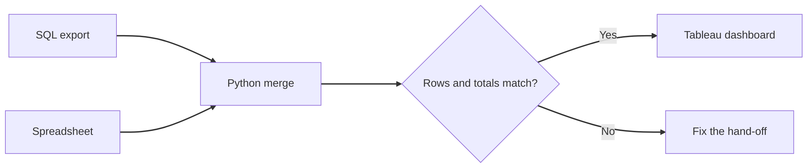

# Connecting the Tools
> Pre-Read — Academic Session 37 | Module 4: GenAI for Analytics Workflows + Basic Python
---

## Mental Map

```mermaid
%%{init: {'themeVariables': {'fontSize': '16px'}, 'flowchart': {'useMaxWidth': false, 'htmlLabels': true, 'nodeSpacing': 80, 'rankSpacing': 120, 'wrappingWidth': 620, 'padding': 20}}}%%
flowchart LR

START["<b>Course Start</b>"]

subgraph foundation[" WHERE WE ARE "]
direction LR
    CURMOD["<b>CURRENT MODULE</b><br/><i>Module 4: GenAI for Analytics Workflows + Basic Python</i><br/>&nbsp;<br/><b>Covered so far:</b> Getting Started with Python Data · Cleaning Data with Pandas · Visualizing Data with Python<br/>plus 8 earlier Module 4 sessions<br/>This is Session 37 of 41"]
    CURSES["<b>CURRENT SESSION</b><br/><b>Connecting the Tools</b><br/>&nbsp;<br/><i>The shift:</i> from <i>using each tool on its own</i> to <b>connecting spreadsheets, SQL, Tableau and Python into one organised workflow with a check at every hand-off</b><br/>&nbsp;<br/>Combining outputs from spreadsheets, SQL, Tableau and Python<br/>Connecting different tools into one workflow<br/>Organising analysis steps end to end"]
end

subgraph outcome[" OUTCOME OF THIS SESSION "]
direction LR
    OUT["<b>By the end, you can…</b><br/>&nbsp;<br/>Combine a SQL export and a spreadsheet of Kirana365 figures in Python,<br/>hand the result to a dashboard, and document the workflow<br/>with a check at every hand-off"]
end

subgraph value[" WHY IT MATTERS "]
direction LR
    CVAL["<b>Course Value</b><br/>This is the structure the end-to-end session follows from raw data to final insight"]
    RVAL["<b>Real-Life Value</b><br/>Replacing copy-and-paste between tools with a hand-off you can repeat and trust"]
end

subgraph future[" WHAT COMES NEXT "]
direction LR
    U0["<b>Next Session</b><br/>End-to-End Analytics Workflow<br/><i>Now we run one complete analysis from question to communicated insight</i>"]
    U1["<b>Later in Module 4</b><br/>Statistics: Distributions; Insights and Drawing Conclusions"]
    U2["<b>Upcoming</b><br/>Capstone Project<br/><i>Joining tools into one workflow is exactly how the capstone is assembled</i>"]
end

START ==>|" begin "| CURMOD
CURMOD ==>|" progress "| CURSES
CURSES ==>|" you get "| OUT
OUT ==>|" course "| CVAL
OUT ==>|" real life "| RVAL
CURSES ==>|" next up "| U0
U0 -.->|" then "| U1
U1 -.->|" ahead "| U2

classDef startBox fill:#F7FAFC,stroke:#4A5568,stroke-width:2px,color:#1A202C
classDef curModBox fill:#FFF8E6,stroke:#B7791F,stroke-width:2px,color:#1A202C
classDef curSessBox fill:#E6FFFA,stroke:#0D9488,stroke-width:3px,color:#1A202C
classDef outBox fill:#FEF2F2,stroke:#DC2626,stroke-width:3px,color:#1A202C
classDef valueBox fill:#F3E8FF,stroke:#7C3AED,stroke-width:2px,color:#1A202C
classDef futureBox fill:#ECFDF5,stroke:#047857,stroke-width:2px,color:#1A202C

class START startBox
class CURMOD curModBox
class CURSES curSessBox
class OUT outBox
class CVAL,RVAL valueBox
class U0,U1,U2 futureBox

linkStyle default stroke-width:2px
```

<div style="overflow-x: scroll; max-width: 100%; display: block;">



</div>

## What You'll Learn
In this pre-read, you'll discover:
- How to combine outputs from spreadsheets, SQL, Tableau and Python
- How to merge two tables on a shared key in pandas
- How to organise analysis steps end to end
- Why every hand-off between tools needs a check

## A. Combining Outputs from Spreadsheets, SQL, Tableau and Python

**💡 Analogy**: Think of a relay race. Each runner is good at their leg, but the race is won or lost at the baton hand-off. Tools are the runners, and the exported file is the baton.

**Each tool does what it is best at, and files such as CSV are how results pass from one to the next.**

**Worked example**:

| Tool | Best at | Hands over |
|---|---|---|
| SQL | Pulling the right rows from the database | A CSV export |
| Spreadsheet | Small inputs kept by hand, such as ad spend | A CSV or sheet |
| Python | Cleaning, merging, calculating | A clean table |
| Tableau | Interactive dashboards | A view for stakeholders |

**⚠️ Common trap**: Copy-pasting between tools. Pasted numbers cannot be repeated or traced, and they go wrong silently.

## B. Connecting Different Tools into One Workflow

**💡 Analogy**: Think of a zip fastener. Two sides line up on a shared tooth pattern. Two tables line up on a shared key such as city name.

**Merge tables in pandas with `merge`, joining on a column that exists in both.**

**Worked example**: SQL export gives units by city. A spreadsheet gives ad spend (₹ lakh) by city:

```python
sql = pd.DataFrame({"city": ["Pune", "Bengaluru", "Chennai"], "units": [5, 9, 6]})
sheet = pd.DataFrame({"city": ["Pune", "Bengaluru", "Chennai"], "ad_spend": [2, 3, 4]})

joined = sql.merge(sheet, on="city")
joined["units_per_lakh"] = joined["units"] / joined["ad_spend"]
```

| City | Units | Ad spend | Units per lakh |
|---|---|---|---|
| Pune | 5 | 2 | 2.5 |
| Bengaluru | 9 | 3 | 3.0 |
| Chennai | 6 | 4 | 1.5 |

Save it with `joined.to_csv("city_summary.csv", index=False)` and open that file in Tableau.

**⚠️ Common trap**: Merging on keys that do not match exactly. If one table says "Bengaluru" and the other "Bangalore", the row silently disappears from the result.

## C. Organising Analysis Steps End to End

**💡 Analogy**: Think of a kitchen layout with a station for each task and a path between them. Organising a workflow means naming the stations and the order, so anyone can cook the same dish.

**Write the workflow as numbered steps, each with its input, its output and the check that must pass before the next step.**

**Worked example**:

| Step | Tool | Check before moving on |
|---|---|---|
| 1. Pull units by city | SQL | 3 cities, total units = 20 |
| 2. Add ad spend | Spreadsheet | 3 cities, no blanks |
| 3. Merge | Python | 3 rows in, 3 rows out |
| 4. Calculate units per lakh | Python | Totals still 20 units |
| 5. Visualise | Tableau | Chart matches the table |

If the merge key were mistyped so Pune dropped to 3 units, the total would read 18 instead of 20. The total check catches this at step 4, not in front of leadership.

**⚠️ Common trap**: Checking only the final dashboard. Every hand-off is a place for numbers to be lost, so check each one.



## Quick Reference — Connecting Tools

| Your situation | Use this | Because |
|---|---|---|
| Two tables share a column | `a.merge(b, on="col")` | Combines them row by row |
| Passing results to another tool | Export a CSV, do not copy-paste | Repeatable and traceable |
| After every merge | Compare row counts and totals | Silent drops are the main risk |
| Planning the workflow | Step, tool, check, in a table | Anyone can rerun it |
| Handing to Tableau | `to_csv("file.csv", index=False)` | A clean file with no extra index column |

## Practice Exercises

1. **Pattern Recognition**: In the merge example, which column is the key, and what would go wrong if one table had "Bangalore"?

2. **Concept Detective**: Why is a copy-paste from SQL results into a spreadsheet risky in a repeated workflow?

3. **Real-Life Application**: Design a 4-step workflow that uses SQL, Python and Tableau to answer "which city turns ad spend into the most units?". Add a check to each step.

4. **Spot the Error**: A merged table has 2 rows where you expected 3. Which tool step would you inspect first?

5. **Planning Ahead**: Next session we run a complete analysis from question to insight. Which three tools from today's table would you use, and in what order?

> ✅ **You're done!** You can now combine tools into one workflow, merge tables on a shared key, and put a check at every hand-off.
Next session, we run a complete analysis in **End-to-End Analytics Workflow**.
