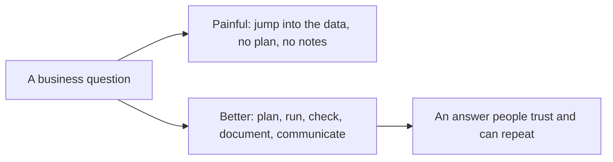
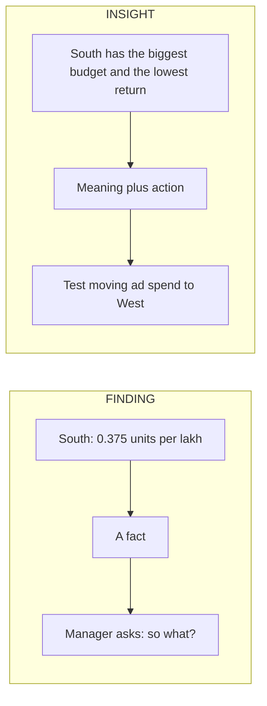

# Lecture Script: End-to-End Analytics Workflow
**Session 17.2 · Module 4: GenAI for Analytics Workflows + Basic Python**
**Duration: 90 minutes · Audience: 40-60 learners · Prerequisite: pre-read; 12.1 to 17.1**

---

## Timing table

| # | Block | Minutes | Running total |
|---|-------|---------|---------------|
| 1 | Opening hook | 5 | 5 |
| 2 | From Known to New | 5 | 10 |
| 3 | A1. Plan: define the question, design the workflow | 10 | 20 |
| 4 | A2. Run: collect, clean, combine, visualise | 20 | 40 |
| 5 | A3. Validate and interpret with limits | 10 | 50 |
| 6 | B. Using GenAI to document the analysis | 13 | 63 |
| 7 | C. Communicating the insight | 15 | 78 |
| 8 | Live practice: your own end-to-end mini case | 7 | 85 |
| 9 | Wrap-up and bridge | 5 | 90 |
| | **Total** | **90** | |

**Running example (same as pre-read):** question "where is ad spend working hardest?"; rows 7 → 6 → 5; units North 9, South 3, West 7 (total 19); ad spend 6/8/4 (₹ lakh); units per ₹ lakh 1.50 / 0.375 / 1.75.

**Setup:** notebook with `orders_export.csv` and `ad_spend.csv` loaded in the folder; a GenAI chat (or the 15.1 script) open; the same files as 17.1.

---

## Block 1 · Opening hook (5 min)

**Say:**
> "The sales manager walks up and says: 'Where is our ad spend working hardest? I need an answer by tomorrow.' Raise a hand if your first move would be opening the data."

*(Many hands.)*

> "That is the instinct, and it is the mistake. The first move is to ask: what exactly do you mean by 'working hardest', and what would a good answer look like? Today we do the whole thing, question to message, the way a professional would."

---

## Block 2 · From Known to New (5 min)

**Hook:**
> "A taxi. The passenger gives a destination. The driver plans the route, drives it, and the passenger cares that they arrive at the right place, and that the driver can explain the route if asked."



**Say:** "Finished means three things: it ran from start to end, it is documented, and it is communicated clearly."

---

## Block 3 · A1. Plan: define the question, design the workflow (10 min)

**Hook:**
> "Vague question in, vague answer out. First job: make it measurable."

**Teach (5 min):** Together, convert "working hardest" into "units sold per ₹ lakh of ad spend, by region." Write the desired output: a table, a chart, a recommendation.

**Callback to 12.3 (3 min):** Draw the workflow on the board, working backwards from the output: message ← chart and table ← combined data ← cleaned orders and ad spend ← raw exports. Then forward as steps.

**Quick check (2 min):** "Why units and not revenue?" *(Our extract is small and units are clean; but note it is a limit. A unit of Headphones is worth more than a Charger.)*

**🔴 Trap:** "Do not start cleaning until you know what the question needs. You will clean things that do not matter, and miss things that do."

**💬 Expect pushback:** *"Why not just start and see what the data says?"*
> "Exploring is fine. But if you cannot say what question you are answering, you will find 'insights' that answer nothing. Decide first, then explore around it."

---

## Block 4 · A2. Run: collect, clean, combine, visualise (20 min)

**Hook:**
> "Now we run it. Everything you have learned in the last five weeks, in one notebook."

**Live code (14 min), narrating each step and its purpose:**

```python
import pandas as pd
import matplotlib.pyplot as plt

orders = pd.read_csv("orders_export.csv")
print(orders.shape)                                   # (7, 5)

orders = orders.drop_duplicates()
print(orders.shape)                                   # (6, 5)

orders["region"] = orders["region"].str.strip().str.title()
orders = orders.dropna(subset=["units"])
print(orders.shape)                                   # (5, 5)

units_by_region = orders.groupby("region")["units"].sum().reset_index()
ad_spend = pd.read_csv("ad_spend.csv")
combined = units_by_region.merge(ad_spend, on="region")
combined["units_per_lakh"] = combined["units"] / combined["ad_spend"]
print(combined)

combined.plot(x="region", y="units_per_lakh", kind="bar",
              legend=False, title="Units sold per ₹ lakh of ad spend")
plt.ylabel("Units per ₹ lakh")
plt.savefig("efficiency.png")
plt.show()
```

**Point out (3 min):**
- Row counts printed at each step: 7 → 6 → 5.
- The missing **price** on order 106 is left alone. "We do not use price for this question. Clean what you need."
- The merge on `region` works only because we trimmed `"north "`. Callback to 17.1.

**Quick check (3 min):** "Which step would silently break the merge if we skipped it?" *(Trimming and title-casing region.)*

**🔴 Trap:** "Do not overwrite the raw files. We are cleaning in memory and writing outputs elsewhere."

**💬 Expect pushback:** *"Why leave the missing price? Shouldn't we fix everything?"*
> "Only what the question needs. Changing things you do not use adds risk and takes time. But you write down what you left alone, so nobody is surprised."

---

## Block 5 · A3. Validate and interpret with limits (10 min)

**Hook:**
> "The code ran. That does not mean the answer is right. Now we check it like we promised in 13.1."

**Run the checks live (4 min):**
```python
print(orders["units"].sum(), combined["units"].sum())     # 19 19
print(len(combined))                                      # 3
print(combined.isna().sum().sum())                        # 0
print(7 / 4)                                              # 1.75 -- West by hand
```

**Interpret (4 min):** Show the table. South has the biggest budget (8) and the fewest units per lakh (0.375). West the highest (1.75). Then ask: "What are we *not* entitled to say?"

Collect and board:
1. Tiny sample: 5 orders.
2. Units, not revenue.
3. Association, not cause (12.1). South may have a new store, a different season, a long-term brand campaign.

**Say (2 min):** "So the honest recommendation is a *test*: move a small amount of budget and measure."

**🔴 Trap:** "Do not hide the limits to look more confident. If the manager finds them later, you lose trust. If you state them up front, you gain it."

**💬 Expect pushback:** *"My manager wants a clear answer, not caveats."*
> "Give the clear answer *and* the caveat in one line. 'West and North look more efficient. Based on a small sample, so let's test.' Clear and honest."

---

## Block 6 · B. Using GenAI to document the analysis (13 min)

**Hook:**
> "A scientist keeps a lab notebook so someone else can repeat the experiment. Your documentation is your lab notebook. Nobody likes writing it, and GenAI is good at it, if you feed it the facts."

**Teach (3 min):** Show the sections: Purpose, Data sources, Steps, Decisions, Assumptions and limits, How to rerun.

**Live demo (6 min):** Paste the code, the row counts and the decisions into GenAI with the prompt from the pre-read: "Use ONLY what is in the material below. If something is unclear, list it as a question instead of guessing."

Read the output aloud. Then **check it** live:
- Does every listed step match a line of code?
- Do the counts match (7 → 6 → 5)?
- Did it claim any check we did not run?
- Did it state the small sample?

**Say:** "If GenAI writes 'validated against the source database' and we never did that, that is a false statement in our documentation. We edit it out."

**Quick check (2 min):** "What did we tell GenAI that stops it inventing?" *(Gave it code and counts; told it to use only that material.)*

**Save (2 min):** Put the checked text in `notes.md` in the folder structure from 17.1.

**🔴 Trap:** "GenAI documentation reads smoothly, which makes false lines hard to spot. Read it against your code, line by line."

**💬 Expect pushback:** *"Why not write the notes myself?"*
> "You can. But writing from scratch takes thirty minutes and many people skip it. A checked GenAI draft takes five. Documentation that exists beats perfect documentation that does not."

---

## Block 7 · C. Communicating the insight (15 min)

**Hook:**
> "Weather report. 'Humidity 85%, pressure falling' is data. 'Carry an umbrella' is the insight. Your manager wants the umbrella."

**Teach (4 min):** Finding vs insight (contrast diagram). Then the four-part structure: headline, evidence, limits, next step.



**Live demo (6 min):** Ask GenAI for the manager message:
> "You are a business analyst. Write a short message for a sales manager (non-technical), under 120 words, in this order: headline, evidence, limits, next step. Use only the table below. Do not claim that ad spend caused sales."

Show the output and check it:
- Every number matches? Recalculate one.
- Any "caused", "proved", "because"? Replace with "is associated with".
- Limits honest?
- Does the manager know what to do next?

**Say (2 min):** "Answer first. If they only read two lines, they must still get it."

**Activity (3 min):** In pairs, rewrite this weak message: "Please find attached the analysis of regional ad performance. Several observations were made." Aim for a headline plus one number.

**🔴 Trap:** "Do not bury the answer in the last paragraph. Nobody reads that far."

**💬 Expect pushback:** *"Won't GenAI's draft sound generic?"*
> "It can. Give it the audience, the length and the order, and then edit it so it sounds like you. You own the message."

---

## Block 8 · Live practice: your own end-to-end mini case (7 min)

**Task (5 min):** In groups, give a one-paragraph case (prepared in advance), for example: "Return rates by product category from a CSV, with a spreadsheet of supplier names." Each group writes on paper:
1. The measurable version of the question.
2. The workflow in five steps, with tools.
3. Two validation checks.
4. A one-line headline and next step.

**Debrief (2 min):** Two groups read their headline aloud. The room judges: "Answer first? Clear next step?"

---

## Block 9 · Wrap-up and bridge (5 min)

**Recap with the mental map open (2 min):**
- Make the question measurable; clean only what is needed.
- Validate at every step; interpret with limits.
- Document with GenAI using your code and counts; check it.
- Communicate: headline, evidence, limits, next step.

**One-line takeaway:**
> "Finish the job: run it end to end, write down what you did, and say the answer first."

**Bridge (1 min):**
> "Today we computed efficiency and compared regions using totals. But when numbers are lumpy, a few huge values can make an average lie. Next session, 17.3, you will learn how the *shape* of data changes what it means, and how to draw fair conclusions instead of guessing."

**Closing prompt (2 min):** "Write the first two lines of the message you would send for your own last analysis. Does the answer appear in them?"

---

## Instructor quick-reference

- **Same numbers everywhere:** rows 7 → 6 → 5; units 9/3/7 (total 19); ad spend 6/8/4; 1.50 / 0.375 / 1.75; West by hand 7 ÷ 4 = 1.75.
- **If long:** run Block 4 from a pre-written notebook and skip the validation prints.
- **If short:** have learners write a short README for the notebook in Block 6.
- **Phrases to model:** "clean only what the question needs", "answer first", "use only what is in the material".
