# End-to-End Analytics Workflow
> Pre-Read — Academic Session 38 | Module 4: GenAI for Analytics Workflows + Basic Python
---

## Mental Map

```mermaid
%%{init: {'themeVariables': {'fontSize': '16px'}, 'flowchart': {'useMaxWidth': false, 'htmlLabels': true, 'nodeSpacing': 80, 'rankSpacing': 120, 'wrappingWidth': 620, 'padding': 20}}}%%
flowchart LR

START["<b>Course Start</b>"]

subgraph foundation[" WHERE WE ARE "]
direction LR
    CURMOD["<b>CURRENT MODULE</b><br/><i>Module 4: GenAI for Analytics Workflows + Basic Python</i><br/>&nbsp;<br/><b>Covered so far:</b> Cleaning Data with Pandas · Visualizing Data with Python · Connecting the Tools<br/>plus 9 earlier Module 4 sessions<br/>This is Session 38 of 41"]
    CURSES["<b>CURRENT SESSION</b><br/><b>End-to-End Analytics Workflow</b><br/>&nbsp;<br/><i>The shift:</i> from <i>separate skills practised one at a time</i> to <b>one complete analysis, from a business question to a documented and clearly communicated insight</b><br/>&nbsp;<br/>Demonstrating a complete analytics workflow<br/>Using GenAI to document analysis steps<br/>Generating and communicating final insights clearly"]
end

subgraph outcome[" OUTCOME OF THIS SESSION "]
direction LR
    OUT["<b>By the end, you can…</b><br/>&nbsp;<br/>Run a Kirana365 analysis end to end, document it with GenAI using your own code and counts,<br/>and write a message that gives the answer first,<br/>with its limits and a next step"]
end

subgraph value[" WHY IT MATTERS "]
direction LR
    CVAL["<b>Course Value</b><br/>This brings together everything in Module 4 and is the pattern the capstone follows"]
    RVAL["<b>Real-Life Value</b><br/>Handing a manager a result they can trust, repeat and act on the same day"]
end

subgraph future[" WHAT COMES NEXT "]
direction LR
    U0["<b>Next Session</b><br/>Statistics: Distributions; Insights and Drawing Conclusions<br/><i>Now we learn to read the shape of data and to conclude only what the evidence supports</i>"]
    U2["<b>Upcoming</b><br/>Capstone Project<br/><i>You will repeat this whole workflow on your own data in the capstone</i>"]
end

START ==>|" begin "| CURMOD
CURMOD ==>|" progress "| CURSES
CURSES ==>|" you get "| OUT
OUT ==>|" course "| CVAL
OUT ==>|" real life "| RVAL
CURSES ==>|" next up "| U0
U0 -.->|" ahead "| U2

classDef startBox fill:#F7FAFC,stroke:#4A5568,stroke-width:2px,color:#1A202C
classDef curModBox fill:#FFF8E6,stroke:#B7791F,stroke-width:2px,color:#1A202C
classDef curSessBox fill:#E6FFFA,stroke:#0D9488,stroke-width:3px,color:#1A202C
classDef outBox fill:#FEF2F2,stroke:#DC2626,stroke-width:3px,color:#1A202C
classDef valueBox fill:#F3E8FF,stroke:#7C3AED,stroke-width:2px,color:#1A202C
classDef futureBox fill:#ECFDF5,stroke:#047857,stroke-width:2px,color:#1A202C

class START startBox
class CURMOD curModBox
class CURSES curSessBox
class OUT outBox
class CVAL,RVAL valueBox
class U0,U2 futureBox

linkStyle default stroke-width:2px
```

<div style="overflow-x: scroll; max-width: 100%; display: block;">



</div>

## What You'll Learn
In this pre-read, you'll discover:
- How a full analysis runs from business question to communicated insight
- How to use GenAI to document your analysis steps without letting it invent them
- How to write a final message that gives the answer first, with limits and a next step
- How to see which earlier skill each part of the workflow uses

## A. A Complete Analytics Workflow

**💡 Analogy**: Think of cooking a full meal rather than practising chopping, boiling and frying separately. The skills are the same, but now they have to come together in the right order.

**An end-to-end workflow is: question, data, clean, combine, analyse, chart, document, communicate, with a check between steps.**

**Worked example**: Question: *"Is our ad spend paying off equally in Pune, Bengaluru and Chennai?"*

| Step | What happens | Skill from |
|---|---|---|
| 1. Clarify | Sharpen to: units per lakh of ad spend, by city, this month | 12.3 |
| 2. Load | Read the messy orders file (7 rows) | 15.2 |
| 3. Clean | Remove duplicates, fix text, handle blanks (7 rows become 5, 20 units) | 16.1 |
| 4. Combine | Merge with the spreadsheet of ad spend | 17.1 |
| 5. Analyse | Pune 5 units on 2 lakh, Bengaluru 9 on 3, Chennai 6 on 4 | 13.2 to 14.2 |
| 6. Chart | Bar chart of units per lakh | 16.2 |

Result: Bengaluru 3.0, Pune 2.5, Chennai 1.5 units per lakh.

**⚠️ Common trap**: Jumping to the chart. If steps 2 to 4 are not checked, the chart is a nicely drawn wrong answer.

```mermaid
%%{init: {'themeVariables': {'fontSize': '16px'}, 'flowchart': {'useMaxWidth': false, 'htmlLabels': true, 'nodeSpacing': 80, 'rankSpacing': 120, 'wrappingWidth': 620, 'padding': 20}}}%%
flowchart LR
    A[Question] --> B[Load]
    B --> C[Clean]
    C --> D[Combine]
    D --> E[Analyse]
    E --> F[Chart]
    F --> G[Document]
    G --> H[Communicate]

linkStyle default stroke-width:2px
```



## B. Using GenAI to Document Analysis Steps

**💡 Analogy**: Think of a lab notebook. A scientist writes down exactly what was done so someone else can repeat it. GenAI can help you write that notebook, but only from what you actually did.

**Give GenAI your own code and your own counts, and ask it to describe the steps in plain language; do not ask it to guess what you did.**

**Worked example**: Prompt:

```
Here is my code and the row counts at each step (7 rows loaded, 1 duplicate
removed, 1 row dropped for missing units, 5 rows left, 20 units total).
Write a short numbered methods note a colleague could follow.
Use only the code and counts I have given you.
[code and counts pasted here]
```

Then check the note: every count in it must match yours.

**⚠️ Common trap**: Asking "document my analysis" with nothing pasted. GenAI will invent plausible steps that you never ran, and the note will look authoritative.

## C. Generating and Communicating Final Insights

**💡 Analogy**: Think of a doctor's summary to a patient. The first thing you hear is the result, in plain words, followed by how sure the doctor is and what to do next.

**Lead with the answer, then give the number, the limit and a next step.**

**Worked example**: Final message:

> **Bengaluru is getting the most from its ad spend: 3.0 units per ₹ lakh, against 2.5 in Pune and 1.5 in Chennai.** Chennai gets half Bengaluru's return. This uses one month and 20 units, so treat it as a direction, not proof. Next step: repeat for the last three months before moving budget.

Compare with a weaker version: a long paragraph that describes the method first and hides the answer in the fourth sentence.

**⚠️ Common trap**: Claiming too much. One month of data cannot show that Chennai's ads "don't work". Say what the data shows and what it cannot show.

## Quick Reference — Running an End-to-End Analysis

| Your situation | Use this | Because |
|---|---|---|
| You get a vague business question | Sharpen it into a precise, measurable one | Everything else depends on it |
| Messy data arrives | Load, inspect, clean, and log row counts | The log is your evidence |
| Combining sources | Merge on a key, then check totals | Silent drops hide here |
| Writing the methods note with GenAI | Paste your code and counts, say "use only these" | Prevents invented steps |
| Reporting the result | Answer first, then limits, then next step | A manager reads the first line |

## Practice Exercises

1. **Pattern Recognition**: In the six-step table, which step produces the numbers 5, 9 and 6, and which step would catch a dropped Pune row?

2. **Concept Detective**: Why must the cleaning log (7 rows to 5, 20 units) exist before GenAI writes the methods note?

3. **Real-Life Application**: Rewrite this message so the answer comes first: "We loaded the data, cleaned it, merged it with ad spend and then found that Bengaluru does best."

4. **Spot the Error**: A colleague's final note says "Chennai's ads are not working". Using only the data above, what is a fairer way to say it?

5. **Planning Ahead**: Next session ends Module 4 with statistics on distributions. If order values include one very large order, what do you think could go wrong with reporting only the average?

> ✅ **You're done!** You can now run a Kirana365 analysis from question to insight, document it honestly with GenAI, and write a message that gives the answer first with its limits.
Next session, we finish Module 4 with **Statistics: Distributions; Insights and Drawing Conclusions**, learning to read the shape of data and conclude only what it supports.
