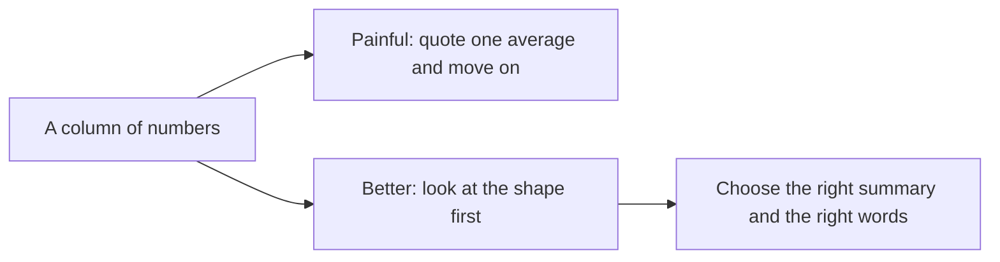
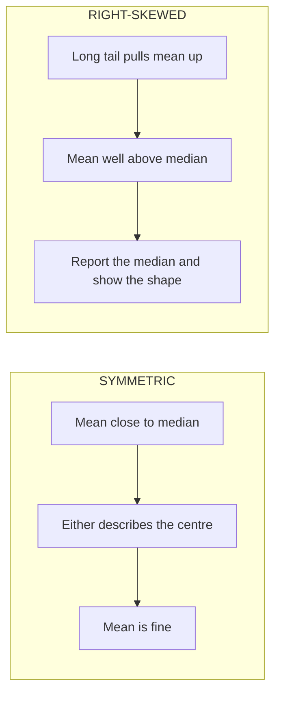

# Lecture Script: Statistics — Distributions, Insights and Drawing Conclusions
**Session 17.3 · Module 4: GenAI for Analytics Workflows + Basic Python**
**Duration: 90 minutes · Audience: 40-60 learners · Prerequisite: pre-read; 12.1 (correlation, causation), 16.2 (histograms and plotting)**

---

## Timing table

| # | Block | Minutes | Running total |
|---|-------|---------|---------------|
| 1 | Opening hook | 5 | 5 |
| 2 | From Known to New | 7 | 12 |
| 3 | A. What distributions are, and shapes | 15 | 27 |
| 4 | B. Skew and misleading averages | 20 | 47 |
| 5 | C. Reading histograms | 18 | 65 |
| 6 | D. Drawing fair conclusions | 15 | 80 |
| 7 | Live practice: rewrite the claims | 5 | 85 |
| 8 | Wrap-up and close of Module 4 | 5 | 90 |
| | **Total** | **90** | |

**Running examples (same as pre-read):**
- Order values (₹): 400, 450, 500, 500, 550, 600, 650, 700, 800, 850, 9,000. Mean ≈ 1,364; median 600; mode 500; without 9,000: mean 600, median 575.
- Delivery days: 1, 1, 2, 2, 2, 2, 3, 3, 8, 9, 9, 10, 10. Mean ≈ 4.8; median 3; mode 2.

**Setup:** notebook open; both lists pasted into cells; `matplotlib` and `statistics` ready. Prepare the two histograms in advance as a backup.

---

## Block 1 · Opening hook (5 min)

**Say:**
> "A company announces: 'Average salary here is ₹16 lakh a year!' Raise your hand if you want to apply."

*(Hands.)*

> "Now suppose I tell you ten people earn ₹6 lakh and the founder earns ₹120 lakh. What is the average?" *(Let them compute: (60 + 120) ÷ 11 ≈ 16.4.)* "Does a typical employee earn 16 lakh? No. Typical is 6."

> "Same company, same data, two very different stories. Today we learn to tell which story the numbers are actually telling."

---

## Block 2 · From Known to New (7 min)

**Hook:**
> "A café. Ten friends, each earning about ₹40,000 a month. The average is about ₹40,000. A billionaire walks in. The average jumps to crores. Did anyone get richer? No. The number moved. It stopped describing anyone."



**Callback to 17.2 (2 min):** "Last time we wrote a message with numbers in it. Today we ask: are those numbers the *right* numbers?"

**Key line:** "One number can describe nobody."

---

## Block 3 · A. What distributions are, and shapes (15 min)

**Hook:**
> "A railway platform crowd. 'Average height 1.65 m' does not tell you if everyone is about that, or if it is children and adults. The picture of the crowd tells you more."

**Teach (6 min):** A distribution = how values of one variable are spread. Three features: centre, spread, shape.

**Shapes (6 min):** Draw four sketches on the board: symmetric bell, right-skewed, left-skewed, two peaks. For each, ask the room for a business example before giving yours:
- Symmetric: heights, measurement errors.
- Right-skewed: order values, incomes, house prices.
- Left-skewed: marks on an easy exam.
- Two peaks: delivery times, local vs outstation.

**Quick check (3 min):** "Customer waiting times at a call centre: most calls answered in 1 minute, but a few wait 30. What shape?" *(Right-skewed.)*

**🔴 Trap:** "Do not assume data is bell-shaped. Many business variables are not. The default assumption in textbooks is a poor guide to real orders."

**💬 Expect pushback:** *"Sir, we learned the normal distribution. Isn't everything normal?"*
> "Many things are close, but money and time are often right-skewed. Always look before assuming."

---

## Block 4 · B. Skew and misleading averages (20 min)

**Hook:**
> "A see-saw. The median balances by *position*. The mean balances by *weight*. One heavy person at the far end tilts the whole thing."

**Live code (8 min):**
```python
import statistics as st

order_values = [400, 450, 500, 500, 550, 600, 650, 700, 800, 850, 9000]

print(st.mean(order_values))      # about 1363.6
print(st.median(order_values))    # 600
print(st.mode(order_values))      # 500
```

Ask: "Which of these would you put in a report as the 'typical order'?"

Then:
```python
without_big = [v for v in order_values if v != 9000]
print(st.mean(without_big))       # 600
print(st.median(without_big))     # 575
```
**Say:** "One order changed the mean from ₹600 to ₹1,364. It barely moved the median."

**Teach (4 min):** Rule of thumb: symmetric → mean and median close, either fine. Right-skewed → mean above median, report the median. "If the mean is far above the median, ring an alarm."



**Second example, the median is not enough (5 min):**
```python
delivery_days = [1, 1, 2, 2, 2, 2, 3, 3, 8, 9, 9, 10, 10]
print(st.mean(delivery_days))     # about 4.77
print(st.median(delivery_days))   # 3
```
**Ask:** "Did any order take about 5 days?" *(None.)* "So what does 4.8 describe?" *(Nothing. A shape with two groups.)*

**Quick check (3 min):** "In a right-skewed distribution, is mean above or below median?" *(Above.)*

**🔴 Trap:** "Reporting the median does not make you safe. The median of the delivery data is 3 days, which describes the local group but hides the outstation customers waiting 8 to 10. Show the shape."

**💬 Expect pushback:** *"So is the mean always wrong?"*
> "No. For symmetric data it is perfectly good, and for totals it is essential: total revenue needs a sum, which is the mean times the count. The mean is wrong as a *description of the typical case* when data is skewed."

**Callback to 12.2 (included in demo):** "If you ask GenAI for 'average order value', it will give you the mean. You now know to ask for the median and the shape."

**Transition:** "How do we *see* the shape? A histogram."

---

## Block 5 · C. Reading histograms (18 min)

**Hook:**
> "Sort coins into trays: ₹0 to 999, ₹1,000 to 1,999, and so on. The number of coins in each tray is the bar."

**Live code (7 min):**
```python
import matplotlib.pyplot as plt

plt.hist(order_values, bins=range(0, 11000, 1000))
plt.title("Order values")
plt.xlabel("Order value (₹)")
plt.ylabel("Number of orders")
plt.show()
```
Read it together: one huge bar on the left (10 orders under ₹1,000), one lonely bar far to the right.

Then:
```python
plt.hist(delivery_days, bins=[0, 2, 4, 6, 8, 10, 12])
plt.title("Delivery time")
plt.xlabel("Days")
plt.ylabel("Number of orders")
plt.show()
```
Expected counts: 2, 6, 0, 0, 3, 2. "Two peaks, with a gap."

**Teach what to look for (4 min):** Clusters, shape, gaps, unusual values, change over time (compare this month's histogram with last month's).

**Bins demo (3 min):** Re-draw the delivery histogram with `bins=3`, then `bins=20`. "Too few and the gap disappears. Too many and it looks jagged. Always try more than one."

**Unusual values (4 min):** Ask: "What do we do with the ₹9,000 order?" Take answers, then show three questions: Error? Real but rare? Telling us something? "Never delete it just because it is awkward. Investigate, and say what you did."

**Quick check (1 min):** "A gap in a histogram means…?" *(Possibly two separate groups, or missing data.)*

**🔴 Trap:** "Do not choose bins until the chart looks the way you want. That is cherry-picking the picture. Try a few and report what is stable across them."

**💬 Expect pushback:** *"Can't I just use `describe()`?"*
> "`describe()` gives numbers: mean, median (the 50% row), min, max. It will not show a gap or two peaks. Numbers and picture together."

---

## Block 6 · D. Drawing fair conclusions (15 min)

**Hook:**
> "A conclusion is a statement the data supports. A guess goes beyond it. Most bad decisions are guesses that sounded like conclusions."

**Teach the ladder (4 min):** Shows, suggests, does not tell us. Use the order value example:
- Shows: "The median order in this sample was ₹600."
- Suggests: "Most customers appear to spend under ₹1,000."
- Does not tell us: "Eleven orders cannot speak for all customers."

**Teach the checklist (5 min):** Put the table on screen: how much data; representative; shape not just average; unusual values explained; like with like; confounders; causation; cherry-picking; what would change my mind.

**Say:** "'What would change my mind?' If nothing could, it is a belief, not a conclusion."

**Callback to 12.1 (2 min):** "Last page of the ladder is the same lesson as correlation: the data says what it says, and no more."

**Fair language (3 min):** Show over-claiming vs fair side by side:
- "Average order value is ₹1,364." → "The median order was ₹600; one large order lifted the mean to ₹1,364."
- "Delivery takes 4.8 days." → "Local orders arrive in 1 to 3 days; outstation orders in 8 to 10."

**Say:** "Notice the fair versions are not weaker. They are more useful, because they tell the reader what to do next."

**Quick check (1 min):** "Is 'ads work in West' a conclusion or a guess from our data?" *(A guess. The data suggests West showed the most units per ₹ lakh in a small sample; worth testing.)*

**🔴 Trap:** "Using the biggest number because it makes your result look impressive is not analysis. It is advertising."

**💬 Expect pushback:** *"If I add all these caveats, nobody will listen."*
> "One line of limits does not weaken a message. 'Based on 11 orders, so a hint rather than proof' makes people trust the rest of it."

---

## Block 7 · Live practice: rewrite the claims (5 min)

**Task (4 min):** On screen, show three weak claims. In pairs, rewrite each fairly:
1. "Average delivery time is 4.8 days, so customers wait about 5 days."
2. "Average order value is ₹1,364, so we should price our accessories around that."
3. "Customers who got 1 to 3 day delivery gave better ratings, so fast delivery causes happier customers."

**Expected ideas:** (1) two groups, 1-3 and 8-10 days. (2) median ₹600, one large order, price to typical customers, check the large order. (3) association, not cause; local customers may differ in other ways; test.

**Debrief (1 min):** One pair reads their best rewrite.

---

## Block 8 · Wrap-up and close of Module 4 (5 min)

**Recap with the mental map open (2 min):**
- Distribution: centre, spread, shape.
- Skew pulls the mean; use the median and show the shape.
- Read histograms: clusters, gaps, outliers; try different bins.
- Fair conclusions: show, suggest, limits.

**One-line takeaway:**
> "One number can describe nobody. Look at the shape, then claim only what the evidence supports."

**Close the module (2 min):**
> "This is the last session listed for Module 4. Look at what you can do now: break a problem into steps, run it with GenAI and Python, check every hand-off, document it, and say the answer first. And today's lesson sits on top of all of it: say only what the evidence supports."

**Closing prompt (1 min):** "Pick one number from a report you read this week. What shape do you think hides behind it?"

---

## Instructor quick-reference

- **Same numbers everywhere:** order values mean ≈ 1,364, median 600, mode 500; without 9,000 mean 600, median 575. Delivery days mean ≈ 4.8, median 3, mode 2; histogram counts 2, 6, 0, 0, 3, 2.
- **If long:** drop the bins demo and shorten Block 7 to two claims.
- **If short:** add `df.describe()` on a DataFrame of the order values and compare 50% with mean.
- **Phrases to model:** "show the shape", "what would change my mind?", "a hint rather than proof".
