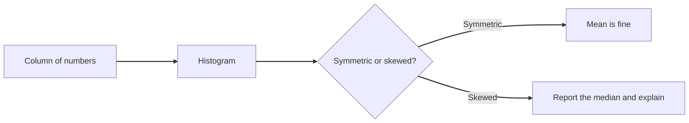

# Statistics: Distributions, Insights and Drawing Conclusions
> Pre-Read — Academic Session 39 | Module 4: GenAI for Analytics Workflows + Basic Python
---

## Mental Map

```mermaid
%%{init: {'themeVariables': {'fontSize': '16px'}, 'flowchart': {'useMaxWidth': false, 'htmlLabels': true, 'nodeSpacing': 80, 'rankSpacing': 120, 'wrappingWidth': 620, 'padding': 20}}}%%
flowchart LR

START["<b>Course Start</b>"]

subgraph foundation[" WHERE WE ARE "]
direction LR
    CURMOD["<b>CURRENT MODULE</b><br/><i>Module 4: GenAI for Analytics Workflows + Basic Python</i><br/>&nbsp;<br/><b>Covered so far:</b> Visualizing Data with Python · Connecting the Tools · End-to-End Analytics Workflow<br/>plus 10 earlier Module 4 sessions<br/>This is Session 39 of 41"]
    CURSES["<b>CURRENT SESSION</b><br/><b>Statistics: Distributions; Insights and Drawing Conclusions</b><br/>&nbsp;<br/><i>The shift:</i> from <i>quoting a single average</i> to <b>reading the shape of the data and drawing only the conclusions the evidence supports</b><br/>&nbsp;<br/>What data distributions are and why shape matters<br/>Skewed data and misleading averages · Reading histograms<br/>Drawing fair conclusions instead of guessing"]
end

subgraph outcome[" OUTCOME OF THIS SESSION "]
direction LR
    OUT["<b>By the end, you can…</b><br/>&nbsp;<br/>Read a histogram of Kirana365 figures, say when the mean misleads and the median is safer,<br/>and word a conclusion that stays within the evidence"]
end

subgraph value[" WHY IT MATTERS "]
direction LR
    CVAL["<b>Course Value</b><br/>Fair conclusions are the standard every analysis in the capstone is judged by"]
    RVAL["<b>Real-Life Value</b><br/>Not building a pricing or staffing decision on an average that describes almost nobody"]
end

subgraph future[" WHAT COMES NEXT "]
direction LR
    U0["<b>Next Session</b><br/>Capstone Project<br/><i>Module 4 ends here; the capstone puts the whole module to work</i>"]
end

START ==>|" begin "| CURMOD
CURMOD ==>|" progress "| CURSES
CURSES ==>|" you get "| OUT
OUT ==>|" course "| CVAL
OUT ==>|" real life "| RVAL
CURSES ==>|" next up "| U0

classDef startBox fill:#F7FAFC,stroke:#4A5568,stroke-width:2px,color:#1A202C
classDef curModBox fill:#FFF8E6,stroke:#B7791F,stroke-width:2px,color:#1A202C
classDef curSessBox fill:#E6FFFA,stroke:#0D9488,stroke-width:3px,color:#1A202C
classDef outBox fill:#FEF2F2,stroke:#DC2626,stroke-width:3px,color:#1A202C
classDef valueBox fill:#F3E8FF,stroke:#7C3AED,stroke-width:2px,color:#1A202C
classDef futureBox fill:#ECFDF5,stroke:#047857,stroke-width:2px,color:#1A202C

class START startBox
class CURMOD curModBox
class CURSES curSessBox
class OUT outBox
class CVAL,RVAL valueBox
class U0 futureBox

linkStyle default stroke-width:2px
```

<div style="overflow-x: scroll; max-width: 100%; display: block;">



</div>

## What You'll Learn
In this pre-read, you'll discover:
- What a distribution is and why its shape matters
- How skewed data makes an average misleading
- How to read a histogram
- How to word a conclusion that stays within the evidence

## A. What Distributions Are and Why Shape Matters

**💡 Analogy**: Think of the heights in a classroom. Knowing the average height tells you little until you see whether most children are near it, or whether there is a group of tall and a group of short children.

**A distribution shows how the values of a variable are spread out, and the shape tells you what the average can and cannot say.**

**Worked example**: Kirana365 has 11 order values (₹): 400, 450, 500, 500, 550, 600, 650, 700, 800, 850 and one large corporate order of 9,000. Ten of the eleven are between 400 and 850. The average, about ₹1,364, describes none of them.

**⚠️ Common trap**: Quoting one number for a whole dataset. A single average hides spread, clusters and outliers.

## B. Skewed Data and Misleading Averages

**💡 Analogy**: Think of a cricket team's batting averages when one player scores a double century. The team average jumps, but most players did not suddenly improve.

**In skewed data a few extreme values pull the mean away from the typical value, so the median is the safer centre.**

**Worked example**: Order values: mean ≈ ₹1,364, median ₹600. The median is the middle value when sorted, and one large order barely moves it.

Delivery days for 13 orders: 1, 1, 2, 2, 2, 2, 3, 3, 8, 9, 9, 10, 10. Mean 4.8, median 3. Two groups exist (fast deliveries and a slow cluster), and "about 4.8 days" describes almost nobody.

```python
import statistics as st
values = [400, 450, 500, 500, 550, 600, 650, 700, 800, 850, 9000]
print(round(st.mean(values)))   # 1364
print(st.median(values))        # 600
```

**⚠️ Common trap**: Defaulting to the mean. When the mean and the median are far apart, the data is skewed, and you should report the median or both and say why.

## C. Reading Histograms

**💡 Analogy**: Think of sorting coins into jars by value and looking at how high each jar fills. A histogram is that row of jars for a number column.

**A histogram groups values into bins and draws a bar for how many fall in each, which makes the shape visible.**

**Worked example**:

```python
import matplotlib.pyplot as plt
plt.hist(values, bins=range(0, 11000, 1000))
plt.title("Order values")
plt.xlabel("Order value (₹)")
plt.ylabel("Number of orders")
plt.show()
```

Ten orders fall in the ₹0 to 1,000 bar and one lies alone in the ₹9,000 to 10,000 bar. A tall cluster with one isolated bar far to the right is a typical skewed picture. Always look at the shape before you trust the mean.

**⚠️ Common trap**: Reading a histogram like a bar chart of categories. The x-axis is a number line, and changing the bin size changes the picture, so try a couple of bin widths.



## D. Drawing Fair Conclusions Instead of Guessing

**💡 Analogy**: Think of a judge. A judge rules on the evidence in the courtroom, not on a hunch about what probably happened elsewhere.

**A fair conclusion says only what the data supports, names how much data it rests on, and avoids words like "proves" and "always".**

**Worked example**:

| Overreach | Fair version |
|---|---|
| "Our average order is ₹1,364" | "Typical orders are about ₹600; one ₹9,000 order lifts the average" |
| "Delivery takes 4.8 days" | "Most orders arrive within 3 days; 5 of 13 take 8 to 10 days" |
| "Ads caused the rise in orders" | "Orders and ad spend moved together; cause is untested" |

From 11 or 13 orders you can describe what you saw. You cannot confidently predict next month.

**⚠️ Common trap**: Guessing beyond the data. A small sample describes itself, and the conclusion should say how many cases it rests on.

## Quick Reference — Reading Shape and Concluding Fairly

| Your situation | Use this | Because |
|---|---|---|
| You want to understand a number column | Draw a histogram first | Shape tells you which summary to trust |
| Mean and median are far apart | Data is skewed; report the median | Extreme values pull the mean |
| One value far from the rest | Check it, then report with and without it | It may be real or an error |
| Writing a conclusion | State the evidence and the sample size | Keeps claims within the data |
| Tempted to write "proves" or "always" | Use "suggests" or "in this sample" | Data rarely proves |

## Practice Exercises

1. **Pattern Recognition**: For order values 400 to 850 plus one 9,000 order, which is closer to a typical order, the mean or the median?

2. **Concept Detective**: In the delivery days data, mean is 4.8 and median is 3. What does the histogram probably look like, and why is "4.8 days" misleading?

3. **Real-Life Application**: Name one Kirana365 variable you would expect to be skewed and one you would expect to be roughly symmetric.

4. **Spot the Error**: Spot the overreach: "Pune customers always prefer Charger over Headphones, as shown by 5 orders." Rewrite it fairly.

5. **Planning Ahead**: Module 4 ends here and the Capstone follows. Which skill from this module (workflow, Python, cleaning, charts, statistics) do you feel least sure about, and what will you revisit?

> ✅ **You're done!** You can now read the shape of Kirana365 data, say when the mean misleads and the median is safer, and word a conclusion that stays within the evidence.
Next session, the Capstone Project puts the whole of Module 4 to work, from question and clean data through to a clearly worded, fair conclusion.
