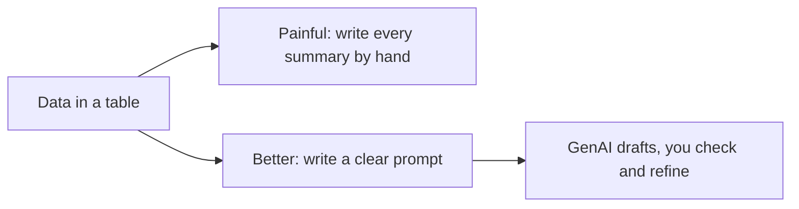
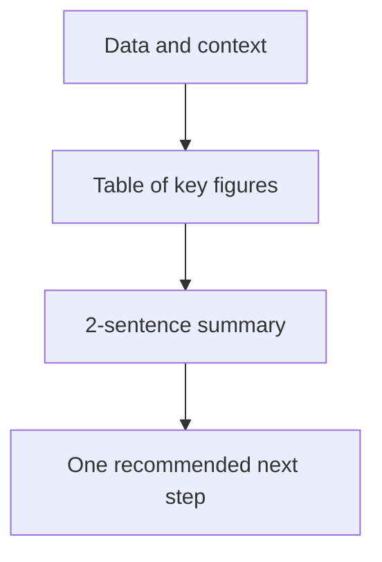
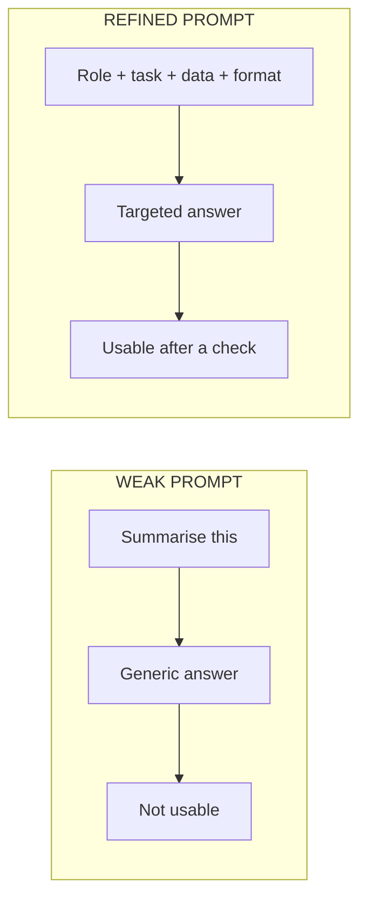

# Lecture Script: Summarise, Compare and Report with GenAI
**Session 12.2 · Module 4: GenAI for Analytics Workflows + Basic Python**
**Duration: 90 minutes · Audience: 40-60 learners · Prerequisite: pre-read for this session; 12.1 (correlation, causation)**

---

## Timing table

| # | Block | Minutes | Running total |
|---|-------|---------|---------------|
| 1 | Opening hook | 5 | 5 |
| 2 | From Known to New | 10 | 15 |
| 3 | A. Prompts for summarising and comparing | 20 | 35 |
| 4 | B. Extracting key points and verifying | 15 | 50 |
| 5 | C. Structured reports | 12 | 62 |
| 6 | D. Refining prompts | 15 | 77 |
| 7 | Live practice: prompt battle | 8 | 85 |
| 8 | Wrap-up and bridge | 5 | 90 |
| | **Total** | **90** | |

**Running example (same as pre-read):** North, South, West: ad spend 6, 8, 4 and sales 41, 55, 31 (₹ lakh). Sales per ₹ of ad spend: ~6.8, ~6.9, ~7.8.

**Setup:** have a GenAI tool open on the projector. Pre-type the weak prompt and the data table.

---

## Block 1 · Opening hook (5 min)

**Say:**
> "Your manager messages you at 5:45 pm: 'Need a three-line summary of regional performance for tomorrow's 9 am meeting.' You have a table of numbers and a tired brain. What do you do?"

*(Take two answers.)*

> "Today you learn to hand that job to GenAI properly. And I say *properly* because there is a wrong way, and the wrong way sends embarrassing numbers to your manager."

**Transition:** "Let's start with what you already do without thinking."

---

## Block 2 · From Known to New (10 min)

**Hook:**
> "Last week you told a friend about a film in two sentences. That is summarising. You compared two phones by price and battery. That is comparing. You already have the skill. What changes today is that you are *briefing* someone else to do it."

**Show the region table.** Ask: "Which region is best?" *(Expect "South", because of highest sales.)*

> "Hold that thought. We'll test it."

**Key line:** "GenAI drafts. You decide."

---

## Block 3 · A. Prompts for summarising and comparing (20 min)

**Hook:**
> "Imagine ordering at a restaurant. 'Give me food' gets you anything. 'Medium-spicy veg biryani, raita, no onions' gets you dinner."

**Live demo 1 (5 min):** Run the **weak prompt**: *"Summarise this data."* with the table pasted. Show the generic answer on screen.

> "Does this help your manager? It is correct and useless."

**Teach the four parts (6 min):** Role, Task, Data/context, Format. Write them on the board.

**Live demo 2 (4 min):** Run the stronger prompt:
> "You are a business analyst. Below is ad spend and sales by region in ₹ lakh. Compare the three regions in three bullets, each under 20 words. Say which region got the most sales per rupee of ad spend."

Compare outputs side by side.

**Say:** "Same data, same tool. The only difference is the brief."

**Teach (3 min):** For comparisons, *name the measure*. "Compare" alone lets GenAI pick the measure, and it will usually pick total.

**Activity (2 min):** In pairs, rewrite "Compare the regions" using the four parts. Take one volunteer.

**🔴 Trap:** "If you do not tell GenAI the units, it may assume. ₹ lakh versus ₹ crore is a hundredfold error. Always state units."

**💬 Expect pushback:** *"Sir, why not just ask for the answer and fix it later?"*
> "You can. But every fix is a round trip. A good brief saves the trips."

**Transition:** "Now suppose GenAI gives you an answer. How do you know it's right?"

---

## Block 4 · B. Extracting key points and verifying (15 min)

**Hook:**
> "GenAI is like a very confident new colleague. Fluent, fast, and sometimes wrong. You would still check their numbers before sending to the boss."

**Teach the four checks (5 min):**
1. Key points: what are the two or three that matter?
2. Numbers: match your data?
3. Claims: any "caused"? (Link back to 12.1.)
4. Missing: anything important left out?

**Worked example (6 min):** Back to "Which region is best?"
- Compute together: South 55 ÷ 8 ≈ 6.9, North 41 ÷ 6 ≈ 6.8, West 31 ÷ 4 ≈ 7.8.
> "West has the lowest total sales and the best sales per rupee. A lazy summary says South wins. The check changes the answer."

**Say:** "Best at what? Always ask what the measure is."

**Callback to 12.1 (2 min):** If GenAI writes "the extra ad spend caused West's sales," what do we say? *(Association only; confounders like season or store size may be at play.)*

**Quick check (2 min):** "GenAI says total sales rose 12%. Your data says 9%. What do you do?" *(Stop, find the source of the difference, do not forward.)*

**🔴 Trap:** "Do not check *only* the sentence that sounds suspicious. Check the numbers that sound *fine*. Those are the ones that slip through."

**💬 Expect pushback:** *"If I have to verify everything, why use GenAI?"*
> "Because verifying a draft is far faster than writing one. You trade writing time for checking time, and checking is quicker."

**Transition:** "Now, how do we get outputs that are easy to check and reuse? Structure."

---

## Block 5 · C. Structured reports (12 min)

**Hook:**
> "A blank page gets you whatever comes to mind. A form with labelled boxes gets you consistent answers. When you ask for a table, you are handing GenAI a form."

**Live demo (6 min):** Prompt:
> "Return a table with columns: Region, Ad spend, Sales, Sales per ₹ of ad spend. Then a two-sentence summary below the table. End with one recommended next step. Use only the data provided."

Show output.

**Teach (3 min):** Standard report shape: title, table, summary, next step.

**Say:** "A fixed shape means every month's report looks the same, and your manager learns where to look."

**Activity (3 min):** Ask learners to name one report from their own work and what the table columns would be.

**🔴 Trap:** "'Recommended next step' is where GenAI invents things. Add 'based only on the data above'."

**💬 Expect pushback:** *"Can I just paste the table into Excel?"*
> "Yes, and ask for CSV format if you plan to. We'll go deeper on connecting tools in Session 17.1."

---

## Block 6 · D. Refining prompts (15 min)

**Hook:**
> "The first answer is a draft, not a verdict. Good analysts do not get it right first time. They get it right by the third try."

**Teach the refining table (5 min):** Too long, too vague, wrong tone, wrong format, missed the point, made-up claim, with the fix for each.

**Live refinement (7 min):** Start from a mediocre output and refine **one change at a time**:
1. Add "maximum 3 bullets".
2. Add "include the actual numbers".
3. Add "write for a non-technical sales manager".
Show how each change moves the output.

**Say:** "Change one thing at a time. Otherwise you will never know which change helped."

**Quick check (3 min):** "The output is three long paragraphs but you need a slide. What do you add?" *(A format and length limit.)*

**🔴 Trap:** "Do not keep stacking instructions until the prompt is a wall of text. If it is getting long, the task may be too big. That is exactly what 12.3 is about."

**💬 Expect pushback:** *"The answer changes every time I run it."*
> "Yes. GenAI is not a calculator. Same prompt can give slightly different words. That is another reason you check the numbers."

---

## Block 7 · Live practice: prompt battle (8 min)

Split the room into two halves. Give both the same data: a new table of **three products** with units sold and returns.

- Half A writes a **weak** prompt. Half B writes a **four-part** prompt.
- Run one from each on the projector. Ask the room to judge which is more useful and why.
- Then ask: "What is *one* thing you would verify in each output?"

**Say:** "Notice how much of the quality was decided before GenAI wrote a single word."

---

## Block 8 · Wrap-up and bridge (5 min)

**Recap with the mental map open (2 min):**
- Strong prompt: role, task, data, format.
- Name the measure for comparisons.
- Verify numbers and claims.
- Ask for structure.
- Refine one change at a time.

**One-line takeaway:**
> "A good prompt is a clear brief. A good analyst checks the draft before it leaves the room."

**Bridge (1 min):**
> "Today one prompt did one job. But what if the analysis is bigger: clean the data, find the trend, write the report? One giant prompt will fail. Next session, 12.3, you learn to break the problem into steps."

**Closing prompt (2 min):** "Pick one report you write regularly. Write down the four parts of the prompt that would draft it."

---

## Instructor quick-reference

- **Same numbers everywhere:** 6/8/4 ad spend, 41/55/31 sales, efficiency ~6.8/~6.9/~7.8.
- **If long:** shorten Block 7 to one round.
- **If short:** add a second refinement demo in Block 6.
- **Phrases to model:** "based only on the data provided", "name the measure".
