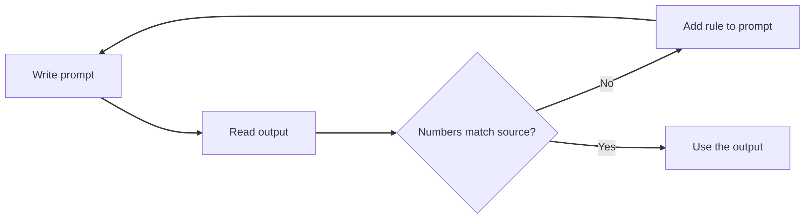

# Summarise, Compare and Report with GenAI
> Pre-Read — Academic Session 27 | Module 4: GenAI for Analytics Workflows + Basic Python
---

## Mental Map

```mermaid
%%{init: {'themeVariables': {'fontSize': '16px'}, 'flowchart': {'useMaxWidth': false, 'htmlLabels': true, 'nodeSpacing': 80, 'rankSpacing': 120, 'wrappingWidth': 620, 'padding': 20}}}%%
flowchart LR

START["<b>Course Start</b>"]

subgraph foundation[" WHERE WE ARE "]
direction LR
    CURMOD["<b>CURRENT MODULE</b><br/><i>Module 4: GenAI for Analytics Workflows + Basic Python</i><br/>&nbsp;<br/><b>Covered so far:</b> Statistics: Relationships in Data<br/>This is Session 27 of 41"]
    CURSES["<b>CURRENT SESSION</b><br/><b>Summarise, Compare and Report with GenAI</b><br/>&nbsp;<br/><i>The shift:</i> from <i>writing a single one-off GenAI prompt for one insight</i> to <b>deliberately prompting GenAI to summarise, compare, and build structured reports — then refining when the output falls short</b><br/>&nbsp;<br/>Prompting for summaries &amp; comparisons · Extracting key points from outputs<br/>Generating structured reports · Refining prompts to improve outputs"]
end

subgraph outcome[" OUTCOME OF THIS SESSION "]
direction LR
    OUT["<b>By the end, you can…</b><br/>&nbsp;<br/>Write a GenAI prompt that turns raw Kirana365 figures into<br/>a structured comparison table or summary report, then<br/>refine the prompt when the first output isn't good enough"]
end

subgraph value[" WHY IT MATTERS "]
direction LR
    CVAL["<b>Course Value</b><br/>This exact skill becomes one step inside the multi-step GenAI workflows you build for the rest of this module"]
    RVAL["<b>Real-Life Value</b><br/>Generating a clean city-performance comparison table for a leadership meeting in minutes instead of manually formatting one"]
end

subgraph future[" WHAT COMES NEXT "]
direction LR
    U0["<b>Next Session</b><br/>Breaking Down the Workflow<br/><i>Now we learn to split a whole analysis problem into steps like this one</i>"]
    U1["<b>Later in Module 4</b><br/>Multi-Step GenAI Workflows · Python Fundamentals I, II, III<br/>Python for APIs and GenAI Integration"]
    U2["<b>Upcoming</b><br/>Capstone Project<br/><i>Prompting for structured, trustworthy output is a skill the capstone assumes you already have</i>"]
end

START ==>|" begin "| CURMOD
CURMOD ==>|" progress "| CURSES
CURSES ==>|" you get "| OUT
OUT ==>|" course "| CVAL
OUT ==>|" real life "| RVAL
CURSES ==>|" next up "| U0
U0 -.->|" then "| U1
U1 -.->|" ahead "| U2

classDef startBox fill:#F7FAFC,stroke:#4A5568,stroke-width:2px,color:#1A202C
classDef curModBox fill:#FFF8E6,stroke:#B7791F,stroke-width:2px,color:#1A202C
classDef curSessBox fill:#E6FFFA,stroke:#0D9488,stroke-width:3px,color:#1A202C
classDef outBox fill:#FEF2F2,stroke:#DC2626,stroke-width:3px,color:#1A202C
classDef valueBox fill:#F3E8FF,stroke:#7C3AED,stroke-width:2px,color:#1A202C
classDef futureBox fill:#ECFDF5,stroke:#047857,stroke-width:2px,color:#1A202C

class START startBox
class CURMOD curModBox
class CURSES curSessBox
class OUT outBox
class CVAL,RVAL valueBox
class U0,U1,U2 futureBox

linkStyle default stroke-width:2px
```

<div style="overflow-x: scroll; max-width: 100%; display: block;">



</div>

## What You'll Learn
In this pre-read, you'll discover:
- How to prompt GenAI to summarise and compare real business figures
- How to pull key points out of a long GenAI output
- How to ask for a structured report (tables, headings, fixed format)
- How to refine a prompt when the first answer is not good enough

## A. Prompting for Summaries and Comparisons

**💡 Analogy**: Think of briefing a new colleague. If you say "look at this and tell me something," you get something vague. If you say "compare these three cities on growth and give me two sentences," you get what you need.

**A good summary or comparison prompt states the role, the data, the task and the output format.**

**Worked example**: Kirana365 has three cities this month (illustrative figures):

| City | Orders | Revenue (₹ lakh) | Growth |
|---|---|---|---|
| Pune | 1,800 | 24 | +9% |
| Bengaluru | 2,600 | 41 | +12% |
| Chennai | 1,400 | 18 | −3% |

Weak prompt: *"Tell me about these cities."*

Stronger prompt:

```
You are a business analyst. Using ONLY the table below, compare the three
cities on revenue and growth. Write 3 sentences for a leadership meeting.
Do not add numbers that are not in the table.
[table pasted here]
```

**⚠️ Common trap**: Giving GenAI data and no task. Without a role, a limit on length, and the instruction to use only your numbers, it will fill gaps with plausible-sounding guesses.

## B. Extracting Key Points from Outputs

**💡 Analogy**: Think of highlighting a textbook. You do not copy the whole page, you mark the lines that carry the idea. Extracting key points is highlighting a long GenAI answer.

**Ask GenAI to extract the few points that matter, and then check each point against your source data.**

**Worked example**: Suppose GenAI returns a long paragraph about the three cities. Follow up with: *"List the 3 most important points as bullets, each with the number it relies on."* You get something like:

- Bengaluru leads on revenue (₹41 lakh) and growth (+12%)
- Pune is growing (+9%) but is behind Bengaluru
- Chennai is the only city shrinking (−3%)

Every point carries a number, so you can tick it off against the table in ten seconds.

**⚠️ Common trap**: Skipping the check because the bullets "look right." GenAI can quietly change a number while rewording. A key point you did not verify against the source is a risk, not an insight.

## C. Generating Structured Reports

**💡 Analogy**: Think of a school report card. Every student gets the same boxes (subject, marks, remarks), so a reader can find things instantly. A structured report is a report card for your analysis.

**Tell GenAI the exact structure you want, such as a table plus a short headline and a recommendation.**

**Worked example**: Prompt:

```
Using only the table below, produce:
1. A one-line headline
2. A comparison table (City | Revenue | Growth | One-word status)
3. One recommendation, max 2 sentences
[table pasted here]
```

Because the layout is fixed, you can paste the answer straight into a slide or an email without reformatting.

**⚠️ Common trap**: Asking for "a report" with no structure. You get a long essay, in a different shape every time, which makes monthly reports hard to compare.

## D. Refining Prompts to Improve Outputs

**💡 Analogy**: Think of giving a tailor feedback. You do not throw the shirt away, you say "shorten the sleeves, loosen the collar." Refining a prompt is adjusting, not starting over.

**When an output falls short, diagnose what is wrong, change one thing in the prompt, and run it again.**

**Worked example**: First output: three long paragraphs, one invented figure ("Chennai revenue fell 20%"). Your fix, in two refinements:

1. *"Only use numbers from the table. If a number is not in the table, say so."*
2. *"Shorten to 3 sentences."*

Second output: three short sentences, every number traceable to the table.

**⚠️ Common trap**: Changing five things at once. If the output improves you will not know why, and if it worsens you will not know which change broke it. Change one thing, test, repeat.



## Quick Reference — Prompting GenAI for Reports

| Your situation | Use this | Because |
|---|---|---|
| You want a short summary | State role, data, length and "use only these numbers" | Limits guessing and keeps it short |
| You want to compare entities | Give a table and name the dimensions to compare | The model compares what you point at |
| The output is long and messy | Ask for key points with the number each relies on | Easy to verify against the source |
| You need the same report every month | Fix the structure in the prompt | Comparable outputs, no reformatting |
| First output is not good enough | Change one thing and rerun | You learn which change helped |

## Practice Exercises

1. **Pattern Recognition**: Look at the weak prompt "Tell me about these cities." List two things missing from it that the stronger prompt included.

2. **Concept Detective**: A GenAI summary says "Pune revenue grew 15%." Your table says +9%. Which section of this pre-read tells you what to do, and what is the first step?

3. **Real-Life Application**: Write a prompt (3 to 4 lines) that asks GenAI to compare Kirana365's cities on orders and revenue, in a fixed table format.

4. **Spot the Error**: A teammate refined a prompt by changing the role, the length limit, the format and the tone all at once, and the output got worse. What went wrong with their method?

5. **Planning Ahead**: Next session we break a whole analysis into steps. In the city comparison above, which single step is GenAI best suited to, and which steps would you do yourself?

> ✅ **You're done!** You can now write a prompt that turns raw figures into a summary or a structured report, check it against the source, and refine it step by step.
Next session, we zoom out in **Breaking Down the Workflow**, learning to split a whole analysis problem into steps and decide where GenAI helps.
