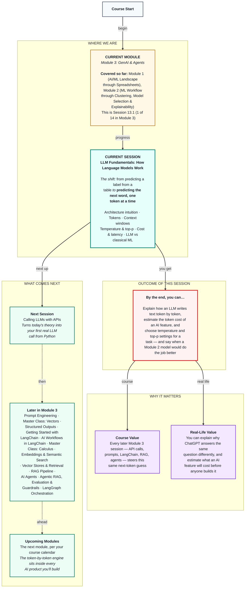

# Generative AI: LLM Fundamentals — How Language Models Work
> **Pre-Read — Academic Session 13.1** | Module 3: GenAI & Agents
---
## Mental Map

---

## What You'll Learn

In this pre-read, you'll discover:
- How a large language model writes text by predicting one small piece at a time
- What tokens and context windows are, and why they decide cost and limits
- How temperature and top-p make the same question give steady or creative answers
- How to estimate what an AI feature will cost before anyone builds it
- When an LLM is the right tool, and when your Module 2 models are better

---

## A. What an LLM Really Does: Predict the Next Piece

**💡 Analogy:** A cricket commentator says "And that's gone all the way for..." and the whole room shouts "SIX!" Nobody looked it up — you've heard so much commentary that you know what usually comes next. An LLM does the same thing, for every kind of text, at enormous scale.

**One-line definition: A large language model (LLM) writes text by repeatedly predicting the most likely next small piece of text, based on everything written so far.**

**Worked example:** In Module 2 you predicted which Swiggy delivery partners might churn. In Module 3 we build an AI helpdesk to answer their payout questions before they leave. *(The helpdesk, its policies and every number in this module are illustrative, made up for teaching — not Swiggy's real rules.)* Given "Your payout will be", the model scores every possible next piece — "credited", "delayed", "reviewed" — picks one, adds it, and scores again. Inside, a design called a **transformer** turns each piece into numbers and works out how every piece relates to every other one. That's the only architecture you need today: score, pick, append, repeat.

**⚠️ Common trap:** Thinking the LLM "looks up" answers in a database. It doesn't — it generates likely-sounding text. That's why it can sound confident and still be wrong, a problem called **hallucination**. Sessions 17.1 and 18.1 are about fixing exactly this.

---

## B. Tokens: The Pieces an LLM Reads and Writes

**💡 Analogy:** A Swiggy bill doesn't charge "per meal" — it charges per item: one biryani, one raita, one Coke. LLMs don't count words or letters either. They count **tokens**.

**One-line definition: A token is a small chunk of text — often a short word, sometimes part of a longer word, a space or a punctuation mark — and it's the unit LLMs read, write and charge for.**

**Worked example:** A rough rule for English is 1 token ≈ ¾ of a word, so 100 words ≈ 130 tokens. A partner's question, "Why is my weekly payout less than last week?", is 9 words, so about 12 tokens. A word like "Hyderabad" might split into three tokens ("Hy" + "der" + "abad"), and "₹1,250" into four. Exact splits differ between models.

**⚠️ Common trap:** Assuming a short message is always cheap. Hindi, Telugu and other Indian languages usually need two to three times more tokens than English for the same meaning, because the model saw less of that text while learning. For a helpdesk serving partners across India, that changes the bill.

---

## C. Context Windows: The Model's Desk Space

**💡 Analogy:** A support agent works at a small desk. She can only keep so many papers on it — the question, the policy page, her notes. When the desk is full, the oldest papers slide off and she can no longer see them.

**One-line definition: A context window is the maximum number of tokens an LLM can handle in one go — your input and its reply together.**

**Worked example:** Context windows range from a few thousand tokens to around a million. Imagine pasting a 300-page partner handbook (about 150,000 tokens) into every question. On a 128,000-token model, it simply doesn't fit. On a bigger model it fits, but you pay for all 150,000 tokens on every single "where is my payout" message. Session 17.1 (RAG) solves this by sending only the two or three relevant pages.

**⚠️ Common trap:** Treating the context window as memory. When a chat ends, the model remembers nothing. When an app seems to "remember" earlier messages, it's quietly re-sending them into the window every time.

---

## D. Temperature and Top-p: Steady or Creative?

**💡 Analogy:** Ask two Hyderabad auto drivers for the best route to the airport. The cautious one always takes the main road. The adventurous one sometimes tries a shortcut. Both know the city — they just take different levels of risk.

**One-line definition: Temperature controls how adventurous the model's choice of next token is; top-p limits the choice to the most likely tokens whose chances add up to p.**

**Worked example:** After "Your payout will be credited by...", suppose the model gives "Friday" 55%, "tomorrow" 25%, "Monday" 12%, "tonight" 6% and "never" 2%. At temperature 0.2, "Friday" rises to about 98% — almost always picked. At temperature 1.5, the chances flatten and "Friday" drops to about 44%. With top-p 0.9 at temperature 1.0, Friday + tomorrow + Monday = 92% crosses 0.9, so only those three stay and "tonight" and "never" are thrown out. For policy answers, use temperature 0–0.3; for five fun Diwali notification lines, 0.8–1.0.

**⚠️ Common trap:** Believing temperature 0 makes the model correct. It makes it (almost always) consistent. If its top guess for the payout day is wrong, temperature 0 gives that wrong answer every time, with total confidence.

---

## E. Cost and Latency: Every Answer Has a Price and a Wait

**💡 Analogy:** An auto ride costs per kilometre and takes time per kilometre. An LLM call costs per token and takes time per token.

**One-line definition: Cost is input tokens × input price plus output tokens × output price; latency (waiting time) grows mostly with how many tokens the model has to write.**

**Worked example:** With illustrative prices of ₹15 per million input tokens and ₹60 per million output tokens, one helpdesk question with 500 input and 200 output tokens costs (500 × 15 + 200 × 60) ÷ 1,000,000 = ₹0.0195 — about 2 paise. At 50,000 questions a day, that's about ₹975 a day. Paste the 150,000-token handbook into every question and the input alone costs ₹2.25 per question — over ₹1.1 lakh a day for the same answers.

**⚠️ Common trap:** Looking only at the price per question. Always multiply by daily volume, and remember output tokens usually cost three to five times more than input. Asking for shorter answers is often the cheapest saving — and it cuts waiting time too.

---

## F. LLMs vs the Models You Built in Module 2

**💡 Analogy:** A Module 2 churn model is a specialist doctor trained only on your clinic's patients, for one question. An LLM is a well-read general physician — it has read a huge general library and can discuss almost anything, but it has never seen your clinic's files.

**One-line definition: A classical ML model is trained by you on your labelled table to predict one label or number; an LLM is trained by a provider on internet-scale text and is steered by instructions to produce free text.**

**Worked example:** For "will this partner churn next month?" on a clean activity table, your Module 2 classifier is cheaper, instant, gives the same answer every time and is easy to test with a train/test split. For "explain this payout rule in simple Hindi", only an LLM can do the job. For "flag likely churners, then write each one a personal retention message", you'd use both: the classifier picks who, and the LLM writes what.

**⚠️ Common trap:** Assuming LLMs make classical ML obsolete. Frame the problem first — exactly the habit from Module 2. And the "never grade your own homework" rule doesn't disappear: it returns as prompt test sets in Session 14.1 and RAGAS evaluation in Session 18.1.

---

## Quick Reference — Choosing LLM Settings

| Your situation | Use this | Because |
|---|---|---|
| Factual answers that must be consistent | Temperature 0–0.3 | Removes randomness, not errors |
| Creative text with variety | Temperature 0.8–1.0, top-p 0.9 | Variety without the weird long tail |
| Your document is huge | Retrieve only relevant pieces (RAG, Session 17.1) | Context windows and costs are limited |
| Estimating the bill | (input × input price + output × output price) × daily volume | Output tokens usually cost more |
| Prediction from a clean labelled table | A Module 2 classical model | Cheaper, faster, easier to evaluate |

---

## Practice Exercises

1. **Concept Detective** — A partner asks the helpdesk the same question twice and gets two slightly different answers. Which setting is most likely responsible, and what value would you choose for a policy-answering bot?

2. **Spot the Error** — A teammate says: "We set temperature to 0, so the helpdesk can't give wrong answers any more." What's wrong with this claim?

3. **Planning Ahead** — Your helpdesk prompt is 800 input tokens and the answer is 250 output tokens. Using the prices in Section E, estimate the daily cost for 20,000 questions. Then estimate it again with answers cut to 100 tokens.

4. **Pattern Recognition** — The same question takes 15 tokens in English but 40 in Telugu. What does this tell you about cost and context-window use for a multilingual helpdesk?

5. **Real-Life Application** — List three tasks at your work or college. For each, decide: classical ML, an LLM, or neither — and say why in one line.

---

> ✅ **You're done!** You can now explain how an LLM writes text one token at a time, why tokens and context windows drive cost and limits, and how temperature and top-p trade consistency for variety.
>
> Next up: **Session 13.2 — Calling LLMs with APIs**, where you stop typing into a chat window and send your first request to an LLM from your own Python code.
