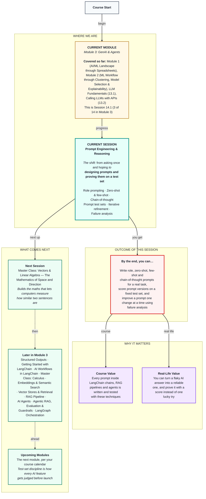

# Generative AI: Prompt Engineering & Reasoning
> **Pre-Read — Academic Session 14.1** | Module 3: GenAI & Agents
---
## Mental Map


---

## What You'll Learn

In this pre-read, you'll discover:
- How giving the model a role changes the quality of its answers
- The difference between zero-shot (just ask) and few-shot (show examples first) prompting
- How chain-of-thought prompting helps with multi-step problems like payout calculations
- How to prove one prompt is better than another using a small test set
- How to improve a prompt one change at a time by studying exactly where it fails

---

## A. Role Prompting: Tell the Model Who It Is

**💡 Analogy:** Ask a passer-by "Is this noise from my bike engine serious?" and you get a guess. Ask a two-wheeler mechanic and you get careful, specific questions. Same question, different expert, different answer.

**One-line definition: Role prompting means telling the model, usually in the system message, who it is, who it's talking to and what matters most.**

**Worked example:** Our helpdesk must **route** every partner message into one of five labels: `payout`, `incentive`, `app_issue`, `safety` or `other`. A weak role says "You are a helpful assistant. Classify this." A useful role says "You are a senior support lead at Swiggy who routes delivery-partner messages. Partners often write short Hinglish messages. Safety issues must never be missed." Given *"kal ka paisa nahi aaya"* ("yesterday's money didn't come"), the weak prompt may reply with a polite Hindi chat message; the useful one knows it's a router, expects Hinglish, and outputs `payout`.

**⚠️ Common trap:** Flattering roles like "You are the world's greatest AI genius" add nothing — the model can't become smarter on command. A good role adds context the model can't guess: who the users are, how they write and what the job is.

---

## B. Zero-Shot vs Few-Shot Prompting

**💡 Analogy:** Training a new delivery partner. Zero-shot is saying "deliver orders politely" and sending them out. Few-shot is letting them ride along on three deliveries first, so they *see* what polite looks like.

**One-line definition: Zero-shot prompting describes the task with no examples; few-shot prompting adds a few solved examples to the prompt before the real question.**

```
Classify the partner message into one of: payout, incentive, app_issue, safety, other.
Reply with only the label.

Message: "Weekly amount still showing pending"                         -> payout
Message: "Peak hour bonus missing for Sunday"                          -> incentive
Message: "Fell off the scooter near Ameerpet, need help with insurance" -> safety

Message: "Can I change my registered bank account?" ->
```

**Worked example:** Without examples (zero-shot), the model might label the bank-account question `other`, since it isn't obviously about money arriving. The few-shot examples teach the boundaries *you* chose: anything about getting paid counts as `payout`, bonuses are `incentive`, and insurance after an accident is `safety`. The trade-off: examples are resent on every call, so they cost tokens every time (Session 13.1).

**⚠️ Common trap:** Picking your three easiest examples. The model already gets those right. Good few-shot examples sit on the tricky boundaries — the cases the model gets wrong without them.

---

## C. Chain-of-Thought: Show the Working

**💡 Analogy:** In a maths exam, students who write every step make fewer mistakes than students who jump straight to the answer. And when they're wrong, you can see where.

**One-line definition: Chain-of-thought (CoT) prompting asks the model to reason step by step before giving its final answer.**

**Worked example:** Illustrative payout rules used all module: ₹30 per order, ₹15 extra per peak-hour order, ₹400 bonus for 60+ orders in a week, ₹100 deducted per verified customer-reported cancellation. Last week a partner did 62 orders (40 at peak, 0 cancellations); this week 62 orders (20 at peak, 3 cancellations). Asked directly why this week is lower, a model may say "probably fewer orders" — wrong, the orders were the same. Asked to work step by step, it writes: base 62 × 30 = ₹1,860 both weeks; peak bonus ₹600 vs ₹300; target bonus ₹400 both weeks; deductions ₹0 vs ₹300. Totals: ₹2,860 vs ₹2,260 — a ₹600 drop, half from fewer peak orders and half from cancellations. Because the model writes one token at a time (Session 13.1), writing the steps first gives it room to work.

**⚠️ Common trap:** Adding "think step by step" to every prompt. For simple routing like `payout` vs `safety`, it only adds tokens, cost and waiting time. Use chain-of-thought for multi-step problems: calculations, rules with conditions and comparisons.

---

## D. Evaluating Prompts with a Small Test Set

**💡 Analogy:** A cricket selector doesn't pick a batter after one good shot in the nets — Module 2 taught you to judge across many innings. One good answer from a prompt proves nothing either.

**One-line definition: A prompt test set is a small list of inputs with known correct answers, used to score every version of a prompt in exactly the same way.**

**Worked example:** Build 10 partner messages with their correct labels, for example "Payout not credited since Friday" → `payout`, "A customer threatened me at the gate" → `safety`, "kal ka paisa nahi aaya" → `payout`, "GPS shows me in Secunderabad but I'm in Gachibowli" → `app_issue` and "Thanks for the help!" → `other`. Run each prompt version on all 10 and count the correct answers. Say zero-shot scores 7/10 and few-shot scores 10/10 — now you have evidence, not a feeling. (Your real scores depend on the model.)

**⚠️ Common trap:** Two traps from Module 2. First, using test messages as few-shot examples — that's grading your own homework, so keep them separate. Second, trusting the overall score: safety messages are rare, so a prompt can score 90% while missing every one of them. Always read *which* messages failed.

---

## E. Iterative Refinement and Failure Analysis

**💡 Analogy:** A good cook doesn't throw away a dish that's too salty. She tastes it, finds what's off, changes one thing, then tastes again.

**One-line definition: Iterative refinement means changing one thing in a prompt at a time and re-running the same test set; failure analysis means grouping the wrong answers to find out why they're wrong.**

**Worked example:** A first prompt's failures usually fall into groups. **Language:** "kal ka paisa nahi aaya" labelled `other` — fix by saying in the role that partners write Hinglish. **Boundary:** "Can I change my bank account?" labelled `other` — fix by defining `payout` as "anything about getting paid, including bank details". **Format:** the model replies "The label is: payout." — fix with "Reply with only the label, nothing else." Fix the biggest group first, re-run the test set, and keep the change only if the score improves.

**⚠️ Common trap:** Rewriting the whole prompt at once when you're frustrated. If the score improves, you don't know which change helped; if it drops, you don't know which one hurt. Change one thing at a time.

---

## Quick Reference — Choosing a Prompting Technique

| Your situation | Use this | Because |
|---|---|---|
| The model lacks context about users or goals | Role prompt in `system` | Adds context it can't guess |
| Simple, common task | Zero-shot | Cheapest, often enough |
| Fuzzy category boundaries or a strict format | Few-shot | Examples teach the boundaries |
| Multi-step calculation or rule-checking | Chain-of-thought | Gives the model room to work |
| Comparing two prompts | Same test set, same scoring | Evidence, not feelings |
| A prompt keeps failing | Group the failures, change one thing | You know what actually helped |

---

## Practice Exercises

1. **Concept Detective** — A prompt says: "You are a helpful assistant. Classify this." What's missing from the role, and how would you rewrite it for the helpdesk router?

2. **Spot the Error** — A teammate uses three messages from the test set as few-shot examples, then reports 100% accuracy on that same test set. What's wrong?

3. **Planning Ahead** — Write a chain-of-thought prompt for "I did 58 orders, 25 in peak hours, 1 cancellation. What's my payout?" using the rules in Section C. Then calculate the correct answer yourself so you can check the model.

4. **Pattern Recognition** — Your failures are three Hinglish messages labelled `other`, and one where the model wrote "Category: incentive". Group them and suggest one fix per group.

5. **Real-Life Application** — Pick a sorting task at work or college (emails, feedback forms, tickets). Write five test examples with correct labels that you could use to compare prompts.

---

> ✅ **You're done!** You can now write role, zero-shot, few-shot and chain-of-thought prompts — and prove which one works better using a test set and a one-change-at-a-time refinement loop.
>
> Next up: **Session 14.2 — Master Class: Vectors & Linear Algebra**, where we build the mathematics that lets computers measure how similar two sentences are.
