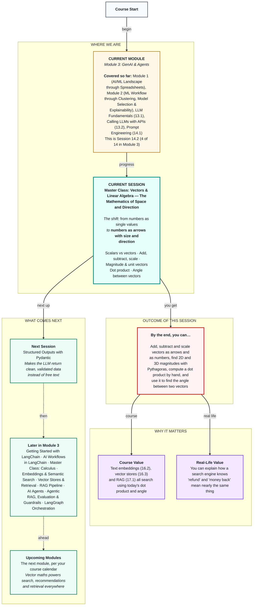

# Mathematics: Master Class — Vectors & Linear Algebra: The Mathematics of Space and Direction
> **Pre-Read — Academic Session 14.2** | Module 3: GenAI & Agents
---
## Mental Map

---

## What You'll Learn

In this pre-read, you'll discover:
- The difference between a scalar (just a size) and a vector (a size and a direction)
- How to add, subtract and scale vectors, both as arrows and as numbers
- How to find a vector's length with Pythagoras, and what a unit vector is
- How to compute a dot product by hand and read what its sign means
- How to find the angle between two vectors — the idea behind "how similar are these two messages?"

---

## A. Scalars vs Vectors

**💡 Analogy:** A delivery partner says, "I rode 5 km." Where is he now? Anywhere on a 5 km circle around the hub. If he says, "I rode 3 km east and 4 km north," you know exactly where he ended up.

**One-line definition: A scalar is a single number that only has size (5 km, ₹600); a vector has both size and direction, and is written as a list of numbers.**

**Worked example:** In Session 14.1 our helpdesk had to know that *"kal ka paisa nahi aaya"* means nearly the same as *"payout not credited since Friday"* — with zero shared words. In Session 16.2 we'll turn each sentence into an arrow of numbers and compare directions. Today we learn the arrows on a Hyderabad map. The trip "3 km east, 4 km north" is the vector **a** = (3, 4): draw an arrow 3 squares right and 4 squares up. The first number is east, the second north; negatives mean west or south, so (−2, 1) is 2 km west and 1 km north. Distance ridden (5 km) and today's payout (₹2,260) are scalars.

**⚠️ Common trap:** Thinking a vector has a fixed starting point. "3 east, 4 north" is the same vector whether the partner starts at the Madhapur hub or the Kukatpally hub. A vector is a movement, not a location.

---

## B. Adding, Subtracting and Scaling Vectors

**💡 Analogy:** A partner rides from the hub to a restaurant, then from the restaurant to the customer. To know where he is relative to the hub, follow one arrow and then the next.

**One-line definition: You add or subtract vectors component by component, and multiplying a vector by a number (a scalar) stretches it — a negative number also flips its direction.**

**Worked example:** Hub to restaurant is **a** = (3, 4); restaurant to customer is **b** = (2, −1). Geometrically, place **b**'s tail at **a**'s tip ("tip to tail"); the sum is the arrow from the start to the end. With numbers: **a** + **b** = (3 + 2, 4 + (−1)) = (5, 3). Subtraction: **a** − **b** = (1, 5), the arrow from **b**'s tip to **a**'s tip. Scaling: 2**a** = (6, 8) is twice as long; 0.5**a** = (1.5, 2) is half as long; −1 × **a** = (−3, −4) points the opposite way. A partner repeating trip **a** three times moves 3**a** = (9, 12).

**⚠️ Common trap:** Adding lengths instead of components. |**a**| = 5 and |**b**| ≈ 2.24, but |**a** + **b**| ≈ 5.83, not 7.24 — **b** points partly back south, undoing some of **a**.

---

## C. Magnitude and Unit Vectors

**💡 Analogy:** The partner rode 3 km east and 4 km north. How far is he from the hub as the crow flies? That straight-line distance is the vector's magnitude.

**One-line definition: A vector's magnitude (length) is the square root of the sum of its squared components — Pythagoras — and a unit vector is a vector divided by its own magnitude, so its length is exactly 1.**

**Worked example:** |**a**| = √(3² + 4²) = √(9 + 16) = √25 = 5 km — the east and north parts are the two short sides of a right-angled triangle. In 3D, add a third square: |(2, 3, 6)| = √(4 + 9 + 36) = √49 = 7. The rule works for any number of dimensions, which matters because sentence vectors in Session 16.2 have 384 numbers. The unit vector of **a** is (3/5, 4/5) = (0.6, 0.8), and √(0.36 + 0.64) = 1. A partner who rode (30, 40) — 50 km — has the same unit vector (0.6, 0.8): same direction, different distance.

**⚠️ Common trap:** Squaring negatives wrongly. |(−3, 4)| = √(9 + 16) = 5, not √(−9 + 16). A squared number is never negative, so a magnitude is never negative.

---

## D. The Dot Product

**💡 Analogy:** It's raining and the wind blows towards the north-east. A partner riding north-east is pushed along; riding south-west, the wind fights him; riding south-east, it blows across him and neither helps nor hurts. The dot product measures how much two arrows point the same way.

**One-line definition: The dot product of two vectors multiplies their matching components and adds the results — a · b = a₁b₁ + a₂b₂ (+ a₃b₃ ...) — giving a single number.**

**Worked example:** With **a** = (3, 4): (3, 4) · (4, 3) = 12 + 12 = **24**, positive, so they point roughly the same way (angle under 90°). (3, 4) · (−4, 3) = −12 + 12 = **0**, so they are **perpendicular** — at exactly 90°, with no overlap at all. (3, 4) · (−3, −4) = −9 − 16 = **−25**, negative, so they point in opposite directions (angle over 90°).

**⚠️ Common trap:** Reading a big dot product as "very similar." Its size depends on the lengths too: (30, 40) · (4, 3) = 240, ten times bigger than before, yet the directions haven't changed. To compare direction alone, you need the angle.

---

## E. The Angle Between Two Vectors

**💡 Analogy:** Two partners leave the same hub. To judge how similar their routes are, you don't care how far each one rode — only how wide the angle is between their directions.

**One-line definition: The dot product also equals a · b = |a| |b| cos(θ), so the angle between two vectors comes from cos(θ) = (a · b) / (|a| |b|).**

**Worked example:** Where the formula comes from: draw **a** and **b** from one point, so the third side of the triangle is **a** − **b**. The law of cosines from school says |**a** − **b**|² = |**a**|² + |**b**|² − 2|**a**||**b**|cos(θ). Using the dot product, |**a** − **b**|² = (**a** − **b**) · (**a** − **b**) = |**a**|² + |**b**|² − 2(**a** · **b**). Setting the two equal and cancelling gives **a** · **b** = |**a**||**b**|cos(θ). For (3, 4) and (4, 3): cos(θ) = 24 / (5 × 5) = 0.96, so θ ≈ 16°. Now score messages on two made-up axes, (about money, about the app): "Payout not credited" = (0.9, 0.1), "kal ka paisa nahi aaya" = (0.8, 0.2), "App keeps crashing" = (0.1, 0.9). The two payout messages give cos(θ) ≈ 0.99 (about 8° apart — nearly the same meaning); payout vs app crash gives cos(θ) ≈ 0.22 (about 77° apart — mostly unrelated). That number is called **cosine similarity** in Session 16.2.

**⚠️ Common trap:** Mixing degrees and radians. In Python, `np.arccos` returns radians; wrap it in `np.degrees(...)` before reading it as an angle.

---

## Quick Reference — Vector Toolkit

| Your situation | Use this | Because |
|---|---|---|
| Combine two movements | Add component by component | Tip-to-tail rule |
| Find the gap between two positions | Subtract | **a** − **b** points from **b** to **a** |
| Find a vector's length | √(sum of squared components) | Pythagoras, in any dimension |
| Keep direction, drop length | Divide by the magnitude (unit vector) | Length becomes exactly 1 |
| Check whether two vectors are perpendicular | Dot product = 0? | cos(90°) = 0 |
| Compare directions, ignoring lengths | cos(θ) = (**a** · **b**) / (|**a**||**b**|) | Cosine similarity in Session 16.2 |

---

## Practice Exercises

1. **Concept Detective** — For each, say scalar or vector: (a) a ₹2,260 payout, (b) 2 km west then 1 km north, (c) 18 peak-hour orders, (d) the arrow from Ameerpet to Hitec City on a map.

2. **Planning Ahead** — A partner rides **a** = (4, −2), then **b** = (−1, 6). Compute **a** + **b**, **a** − **b**, 3**a** and the magnitude of **a** + **b**. Sketch the tip-to-tail picture.

3. **Spot the Error** — A classmate writes |(−6, 8)| = √(−36 + 64) = √28 ≈ 5.29. Find and fix the mistake.

4. **Pattern Recognition** — Compute the dot products of (2, 3) with (3, −2), (4, 6) and (−2, −3). Without computing angles, say which pair is perpendicular, which points the same way and which points opposite.

5. **Real-Life Application** — Score three of your own messages on two axes you invent, such as "about food" and "about money." Compute the cosine between each pair. Do the numbers match your gut feeling about which messages are similar?

---

> ✅ **You're done!** You can now work with vectors as arrows and as numbers, find lengths and unit vectors with Pythagoras, compute dot products by hand, and turn a dot product into the angle that measures how similar two directions are.
>
> Next up: **Session 14.3 — Structured Outputs with Pydantic**, where we make the LLM return clean, validated data instead of free text.
