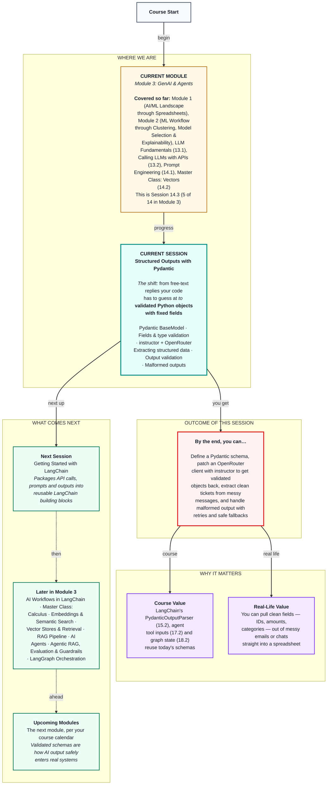

# Generative AI: Structured Outputs with Pydantic
> **Pre-Read — Academic Session 14.3** | Module 3: GenAI & Agents
---
## Mental Map


---

## What You'll Learn

In this pre-read, you'll discover:
- How to describe the exact shape of the data you want with a Pydantic `BaseModel`
- How Pydantic validates types and rules automatically, and tells you exactly what's wrong
- How the instructor library, wrapped around an OpenRouter client, makes the LLM return that shape
- How to extract clean, validated fields from a messy partner message
- What to do when the LLM's output still comes back malformed

---

## A. Pydantic BaseModel: The Printed Form

**💡 Analogy:** Ask 500 delivery partners to "write down your problem" on blank paper and you get paragraphs, one-word answers and missing IDs. Hand them a printed form — Partner ID ____, Issue type ☐ payout ☐ incentive ..., Amount ₹____ — and every answer lands in the right box.

**One-line definition: Pydantic is a Python library for describing the shape of data; a `BaseModel` is a class whose fields list each box on the form and the type it must hold.**

```python
from typing import Literal, Optional
from pydantic import BaseModel, Field

class PartnerTicket(BaseModel):
    partner_id: str = Field(description="Partner ID like P-20417")
    category: Literal["payout", "incentive", "app_issue", "safety", "other"]
    amount_disputed: Optional[int] = Field(default=None, ge=0, description="Rupees, digits only")
    orders_mentioned: Optional[int] = Field(default=None, ge=0)
    disputes_cancellations: bool = False
    urgency: Literal["low", "medium", "high"]
```

**Worked example:** In Session 14.1 the router sometimes replied `payout`, sometimes `Payout`, sometimes "The label is: payout." — and our code had to guess. With this model, `Literal[...]` allows only those exact values (14.1's label list), `Optional[int] = None` lets a box stay empty, `ge=0` means "greater than or equal to 0", and `description` is a note that instructor later passes to the LLM. You can fill the form by hand: `PartnerTicket(partner_id="P-20417", category="payout", amount_disputed=600, urgency="high")`, and `t.amount_disputed + 100` gives 700 — a real number, not text.

**⚠️ Common trap:** Making every field required. If a partner didn't mention an amount, a required `amount_disputed: int` forces the LLM to invent one. Use `Optional[...] = None` for anything that may genuinely be missing.

---

## B. Type Validation

**💡 Analogy:** A good bank clerk checks your form before accepting it: "Amount must be a number. This box is empty. 'Payoutt' isn't one of the options." Pydantic is that clerk.

**One-line definition: Validation means Pydantic checks every value against its type and rules when the object is created, and refuses to create it — with a `ValidationError` naming the field and the reason — if anything is wrong.**

```python
from pydantic import ValidationError, field_validator

try:
    PartnerTicket(partner_id="P-20417", category="Payout", urgency="high")
except ValidationError as e:
    print(e)          # says category must be one of the allowed values
```

**Worked example:** `amount_disputed=600` passes. `amount_disputed="600"` also passes — Pydantic converts clean numeric text to the int 600. `"600 rupees"` fails (not a number), `-50` fails (breaks `ge=0`), `category="Payout"` fails (case matters), and a missing `urgency` fails (required). You can add your own rule with a validator: a `@field_validator("partner_id")` method can reject any ID that isn't "P-" followed by digits.

**⚠️ Common trap:** Thinking validation checks the truth. If the partner said ₹600 and the LLM writes 500, Pydantic is perfectly happy — 500 is a valid int. Validation checks shape and rules, not facts, so you still need a test set (Session 14.1).

---

## C. The instructor Library and Patching the OpenRouter Client

**💡 Analogy:** Pydantic is the form. instructor is the receptionist who hands the form to the LLM and checks it when it comes back. If a box is wrong, she hands it back saying "please fix the amount."

**One-line definition: instructor "patches" (wraps) an LLM client so that you pass a Pydantic model as `response_model` and get back a validated object instead of text.**

```python
import os, instructor
from openai import OpenAI

base_client = OpenAI(base_url="https://openrouter.ai/api/v1",
                     api_key=os.getenv("OPENROUTER_API_KEY"))
client = instructor.from_openai(base_client, mode=instructor.Mode.JSON)   # the patch

ticket = client.chat.completions.create(
    model="openai/gpt-4o-mini", response_model=PartnerTicket,
    max_retries=2, temperature=0,
    messages=[{"role": "system", "content": "Extract a support ticket from the partner's message."},
              {"role": "user", "content": "bhai mera ID P-20417 hai, payout ₹600 kam aaya ..."}])
```

**Worked example:** OpenRouter speaks the OpenAI format (Session 13.2), so we use the official `openai` client with `base_url` pointed at OpenRouter. `instructor.from_openai(...)` patches it — older tutorials write `instructor.patch(OpenAI(...))` for the same idea. Now `ticket.amount_disputed` is guaranteed to be an int or `None`, and instructor turns your field descriptions into instructions for the model automatically.

**⚠️ Common trap:** Leaving instructor on its default mode with OpenRouter. The default relies on "tool calling", which not every model on OpenRouter supports. `mode=instructor.Mode.JSON` asks for plain JSON, which nearly every model can produce.

---

## D. Extracting Structured Data from LLM Responses

**💡 Analogy:** A data-entry operator reads handwritten forms all day and types the fields into a sheet. Extraction is the reading; validation is the double-check before anything is saved.

**One-line definition: Extraction means pulling specific fields out of unstructured text; doing it with a Pydantic schema means every extracted record is checked before it reaches your spreadsheet or database.**

**Worked example:** The message *"bhai mera ID P-20417 hai, last week 62 orders kiye but payout ₹600 kam aaya, 3 cancellation bhi lage jo maine nahi kiye. jaldi dekho"* becomes `partner_id="P-20417"`, `category="payout"`, `amount_disputed=600`, `orders_mentioned=62`, `disputes_cancellations=True`, `urgency="high"`. *"P-33150: rain bonus not added for Tuesday"* becomes an `incentive` ticket with no amount. Once every message is a `PartnerTicket`, it's ordinary Module 1 Pandas work: `pd.DataFrame([t.model_dump() for t in tickets])`, then count tickets per category or sum the disputed rupees.

**⚠️ Common trap:** Packing too much into one schema. A 25-field model with nested lists confuses smaller models and fails validation more often. Start with the 5–7 fields you actually use.

---

## E. Output Validation and Handling Malformed Outputs

**💡 Analogy:** When a form comes back with a box wrong, a sensible office doesn't throw it away or accept it. It returns it with a sticky note: "Amount must be a number." If it's still wrong after a couple of tries, it goes to a person.

**One-line definition: Malformed output is any reply that isn't valid JSON or doesn't pass your schema; the fix is to retry with the error message, then fall back safely, then log what happened.**

```python
try:
    ticket = client.chat.completions.create(
        model=MODEL, response_model=PartnerTicket, max_retries=2, messages=msgs)
except Exception as e:                  # instructor raises once retries are used up
    print("Could not extract:", type(e).__name__)
    ticket = None                       # send the raw message to a human instead of crashing
```

**Worked example:** The LLM first returns `"amount_disputed": "₹600"`. Pydantic rejects it. instructor automatically re-asks, including the error — "amount_disputed: Input should be a valid integer" — and the second reply has `600`. Your code never sees the broken version. A message with no partner ID at all can never pass the validator, so after the retries the code falls back to the human review queue.

**⚠️ Common trap:** Setting `max_retries=10` "to be safe." Every retry is another paid call and more waiting (Session 13.1). If a message still fails after a couple of retries, it's genuinely ambiguous — route it to a person.

---

## Quick Reference — Structured Output Decisions

| Your situation | Use this | Because |
|---|---|---|
| You need the same fields every time | Pydantic `BaseModel` | The form defines the boxes |
| A value must be one of a fixed set | `Literal[...]` | Rejects anything else |
| A value might not be in the message | `Optional[...] = None` | Stops the LLM inventing values |
| You need validated objects from an LLM | instructor + `response_model` | Retries with the error message |
| The OpenRouter model lacks tool calling | `mode=instructor.Mode.JSON` | Plain JSON works almost everywhere |
| Still invalid after retries | Catch, fall back, log, human review | Never crash, never guess |

---

## Practice Exercises

1. **Concept Detective** — A partner writes: "P-55021 app GPS wrong since morning, lost 4 orders." Fill in a `PartnerTicket` by hand. Which fields stay `None`?

2. **Spot the Error** — A teammate defines `amount_disputed: int` (required, no default). What will the LLM do for a message that mentions no amount, and how would you fix the field?

3. **Pattern Recognition** — Say whether `PartnerTicket` accepts each value: `category="safety"`, `category="Safety"`, `amount_disputed="450"`, `amount_disputed=-10`, and `partner_id="20417"` with the ID validator.

4. **Planning Ahead** — Design a Pydantic model for customer restaurant complaints: restaurant name, dish, issue type from a fixed list, refund requested yes/no, refund amount. Mark which fields should be optional.

5. **Real-Life Application** — Name three places at work or college where people type free text you'd love to turn into a spreadsheet (feedback forms, emails, WhatsApp orders). Sketch the fields for one of them.

---

> ✅ **You're done!** You can now define a Pydantic schema with types and rules, use instructor on an OpenRouter client to get validated objects from an LLM, and handle malformed outputs with retries and safe fallbacks instead of crashes.
>
> Next up: **Session 15.1 — Getting Started with LangChain**, where everything you've hand-built so far — API calls, prompts and structured outputs — becomes reusable building blocks you can chain together.
