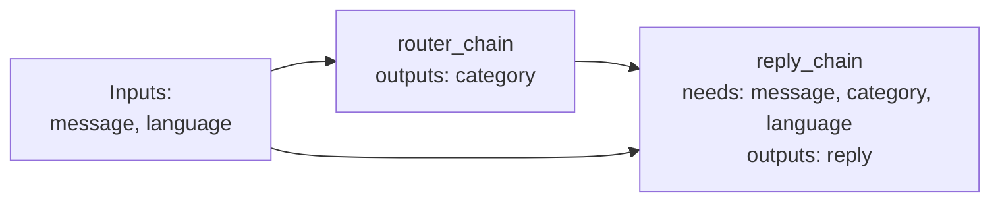

# Lecture Script: Generative AI — Getting Started with LangChain
> **Instructor Reference** — Module 3: GenAI & Agents | Academic Session 15.1 | Duration: 2 Hours

---

## Session Overview
**Goal:** By the end of this session, students can explain what LangChain adds over raw API calls, connect `ChatOpenAI` to OpenRouter, build `PromptTemplate` and `ChatPromptTemplate` objects with named variables, wrap them in `LLMChain`, and wire a two-step `SequentialChain` that routes a partner message and then replies in the partner's language.

**Student profile at this point:** They've hand-built raw API calls with retries (13.2), tested prompts (14.1) and used Pydantic with instructor (14.3) — they've written a lot of glue code and should feel it. Likely wrong assumptions: "LangChain makes the model smarter," "frameworks are magic I don't need to understand," or the opposite, "frameworks are pointless, I can write it myself." Boredom risk: low, but version confusion from online tutorials is high — be explicit about the pinned version.

**Key outcome:** Students should leave asking, before writing LLM code: "Which parts are reusable blocks — model, templates, steps — and which variable names connect them?"

> 🎯 **The one sentence this session must land:** *LangChain doesn't make the model smarter — it turns the plumbing you've been hand-writing into reusable blocks, so a multi-step pipeline is just templates and models wired together by variable names.*

---

## Timing Breakdown

| Segment | Duration | Cumulative |
|---|---|---|
| Opening — "Count Your Glue" | 8 min | 8 min |
| Concept Block 1: Why LangChain over Raw API Calls | 10 min | 18 min |
| Concept Block 2: Setup & ChatOpenAI with OpenRouter | 10 min | 28 min |
| Practical Block 1: Raw vs LangChain, Side by Side | 7 min | 35 min |
| Concept Block 3: PromptTemplate | 8 min | 43 min |
| Concept Block 4: ChatPromptTemplate | 10 min | 53 min |
| **BREAK** | 10 min | 63 min |
| Concept Block 5: LLMChain | 8 min | 71 min |
| Concept Block 6: SequentialChain | 12 min | 83 min |
| Practical Block 2: Live Coding Demo (TA Code) | 14 min | 97 min |
| Practical Block 3: Design a Three-Step Chain | 8 min | 105 min |
| Practical Block 4: Fix the Broken Wiring | 7 min | 112 min |
| Summary & Bridge | 4 min | 116 min |
| Q&A & Doubt Solving | 4 min | 120 min |

---

## Opening — "Count Your Glue" (8 min)

Open with this, verbatim-ish, with the last three sessions' code on screen:

> "Here's everything you wrote to route one partner message and reply to it: a `requests.post` with headers and a JSON body — 15 lines. A retry loop with backoff — 12 lines. F-string prompts. `['choices'][0]['message']['content']` parsing. Manual code to pass step 1's answer into step 2."

Pause. Ask the room:

> "How many of those lines are about the idea — route, then reply — and how many are plumbing?"

(Let them estimate. Usually: five lines of idea, forty of plumbing.)

> "Now imagine 50 developers at Swiggy, each writing their own retry loop and their own parsing. Fifty slightly different bugs. That's why frameworks exist."

**Pivot line:** "Today we keep every idea you've learned — system messages, temperature, templates, routing — and let LangChain handle the plumbing."

**Context for sessions ahead:** "Workflows in 15.2, retrievers in 16.3, RAG in 17.1 and agents in 17.2 are all LangChain blocks snapped together. Today you learn the snapping."

---

## Concept Block 1: Why LangChain over Raw API Calls (10 min)

> "You can grind fresh masala for every meal, or keep labelled jars — garam masala, sambar powder — and combine them. Same food, less repetition, and anyone in the kitchen can follow the recipe."

Write on the board:

> Raw calls: hand-written request + parsing · new provider = rewrite · hand-wired steps
> LangChain: `llm.invoke()` · swap one model object · chains wired by variable names

### 🔴 The trap / highest-value moment
> "Some of you think LangChain will make the helpdesk's answers better. It won't — same prompt, same model, same answer. Underneath every LangChain call is the exact POST request from 13.2, which is why you learned that first. Write this down: *a framework changes how fast and cleanly you build — not how smart the model is.*"

---

## Concept Block 2: Setup & ChatOpenAI with OpenRouter (10 min)

> "A universal TV remote: program it once, and the buttons stay the same even when you change TVs. `ChatOpenAI` is that remote."

```python
llm = ChatOpenAI(model="openai/gpt-4o-mini",
                 base_url="https://openrouter.ai/api/v1",
                 api_key=os.getenv("OPENROUTER_API_KEY"),
                 temperature=0, max_tokens=200, max_retries=3)
llm.invoke("...").content
```

> "Every setting is familiar. `base_url` points at OpenRouter, so 'ChatOpenAI' can talk to Claude, Gemini or Llama. And `max_retries=3` is your entire backoff loop from 13.2 in one argument. LangChain changes fast, so we pin version 0.3 for this module — code from an old blog post may not run."

### 🔴 The trap / highest-value moment
> "`llm.invoke(...)` returns a message object, not a string. Print it and you'll see token counts and metadata. Write this down: *add `.content` to get the text.*"

---

## Practical Block 1: Raw vs LangChain, Side by Side (7 min)

Put Session 13.2's raw call and the `ChatOpenAI` version side by side, and give pairs three minutes to draw lines between matching pieces. The answers: the URL becomes `base_url`; the Bearer header becomes `api_key`; `model`, `temperature` and `max_tokens` keep their names; the retry loop becomes `max_retries`; the `choices` parsing becomes `.content`. Nothing disappeared — it moved inside the framework. If someone asks why we bothered with raw requests, say that when LangChain throws a strange error at 2 am, they'll know it's just a POST request with a 401 or a 429 inside.

---

## Concept Block 3: PromptTemplate (8 min)

> "A wedding-card printer doesn't design a new card for every guest. One template — 'Dear ____, you're invited' — and only the name changes."

```python
router_template = PromptTemplate.from_template(
    "Classify this partner message into: payout, incentive, app_issue, safety, other.\n"
    "Reply with only the label.\n\nMessage: {message}")
router_template.input_variables      # ['message']
```

> "That's your 14.1 router prompt. The `{message}` blank is now named and checked — forget to fill it and you get a clear error instead of a silent bug."

### 🔴 The trap / highest-value moment
> "Put example JSON like `{\"label\": \"payout\"}` into a template and LangChain thinks `label` is a blank. Write this down: *a real curly brace in a template is written `{{` or `}}`.*"

---

## Concept Block 4: ChatPromptTemplate (10 min)

> "A call-centre script has the supervisor's briefing card and the customer's words — 13.2's system and user messages. A `ChatPromptTemplate` is a script where both parts can have blanks."

```python
reply_template = ChatPromptTemplate.from_messages([
    ("system", "You are the partner helpdesk. Reply in {language}, under 60 words."),
    ("human", "Issue category: {category}\nPartner message: {message}"),
])
```

> "Three blanks: language, category and message. LangChain says `human` and `ai` where the API says `user` and `assistant`. Chat models work best with role messages, so you'll use this almost always. And look at `{category}` — where will that value come from? Not from the partner. From another chain. Hold that thought."

### 🔴 The trap / highest-value moment
> "Once templates make it easy, people put the rules inside the human message — 'Reply in Hindi, under 60 words: {message}'. Same lesson as 13.2: a partner's text can argue with rules sitting next to it. Write this down: *rules go in system, the partner's words go in human.*"

---

## BREAK (10 min)

---

## Concept Block 5: LLMChain (8 min)

> "A tiffin service: one recipe card, one cook. You hand in today's ingredients and get a packed box back."

```python
router_chain = LLMChain(llm=llm, prompt=router_template, output_key="category")
router_chain.invoke({"message": "kal ka paisa nahi aaya"})
# {'message': 'kal ka paisa nahi aaya', 'category': 'payout'}
```

> "Template plus model, one call; the result is a dictionary of your inputs plus the answer under `output_key`. `LLMChain` is LangChain's classic chain — it works in 0.3 with a deprecation warning, and newer code writes `router_template | llm`. We use it today because `SequentialChain` builds on it; you'll use the pipe style from 15.2."

### 🔴 The trap / highest-value moment
> "Forget `output_key` and the answer is stored as `'text'`. Two chains both outputting `'text'`, and the next step can't tell them apart. Write this down: *always name your output — the name is how other steps find it.*"

---

## Concept Block 6: SequentialChain (12 min)

> "A Swiggy order: the restaurant cooks, the partner picks up, the partner delivers. Each step uses what the last one produced, and nobody re-explains the order."

Draw on the board:



```python
helpdesk = SequentialChain(chains=[router_chain, reply_chain],
                           input_variables=["message", "language"],
                           output_variables=["category", "reply"])
```

> "The router outputs `category`. The reply template has a `{category}` blank. Names match, so SequentialChain passes the value across automatically."

### 🔴 The trap / highest-value moment
> "If the router outputs `label` but the reply template wants `category`, SequentialChain refuses to even build. Write this down: *in a chain, variable names are the wires — one letter different and nothing connects.*"

---

## Practical Block 2: Live Coding Demo (TA Code) (14 min)

**Handoff line (must match TA code file's opening comment):** "Our helpdesk's two jobs — route the message, then reply in the partner's language — rebuilt as LangChain chains."

Hand off to `ta-code - Session 15.1 - Getting Started with LangChain.py`, narrating each `# --- EXPLAIN ---` block aloud:

1. Create `ChatOpenAI` pointed at OpenRouter — show the returned object's type, then `.content`
2. Build the router `PromptTemplate` — print its `input_variables` and the filled-in prompt
3. Build the reply `ChatPromptTemplate` — print its three blanks
4. Run `router_chain` alone — show the result dictionary
5. Run the `SequentialChain` on the three-message inbox — read each category and reply
6. Run the deliberately broken wiring (`output_key="label"`) — show the chain refusing to build

💬 Expect a question: "Why the deprecation warnings?" Welcome it. Say: "LangChain moved to a newer style. The old classes still work in the version we pinned; we hide the warnings in class so they don't distract — in your own projects, read them."

---

## Practical Block 3: Design a Three-Step Chain (8 min)

In pairs, students spend five minutes designing a three-step helpdesk chain: (1) detect the partner's language, (2) classify the category, (3) reply in the detected language — writing each chain's inputs and `output_key`, plus the SequentialChain's `input_variables` and `output_variables`. A model answer: `language_chain` (message → language), `router_chain` (message → category), `reply_chain` (message, category, language → reply), with `input_variables=["message"]` and `output_variables=["language", "category", "reply"]`. Point out that language is no longer an outside input — the first chain produces it. If pairs ask whether the router can go before the language chain, yes: they don't depend on each other, and only the reply chain must come last.

---

## Practical Block 4: Fix the Broken Wiring (7 min)

Show three broken chains and give students a minute each to find the bug: (1) the router's `output_key="label"` while the reply template uses `{category}` — rename one so they match; (2) `SequentialChain(input_variables=["message"])` while the reply template needs `{language}` and no chain produces it — add "language" to the inputs; (3) a template containing `Return {"label": "..."} for: {message}` — escape the braces as `{{"label": "..."}}`. Close with the rule: every blank must come from somewhere — the outside inputs or an earlier chain's output.

---

## Summary & Bridge (4 min)

| Concept | The one thing to remember |
|---|---|
| Why LangChain | Reusable blocks instead of plumbing — not a smarter model |
| ChatOpenAI + OpenRouter | `base_url` + `api_key`; `max_retries` replaces your loop; `.content` for text |
| PromptTemplate | Named blanks, reusable, checked; escape real braces as `{{ }}` |
| ChatPromptTemplate | Role messages with blanks — rules in system, content in human |
| LLMChain | Template + model; name the output with `output_key` |
| SequentialChain | Steps wired by matching variable names |

Close on the thesis line: "LangChain doesn't make the model smarter — it turns the plumbing you've been hand-writing into reusable blocks, so a multi-step pipeline is just templates and models wired together by variable names."

**Bridge to next session:** "Today's chains still return raw text — we used `.strip()` as a band-aid on the category. Session 15.2 — Building AI Workflows in LangChain — adds output parsers, including one that uses your Pydantic models from 14.3, and builds four real mini-apps: an extraction chain, a summariser, an FAQ bot and a CSV copilot."

---

## Q&A & Doubt Solving (4 min)

**Q: Should I learn `LLMChain` or the pipe `|` style?**
→ Both. `LLMChain` and `SequentialChain` make the "named outputs feed named inputs" idea very visible; most new code uses the pipe style, which you'll use from 15.2.

**Q: Is LangChain the only framework?**
→ No — LlamaIndex, Haystack and others exist, and many teams use raw SDKs. The ideas — templates, chains, retrievers, agents — transfer between them.

**Q: Does LangChain cost money?**
→ The library is free and open source. You still pay your model provider for every call it makes on your behalf.

**Q: Can one chain use a different model from another?**
→ Yes — each `LLMChain` has its own `llm`. A cheap small model could route and a stronger one write the reply, which is a common cost trick.

**Q: How do I see the exact prompt LangChain sent?**
→ Call `template.format(...)` or `template.invoke(...)` yourself and print it. Debugging starts with seeing the exact text the model received.

---

## Instructor Notes
- **Words not yet earned:** output parsers and PydanticOutputParser (15.2), retrievers and vector stores (16.3), RAG (17.1), agents and tools (17.2). Mention the pipe style only as "the newer way to write LLMChain."
- **Biggest risk in this session:** version confusion from online tutorials. Say the pinned version (0.3) out loud at least twice, and put the install line on the board.
- **Board management:** keep the raw-vs-LangChain comparison and the SequentialChain wiring diagram visible from Concept Block 6 onward.
- **Common confusions, numbered:**
  1. Thinking LangChain improves answer quality
  2. Printing the message object instead of `.content`
  3. Unescaped braces in templates
  4. Forgetting `output_key` (the default is `"text"`)
  5. Mismatched variable names between chains
  6. A template blank that no input or earlier chain provides
- **Cross-references:** Session 15.2 adds parsers and the pipe style; Session 16.3 adds retrievers as another block; Session 17.1 combines retriever, template and model; Session 17.2 lets the model choose which block to run.
- **Local/cultural context notes:** the masala-jar and tiffin-service analogies work well. Keep the same three inbox messages (Hinglish payout, rain bonus, Gachibowli safety) — they carry forward to 15.2.
