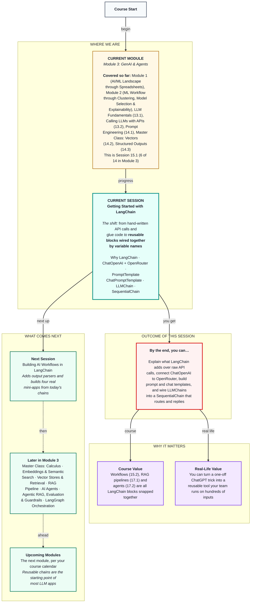

# Generative AI: Getting Started with LangChain
> **Pre-Read — Academic Session 15.1** | Module 3: GenAI & Agents
---
## Mental Map


---

## What You'll Learn

In this pre-read, you'll discover:
- Why frameworks like LangChain exist when you can already call an LLM with `requests`
- How to set up LangChain and connect it to OpenRouter with `ChatOpenAI`
- How `PromptTemplate` and `ChatPromptTemplate` turn prompts into reusable fill-in-the-blank forms
- How `LLMChain` and `SequentialChain` join templates and models into multi-step flows

---

## A. Why LangChain over Raw API Calls?

**💡 Analogy:** You can grind fresh masala for every meal. Or you can keep labelled jars — garam masala, sambar powder, biryani mix — and simply combine them. Same food, far less repetition, and anyone in the kitchen can follow the recipe.

**One-line definition: LangChain is a Python framework of ready-made, swappable building blocks — models, prompt templates, chains, parsers, retrievers and agents — so you write the idea of your pipeline instead of the plumbing.**

**Worked example:** Since Session 13.2 you've hand-written about 15 lines for each API call (URL, headers, JSON body), about 12 lines of retry-with-backoff, f-string prompts in 14.1, `["choices"][0]["message"]["content"]` parsing, and manual code to pass step 1's answer into step 2. To route a partner message and then reply to it, perhaps five lines are the actual idea and forty are glue. LangChain replaces the glue with one `invoke()` call per block, lets you swap providers by changing one model object, and connects steps by variable name.

**⚠️ Common trap:** Thinking LangChain makes the model smarter. The same prompt to the same model gives the same quality of answer. LangChain changes how quickly and cleanly you build — underneath, it still sends the POST request from Session 13.2.

---

## B. LangChain Setup and ChatOpenAI with an OpenRouter Base URL

**💡 Analogy:** A universal TV remote: program it once and the same buttons work. Change TVs, reprogram one setting, and the buttons stay the same.

**One-line definition: `ChatOpenAI` is LangChain's model object for any OpenAI-style chat API; pointing its `base_url` at OpenRouter lets it reach almost any model.**

```python
# pip install "langchain==0.3.*" "langchain-openai==0.3.*" python-dotenv
import os
from dotenv import load_dotenv
from langchain_openai import ChatOpenAI

load_dotenv()
llm = ChatOpenAI(model="openai/gpt-4o-mini",
                 base_url="https://openrouter.ai/api/v1",
                 api_key=os.getenv("OPENROUTER_API_KEY"),
                 temperature=0, max_tokens=200, max_retries=3)

print(llm.invoke("In one line, what is a weekly payout?").content)
```

**Worked example:** Every setting is familiar. `temperature` and `max_tokens` are the same dials from Sessions 13.1 and 13.2. `base_url` and `api_key` replace the URL and Bearer header. `max_retries=3` replaces your entire backoff loop. We pin LangChain 0.3 for this module because LangChain changes quickly — code copied from an old blog post may not run.

**⚠️ Common trap:** Printing the result of `llm.invoke(...)` and getting a confusing object full of metadata. It returns a message object, not a string. Add `.content` to get the text.

---

## C. PromptTemplate and ChatPromptTemplate

**💡 Analogy:** A wedding-card printer doesn't design a new card for every guest. There's one template — "Dear ____, you're invited..." — and only the name changes. A call-centre script adds a second layer: the supervisor's briefing card stays the same, the customer's words change every call.

**One-line definition: A `PromptTemplate` is a prompt with named blanks in curly braces; a `ChatPromptTemplate` is a list of role-tagged messages (system, human, ai) that can each contain blanks.**

```python
from langchain_core.prompts import PromptTemplate, ChatPromptTemplate

router_template = PromptTemplate.from_template(
    "Classify this partner message into: payout, incentive, app_issue, safety, other.\n"
    "Reply with only the label.\n\nMessage: {message}")

reply_template = ChatPromptTemplate.from_messages([
    ("system", "You are the partner helpdesk. Reply in {language}, under 60 words."),
    ("human", "Issue category: {category}\nPartner message: {message}"),
])
```

**Worked example:** `router_template` is your Session 14.1 router prompt, now named and reusable: `router_template.input_variables` returns `['message']`, and forgetting to fill a blank gives a clear error instead of a silent bug. `reply_template` has three blanks — `language`, `category` and `message`. LangChain calls the roles `human` and `ai`, the same as `user` and `assistant` in Session 13.2. Chat models work best with role messages, so in practice you'll use `ChatPromptTemplate` almost always.

**⚠️ Common trap:** Writing example JSON such as `{"label": "payout"}` inside a template. LangChain thinks `label` is a blank. A real curly brace must be written `{{` or `}}`.

---

## D. LLMChain: Template + Model in One Unit

**💡 Analogy:** A tiffin service: one fixed recipe card plus one cook. You hand in today's ingredients and get back a packed box, without thinking about the kitchen.

**One-line definition: An `LLMChain` joins a prompt template and a model so that one call fills the blanks, calls the model and returns the answer under a name you choose with `output_key`.**

```python
from langchain.chains import LLMChain

router_chain = LLMChain(llm=llm, prompt=router_template, output_key="category")
result = router_chain.invoke({"message": "kal ka paisa nahi aaya"})
print(result["category"])        # "payout"
```

**Worked example:** The result is a dictionary holding your inputs plus the answer under `"category"`. `LLMChain` is LangChain's classic chain: it still works in 0.3, with a deprecation warning. Newer code writes the same thing with a pipe, `router_template | llm`, which you'll use from Session 15.2. We learn `LLMChain` first because `SequentialChain` builds directly on it.

**⚠️ Common trap:** Forgetting `output_key`. The default name is `"text"`, and if two chains both output `"text"`, the next step can't tell them apart. Always name your output.

---

## E. SequentialChain: Steps That Feed Each Other

**💡 Analogy:** A Swiggy order moves through steps: the restaurant cooks, the partner picks up, the partner delivers. Each step uses what the previous one produced, and nobody re-explains the order at every step.

**One-line definition: A `SequentialChain` runs several chains in order and passes each chain's output to the next by matching variable names.**

```python
from langchain.chains import SequentialChain

reply_chain = LLMChain(llm=llm, prompt=reply_template, output_key="reply")
helpdesk = SequentialChain(chains=[router_chain, reply_chain],
                           input_variables=["message", "language"],
                           output_variables=["category", "reply"])

out = helpdesk.invoke({"message": "kal ka paisa nahi aaya", "language": "simple Hindi"})
```

**Worked example:** The router chain outputs `category`. The reply template has a `{category}` blank. Because the names match, `SequentialChain` fills it automatically — no manual saving or passing. The only outside inputs are `message` and `language`; every other blank must be produced by an earlier chain.

**⚠️ Common trap:** A name mismatch. If the router's `output_key` is `"label"` but the reply template asks for `{category}`, building the chain fails with "Missing required input keys". Variable names are the wires — one letter different and nothing connects.

---

## Quick Reference — LangChain Building Blocks

| Your situation | Use this | Because |
|---|---|---|
| Call any OpenRouter model | `ChatOpenAI(base_url=..., api_key=..., model=...)` | One object, built-in retries |
| A single reusable instruction | `PromptTemplate` | Named blanks, checked automatically |
| System rules plus user content | `ChatPromptTemplate` | Role messages with blanks |
| Template + model as one unit | `LLMChain` (or `template | llm`) | One `invoke`, named output |
| Step 2 needs step 1's answer | `SequentialChain` | Wires steps by variable name |
| Example JSON inside a template | Escape as `{{ }}` | Single braces mean "blank" |

---

## Practice Exercises

1. **Concept Detective** — Look at your `ask_llm()` helper from Session 13.2. List three things it does that `ChatOpenAI` now does for you.

2. **Spot the Error** — Building a SequentialChain fails with "Missing required input keys: {'category'}". The router chain has `output_key="label"`. What's wrong, and what are two ways to fix it?

3. **Planning Ahead** — Design a three-step SequentialChain: (1) detect the partner's language, (2) classify the category, (3) write the reply in the detected language. For each chain, list its input variables and `output_key`.

4. **Pattern Recognition** — A template reads `Return JSON like {"label": "payout"} for: {message}`. What will LangChain think the blanks are, and how do you fix it?

5. **Real-Life Application** — Describe a two-step text task from your work or college (for example, summarise a document, then write an email about it). Sketch it as two chains with named outputs.

---

> ✅ **You're done!** You can now explain why LangChain exists, connect it to OpenRouter, build reusable prompt and chat templates, and wire chains so each step's output feeds the next automatically.
>
> Next up: **Session 15.2 — Building AI Workflows in LangChain**, where you add output parsers and turn these chains into real mini-apps: an extraction pipeline, a summariser, an FAQ bot and a CSV copilot.
