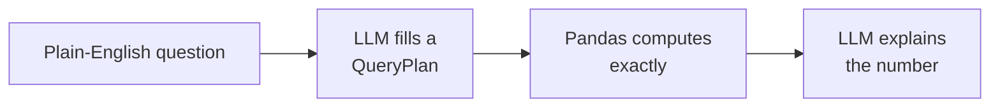

# Lecture Script: Generative AI — Building AI Workflows in LangChain
> **Instructor Reference** — Module 3: GenAI & Agents | Academic Session 15.2 | Duration: 2 Hours

---

## Session Overview
**Goal:** By the end of this session, students can end a chain with the right output parser (`StrOutputParser`, `JsonOutputParser`, `PydanticOutputParser`), build extraction and summarisation chains in the pipe style, design a grounded FAQ bot with a safe fallback, implement the plan-then-compute CSV copilot pattern, and connect workflows into a pipeline that passes structured data between steps.

**Student profile at this point:** They know `ChatOpenAI`, templates, `LLMChain` and `SequentialChain` from 15.1, Pydantic and instructor from 14.3, and Pandas from Module 1. They've seen chains return free text that needed `.strip()` band-aids. Likely wrong assumptions: "the parser makes the model output the right format," "an LLM can total numbers from text," and "a CSV copilot means letting the LLM write and run Pandas code." Boredom risk: low, but four mini-apps in one session can feel scattered — keep returning to "what does partner-ops need?"

**Key outcome:** Students should leave asking, for any AI workflow: "What structured thing does each step hand to the next — and which steps should be Python, not the LLM?"

> 🎯 **The one sentence this session must land:** *Real AI workflows aren't one clever prompt — they're steps that hand structured data to each other, where the LLM does the language and Python does the maths.*

---

## Timing Breakdown

| Segment | Duration | Cumulative |
|---|---|---|
| Opening — "Four Asks from Partner-Ops" | 8 min | 8 min |
| Concept Block 1: Output Parsers & the Pipe Style | 10 min | 18 min |
| Concept Block 2: PydanticOutputParser & JsonOutputParser | 10 min | 28 min |
| Practical Block 1: Pick the Parser | 7 min | 35 min |
| Concept Block 3: Extraction & Summarisation Chains | 10 min | 45 min |
| Concept Block 4: FAQ Bot Design | 8 min | 53 min |
| **BREAK** | 10 min | 63 min |
| Concept Block 5: The CSV Copilot Pattern | 12 min | 75 min |
| Practical Block 2: Live Coding Demo (TA Code) | 14 min | 89 min |
| Concept Block 6: Multi-Step Pipelines | 8 min | 97 min |
| Practical Block 3: Design the Pipeline | 8 min | 105 min |
| Practical Block 4: "Just Let It Run the Code?" Debate | 7 min | 112 min |
| Summary & Bridge | 4 min | 116 min |
| Q&A & Doubt Solving | 4 min | 120 min |

---

## Opening — "Four Asks from Partner-Ops" (8 min)

Open with this, verbatim-ish, with four sticky-note asks on screen:

> "Swiggy's partner-ops manager has four asks for our helpdesk. One: turn every partner message into a clean ticket. Two: give me a 5-line summary of this week's complaints. Three: answer the common questions instantly — but only with approved answers. Four: let me ask the partner activity CSV questions in plain English."

Pause. Ask the room:

> "Ask number two: summarise 200 complaints, including the total rupees disputed. Who would just paste all 200 messages into ChatGPT and ask for the total?"

(Some hands.)

> "By the end of today you'll know why that gives a confident, wrong number — and the three-step pattern that gives the right one."

**Pivot line:** "Last session you built chains. Today you build products — every one is a 15.1 chain with a new piece at the end: a parser that turns text into something your code can trust."

**Context for sessions ahead:** "Today's FAQ bot becomes a RAG bot in 17.1, and today's CSV copilot becomes an agent's tool in 17.2."

---

## Concept Block 1: Output Parsers & the Pipe Style (10 min)

> "At a delivery hub, the bag arrives at the counter and someone unpacks it — food to the shelf, bill to the file. An output parser is that person at the end of a chain."

Write on the board:

> `chain = prompt | llm | parser` — "|" means "then"
> `StrOutputParser` → text · `JsonOutputParser` → dict, no checks · `PydanticOutputParser` → validated object

> "In 15.1 we wrote `LLMChain(llm=..., prompt=...)`. The pipe does the same thing and lets us add a parser at the end."

### 🔴 The trap / highest-value moment
> "A parser reads; it doesn't command. If the model writes broken JSON, the parser just fails. Write this down: *the parser checks the output — the prompt still has to ask for the right format.*"

---

## Concept Block 2: PydanticOutputParser & JsonOutputParser (10 min)

> "In 14.3, instructor handed the model a form. `PydanticOutputParser` is the same form, but it plugs into a chain — and it writes the 'how to fill this in' instructions for you."

```python
parser = PydanticOutputParser(pydantic_object=PartnerTicket)
prompt = ChatPromptTemplate.from_messages([
    ("system", "Extract a ticket...\n{format_instructions}"),
    ("human", "{message}"),
]).partial(format_instructions=parser.get_format_instructions())
extract_chain = prompt | llm | parser
```

> "Three moves: make the parser from your model, fill its format instructions into the prompt once with `.partial()`, and put the parser at the end. `JsonOutputParser` is the loose cousin — it returns a dict and checks nothing, so '₹600' sails through and breaks your database later."

### 🔴 The trap / highest-value moment
> "Forget `{format_instructions}` and the model has no idea what shape you want, so most replies fail to parse. Write this down: *PydanticOutputParser needs its format instructions in the prompt.*"

---

## Practical Block 1: Pick the Parser (7 min)

Rapid fire — which parser, and why: a warm reply to a partner (`StrOutputParser` — text for a person); tickets that go into the ops database (`PydanticOutputParser` — guaranteed types); a quick notebook experiment to see which fields could be pulled out (`JsonOutputParser` — loose exploration is fine); classifying a message into one of five labels (`PydanticOutputParser` with a `Literal` — no more "Label: payout"); the weekly brief (`StrOutputParser`). Close with the rule: match the parser to whoever consumes the output — code needs structure, people need prose.

---

## Concept Block 3: Extraction & Summarisation Chains (10 min)

> "A newspaper desk has two jobs: reporters pull facts out of interviews — extraction — and editors turn a pile of facts into a short story — summarisation."

Write on the board:

> Summary prompt: who it's for (ops manager) · how long (5 bullets) · "use ONLY the data given" · what must be included (rupee totals)

> "You've just seen extraction. A good summary prompt has those four ingredients."

### 🔴 The trap / highest-value moment
> "Back to my opening question. Paste 200 raw messages and ask for the total disputed, and the LLM adds up numbers it reads from text — LLMs are poor calculators, so you get a confident, wrong total. Write this down: *extract first, total in Pandas, then let the LLM write around correct numbers.*"

---

## Concept Block 4: FAQ Bot Design (8 min)

> "A new support agent gets a laminated FAQ card on day one. If the question's on the card, she reads from it. If not, she says 'let me check and get back to you.'"

Write on the board:

> "Answer ONLY using this FAQ: {faq}"
> "If the answer is not in the FAQ, reply exactly: 'I'll connect you to a support agent.'"

> "Line one grounds it. Line two — the fallback — is the more important one: a bot that says 'I'll connect you' is safe, while a bot that invents 'yes, bicycles are fine' creates a policy that doesn't exist. Remember 13.2? The model guessed the payout day. Today, for the first time, it answers from approved text."

### 🔴 The trap / highest-value moment
> "Then someone says, 'Let's paste all 300 FAQs and the whole handbook in.' 13.1's cost and context-window problem returns. Write this down: *stuffing the prompt works for a small FAQ — big knowledge needs retrieval (RAG, 17.1).*"

---

## BREAK (10 min)

---

## Concept Block 5: The CSV Copilot Pattern (12 min)

> "A manager asks her analyst, 'Which zone has the lowest average partner rating?' The analyst decides which column and calculation to use, runs it in Excel, then explains the result. Plan, compute, explain — three different jobs."

Draw on the board:



```python
class QueryPlan(BaseModel):
    metric: Literal["orders_last_30_days", "avg_rating", "months_active", "churned"]
    aggregation: Literal["mean", "sum", "count", "max", "min"]
    group_by: Optional[Literal["zone", "churned"]] = None
```

> "It's Module 2's 200-partner churn data, plus a `zone` column. The LLM never sees the rows — only the column names — and the `Literal`s mean it can't ask for a column that doesn't exist or an operation we didn't allow. Our code then runs `df.groupby(plan.group_by)[plan.metric].agg(plan.aggregation)`. Exact and safe."

### 🔴 The trap / highest-value moment
> "Two tempting shortcuts: paste the CSV into the prompt (unreliable maths, and impossible at 200,000 rows), or let the LLM write Pandas code and run it with `exec()` (now a cleverly worded question could make your server run anything). Write this down: *the LLM plans, Python computes — and the plan can only contain operations you allowed.*"

---

## Practical Block 2: Live Coding Demo (TA Code) (14 min)

**Handoff line (must match TA code file's opening comment):** "Four asks from Swiggy partner-ops — clean tickets, a weekly brief, an FAQ bot, and a CSV copilot — built as chains."

Hand off to `ta-code - Session 15.2 - Building AI Workflows in LangChain.py`, narrating each `# --- EXPLAIN ---` block aloud:

1. Build `extract_chain` with `PydanticOutputParser` — show a validated ticket, then the loose `JsonOutputParser` dictionary for contrast
2. `.batch()` six messages → a DataFrame → `groupby` totals → the weekly brief — point out that the brief's rupee totals match the Pandas table exactly
3. Run the FAQ bot on two answerable questions (one in Hinglish), then "Can I deliver on a bicycle?" — show the fallback line
4. Run the CSV copilot — show the plan, the Pandas result and the explanation for both questions

💬 Expect a comment: "The brief got the numbers right — so LLMs can do maths?" Welcome it. Say: "Look again — it didn't add anything. Pandas added. The LLM only copied numbers we handed it. That's the whole trick."

---

## Concept Block 6: Multi-Step Pipelines (8 min)

> "On a factory line, one station cuts, the next stitches, the next packs. Each station gets a standard part, not a random pile — that's why the line doesn't jam."

Write on the board:

> raw messages → `extract_chain.batch(...)` → list of PartnerTicket (structured)
> → Pandas groupby → totals table (exact numbers)
> → `summary_chain` → 5-bullet brief (prose for a person)

> "Look at what crosses each arrow: validated objects, then an exact table, then prose. Free text only appears at the very end, for a human. And `.batch()` runs a chain on a whole list in parallel — far faster than a loop."

### 🔴 The trap / highest-value moment
> "If step 1 hands step 2 'around ₹600 I think', step 2 has to guess again and errors pile up down the line. Write this down: *pass structured data between steps; free text only at the end, for people.*"

---

## Practical Block 3: Design the Pipeline (8 min)

In pairs, students spend five minutes designing this pipeline for partner-ops: "Every Monday, read last week's 1,000 customer complaints about restaurants and send me a brief with the top three issues and the total refunds requested." A model answer: (1) `extract_chain.batch(...)` with a `RestaurantComplaint` model from 14.3's exercise → a list of objects; (2) Pandas `value_counts()` on the issue and `sum()` on the refund amount → a totals table; (3) `summary_chain` asking for the top three issues and total refunds, using only those numbers → the brief. If someone asks about messages that fail extraction, use 14.3's lesson: catch and count them, and put the count in the brief — "12 messages couldn't be processed."

---

## Practical Block 4: "Just Let It Run the Code?" Debate (7 min)

Split the room. Side A argues the CSV copilot should let the LLM write and run Pandas code, so it can answer any question; side B argues it should only fill a fixed QueryPlan. Give two minutes to prepare and one minute per side. Surface both truths: a fixed plan limits which questions can be answered, but running generated code means a question like "...and also delete the data folder" could do real damage, and arithmetic mistakes stay invisible. Real teams compromise — widen the plan schema as new question types appear, or run generated code only in a locked-down sandbox with read-only data. We formalise these trade-offs as guardrails in 18.1.

---

## Summary & Bridge (4 min)

| Concept | The one thing to remember |
|---|---|
| Output parsers | The last block in a chain — they read output; the prompt still asks for the format |
| Pydantic vs JSON parser | Pydantic validates types; JSON checks nothing; include format instructions |
| Extraction & summarisation | Extract, compute in Pandas, then summarise around correct numbers |
| FAQ bot | Answer only from approved text, with an exact fallback line |
| CSV copilot | The LLM plans (Literal-limited), Python computes, the LLM explains |
| Pipelines | Structured hand-offs between steps; prose only at the end |

Close on the thesis line: "Real AI workflows aren't one clever prompt — they're steps that hand structured data to each other, where the LLM does the language and Python does the maths."

**Bridge to next session:** "Our FAQ bot works for a few answers, but the full handbook has hundreds of pages. To find the right page for 'kal ka paisa nahi aaya' we'll need to measure meaning with vectors — and to understand those, we need to know how models learn. Session 16.1 — Master Class: Calculus Intuition — is the maths of change and 'walking downhill' behind that learning."

---

## Q&A & Doubt Solving (4 min)

**Q: When should I use instructor (14.3) instead of `PydanticOutputParser`?**
→ Both use the same Pydantic models. instructor is great for standalone extraction with automatic retries; `PydanticOutputParser` fits naturally inside LangChain chains and pipelines.

**Q: What if a parser fails inside `.batch()`?**
→ By default one failure raises an error. Pass `return_exceptions=True` to `.batch()` so failures come back as error objects you can count and send to a person.

**Q: Can the FAQ bot remember earlier questions?**
→ Only if you resend the history (13.2). For a simple FAQ bot, each question is usually independent, which keeps it cheap.

**Q: How big can the FAQ in the prompt get?**
→ Until cost, speed or accuracy suffers — often a few dozen short Q&As. Beyond that, retrieval (17.1) is the right tool.

**Q: Is the CSV copilot pattern used in real products?**
→ Yes — many "chat with your data" tools translate questions into structured queries, often SQL, and run them in a database. Same plan-then-compute idea.

---

## Instructor Notes
- **Words not yet earned:** embeddings, vector stores, retrievers and RAG (16.2–17.1), agents, tool calling and ReAct (17.2), guardrails (18.1).
- **Biggest risk in this session:** scatter — four mini-apps. Keep the four sticky-note asks on the board and tick each off as you build it.
- **Board management:** keep the parser list, the plan-compute-explain diagram and the pipeline arrows visible from when each is introduced.
- **Common confusions, numbered:**
  1. Thinking the parser controls the model's output format
  2. Missing `{format_instructions}` with `PydanticOutputParser`
  3. Letting the LLM total numbers from raw text
  4. Building an FAQ bot without an exact fallback line
  5. Executing LLM-generated code in a CSV copilot
  6. Passing free text between pipeline steps
- **Cross-references:** Sessions 16.2–16.3 make large knowledge searchable; Session 17.1 upgrades the FAQ bot to RAG; Session 17.2 turns the CSV copilot into an agent tool; Session 18.1 formalises the safety trade-offs.
- **Local/cultural context notes:** reusing Module 2's churn dataset (now with Hyderabad zones) gives a satisfying "it all connects" moment. The Hinglish FAQ question, "Paisa kab aata hai?", lands well. The FAQ text is illustrative, not a real policy.
