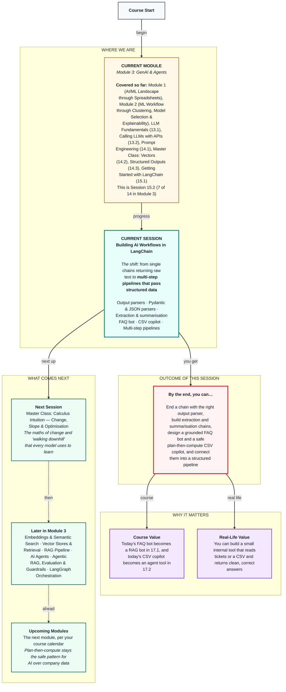

# Generative AI: Building AI Workflows in LangChain
> **Pre-Read — Academic Session 15.2** | Module 3: GenAI & Agents
---
## Mental Map


---

## What You'll Learn

In this pre-read, you'll discover:
- How output parsers turn a model's text into strings, dictionaries or validated objects inside a chain
- How to build extraction and summarisation chains with the pipe (`|`) style
- How to design a simple FAQ bot, and where its limits are
- The CSV copilot pattern: the LLM plans the question, Python computes the answer
- How to build multi-step pipelines that pass structured data from step to step

---

## A. LangChain Output Parsers

**💡 Analogy:** At a delivery hub, the raw bag arrives at the counter and someone unpacks it — food to the shelf, bill to the file. Without that person, the bag just sits there. An output parser is that person at the end of a chain.

**One-line definition: An output parser is the last block in a chain; it converts the model's raw reply into the shape your code needs — a string, a dictionary or a validated object.**

```python
from langchain_core.output_parsers import StrOutputParser

reply_chain = reply_template | llm | StrOutputParser()     # "|" means "then"
text = reply_chain.invoke({"message": "...", "category": "payout", "language": "Hindi"})
```

**Worked example:** From today we use the pipe style, `prompt | llm | parser`, which does what `LLMChain` did in Session 15.1 but lets us add a parser at the end. `StrOutputParser` returns plain text, for replies and summaries a person will read. `JsonOutputParser` returns a Python dictionary with no checks. `PydanticOutputParser` returns a validated object, using your Session 14.3 models.

**⚠️ Common trap:** Thinking the parser forces the model to behave. A parser only reads the reply. If the model writes broken JSON, the parser simply fails — the prompt still has to ask for the right format.

---

## B. PydanticOutputParser and JsonOutputParser

**💡 Analogy:** In 14.3, instructor was the receptionist handing the LLM a form. `PydanticOutputParser` is the same form, but it slots into a LangChain chain — and it also writes the instructions on how to fill it in.

**One-line definition: `PydanticOutputParser` takes your Pydantic model, generates format instructions for the prompt and validates the reply into an object; `JsonOutputParser` just turns the reply into a dictionary without checking types.**

```python
from langchain_core.output_parsers import PydanticOutputParser

parser = PydanticOutputParser(pydantic_object=PartnerTicket)       # the 14.3 model
extract_prompt = ChatPromptTemplate.from_messages([
    ("system", "Extract a support ticket from a partner's message.\n{format_instructions}"),
    ("human", "{message}"),
]).partial(format_instructions=parser.get_format_instructions())

extract_chain = extract_prompt | llm | parser
```

**Worked example:** `get_format_instructions()` writes the "return JSON matching this schema" text for you, and `.partial(...)` fills that blank once, so callers only pass `message`. `extract_chain.invoke({"message": "bhai mera ID P-20417 hai, payout ₹600 kam aaya"})` returns a `PartnerTicket` whose `amount_disputed` is the int 600. With `JsonOutputParser`, a value like `"₹600"` would pass silently — and break your database later.

**⚠️ Common trap:** Forgetting `{format_instructions}` in the prompt. Without it, the model has no idea what shape you want, and most replies fail to parse.

---

## C. Extraction and Summarisation Chains

**💡 Analogy:** A newspaper desk has two jobs: reporters pull facts out of interviews (extraction), and editors turn a pile of facts into a short headline story (summarisation).

**One-line definition: An extraction chain pulls fixed fields out of unstructured text; a summarisation chain condenses a lot of information into a short version for a specific reader.**

```python
summary_prompt = ChatPromptTemplate.from_messages([
    ("system", "You write crisp weekly briefs for the partner-ops manager. "
               "Maximum 5 bullet points. Use ONLY the data given. Mention rupee totals."),
    ("human", "This week's ticket data:\n{ticket_table}"),
])
summary_chain = summary_prompt | llm | StrOutputParser()
```

**Worked example:** The partner-ops team wants every message turned into a clean ticket, plus a weekly brief. A good summarisation prompt says who the reader is (the ops manager), how long to be (5 bullets), to use only the data given, and what must be included (rupee totals). Fed a table of this week's ticket totals, it returns bullets such as "Payout complaints are the largest group, with the highest disputed total."

**⚠️ Common trap:** Asking an LLM to add up 200 rupee amounts straight from raw messages. LLMs are unreliable calculators and will give a confident, wrong total. Extract first, total the numbers with Pandas, then let the LLM write the story around correct numbers.

---

## D. FAQ Bot Design

**💡 Analogy:** A new support agent gets a laminated FAQ card on her first day. If a partner's question is on the card, she reads from it. If it isn't, she says, "Let me check and get back to you."

**One-line definition: A simple FAQ bot puts a small, approved list of questions and answers in the system prompt, tells the model to answer only from it, and gives an exact fallback line for everything else.**

```python
FAQ = """
Q: When are weekly payouts credited? A: Every Friday by 8 pm to your registered bank account.
Q: How is the rain bonus paid? A: Rs 10 extra per order delivered during an active rain alert.
Q: How do I change my bank account? A: Profile > Bank Details; changes take 2 working days.
"""
faq_prompt = ChatPromptTemplate.from_messages([
    ("system", "Answer ONLY using this FAQ:\n{faq}\nIf the answer is not in the FAQ, reply exactly: "
               "'I'll connect you to a support agent.' Reply in the partner's language."),
    ("human", "{question}"),
]).partial(faq=FAQ)
faq_bot = faq_prompt | llm | StrOutputParser()
```

**Worked example:** *(This FAQ is illustrative, written for this course — not a real policy.)* "Paisa kab aata hai?" gets "Har Friday raat 8 baje tak aapke bank account mein." "Can I deliver on a bicycle?" gets "I'll connect you to a support agent." — the FAQ is silent, so the bot doesn't guess. In Session 13.2 the model confidently guessed the payout day; now it answers from approved text.

**⚠️ Common trap:** Growing the FAQ to hundreds of questions, or pasting the whole partner handbook into the prompt. Every word is resent on every call — Session 13.1's cost and context-window problem. Session 17.1 (RAG) fixes this by fetching only the relevant passages.

---

## E. The CSV Copilot Pattern

**💡 Analogy:** A manager asks her analyst, "Which zone has the lowest average partner rating?" The analyst doesn't guess. She decides which column and calculation are needed, runs it in Excel, then explains the result. Planning, computing and explaining are three different jobs.

**One-line definition: A CSV copilot answers plain-English questions about a table safely: the LLM turns the question into a structured plan, Python executes the plan, and the LLM explains the result.**

```python
class QueryPlan(BaseModel):
    metric: Literal["orders_last_30_days", "avg_rating", "months_active", "churned"]
    aggregation: Literal["mean", "sum", "count", "max", "min"]
    group_by: Optional[Literal["zone", "churned"]] = None
```

**Worked example:** We reuse Module 2's 200-partner churn data, plus a `zone` column. For "Which zone has the lowest average rating?", the LLM fills the plan `{"metric": "avg_rating", "aggregation": "mean", "group_by": "zone"}`. Python runs `df.groupby("zone")["avg_rating"].mean()` and gets exact numbers. The LLM then explains, for example, "Kukatpally has the lowest average rating." The `Literal` fields mean the LLM can't ask for a column that doesn't exist or an operation you didn't allow.

**⚠️ Common trap:** Taking a shortcut. Pasting the whole CSV into the prompt gives unreliable maths and won't fit at 200,000 rows. Letting the LLM write Pandas code and running it blindly means a cleverly worded question could make your computer run anything. The LLM plans; Python computes.

---

## F. Multi-Step Pipelines

**💡 Analogy:** On a factory line, one station cuts, the next stitches and the next packs. Each station receives a standard part, not a random pile — that's why the line doesn't jam.

**One-line definition: A multi-step pipeline chains several workflows so that each step passes structured output — not free text — to the next.**

```python
tickets = extract_chain.batch([{"message": m} for m in messages])     # many at once
df = pd.DataFrame([t.model_dump() for t in tickets])
totals = df.groupby("category").agg(tickets=("category", "size"),
                                    disputed=("amount_disputed", "sum"))
brief = summary_chain.invoke({"ticket_table": totals.to_string()})
```

**Worked example:** The weekly ops pipeline is: raw partner messages → `extract_chain` → a list of `PartnerTicket` objects → Pandas totals → `summary_chain` → a 5-bullet brief. `.batch()` runs the chain on a whole list in parallel, much faster than a loop. Because step 2 receives validated objects, every `amount_disputed` is an int or `None`, so the rupee totals are exact and the summary is built on correct numbers.

**⚠️ Common trap:** Passing free text between steps. If step 1 returns "about ₹600 I think", step 2 has to guess again and errors pile up down the line. Pass structured data between steps; free text only belongs at the end, for people.

---

## Quick Reference — Which Workflow Pattern?

| Your situation | Use this | Because |
|---|---|---|
| You want plain text out | `prompt | llm | StrOutputParser()` | Simplest chain |
| You need guaranteed fields | `PydanticOutputParser` + format instructions | Validated objects inside a chain |
| A small set of approved answers | FAQ in the system prompt with a fallback | Simple and grounded |
| A large knowledge base | RAG (Session 17.1) | You can't paste it all |
| Questions about a table | CSV copilot: LLM plans, Pandas computes | Exact maths, no arbitrary code |
| A summary that needs numbers | Extract → compute → summarise | LLMs aren't calculators |

---

## Practice Exercises

1. **Concept Detective** — A chain is `prompt | llm | JsonOutputParser()`, and the database later rejects `"amount": "₹600"`. Which parser would have caught this earlier, and why?

2. **Spot the Error** — An extraction prompt has no `{format_instructions}`, and `PydanticOutputParser` fails on most replies. Explain why and fix the prompt.

3. **Planning Ahead** — The ops manager asks, "How many partners in Madhapur churned?" Which fields does the current `QueryPlan` lack? Add them.

4. **Pattern Recognition** — An FAQ bot answers "Can I deliver on a bicycle?" with "Yes, bicycles are allowed in all zones," though the FAQ says nothing about bicycles. What went wrong in the design, and which line of the prompt should prevent it?

5. **Real-Life Application** — Sketch a three-step pipeline for a task you know (for example, customer reviews → extracted ratings and issues → monthly summary). For each step, name what goes in and what structured thing comes out.

---

> ✅ **You're done!** You can now end chains with the right output parser, build extraction and summarisation workflows, design a grounded FAQ bot, use the safe plan-then-compute CSV copilot pattern, and connect it all into pipelines that pass structured data.
>
> Next up: **Session 16.1 — Master Class: Calculus Intuition — Change, Slope & Optimisation**, where we learn the maths of "walking downhill" that models use to learn.
