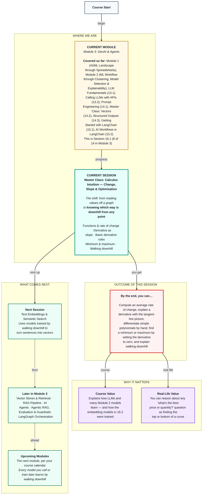

# Mathematics: Master Class — Calculus Intuition: Change, Slope & Optimisation
> **Pre-Read — Academic Session 16.1** | Module 3: GenAI & Agents
---
## Mental Map

---

## What You'll Learn

In this pre-read, you'll discover:
- What a function is, and how to measure its average rate of change between two points
- What a derivative is, using only the picture of a slope at one point
- Three simple rules for finding derivatives of polynomials by hand
- How setting the derivative to zero finds the top or bottom of a curve
- Why "walking downhill" is how LLMs and many other models learn

---

## A. The Idea of a Function and Rate of Change

**💡 Analogy:** A vending machine is a function: press a button number and you get one specific snack. Same button, same snack, every time.

**One-line definition: A function is a rule that turns each input into exactly one output, written y = f(x); its average rate of change between two points is (f(b) − f(a)) / (b − a).**

**Worked example:** For y = x², the inputs 0, 1, 2, 3 give 0, 1, 4, 9; for y = x³ they give 0, 1, 8, 27. A straight line has the same steepness everywhere — slope = rise ÷ run — so y = 2x + 1 rises 2 for every 1 across. A curve's steepness keeps changing, so we measure it between two points. A partner pulling away from a signal travels d(t) = t² metres after t seconds. From t = 1 to t = 3, the average rate is (9 − 1) / (3 − 1) = 4 metres per second — like reading the odometer at two moments and dividing by the time.

**⚠️ Common trap:** Confusing a function's value with its rate of change. At t = 3 the partner has travelled 9 m, but his speed is a different number. "How far" and "how fast" are different questions.

---

## B. Derivatives: What They Mean Geometrically

**💡 Analogy:** The average speed between Ameerpet and Hitec City tells you little about how fast you were going at one exact moment. A speedometer shows the speed right now. A derivative is a speedometer for any function.

**One-line definition: The derivative of a function at a point is the value the average rate of change settles on as the two points slide closer together — the slope of the tangent line that just touches the curve there.**

**Worked example:** For d(t) = t², slide the second point towards t = 1. From 1 to 3 the average rate is 4; from 1 to 2 it's 3; from 1 to 1.1 it's 2.1; from 1 to 1.01 it's 2.01; from 1 to 1.001 it's 2.001. It settles on 2 — the speed at exactly t = 1, written d′(1) or dy/dx. A line through two points of a curve is a **secant** (its slope is the average rate). As the second point slides closer, the secant swings round until it just touches at one point: the **tangent**, whose slope is the derivative. A positive derivative means the curve is going up (increasing), negative means going down (decreasing), and zero means flat.

**⚠️ Common trap:** Two of them. Plugging the same point in twice gives (1 − 1) / (1 − 1) = 0/0, which is meaningless — the derivative is what the ratio approaches as the gap shrinks. And slope zero means flat, not necessarily a minimum: y = x³ is flat at x = 0, then keeps rising.

---

## C. Basic Derivative Rules for Polynomials

**💡 Analogy:** You don't work out 7 × 8 from scratch every time — you learned the times table. These rules are the times table for derivatives.

**One-line definition: The power rule says d/dx(xⁿ) = n·xⁿ⁻¹; the constant rule says a constant on its own has derivative 0 and a constant multiplier stays; the sum rule says you differentiate each term separately and add.**

**Worked example:** For f(x) = 3x² + 2x + 1: 3x² becomes 3 × 2x = 6x; 2x becomes 2 (since d/dx(x) = 1); the constant 1 becomes 0. So f′(x) = 6x + 2. Check against Section B's idea: f′(1) = 8, and the average rate from 1 to 1.001 is (6.008003 − 6) / 0.001 ≈ 8.003. The power rule also gives d/dx(t²) = 2t, so d′(1) = 2 — exactly what the shrinking gap settled on.

**⚠️ Common trap:** Keeping the constant. In 3x² + 2x + 1, the "+1" lifts the whole curve up but doesn't make it steeper anywhere, so its derivative is 0. Writing d/dx(5x² + 7) = 10x + 7 is wrong; it's 10x.

---

## D. Finding a Minimum or Maximum

**💡 Analogy:** Walking on a hill in thick fog, you can't see the top. But you can feel whether the ground under your feet tilts up, down or is flat — and flat ground is where tops and bottoms live.

**One-line definition: To find where a function has a minimum or maximum, find f′(x), set it equal to zero, solve for x, and check the slope on both sides.**

**Worked example:** For f(x) = 3x² + 2x + 1: 6x + 2 = 0 gives x = −1/3, and f(−1/3) = 1/3 − 2/3 + 1 = 2/3. Just left of −1/3 the slope is negative (going down); just right it's positive (going up) — so this is a **minimum**. For y = x³ − 3x: 3x² − 3 = 0 gives x = −1 or x = 1. At x = −1 (y = 2) the slope goes up then down, a hilltop (**maximum**); at x = 1 (y = −2) it goes down then up, a valley (**minimum**). Down-then-up is a minimum; up-then-down is a maximum.

**⚠️ Common trap:** Stopping at "x = −1/3" without checking what kind of flat point it is. Always check the slope on both sides, or picture the curve.

---

## E. Optimisation Intuition: Walking Downhill

**💡 Analogy:** You're blindfolded on a hillside at Ananthagiri and want to reach the valley. You feel the slope under your feet; if the ground tilts down to your left, you step left. Small steps, feel again, repeat — and you reach the bottom without ever seeing it.

**One-line definition: To minimise means to find the input that makes something as small as possible; when there's no neat formula, you walk downhill with new x = old x − (step size) × (slope at old x).**

**Worked example:** For y = x², setting dy/dx = 2x = 0 gives x = 0 directly. But a real model has millions of internal numbers to tune and usually no neat formula, so it walks. Start at x = 4 with step size 0.1: the slope is 8, so x becomes 4 − 0.8 = 3.2; then 2.56, 2.048, 1.638 — closer to 0 every step. A positive slope means you're right of the valley, so subtracting moves you left; a negative slope moves you right. This is **gradient descent**, and it's how LLMs, neural networks and models like logistic regression are trained: the "x" is the model's internal numbers and the curve is its error. Plain linear regression in scikit-learn takes a shortcut — it solves "slope = 0" directly with a formula. The **chain rule**, which we only mention today, says that when one thing depends on another that depends on a third, the rates multiply: fuel at ₹6 per km and riding at 25 km per hour means fuel cost grows at 6 × 25 = ₹150 per hour. Inside a model, it links the error back to every internal number.

**⚠️ Common trap:** Taking giant steps. With step size 1.1 on x², you jump from 4 to −4.8, then 5.76, then −6.91 — bouncing further from the bottom each time. Too small is slow; too big never settles.

---

## Quick Reference — Calculus Toolkit

| Your situation | Use this | Because |
|---|---|---|
| Steepness of a straight line | rise ÷ run | It's the same everywhere on a line |
| Average change between two points | (f(b) − f(a)) / (b − a) | The secant's slope |
| Steepness at one exact point | The derivative f′(x) | The tangent's slope |
| Derivative of a polynomial | Power, constant and sum rules | Term by term |
| Find a top or bottom | Solve f′(x) = 0, check both sides | Flat spots hold the extremes |
| Minimise without a formula | x ← x − step × slope | Walking downhill (gradient descent) |

---

## Practice Exercises

1. **Planning Ahead** — For f(x) = x³, compute the average rate of change from x = 2 to x = 3, then from 2 to 2.1, then from 2 to 2.01. What number is it settling on? Check it with the power rule.

2. **Concept Detective** — Find f′(x) for f(x) = 4x³ − 6x² + 5. Where is f′(x) = 0? Which point is a hilltop and which is a valley?

3. **Spot the Error** — A classmate writes d/dx(5x² + 7) = 10x + 7. Find and fix the mistake.

4. **Pattern Recognition** — Run three steps of walking downhill on f(x) = x², starting at x = −3 with step size 0.25. Which direction does x move, and why?

5. **Real-Life Application** — A hub manager's net benefit from a weekly bonus of b hundred rupees is N(b) = 40b − b². Which bonus maximises N, and what happens to N if the bonus goes beyond it?

---

> ✅ **You're done!** You can now compute rates of change, explain a derivative as the slope of a tangent, differentiate simple polynomials by hand, find tops and bottoms by setting the derivative to zero, and explain how walking downhill lets a model reduce its error.
>
> Next up: **Session 16.2 — Text Embeddings & Semantic Search**, where models trained this way turn sentences into vectors, and Session 14.2's cosine finds messages that mean the same thing.
