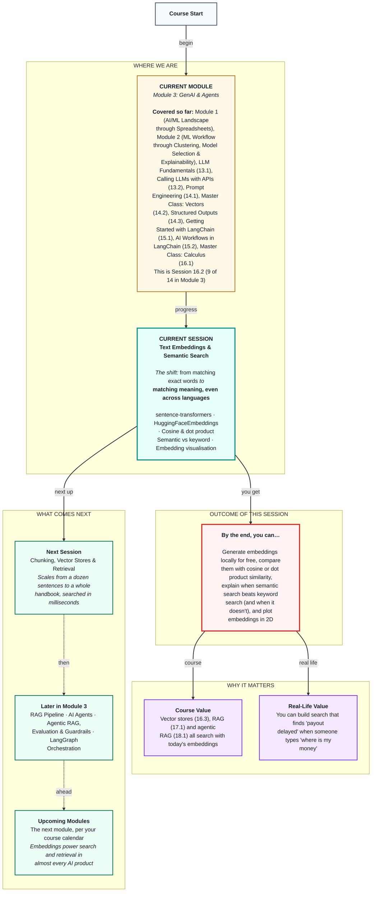

# Generative AI: Text Embeddings & Semantic Search
> **Pre-Read — Academic Session 16.2** | Module 3: GenAI & Agents
---
## Mental Map


---

## What You'll Learn

In this pre-read, you'll discover:
- What a text embedding is: a sentence turned into a vector that captures its meaning
- How to generate embeddings on your own laptop with sentence-transformers, with no paid API
- How cosine and dot product similarity compare two embeddings, straight from Session 14.2
- Why semantic search finds meaning that keyword search misses, and when keyword search still wins
- How to use embeddings in LangChain and see them on a 2D plot

---

## A. Embeddings and the sentence-transformers Library

**💡 Analogy:** A map of Hyderabad gives every place two numbers, latitude and longitude, and places that are close on the ground get close numbers. An embedding is a map for meaning: sentences that mean similar things get placed near each other.

**One-line definition: A text embedding is a vector — a list of numbers — that represents the meaning of a piece of text, and sentence-transformers is a free Python library that generates embeddings on your own computer.**

```python
from sentence_transformers import SentenceTransformer

model = SentenceTransformer("paraphrase-multilingual-MiniLM-L12-v2")   # downloads once
vectors = model.encode(["Payout not credited since Friday",
                        "kal ka paisa nahi aaya",
                        "App keeps crashing"], normalize_embeddings=True)
print(vectors.shape)        # (3, 384) -> 3 sentences, 384 numbers each
```

**Worked example:** In Session 14.2 we invented two axes, "about money" and "about the app", and scored messages by hand. An embedding model does this automatically, with 384 axes it learned itself by walking downhill (Session 16.1) on millions of sentence pairs. We pick a multilingual model because partners write in Hindi and Hinglish; `all-MiniLM-L6-v2` is a popular, faster English-only choice. The model downloads once and then runs locally for free: 1,000 messages × 384 numbers is only about 1.5 MB.

**⚠️ Common trap:** Thinking each of the 384 numbers stands for a nameable idea like "money." The model's axes aren't labelled the way our hand-made ones were. The meaning lives in the direction of the whole vector.

---

## B. HuggingFaceEmbeddings in LangChain

**💡 Analogy:** It's the same home kitchen, but now with a standard plug that fits all of LangChain's appliances — vector stores, retrievers and RAG chains.

**One-line definition: `HuggingFaceEmbeddings` wraps a sentence-transformers model in LangChain's standard embeddings interface, with `embed_documents` for the texts you search through and `embed_query` for the user's question.**

```python
from langchain_huggingface import HuggingFaceEmbeddings

emb = HuggingFaceEmbeddings(model_name="paraphrase-multilingual-MiniLM-L12-v2",
                            encode_kwargs={"normalize_embeddings": True})
doc_vectors = emb.embed_documents(["Payout not credited since Friday", "App keeps crashing"])
query_vector = emb.embed_query("where is my money")       # 384 numbers
```

**Worked example:** The two methods exist because some models embed questions and documents slightly differently; LangChain keeps them separate so you never mix them up. You'll rarely call them yourself after today — in Session 16.3 you hand `emb` to a vector store once, and it calls both for you.

**⚠️ Common trap:** Embedding documents with one model (or one setting) and queries with another. Each model draws its own "meaning map", so comparing vectors from two models is like comparing latitude from one map with longitude from another. Use one embeddings object, with the same model and settings, for both sides.

---

## C. Cosine Similarity and Dot Product Similarity

**💡 Analogy:** Remember Session 14.2's two partners leaving the hub: we cared about the angle between their directions, not how far each one rode.

**One-line definition: Cosine similarity, (a · b) / (|a| |b|), measures the angle between two embeddings — near 1 means similar meaning, near 0 unrelated — and the dot product, a · b, gives the same answer once vectors are normalised.**

**Worked example:** `normalize_embeddings=True` turns every vector into a unit vector (length 1, Session 14.2), so the bottom of the cosine formula becomes 1 × 1 and cosine equals the plain dot product — which is cheaper to compute across millions of vectors. Comparing "Payout not credited since Friday" with others, expect "Weekly amount still pending" to score high, "kal ka paisa nahi aaya" medium to high (same meaning, zero shared words), and "App keeps crashing" low, near 0. Romanised Hinglish — Hindi typed in English letters — is harder for these models than Hindi in Devanagari script, so it usually scores a little lower than a clean English paraphrase. Exact numbers depend on the model.

**⚠️ Common trap:** Reading a score as a percentage. A similarity of 0.6 doesn't mean "60% the same." Scores are only meaningful compared with each other, from the same model — the ranking matters, not the raw number.

---

## D. Semantic Search vs Keyword Search

**💡 Analogy:** A new support agent who only matches exact words will miss "paisa nahi aaya" when told to look for "payout." An experienced agent understands what the partner means.

**One-line definition: Keyword search finds documents that share words with the query; semantic search finds documents whose embeddings point in a similar direction to the query's embedding — matching meaning, not words.**

**Worked example:** A partner types "where is my money". Keyword search ranks "Where is the nearest hub?" first, because it shares "where" and "is", and finds nothing for "Payout not credited since Friday" or "kal ka paisa nahi aaya", which share no words at all. Semantic search ranks the payout messages near the top. But for "P-20417", a partner ID, keyword search wins: an ID has no meaning to embed, while an exact match finds it instantly. The same is true of order numbers, error codes and exact policy clause numbers.

**⚠️ Common trap:** Assuming semantic search is always better. Use semantic search for anything people could phrase in different ways or languages, and keyword search for IDs, codes and exact names. Many real systems run both and combine the results (called hybrid search).

---

## E. Embedding Visualisation

**💡 Analogy:** A globe is 3D, but a printed map flattens it to 2D. Some distances get a little distorted, yet you can still see which cities are near each other.

**One-line definition: Visualising embeddings means squashing their hundreds of dimensions down to two — for example with PCA (Principal Component Analysis) — so you can plot them and see which texts sit near each other.**

```python
from sklearn.decomposition import PCA
import matplotlib.pyplot as plt

points = PCA(n_components=2).fit_transform(vectors)
plt.scatter(points[:, 0], points[:, 1])
plt.show()
```

**Worked example:** Plot a dozen partner messages coloured by topic. Payout messages tend to sit near each other, app problems in another area and safety messages in a third. Nobody told the model these categories — it's the same idea as clustering in Module 2: structure found without labels.

**⚠️ Common trap:** Over-reading the picture. Squashing 384 dimensions into 2 loses information, so two points that look close on the plot may not be close in the real space. Use the plot for intuition and the cosine scores for decisions.

---

## Quick Reference — Embeddings & Search

| Your situation | Use this | Because |
|---|---|---|
| Turn text into meaning-vectors for free | sentence-transformers | Runs locally, no API |
| Hindi, Hinglish or mixed messages | `paraphrase-multilingual-MiniLM-L12-v2` | Trained on 50+ languages |
| Compare two embeddings | Cosine similarity (or dot product once normalised) | Direction only |
| Queries and documents | The same model and settings, always | Different models draw different maps |
| Different words, same meaning | Semantic search | Matches meaning |
| IDs, codes, exact names | Keyword search | Exact match |

---

## Practice Exercises

1. **Concept Detective** — A teammate embeds the handbook with `all-MiniLM-L6-v2` and partner questions with the multilingual model, then compares them. The results look random. Why?

2. **Spot the Error** — A report says: "The similarity between these two messages is 0.62, so they are 62% identical." What's wrong with this reading?

3. **Pattern Recognition** — For each query, say whether keyword or semantic search will do better: (a) "P-33150", (b) "bonus missing hai", (c) "SOS button not working", (d) "error code E-104".

4. **Planning Ahead** — Two normalised embeddings have a dot product of 0.85. What is their cosine similarity? What would it be if they weren't normalised and had lengths 2 and 3?

5. **Real-Life Application** — Think of a search box you use that only matches exact words. Write three queries where semantic search would help and one where it wouldn't.

---

> ✅ **You're done!** You can now generate embeddings locally, compare them with cosine or dot product similarity, explain when semantic search beats keyword search (and when it doesn't), and plug embeddings into LangChain.
>
> Next up: **Session 16.3 — Chunking, Vector Stores & Retrieval**, where we scale from a dozen sentences to a whole partner handbook — split into chunks, stored in ChromaDB and FAISS, and searched in milliseconds.
