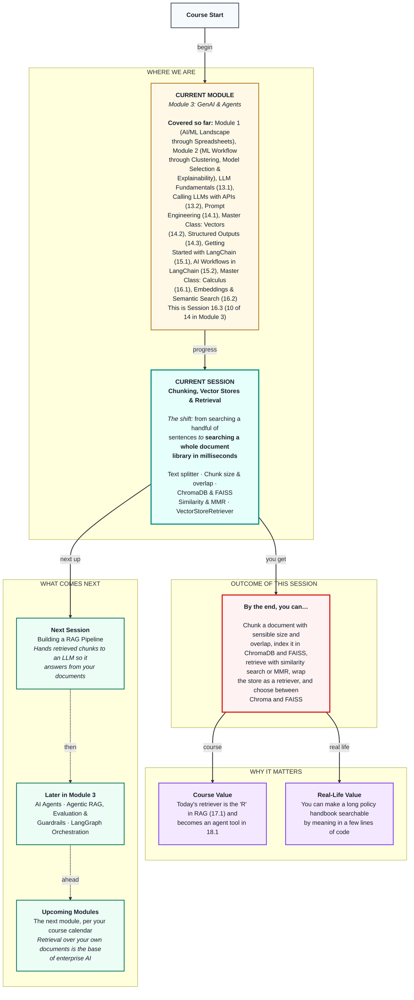

# Generative AI: Chunking, Vector Stores & Retrieval
> **Pre-Read — Academic Session 16.3** | Module 3: GenAI & Agents
---
## Mental Map


---

## What You'll Learn

In this pre-read, you'll discover:
- Why long documents must be cut into chunks, and how to choose chunk size and overlap
- What a vector store is, and how to set up and fill ChromaDB and FAISS
- How similarity search and MMR decide which chunks come back
- How a VectorStoreRetriever packages search into one standard object
- When to choose ChromaDB and when to choose FAISS

---

## A. Chunking with RecursiveCharacterTextSplitter

**💡 Analogy:** If someone asks where the rain bonus rule is, you don't hand them the whole handbook and say "it's in there." You open it to the right paragraph. When you cut a long article to fit a notice board, you cut between paragraphs first, then between sentences, and only as a last resort mid-sentence.

**One-line definition: Chunking means splitting a long document into smaller pieces that are embedded and stored separately; `RecursiveCharacterTextSplitter` cuts at the most natural break — paragraph, then line, then space — that keeps each chunk under the size limit.**

```python
from langchain_text_splitters import RecursiveCharacterTextSplitter

splitter = RecursiveCharacterTextSplitter(chunk_size=500, chunk_overlap=80)
chunks = splitter.split_documents(section_docs)
```

**Worked example:** In class we search a short extract of the partner handbook: seven sections, from payouts to safety, in `partner_handbook.txt`. *(It's illustrative, written for this course; a real handbook runs to hundreds of pages, and the method is identical.)* Section 1 covers five topics — the payout cycle, what makes up a payout, deductions, disputes and holds. As one chunk, its embedding points at the "average" of all five, a weak match for any specific question. Split into paragraph-sized chunks, "how do I raise a dispute?" matches the dispute paragraph strongly. We also store each section's title as **metadata**, so every chunk remembers where it came from: `{"section": "4. Safety and Insurance"}`.

**⚠️ Common trap:** Cutting by a fixed number of characters with no care for meaning — chopping "Rs 100 is deducted for each cancellation" into "Rs 100 is deducted for ea" and "ch cancellation". A chunk that cuts a fact in half can't answer anything.

---

## B. Chunk Size and Overlap Strategies

**💡 Analogy:** Photocopying a long document page by page, you leave a little margin from the previous page at the top of each copy, so a sentence that runs across the page break appears whole somewhere.

**One-line definition: `chunk_size` is the maximum length of each chunk in characters, and `chunk_overlap` is how many characters each chunk repeats from the end of the previous one.**

**Worked example:** Small chunks (about 200 characters) suit precise facts like "₹10 per order" but can lose the "when" or "how". Medium chunks (about 500) suit most policy questions and are our starting point. Large chunks (about 1,500) keep whole procedures together but blur meaning and send more tokens to the LLM later. On our handbook extract, a chunk size of 1,500 gives roughly one chunk per section, while 500 with 80 overlap gives paragraph-sized chunks. An overlap of 10–20% of the chunk size is typical.

**⚠️ Common trap:** Treating chunk size as a fixed rule. Like Module 2's train/test split ratio, it's a judgement call: try a few sizes on real partner questions and keep the one that brings back the right paragraphs. Remember too that the size is measured in characters, not words or tokens.

---

## C. ChromaDB and FAISS: Setup and Indexing

**💡 Analogy:** A library doesn't pile books on the floor — it shelves them with a catalogue so the librarian can find the right one fast. ChromaDB is a full library building whose catalogue stays overnight; FAISS is a lightning-fast index-card box you carry in your bag and save yourself.

**One-line definition: A vector store keeps each chunk's text, embedding and metadata together and finds the chunks closest to a query; ChromaDB is a vector database that saves to disk, and FAISS is a very fast in-memory search library you save and load as files.**

```python
from langchain_chroma import Chroma
from langchain_community.vectorstores import FAISS

chroma_db = Chroma.from_documents(chunks, emb, collection_name="partner_handbook",
                                  persist_directory="chroma_partner_handbook")
faiss_db = FAISS.from_documents(chunks, emb)
faiss_db.save_local("faiss_partner_handbook")
```

**Worked example:** `from_documents` does three jobs at once: it embeds every chunk with the `emb` object from Session 16.2, stores the vectors with their text and metadata, and builds the index. Chroma saves to its folder automatically — close Python, come back tomorrow, and reload it with `Chroma(collection_name=..., embedding_function=emb, persist_directory=...)` without re-embedding. FAISS lives in memory until you call `save_local`.

**⚠️ Common trap:** Running `Chroma.from_documents` again on the same folder while debugging. Chroma adds the chunks again, so every paragraph now exists twice and searches return duplicates. Delete the folder first, or load the existing store instead of rebuilding.

---

## D. Similarity Search and MMR Retrieval

**💡 Analogy:** Ask three friends for a restaurant and all three say "Paradise Biryani." Relevant — but you learned only one thing. Better to get Paradise, a dosa place and a café: still relevant, and each adds something new.

**One-line definition: Similarity search returns the k chunks closest to the query; MMR (Maximal Marginal Relevance) first shortlists `fetch_k` similar chunks, then picks k that are relevant and different from each other.**

```python
results = chroma_db.similarity_search_with_score("bonus nahi mila barish wale din", k=3)
diverse = chroma_db.max_marginal_relevance_search(
    "how is my weekly payout calculated", k=3, fetch_k=10, lambda_mult=0.5)
```

**Worked example:** The Hinglish query "bonus nahi mila barish wale din" ("didn't get the bonus on the rainy day") should return, at or near the top, the chunk from section 2 explaining the ₹10 rain bonus and the 7-day dispute window — the handbook is English and the question is Hinglish, but the multilingual embeddings bridge the gap. For the broad question "how is my weekly payout calculated", plain similarity may return three overlapping slices of one paragraph, while MMR returns the payout components, the deductions and the peak-hour rules. `lambda_mult` slides between pure relevance (1.0) and pure variety (0.0).

**⚠️ Common trap:** Misreading the score. `similarity_search_with_score` in Chroma and FAISS returns a distance by default — lower means closer. That's the opposite of cosine similarity in Session 16.2, where higher means closer. Also, use MMR for broad questions; for a precise single fact, plain similarity is better.

---

## E. The VectorStoreRetriever

**💡 Analogy:** Instead of walking into the library yourself, you have a librarian on call. You ask a question; she brings back the right pages. You don't care how the shelves are organised.

**One-line definition: A `VectorStoreRetriever` wraps any vector store in one standard object: you give it a question with `.invoke()` and get back a list of matching documents.**

```python
retriever = chroma_db.as_retriever(search_type="mmr", search_kwargs={"k": 3, "fetch_k": 10})
docs = retriever.invoke("I fell off my bike during a delivery, what do I do?")

safety_only = chroma_db.as_retriever(
    search_kwargs={"k": 2, "filter": {"section": "4. Safety and Insurance"}})
```

**Worked example:** `search_type` can be `"similarity"` (the default), `"mmr"` or `"similarity_score_threshold"` (only chunks closer than a cut-off). A metadata filter searches one section only. In Session 17.1, a RAG chain just needs *a* retriever — it doesn't care whether Chroma or FAISS is underneath, so you can swap the store without changing the chain.

**⚠️ Common trap:** Setting k high "to be safe." Every retrieved chunk is later pasted into the LLM's prompt — more tokens, more cost (Session 13.1) and more irrelevant text to confuse the answer. Start with k = 3 or 4.

---

## F. ChromaDB vs FAISS

**💡 Analogy:** Choosing between them is like choosing between a library and an index-card box: one is built to grow, stay put and be organised; the other is built for raw speed.

**One-line definition: ChromaDB is the better fit for apps that grow, need metadata filters and must persist; FAISS is the better fit for very fast search over very large, mostly static collections.**

**Worked example:** The partner helpdesk's handbook is updated monthly and needs "search only the Safety section", so Chroma fits: it saves automatically, filters by metadata and makes adding or deleting chunks easy. A one-time research notebook searching 20 million product titles fits FAISS, which is built for speed at that scale. For a classroom experiment with 50 chunks, either is fine — pick the one you know.

**⚠️ Common trap:** Asking which one is "better." They solve slightly different problems. Choose on persistence, updates, filtering and scale — not on which name you've heard more.

---

## Quick Reference — Chunking & Retrieval Choices

| Your situation | Use this | Because |
|---|---|---|
| Long documents | `RecursiveCharacterTextSplitter` | Focused chunks, natural breaks |
| Most policy Q&A | chunk_size ~500, overlap ~50–100, then test | A balanced starting point |
| You need to show sources | Store metadata with each chunk | Traceable answers |
| The app grows, needs filters, must persist | ChromaDB | Database with filtering and auto-save |
| A huge static collection, maximum speed | FAISS | Built for scale |
| Broad questions | MMR | Relevant and non-repetitive |
| Plugging into RAG (17.1) | `as_retriever()` | One standard interface |

---

## Practice Exercises

1. **Concept Detective** — A teammate stores the whole handbook as one chunk. Every question returns the same chunk, and the answers feel vague. Explain why, using the idea of blurred meaning.

2. **Spot the Error** — After running the notebook three times, every search returns each paragraph three times. What happened, and what are two fixes?

3. **Planning Ahead** — For the question "What's the full procedure after an accident?", would you choose a chunk size of 200, 500 or 1,500 for section 4 (Safety and Insurance)? Explain the trade-off.

4. **Pattern Recognition** — A search returns distances 0.42, 0.45 and 0.91. Which chunk is the best match? What might the 0.91 chunk be doing in the results?

5. **Real-Life Application** — Pick a long document you deal with (a college handbook, HR policy or product manual). How would you split it, what metadata would you store, and which retrieval type suits the questions people ask about it?

---

> ✅ **You're done!** You can now chunk documents sensibly, index them in ChromaDB and FAISS, retrieve with similarity search or MMR, and package it all as a retriever — the "R" in RAG.
>
> Next up: **Session 17.1 — Building a RAG Pipeline**, where these retrieved chunks are handed to an LLM so it answers partners from the handbook instead of guessing.
