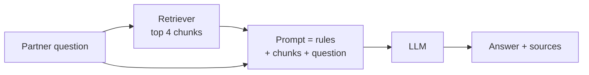

# Lecture Script: Generative AI — Building a RAG Pipeline
> **Instructor Reference** — Module 3: GenAI & Agents | Academic Session 17.1 | Duration: 2 Hours

---

## Session Overview
**Goal:** By the end of this session, students can build an end-to-end RAG pipeline connecting a ChromaDB retriever to an LLM — with both the classic `RetrievalQA` and `create_stuff_documents_chain` + `create_retrieval_chain` — write a context-injection prompt with grounding, a fallback and citations, compare grounded and ungrounded answers, and diagnose whether a wrong answer is a retrieval or a generation failure.

**Student profile at this point:** They have every piece: LLM behaviour and hallucination (13.1), API calls (13.2), tested prompts (14.1), chains (15.1–15.2), embeddings (16.2) and a Chroma retriever over the handbook (16.3). They've never connected retrieval to generation. Likely wrong assumptions: "RAG trains the model on my documents," "RAG eliminates hallucination," and "a wrong answer means a bad prompt." Boredom risk: low — this is where everything clicks — but environment issues from 16.3 can carry over, so have the TA check that everyone's Chroma store loads before the break.

**Key outcome:** Students should leave asking, whenever a RAG answer looks wrong: "What did the retriever actually bring back?" — before touching the prompt.

> 🎯 **The one sentence this session must land:** *RAG is an open-book exam for the LLM — retrieve the right pages, tell it to answer only from them and to admit when they're silent, and when it's wrong, check the pages before blaming the student.*

---

## Timing Breakdown

| Segment | Duration | Cumulative |
|---|---|---|
| Opening — "The Confident Wrong Answer, Revisited" | 8 min | 8 min |
| Concept Block 1: Connecting a Retriever to an LLM | 10 min | 18 min |
| Concept Block 2: Prompt with Context Injection | 10 min | 28 min |
| Practical Block 1: Write the RAG Prompt | 7 min | 35 min |
| Concept Block 3: RetrievalQA | 10 min | 45 min |
| Concept Block 4: create_retrieval_chain & the Combine-Documents Chain | 12 min | 57 min |
| **BREAK** | 10 min | 67 min |
| Practical Block 2: Live Coding Demo (TA Code) | 14 min | 81 min |
| Concept Block 5: Grounded vs Ungrounded & Hallucination Reduction | 12 min | 93 min |
| Practical Block 3: Grounded or Not? | 9 min | 102 min |
| Practical Block 4: Retrieval or Generation Failure? | 10 min | 112 min |
| Summary & Bridge | 4 min | 116 min |
| Q&A & Doubt Solving | 4 min | 120 min |

---

## Opening — "The Confident Wrong Answer, Revisited" (8 min)

Open with this, verbatim-ish, with Session 13.2's TA demo output back on screen:

> "Four sessions ago, our helpdesk told a partner, with total confidence, when his payout would arrive. It had never seen our policy. It guessed. In 15.2 we fixed it — for a few questions pasted into a prompt. In 16.3 we built a retriever that finds the right handbook paragraph for any question. But it just hands back paragraphs, and the partner doesn't want paragraphs at 11:40 pm."

Pause. Ask the room:

> "We have a model that writes well but doesn't know our policy, and a retriever that knows our policy but can't write. What's the obvious move?"

(Someone will say, "Put them together.")

> "That's RAG. Today everything from the last eight sessions clicks into one pipeline."

**Pivot line:** "Retrieval finds the pages, generation writes the answer — and today we also learn how to tell which half broke when something goes wrong."

**Context for sessions ahead:** "In 17.2 this RAG chain is joined by tools in an agent. In 18.1 it becomes the agent's retrieval tool, and we measure it properly with RAGAS."

---

## Concept Block 1: Connecting a Retriever to an LLM (10 min)

> "An open-book exam. A student who memorised everything might misremember a detail and write it confidently. A student who can open the textbook, find the page and then write makes far fewer mistakes — and can show you the page."

Draw on the board:



> "**Retrieval-Augmented Generation.** Retrieval first — the 'R' from 16.3. Then generation, augmented with what was retrieved."

### 🔴 The trap / highest-value moment
> "Someone always says, 'So RAG trains the model on our handbook.' No — nothing in the model changes. Tomorrow, without the retriever, it knows exactly as little as before. Write this down: *RAG hands the model the right pages at answer time — it doesn't teach it anything.*"

---

## Concept Block 2: Prompt with Context Injection (10 min)

> "Before a call, a supervisor slips the agent a printout: 'Here's the policy page. Answer from this. If it's not on the page, escalate.' That's exactly our system prompt."

Write on the board, annotating each line:

```
"Answer ONLY using the handbook context below."                 ← grounding
"If not in the context, reply exactly: 'I couldn't find this
 in the handbook - I'll connect you to a support agent.'"       ← fallback
"Reply in the partner's language, under 80 words,
 and mention the section number(s)."                            ← usability + citation
"Handbook context:\n{context}"                                  ← injection point
human: "{input}"
```

> "`{context}` is where the retrieved chunks get pasted. That's **context injection**."

### 🔴 The trap / highest-value moment
> "Remove the fallback line and ask 'Can I deliver on a bicycle?' — not in the handbook. The model happily fills the gap with its own guess: the very hallucination RAG was meant to stop. Write this down: *the fallback line is what makes RAG honest when retrieval comes back empty-handed.*"

---

## Practical Block 1: Write the RAG Prompt (7 min)

Students individually spend four minutes writing a RAG system prompt for a college helpdesk that answers from the student handbook (attendance, exams, fees), including grounding, an exact fallback, citations and a length limit. Show a model answer: "You are the student helpdesk for the college's online programme. Answer ONLY using the handbook context below. If the answer is not in the context, reply exactly: 'I couldn't find this in the student handbook — please email the programme office.' Cite the handbook section. Keep answers under 80 words. Handbook context: {context}." If someone asks why we can't just write "don't hallucinate", say the model doesn't know when it's hallucinating — give it a concrete rule and a concrete action instead of a wish.

---

## Concept Block 3: RetrievalQA (10 min)

> "A ready-made thali: everything on one plate, quick, with limited customisation. That's `RetrievalQA`."

```python
qa = RetrievalQA.from_chain_type(
    llm=llm, chain_type="stuff", retriever=retriever,
    return_source_documents=True,
    chain_type_kwargs={"prompt": qa_prompt})        # blanks: {context}, {question}

out = qa.invoke({"query": "..."})
out["result"]; out["source_documents"]
```

> "`chain_type='stuff'` pastes every retrieved chunk into one prompt; `return_source_documents=True` gives you the chunks back so you can check. Like `LLMChain`, it's a classic chain — deprecated in 0.3 but still in a huge number of tutorials and codebases, so you should recognise it."

### 🔴 The trap / highest-value moment
> "RetrievalQA's prompt must use `{context}` and `{question}`. Write `{input}` out of habit from the next chain, and it crashes. Write this down: *RetrievalQA uses {question}; create_retrieval_chain uses {input}.*"

---

## Concept Block 4: create_retrieval_chain & the Combine-Documents Chain (12 min)

> "A buffet where you build your own plate: one person fetches, another arranges and serves. More pieces, but you control each one."

```python
combine_docs_chain = create_stuff_documents_chain(llm, rag_prompt)   # chunks → {context} → LLM
rag_chain = create_retrieval_chain(retriever, combine_docs_chain)    # input → retriever → combine

out = rag_chain.invoke({"input": "bonus nahi mila barish wale din, kya karun?"})
out["answer"]; out["context"]
```

> "The **combine-documents chain** takes a list of chunks, stuffs their text into `{context}` and calls the LLM. `create_retrieval_chain` runs the retriever on the input and passes the chunks along. The blanks are `{context}` and `{input}`; the outputs are `answer` and `context`. It's the recommended style because each part is swappable — that pays off in 18.1."

### 🔴 The trap / highest-value moment
> "'Stuff' means every retrieved chunk goes into one prompt. Set k = 20 with 1,500-character chunks and you're back at 13.1's ₹1-lakh-a-day problem. Write this down: *RAG keeps cost low only if k stays small and chunks stay focused.*"

---

## BREAK (10 min)

*(TA: confirm everyone's `chroma_partner_handbook` folder loads, or that `partner_handbook.txt` sits next to their script so it can rebuild.)*

---

## Practical Block 2: Live Coding Demo (TA Code) (14 min)

**Handoff line (must match TA code file's opening comment):** "The 11:40 pm partner finally gets answers from the real handbook — same questions, LLM alone vs LLM + retrieval."

Hand off to `ta-code - Session 17.1 - Building a RAG Pipeline.py`, narrating each `# --- EXPLAIN ---` block aloud:

1. Load (or rebuild) the Chroma store from 16.3
2. Ungrounded: send four questions to the LLM alone — read the answers aloud, especially the bicycle one
3. Grounded: send the same four through `create_retrieval_chain` — show the answers and source sections
4. Run `RetrievalQA` on the accident-reporting question — same idea, different keys
5. Run the deliberately bad retriever — the model answers faithfully from the wrong chunk

💬 Expect a comment: "The ungrounded insurance answer sounded more detailed!" Welcome it. Say: "Exactly. Fluency isn't accuracy. The grounded answer is shorter because it only says what the handbook says — and it tells you where."

---

## Concept Block 5: Grounded vs Ungrounded & Hallucination Reduction (12 min)

> "Two agents, same question. One answers from memory, one from the policy page in front of her. When they disagree, the one with the page is right — and can prove it."

Write the comparison from the TA output on the board: the holiday payout, the insurance amount and the bicycle question, grounded vs ungrounded.

> "Look at the bicycle row. The grounded bot said, 'I couldn't find this.' Is that a failure?" (Let them answer.) "No — it's the best possible answer. The handbook really is silent."

Write the toolkit:

> Prompt: "answer ONLY from context" + fallback + section citations
> Model: temperature 0 · Retrieval: good chunks, metadata, small k, MMR · Product: show sources to the partner

### 🔴 The trap / highest-value moment
> "RAG reduces hallucination; it doesn't eliminate it. The model can still blend two chunks wrongly or add a 'helpful' detail that isn't there. Write this down: *grounded means checkable — so keep the sources and actually check them.*"

---

## Practical Block 3: Grounded or Not? (9 min)

Show four answers with their retrieved chunks, and give pairs five minutes to label each as grounded, partly grounded or ungrounded. (1) Rain bonus, chunks 2.2: "₹10 extra per order during an active rain alert (Section 2.2)" — grounded. (2) Rain bonus, chunks 2.2: "₹10 extra per order during rain alerts, and double on weekends (Section 2.2)" — partly grounded; "double on weekends" appears nowhere. (3) Change bank account, chunk 3.1: "Profile > Bank Details; verified in 2 working days; payouts held meanwhile (3.1)" — grounded. (4) Festival bonus amount, chunk 2.4: "₹500 during Diwali (2.4)" — ungrounded; 2.4 gives no amount. Expect an argument about #4 ("it cited a section!"). Welcome it: a citation is a claim, not proof — which is why 18.1 measures faithfulness.

---

## Practical Block 4: Retrieval or Generation Failure? (10 min)

Show three wrong answers with their retrieved chunks, and give pairs six minutes to diagnose each and name the fix. (1) "Deadline to report an accident?" answered "7 days", with chunks 1.4 (disputes, 7 days) and 2.2 — a retrieval failure: the accident paragraph (4.3, 48 hours) never came back, so check chunking, try MMR or add subsection metadata. (2) "Accident cover amount?" answered "₹50,000", with chunk 4.2 (₹2,00,000 accident cover, ₹50,000 hospitalisation) — a generation failure: the right chunk, the wrong number, so sharpen the prompt ("quote amounts exactly as written") and check the temperature. (3) "How do I get coaching?" answered "I couldn't find this", with chunks 7.1 and 7.2 — a retrieval failure: 6.2 wasn't retrieved, so raise k or fix the chunk boundaries. Two of three were retrieval failures, which is typical: always open `out["context"]` before touching the prompt.

---

## Summary & Bridge (4 min)

| Concept | The one thing to remember |
|---|---|
| RAG | Retrieve first, then generate from what was retrieved — an open book, not new lessons |
| Context injection | Chunks go into `{context}`, with grounding, a fallback, citations and a length limit |
| RetrievalQA | Classic; `{context}` and `{question}`; `result` + `source_documents` |
| create_retrieval_chain | Recommended; `{context}` and `{input}`; `answer` + `context` |
| Grounded vs ungrounded | Fluency isn't accuracy; "I couldn't find this" can be the best answer |
| Hallucination reduction | RAG reduces it, not removes it; check the retrieved chunks first |

Close on the thesis line: "RAG is an open-book exam for the LLM — retrieve the right pages, tell it to answer only from them and to admit when they're silent, and when it's wrong, check the pages before blaming the student."

**Bridge to next session:** "Our helpdesk can now read the handbook. But the ₹600 question from 14.1 needs calculation on the partner's own numbers, and the handbook can't do that. Session 17.2 — Building an AI Agent with LangChain — gives the LLM tools — a payout calculator, a partner-stats lookup, the handbook search — and lets it decide which to use, step by step."

---

## Q&A & Doubt Solving (4 min)

**Q: Is RAG better than fine-tuning a model on our handbook?**
→ For facts that change, like policies and prices, RAG is usually better: you update a document, not a model, and you get sources. Fine-tuning suits teaching a style or format.

**Q: What if two handbook sections contradict each other?**
→ The model may pick either or blend them. Fix the source documents — RAG can't resolve contradictions your documents contain.

**Q: Why "stuff"? Are there other chain types?**
→ Others exist, such as summarising chunks separately before combining, mainly for when there's too much text to stuff. With a small k and focused chunks, stuff is simplest and usually best.

**Q: Should the partner see the source text?**
→ Showing the section name or a short snippet builds trust and lets them verify. Showing raw chunks can confuse — design for your users.

**Q: Can RAG work with the FAQ bot from 15.2?**
→ Yes — put the FAQ entries into the vector store as chunks. RAG is the scaled-up version of that FAQ bot.

---

## Instructor Notes
- **Words not yet earned:** agents, tools and ReAct (17.2), RAGAS, faithfulness and context recall (18.1 — name them only if a student asks how to measure this), re-ranking, query rewriting.
- **Biggest risk in this session:** the ungrounded demo producing a correct guess by luck. If it happens, lean into it: "Correct today — but could you prove it? Could you trust it next week?" The bicycle question reliably shows the difference.
- **Board management:** keep the RAG flow diagram and the annotated RAG prompt visible all session; add the retrieval-vs-generation diagnosis during Practical Block 4.
- **Common confusions, numbered:**
  1. Thinking RAG trains or changes the model
  2. Leaving out the fallback line
  3. Mixing `{question}` and `{input}` between chain styles
  4. Using a large k with "stuff", which explodes cost
  5. Treating citations as proof
  6. Blaming the prompt for retrieval failures
- **Cross-references:** Session 13.1's hallucination is the problem RAG addresses; Session 16.3 built the retriever; Session 17.2 adds tools; Session 18.1 wraps this retriever as a tool and measures faithfulness, context recall and answer correctness with RAGAS.
- **Local/cultural context notes:** bring the 13.2 guess back on screen for the opening — the callback lands strongly. The Hinglish rain-bonus question and the bicycle question are the two best live demos.
