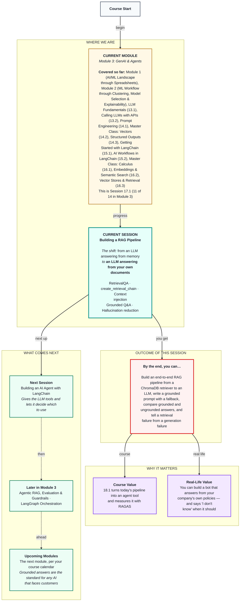

# Generative AI: Building a RAG Pipeline
> **Pre-Read — Academic Session 17.1** | Module 3: GenAI & Agents
---
## Mental Map


---

## What You'll Learn

In this pre-read, you'll discover:
- What RAG (Retrieval-Augmented Generation) is, and how it connects a retriever to an LLM
- How context injection puts retrieved handbook text into the prompt
- How to build a RAG chain with the classic `RetrievalQA` and the newer `create_retrieval_chain`
- How to compare grounded and ungrounded answers side by side
- How to reduce hallucination, and tell a retrieval failure from a generation failure

---

## A. Connecting a Retriever to an LLM

**💡 Analogy:** An open-book exam. A student who memorised everything might misremember a detail and write it confidently. A student allowed to open the textbook, find the right page and then write makes far fewer mistakes — and can point to the page.

**One-line definition: RAG (Retrieval-Augmented Generation) means first retrieving the most relevant pieces of your documents, then giving them to the LLM with the question, so it answers from those pieces.**

**Worked example:** You now have every piece. LLMs write well but can hallucinate (13.1); you can call them (13.2), prompt them (14.1) and chain them (15.1–15.2); and a retriever finds the right handbook paragraphs (16.3). In 13.2 the helpdesk guessed the payout day; in 15.2 the FAQ bot knew only a few pasted answers. With RAG, the partner's question goes to the retriever, the top 3–4 chunks plus the question go into the prompt, and the LLM writes an answer from those chunks — with the source section attached. Instead of pasting the whole handbook (13.1's cost problem), you send only what's relevant.

**⚠️ Common trap:** Thinking RAG "teaches" the model your documents. Nothing in the model changes. RAG hands it the right pages at the moment of answering — an open book, not extra lessons.

---

## B. Prompt with Context Injection

**💡 Analogy:** Before a support call, a supervisor slips the agent a printout: "Here's the policy page for this issue. Answer from this. If it's not on the page, escalate."

**One-line definition: Context injection means inserting the retrieved chunks into the prompt — usually in a `{context}` blank — alongside the user's question and the rules for using them.**

```python
from langchain_core.prompts import ChatPromptTemplate

rag_prompt = ChatPromptTemplate.from_messages([
    ("system",
     "You are the delivery-partner helpdesk.\n"
     "Answer ONLY using the handbook context below.\n"
     "If the answer is not in the context, reply exactly: "
     "'I couldn't find this in the handbook - I'll connect you to a support agent.'\n"
     "Reply in the partner's language, under 80 words, and mention the section number.\n\n"
     "Handbook context:\n{context}"),
    ("human", "{input}"),
])
```

**Worked example:** Each line has a job. "Answer ONLY using the context" grounds the model. The exact fallback sentence handles questions the handbook doesn't cover. "Mention the section number" makes the answer checkable. "Under 80 words, in the partner's language" keeps it usable and cheap (13.1, 13.2).

**⚠️ Common trap:** Leaving out the fallback line. When the handbook has no answer, the model fills the gap with its own guess — the very hallucination RAG was meant to stop.

---

## C. LangChain RetrievalQA

**💡 Analogy:** A ready-made thali: everything on one plate, quick to order, with limited ways to customise.

**One-line definition: `RetrievalQA` is LangChain's classic RAG chain: give it an LLM and a retriever, and it retrieves, "stuffs" the chunks into a prompt and returns the answer.**

```python
from langchain.chains import RetrievalQA

qa = RetrievalQA.from_chain_type(llm=llm, chain_type="stuff", retriever=retriever,
                                 return_source_documents=True,
                                 chain_type_kwargs={"prompt": qa_prompt})
out = qa.invoke({"query": "When is my payout credited if Friday is a holiday?"})
print(out["result"], [d.metadata["section"] for d in out["source_documents"]])
```

**Worked example:** `chain_type="stuff"` pastes every retrieved chunk into one prompt. `return_source_documents=True` gives you the chunks back so you can check the answer. The input key is `"query"`, and the outputs are `"result"` and `"source_documents"`. Like `LLMChain`, `RetrievalQA` still works in LangChain 0.3 with a deprecation warning — it's in a huge number of tutorials, so you should recognise it.

**⚠️ Common trap:** Using the wrong blank names. A custom `RetrievalQA` prompt must use `{context}` and `{question}` — not `{input}` — or the chain fails.

---

## D. create_retrieval_chain and the Combine-Documents Chain

**💡 Analogy:** Building your own plate at a buffet: one person fetches the food (the retriever), another arranges and serves it (the combine-documents chain). More pieces, but you control each one.

**One-line definition: `create_retrieval_chain` joins a retriever with a combine-documents chain — built with `create_stuff_documents_chain` — that formats the retrieved chunks into the prompt and calls the LLM.**

```python
from langchain.chains import create_retrieval_chain
from langchain.chains.combine_documents import create_stuff_documents_chain

combine_docs_chain = create_stuff_documents_chain(llm, rag_prompt)    # fills {context}
rag_chain = create_retrieval_chain(retriever, combine_docs_chain)

out = rag_chain.invoke({"input": "bonus nahi mila barish wale din, kya karun?"})
print(out["answer"], [d.metadata["section"] for d in out["context"]])
```

**Worked example:** For the Hinglish rain-bonus question, the retriever brings back sections 2.2 (rain bonus) and 1.4 (disputes), and the answer reads: "Barish ke alert ke dauraan har order par ₹10 extra milta hai. Agar bonus nahi mila, 7 din ke andar Help > Payout Dispute mein shikayat karein (Section 2.2, 1.4)." This chain's prompt blanks are `{context}` and `{input}`, and its outputs are `"input"`, `"context"` (the chunks) and `"answer"`. It's the recommended style because each part can be swapped independently.

**⚠️ Common trap:** Forgetting what "stuff" means: every retrieved chunk goes into one prompt. With k = 20 large chunks, you're back to Session 13.1's cost and context-window problems. Keep k small and chunks focused.

---

## E. Grounded Document Q&A vs Ungrounded Responses

**💡 Analogy:** Two support agents get the same question. One answers from memory; the other answers from the policy page in front of her. When they disagree, the one with the page is right — and she can prove it.

**One-line definition: A grounded answer is based on retrieved source documents and can be checked against them; an ungrounded answer comes only from what the model absorbed in training.**

**Worked example:** Ask the same model three questions with and without RAG. "When is my payout credited if Friday is a bank holiday?" — ungrounded, a plausible guess like "within 3–5 business days"; grounded, "the next working day by 8 pm (Section 1.1)". "How much accident insurance do I get?" — ungrounded, vague or invented; grounded, "up to ₹2,00,000 on active orders and for 30 minutes after (Section 4.2)". "Can I deliver on a bicycle?" — ungrounded, a confident yes or no; grounded, "I couldn't find this in the handbook." That last answer is the best one: the handbook really is silent.

**⚠️ Common trap:** Judging answers by how fluent they sound. Ungrounded answers often sound more confident and complete. Always check against the source.

---

## F. Hallucination Reduction

**💡 Analogy:** When a delivery goes wrong, you check where it failed. Was the wrong food picked up (the restaurant's mistake), or the right food delivered badly (the rider's mistake)? Fixing the wrong one wastes time.

**One-line definition: Hallucination is the LLM stating something its sources don't support; RAG reduces it through grounding, fallbacks and citations, and when an answer is still wrong you check whether retrieval or generation failed.**

**Worked example:** The toolkit: "answer ONLY from context" plus an exact fallback and section citations (prompt), temperature 0 (model), good chunks, metadata and a small k (retrieval), and showing sources to the partner (product). Now diagnose: "How much do I get per rain order?" gets the answer "₹15". Check the retrieved chunks — they hold section 2.1 (peak bonus, ₹15) but not 2.2 (rain bonus, ₹10). The model answered faithfully from the wrong chunk, so this is a **retrieval failure**: rewriting the prompt won't help, improving retrieval will. If the right chunk *was* there and the answer was still wrong, it's a **generation failure** — fix the prompt or model.

**⚠️ Common trap:** Blaming the LLM for every wrong answer. Always look at `out["context"]` (or `source_documents`) first. In practice, a large share of RAG failures are retrieval failures.

---

## Quick Reference — Building a RAG Chain

| Your situation | Use this | Because |
|---|---|---|
| Answer from your own documents | RAG: retriever + prompt + LLM | Grounded, checkable answers |
| Reading older tutorials | `RetrievalQA.from_chain_type` | Classic; blanks `{context}`, `{question}` |
| Writing new code | `create_stuff_documents_chain` + `create_retrieval_chain` | Recommended; blanks `{context}`, `{input}` |
| The answer isn't in the documents | An exact fallback sentence | Prevents invented answers |
| A wrong answer | Check the retrieved chunks first | Retrieval vs generation failure |
| Cost creeping up | Keep k small and chunks focused | "Stuff" sends every chunk |

---

## Practice Exercises

1. **Concept Detective** — Explain to a non-technical ops manager, in three sentences, how a RAG helpdesk differs from "just using ChatGPT."

2. **Spot the Error** — A `RetrievalQA` custom prompt uses `{context}` and `{input}`. The chain crashes. Why?

3. **Pattern Recognition** — A partner asks, "What's the deadline to report an accident?" The bot says "7 days." The retrieved chunks are sections 1.4 (disputes, 7 days) and 4.2 (insurance amounts). Is this a retrieval or a generation failure, and what would you change?

4. **Planning Ahead** — Write a RAG system prompt for a college helpdesk answering from the student handbook. Include grounding, an exact fallback, citations and a length limit.

5. **Real-Life Application** — Name two situations at work or college where an ungrounded AI answer could cause real harm, and how RAG with sources would reduce that risk.

---

> ✅ **You're done!** You can now build a RAG pipeline that retrieves handbook chunks and injects them into the prompt, compare grounded and ungrounded answers, and diagnose whether a wrong answer came from retrieval or generation.
>
> Next up: **Session 17.2 — Building an AI Agent with LangChain**, where the helpdesk stops only answering and starts acting — choosing tools like a payout calculator by itself.
