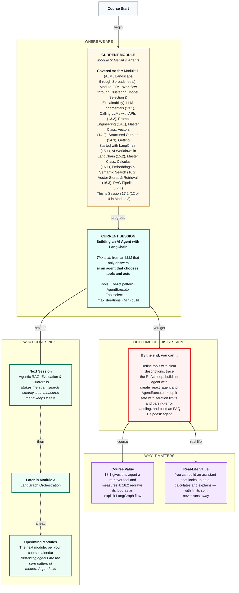

# Generative AI: Building an AI Agent with LangChain
> **Pre-Read — Academic Session 17.2** | Module 3: GenAI & Agents
---
## Mental Map


---

## What You'll Learn

In this pre-read, you'll discover:
- How to define custom LangChain tools, and why their descriptions matter so much
- The ReAct pattern: Thought → Action → Observation, repeated until the answer is ready
- How `AgentExecutor`, `create_react_agent` and the older `initialize_agent` run that loop
- How agents select tools and keep looping, safely capped with `max_iterations` and `handle_parsing_errors`
- How to build a mini FAQ Helpdesk agent that searches, looks up and calculates

---

## A. LangChain Tools: Giving the LLM Hands

**💡 Analogy:** A new support agent can talk well, but to help partners she needs access to the payout system, the partner database and the policy binder — each with a label saying what it's for. A chain is a fixed thali, always the same courses in the same order; an agent is a waiter who decides what to bring, using whatever the kitchen offers.

**One-line definition: A tool is a Python function the agent may call, plus a name and a description that tell the LLM when to use it; LangChain creates one with the `@tool` decorator or `Tool(name=..., func=..., description=...)`.**

```python
from langchain_core.tools import tool

@tool
def calculate_weekly_payout(partner_id: str) -> str:
    """Calculate EXACT payout amounts for this week and last week with a full breakdown.
    Use this for any question about how much a partner earned or why a payout changed.
    Input: a partner ID like P-20417."""
    ...   # plain Python: base + peak + target bonus + rain bonus - deductions
```

**Worked example:** Remember the ₹600 question from Session 14.1: "Why is my payout ₹600 less this week? My ID is P-20417." Answering it properly needs three things: the partner's own numbers (a `get_partner_stats` lookup), exact maths for both weeks (a `calculate_weekly_payout` tool — not the LLM, as Session 15.2 taught), and the policy behind each part (`search_handbook`, the RAG retriever from 17.1). "How do I change my bank account?" needs only the handbook. No single fixed chain fits every question, so an agent chooses. (The curriculum says "create_tool"; in LangChain that means `@tool` or `Tool(...)`.)

**⚠️ Common trap:** Lazy descriptions like "payout tool". The LLM never sees your code — only the name and description. Say what the tool does, what input it wants and when to use it, and make sure no two descriptions overlap.

---

## B. The ReAct Agent Pattern

**💡 Analogy:** A detective doesn't solve a case in one leap. She thinks ("the payout dropped — check his orders"), acts (pulls the records), observes ("same orders, but fewer at peak hours"), then thinks again — until the case is closed.

**One-line definition: ReAct (Reason + Act) is an agent pattern built on a loop: the LLM writes a Thought, picks an Action and its input, reads the Observation (the tool's result), and repeats until it writes a Final Answer.**

```
Thought: I need his weekly payout breakdown.
Action: calculate_weekly_payout
Action Input: P-20417
Observation: Last week Rs 2,860 (40 peak orders, 0 cancellations). This week Rs 2,260 (20 peak, 3 cancellations).
Thought: Peak bonus fell by Rs 300 and deductions rose by Rs 300. I should check the deduction policy.
Action: search_handbook
Action Input: cancellation deduction policy
Observation: [1.3] Rs 100 deducted per customer-reported cancellation verified as the partner's fault...
Final Answer: Your payout is Rs 600 lower: 20 fewer peak-hour orders (Rs 300 less) and 3 verified
cancellations (Rs 300 deducted, Section 1.3). If one wasn't your fault, dispute it within 7 days (1.4).
```

**Worked example:** The trace above is the agent answering the ₹600 question by itself. The Thought lines are Session 14.1's chain-of-thought — the model working step by step — but now each step can *do* something and see a real result.

**⚠️ Common trap:** Treating the Thoughts as the model's true reasoning. They're generated text, like everything in Session 13.1. They're a useful debugging window, but a model can write a sensible Thought and still pick the wrong tool.

---

## C. AgentExecutor, create_react_agent and initialize_agent

**💡 Analogy:** The agent is the decision-maker. The AgentExecutor is the shift supervisor who actually runs the loop: she passes each decision to the right tool, brings back the result, enforces the rules and ends the shift.

**One-line definition: `create_react_agent` builds the decision-maker from an LLM, tools and a ReAct prompt; `AgentExecutor` runs the Thought → Action → Observation loop until a Final Answer or a limit; `initialize_agent` is the older one-line version of both.**

```python
from langchain.agents import AgentExecutor, create_react_agent

tools = [search_handbook, get_partner_stats, calculate_weekly_payout]
agent = create_react_agent(llm, tools, react_prompt)
executor = AgentExecutor(agent=agent, tools=tools, verbose=True,
                         max_iterations=6, handle_parsing_errors=True)
executor.invoke({"input": "Why is P-20417's payout Rs 600 less this week?"})
```

**Worked example:** The ReAct prompt must contain four blanks: `{tools}` (each tool's name and description), `{tool_names}`, `{input}` (the question) and `{agent_scratchpad}` (every Thought, Action and Observation so far — the agent's working memory for this one question). Older tutorials write `initialize_agent(tools, llm, agent=AgentType.ZERO_SHOT_REACT_DESCRIPTION)`, which still works in LangChain 0.3 with a deprecation warning. Prefer `create_react_agent` + `AgentExecutor`, where you can see and edit the prompt.

**⚠️ Common trap:** Turning `verbose` off while learning. Without the printed trace, you can't see why an agent did something strange. Keep `verbose=True` until it behaves.

---

## D. Tool Selection Logic and Multi-Step Action Loops

**💡 Analogy:** A good waiter doesn't bring every dish in the kitchen. He brings what the order needs, in a sensible order — starters before mains.

**One-line definition: Tool selection is the LLM matching the question against tool descriptions; a multi-step action loop is the agent calling several tools in sequence, using each observation to decide the next action.**

**Worked example:** "How do I change my bank account?" should trigger `search_handbook` only. "What's my payout this week? I'm P-33150" needs `calculate_weekly_payout`. "How many rain orders did I do?" needs `get_partner_stats`. "Why is my payout ₹600 less?" needs `calculate_weekly_payout`, then `search_handbook`. "Tell me a joke" needs no tool at all. Good selection comes from clear, non-overlapping descriptions, a prompt saying when to use tools, and few tools — three well-described tools beat fifteen vague ones.

**⚠️ Common trap:** Adding a "do everything" tool such as `run_python(code)`. The agent will use it for everything, including things it shouldn't — the same danger as running generated code in Session 15.2's CSV copilot.

---

## E. max_iterations and handle_parsing_errors

**💡 Analogy:** A delivery app caps how many times an order can be reassigned. Without a cap, one confused order could bounce around for a very long time.

**One-line definition: `max_iterations` caps how many Thought → Action → Observation rounds the agent may take; `handle_parsing_errors=True` sends badly formatted replies back to the model as an error to fix, instead of crashing.**

**Worked example:** A partner asks, "What will my payout be next month?" No tool can answer the future, so a confused agent may call `calculate_weekly_payout` again and again. The default cap is 15 rounds, and each round is a paid LLM call; with `max_iterations=6`, it stops sooner and the helpdesk falls back to "I'll connect you to a support agent." Separately, if the model writes "I think the answer is..." without "Final Answer:", `handle_parsing_errors=True` returns the format error as an observation and the model corrects itself.

**⚠️ Common trap:** Setting `max_iterations=50` "so it never gives up." At 50,000 questions a day and one paid call per round (Session 13.1), a looping agent becomes your biggest bill. Most good answers need 1–4 steps.

---

## F. Mini-Build: FAQ Helpdesk Agent (or CSV Analyst)

**💡 Analogy:** It's the support agent from Section A on her first real shift: three labelled systems, a supervisor capping how long she can spend, and a rule to escalate what she can't answer.

**One-line definition: The mini-build is a ReAct agent with three tools — handbook search, partner stats and a payout calculator — run by an AgentExecutor with safe limits.**

**Worked example:** The FAQ Helpdesk agent answers policy questions from the handbook, number questions from the stats and calculator, and the ₹600 question by combining both, citing sections each time. The alternative build, a **CSV Analyst** agent, swaps the tools for Session 15.2's CSV copilot (plan → Pandas → explain) plus a tool that describes the table's columns. Same agent pattern, different hands — chains don't disappear when you build agents; they become the agent's tools.

**⚠️ Common trap:** Skipping the limits in a "quick demo" and shipping it. Every agent that faces real users needs a step cap, parsing-error handling and a human fallback from day one.

---

## Quick Reference — Chain or Agent?

| Your situation | Use this | Because |
|---|---|---|
| The steps are always the same | A chain (Sessions 15.1–17.1) | Faster, cheaper, predictable |
| The question decides the steps | An agent | The LLM chooses tools |
| Create a tool | `@tool` with a clear docstring, or `Tool(...)` | The description drives selection |
| Maths or data lookups | A Python tool | LLMs aren't calculators |
| Build a ReAct agent | `create_react_agent` + `AgentExecutor` | Visible, editable prompt |
| Prevent runaway loops and format crashes | `max_iterations` (4–8) + `handle_parsing_errors=True` | Caps cost; self-corrects |

---

## Practice Exercises

1. **Concept Detective** — For each, say chain or agent: (a) translate every message to English, (b) answer partner questions that may need policy, stats or calculation, (c) extract a ticket from every message, (d) answer any question about the partner table.

2. **Spot the Error** — Two tools have the descriptions "gets data" and "gets info". The agent keeps choosing the wrong one. Rewrite both descriptions.

3. **Planning Ahead** — Write the ReAct trace (Thought, Action, Action Input, Observation, Final Answer) you'd expect for: "I'm P-33150. Did I get my rain bonus this week, and how is it calculated?"

4. **Pattern Recognition** — An agent's trace shows `calculate_weekly_payout` called five times in a row with the same input, then "Agent stopped due to iteration limit." What went wrong, and which settings or design changes would you look at?

5. **Real-Life Application** — Design a three-tool agent for a task at your work or college. Name each tool, write its one-line description, and give an example question that needs two of the tools.

---

> ✅ **You're done!** You can now define tools with clear descriptions, explain the ReAct loop, build an agent with `create_react_agent` and `AgentExecutor`, and keep it safe with iteration limits and parsing-error handling.
>
> Next up: **Session 18.1 — Agentic RAG, Evaluation & Guardrails**, where the handbook retriever becomes a first-class agent tool — and we finally measure how correct and faithful the helpdesk is, and add guardrails to keep it safe.
