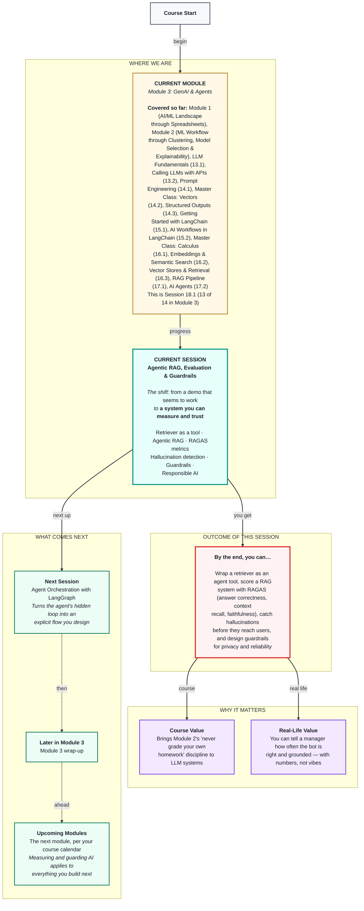

# Generative AI: Agentic RAG, Evaluation & Guardrails
> **Pre-Read — Academic Session 18.1** | Module 3: GenAI & Agents
---
## Mental Map


---

## What You'll Learn

In this pre-read, you'll discover:
- How to wrap a retriever as an agent tool, and what makes agentic RAG different from plain RAG
- How the RAGAS framework scores a RAG system with answer correctness, context recall and faithfulness
- How to catch hallucinations before they reach a partner
- How to design guardrails on the way in and the way out
- The privacy, reliability and responsible AI principles that decide whether a helpdesk is safe to launch

---

## A. A LangChain Retriever as a Tool

**💡 Analogy:** In Session 17.2 we hand-labelled each system the support agent could use. LangChain sells a ready-made label printer for one of them: the policy binder.

**One-line definition: `create_retriever_tool` wraps any retriever as a LangChain tool with a name and a description, so an agent can call it like any other tool.**

```python
from langchain.tools.retriever import create_retriever_tool

handbook_tool = create_retriever_tool(
    retriever,                                   # the Chroma retriever from 16.3 / 17.1
    name="search_handbook",
    description="Search the official partner handbook for policy and rules: payouts, bonuses, "
                "deductions, disputes, bank details, insurance, safety, app issues.")
tools = [handbook_tool, get_partner_stats, calculate_weekly_payout]   # from 17.2
```

**Worked example:** Swiggy's ops head has seen the demos: the RAG bot (17.1) and the agent that answered the ₹600 question (17.2). Before launch she asks what every serious manager asks: "How often is it right? How do you know? And what stops it from doing something harmful?" First, we tidy the agent: in 17.2 we wrapped the retriever by hand with `@tool`; `create_retriever_tool` does it in one call and returns each chunk's text to the agent as the observation. (The curriculum calls it "create_retrieval_tool"; the actual function is `create_retriever_tool`.)

**⚠️ Common trap:** A vague description like "search documents". Exactly as in 17.2, the description is all the agent sees — say which topics the handbook covers so the agent knows when to search it and when to use the stats or calculator instead.

---

## B. The Agentic RAG Pattern

**💡 Analogy:** In 17.1 our RAG bot was a student who *must* open the textbook before every answer, even for "hello." In agentic RAG, the textbook becomes one of her tools. She decides whether to open it and what to look up — and she can look again with a better search.

**One-line definition: Agentic RAG means giving an agent the retriever as one of its tools, so the agent decides when to retrieve, what to search for, and whether to search again.**

**Worked example:** A partner writes, "bonus nahi mila barish wale din, P-33150 hoon." Plain RAG would search once with those exact Hinglish words. The agent checks the partner's stats (12 rain-alert orders) and rephrases the search into clear English, "rain bonus policy", finding section 2.2. Then it searches again for "how to dispute a missing bonus" (section 1.4) and answers with both sections cited. Rephrasing also helps with romanised Hinglish, which embeddings find harder (Session 16.2).

**⚠️ Common trap:** Assuming agentic RAG is always better. More decisions mean more LLM calls, more cost and more ways to go wrong, and the varying path makes it harder to evaluate. If every question needs the handbook exactly once, plain RAG is simpler.

---

## C. The RAGAS Framework and Its Three Metrics

**💡 Analogy:** A restaurant inspector doesn't just taste the final dish. She checks whether the kitchen fetched the right ingredients, whether the cook used only those ingredients, and whether the dish is what the customer ordered.

**One-line definition: RAGAS (Retrieval-Augmented Generation Assessment) is an open-source library that scores a RAG system on a test set with an LLM as the judge: context recall tests retrieval, faithfulness tests generation, and answer correctness tests the end result against a human-written reference.**

```python
from ragas import EvaluationDataset, evaluate
from ragas.metrics import LLMContextRecall, Faithfulness, AnswerCorrectness
from ragas.llms import LangchainLLMWrapper
from ragas.embeddings import LangchainEmbeddingsWrapper

dataset = EvaluationDataset.from_list(rows)   # user_input, retrieved_contexts, response, reference
result = evaluate(dataset=dataset,
                  metrics=[LLMContextRecall(), Faithfulness(), AnswerCorrectness()],
                  llm=LangchainLLMWrapper(judge_llm), embeddings=LangchainEmbeddingsWrapper(emb))
```

**Worked example:** Each test row holds the question, the chunks your retriever returned, your system's answer, and a **reference** answer written by a person reading the handbook — for example, "On the next working day by 8 pm." To score **faithfulness**, the judge splits the answer into claims and checks each against the chunks. "You get ₹10 extra per rain-alert order, paid every Friday, and double on weekends" has three claims; the first two are supported and "double on weekends" isn't, so faithfulness = 2/3 ≈ 0.67. To score **context recall**, the judge checks how much of the reference can be found in the retrieved chunks. Read them together: low recall with high faithfulness means retrieval missed facts while the model stayed honest (fix chunking or k); high recall with low faithfulness means the right chunks came back but the model added things (fix the prompt or model).

**⚠️ Common trap:** Two of them. Writing the references by copying the bot's own answers is grading your own homework — Module 2's rule — so references must come from a person. And reporting only averages hides problems: a 0.92 average can hide one 0.2 on the accident-insurance question. Always read the per-question table.

---

## D. Hallucination Detection

**💡 Analogy:** A newspaper doesn't print a story just because the reporter is confident. A fact-checker checks names and numbers against sources before it goes to print.

**One-line definition: Hallucination detection means checking an answer before it reaches the user, and blocking or flagging it if it contains claims the sources don't support.**

**Worked example:** RAGAS scores a test set; in production we also check each live answer. A faithfulness judge costs an extra LLM call. A **number check** is free and instant: every rupee amount, percentage or day count in the answer must appear in the retrieved chunks or tool outputs. If an answer says "accident cover is ₹5,00,000" and chunk 4.2 says ₹2,00,000, then "500000" appears nowhere in the sources — block it and send the fallback "I'll connect you to a support agent." A **citation check** (the cited section must actually have been retrieved) is free too.

**⚠️ Common trap:** Trusting an LLM judge completely. The judge is an LLM too and can make mistakes. Spot-check its verdicts by hand, especially early on.

---

## E. Guardrails Design

**💡 Analogy:** A metro station has checks at both ends: security at the entry (what comes in) and gates at the exit (what goes out). The train runs freely in between.

**One-line definition: Guardrails are rules and checks placed around an LLM system — on the input before it reaches the model, and on the output before it reaches the user — that block, fix or escalate risky cases.**

**Worked example:** Input guardrails for the helpdesk: redact phone and bank account numbers before any API call; flag prompt injection such as "ignore your instructions and..."; check ownership, so a partner logged in as P-20417 can only ask about P-20417; and send threats or accidents straight to the human safety team with an SOS reminder, skipping the bot. Output guardrails: the number and citation checks from Section D, plus length and tone limits. A partner who asks "What was P-33150's payout?" is politely refused — by code, not by asking the model nicely.

**⚠️ Common trap:** Relying only on the system prompt ("never reveal other partners' data"). Prompts can be talked around, as Session 14.3's injection example showed. Critical rules — especially privacy — must be enforced in code, outside the LLM.

---

## F. Privacy, Reliability and a Responsible AI Framework

**💡 Analogy:** A bank teller is polite and fast — but the bank also verifies identity, never reads out someone else's balance, keeps records and escalates unusual requests. Speed is useless without trust.

**One-line definition: Privacy means sending and storing only the minimum personal data; reliability means the system fails safely and predictably; a responsible AI framework turns these into regular checks for fairness, transparency, privacy, safety and accountability.**

**Worked example:** **Privacy:** send the LLM the question and the stats it needs — not the partner's phone, bank account or address — redact PII in code, enforce access in code, and check your provider's data policy (13.2). **Reliability:** every failure path ends in a human fallback; limits everywhere (`max_tokens`, timeouts, retries, `max_iterations`); re-run the RAGAS test set after every handbook or prompt change; money changes and safety issues always go to a person. **Responsible AI:** check fairness by scoring Hindi, Telugu and English questions separately; be transparent ("I'm the helpdesk bot" plus citations); and make someone accountable, with logged conversations and a named owner.

**⚠️ Common trap:** Treating responsible AI as a document you write once. It's a set of checks you run — scores per language, guardrail logs, escalation counts — every time the system changes.

---

## Quick Reference — Evaluate and Protect

| Your situation | Use this | Because |
|---|---|---|
| The agent should decide when to search | `create_retriever_tool` → agentic RAG | Retrieval becomes a choice |
| You need numbers, not vibes | RAGAS on a human-written test set | Repeatable scores |
| Is retrieval finding the facts? | Context recall | Tests the retrieval half |
| Is the answer sticking to the sources? | Faithfulness | Tests the generation half |
| Block invented amounts | Number and citation checks | Free and instant |
| Personal data or another partner's data | Redaction and ownership checks in code | Prompts can be bypassed |
| Safety issues or money changes | Escalate to a human | Accountability |

---

## Practice Exercises

1. **Concept Detective** — Context recall is 0.4 and faithfulness is 0.95. Is the main problem retrieval or generation? What would you try first?

2. **Spot the Error** — A team writes its RAGAS reference answers by copying the bot's own responses, and reports answer correctness of 0.98. What's wrong?

3. **Planning Ahead** — Compute faithfulness by hand for this answer: "Report accidents within 48 hours via Help > Safety; the safety team calls within 24 hours; cover is ₹3,00,000." The retrieved chunks are sections 4.2 and 4.3.

4. **Pattern Recognition** — Logged in as P-20417, a user asks, "What was P-33150's payout this week?" Which guardrail should catch this, where should it run, and why can't the system prompt alone be trusted?

5. **Real-Life Application** — Pick an AI tool you use or could build at work or college. For each of the five responsible AI principles, write one concrete check you would run.

---

> ✅ **You're done!** You can now turn a retriever into an agent tool, measure a RAG system's retrieval and generation separately with RAGAS, catch hallucinations before they reach users, and design guardrails grounded in privacy, reliability and responsible AI.
>
> Next up: **Session 18.2 — Agent Orchestration with LangGraph**, where the agent's hidden loop becomes an explicit flowchart — with branches, retries and these guardrails built in as steps you can see.
