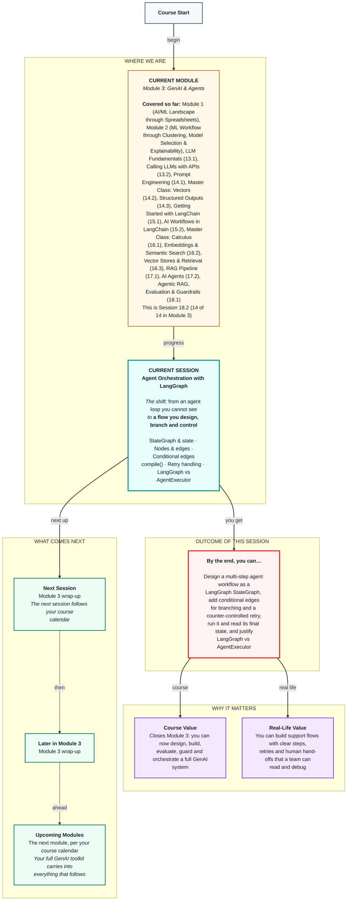

# Generative AI: Agent Orchestration with LangGraph
> **Pre-Read — Academic Session 18.2** | Module 3: GenAI & Agents
---
## Mental Map


---

## What You'll Learn

In this pre-read, you'll discover:
- How a LangGraph StateGraph carries shared state through a flow you design
- How nodes, edges, `add_node`, `add_edge` and `compile()` build a working graph
- How conditional edges handle branching — block, escalate or answer
- How to build retry handling with a counter in the state
- When to use LangGraph, and when AgentExecutor is enough

---

## A. LangGraph StateGraph and State Management

**💡 Analogy:** A hospital patient file travels from reception to the nurse, the doctor and the pharmacy. Each person reads what they need and adds their part; nobody re-asks the patient's name at every desk.

**One-line definition: LangGraph builds LLM applications as graphs, and a `StateGraph` is a graph built around one shared state — a typed dictionary that every step reads from and updates.**

```python
from typing import TypedDict, List
from langgraph.graph import StateGraph

class HelpdeskState(TypedDict):
    partner_id: str        # who is asking (from login, not from the message)
    question: str          # the message, after redaction
    route: str             # "ok", "block" or "escalate"
    context: List[str]     # retrieved handbook chunks
    answer: str            # the current draft answer
    check_passed: bool     # did the number check pass?
    attempts: int          # how many answers we've tried

graph = StateGraph(HelpdeskState)
```

**Worked example:** At the end of Session 18.1, our input guardrails, RAG answer, number check and fallback were separate pieces called by hand. Today they become one system with clear rules: always run the guardrails first; refuse blocked messages and send safety issues to a human; otherwise retrieve and answer; check the answer, retry once with stricter instructions, then hand over to a human. The state carries everything those steps need. `TypedDict` simply lists the keys and their types — a lighter cousin of Session 14.3's Pydantic models.

**⚠️ Common trap:** Putting everything into the state "just in case." Keep only what later steps need — a huge state is hard to read when debugging, which defeats the purpose.

---

## B. Nodes and add_node

**💡 Analogy:** Each desk in the hospital is a node: reception, nurse, doctor. Each does one job with the patient file.

**One-line definition: A node is a plain Python function that receives the current state and returns a dictionary of only the keys it changed; `add_node(name, function)` registers it in the graph.**

```python
def retrieve(state: HelpdeskState) -> dict:
    docs = retriever.invoke(state["question"])
    return {"context": [d.page_content for d in docs]}

def check(state: HelpdeskState) -> dict:
    unsupported = numbers_in(state["answer"]) - numbers_in(" ".join(state["context"]))
    return {"check_passed": len(unsupported) == 0}

graph.add_node("retrieve", retrieve)
graph.add_node("check", check)
```

**Worked example:** Our helpdesk has seven nodes: `guard` (18.1's guardrails, which set `route`), `refuse`, `human`, `retrieve` (16.3's retriever), `answer` (17.1's RAG prompt, which also adds 1 to `attempts`), `check` (18.1's number check) and `fallback`. Every node calls things you already built — LangGraph only decides what runs when.

**⚠️ Common trap:** Returning the whole state from a node, or forgetting to return anything. A node returns only the keys it changed; LangGraph merges them into the state.

---

## C. Edges, add_edge, START, END and compile()

**💡 Analogy:** Arrows painted on a hospital floor: "from reception, go to the nurse." Fixed directions, no decisions.

**One-line definition: An edge connects one node to the next; `START` and `END` mark where the flow begins and stops; `compile()` checks the graph and turns it into a runnable app.**

```python
from langgraph.graph import START, END

graph.add_edge(START, "guard")
graph.add_edge("retrieve", "answer")
graph.add_edge("answer", "check")
graph.add_edge("fallback", END)

app = graph.compile()
final_state = app.invoke({"partner_id": "P-20417", "question": "How much is the rain bonus?",
                          "attempts": 0})
print(final_state["answer"])
```

**Worked example:** `app.invoke()` returns the whole final state, not just the answer — so you can see the context retrieved, how many attempts it took and whether the check passed. And `app.get_graph().draw_mermaid()` prints the graph as a mermaid diagram, the same format as every mental map in this course: your system documents itself.

**⚠️ Common trap:** A node with no way out. Every path must eventually reach `END`, or the graph won't compile or run correctly.

---

## D. Conditional Edges: Branching

**💡 Analogy:** At hospital triage, the nurse looks at the patient and decides: emergency room, general ward or home. Same desk, different next stop depending on what she sees.

**One-line definition: A conditional edge uses a small routing function that reads the state and returns a name, and a mapping turns that name into the next node.**

```python
def route_after_guard(state: HelpdeskState) -> str:
    return state["route"]            # "ok", "block" or "escalate"

graph.add_conditional_edges("guard", route_after_guard,
                            {"ok": "retrieve", "block": "refuse", "escalate": "human"})
```

**Worked example:** "customer ne gate pe dhamki di" ("the customer threatened me at the gate"): the `guard` node finds a safety word and sets `route = "escalate"`, so the flow goes to `human` and then `END`. The LLM never even runs. In Session 17.2, "safety issues go to a human" was only a request in the agent's prompt; here it's an arrow in the graph, and it can't be skipped.

**⚠️ Common trap:** Doing heavy work inside a routing function. Keep routers tiny — read the state, return a name. Do the real work, including any LLM calls, inside nodes.

---

## E. Retry Handling Across Nodes

**💡 Analogy:** A factory quality inspector sends a faulty part back to the machine once, with adjusted settings. If it's still faulty, it goes to a human technician — it doesn't loop forever.

**One-line definition: Retry handling in LangGraph is a conditional edge that loops back to an earlier node, controlled by a counter stored in the state, with a give-up path to a fallback.**

```python
MAX_ATTEMPTS = 2

def route_after_check(state: HelpdeskState) -> str:
    if state["check_passed"]:
        return "done"
    return "retry" if state["attempts"] < MAX_ATTEMPTS else "give_up"

graph.add_conditional_edges("check", route_after_check,
                            {"done": END, "retry": "answer", "give_up": "fallback"})
```

**Worked example:** The `answer` node writes "Accident cover is ₹5,00,000" (attempts becomes 1). `check` finds that 500000 isn't in the sources, so `check_passed` is false. The router returns "retry" (1 < 2), and the flow goes back to `answer`, which sees `attempts > 0` and adds "quote every amount exactly as written." The new answer, "₹2,00,000 on active orders (Section 4.2)", passes, and the flow ends. If the second try had also failed, `attempts` would be 2, the router would return "give_up", and `fallback` would connect the partner to a person. Unlike Session 13.2's retries — the same request again after a 429 — this retries with a changed instruction after a quality failure.

**⚠️ Common trap:** A retry loop with no counter. LangGraph has a built-in recursion limit (25 steps by default), but hitting it ends in an error, not a polite fallback. Every loop needs a counter in the state and a give-up path.

---

## F. Multi-Step Agent Flow Design and LangGraph vs AgentExecutor

**💡 Analogy:** AgentExecutor is a talented freelancer: give her a goal and tools, and she decides everything herself. LangGraph is a documented office process: every hand-off, check and escalation is fixed on the wall, and the people at each desk still do the thinking.

**One-line definition: In AgentExecutor the LLM picks every step inside a hidden loop; in LangGraph you design the steps, branches and retries as an explicit graph, and LLMs work inside the nodes.**

**Worked example:** Choose AgentExecutor for open-ended questions with a few tools and no hard rules, like a quick prototype or a CSV analyst for one manager — it needs little setup. Choose LangGraph when you need guarantees: safety messages must reach a human, a refund above ₹500 needs approval, a draft must be checked and retried before sending. They also combine: a LangGraph node can run the 17.2 agent for the open-ended part, while the graph guarantees the guardrails and checks around it.

**⚠️ Common trap:** Choosing LangGraph for everything because it's newer. For a simple prototype, a graph is extra work. Reach for it when rules, branches, retries or hand-offs must be guaranteed.

---

## Quick Reference — Building a LangGraph Flow

| Your situation | Use this | Because |
|---|---|---|
| Define what flows between steps | `TypedDict` state + `StateGraph(State)` | One visible, typed state |
| A step of work | Node function → `add_node(name, fn)` | Returns only the changed keys |
| Always go from A to B | `add_edge("A", "B")` | A fixed arrow |
| Choose the next step | `add_conditional_edges(node, router, mapping)` | Branching on the state |
| Make it runnable | `app = graph.compile()` | Validates and builds |
| Retry with a limit | A counter in the state + a loop edge + a give-up path | Controlled loops |
| Open-ended tool use, no hard rules | AgentExecutor | Less setup |

---

## Practice Exercises

1. **Concept Detective** — For each, choose AgentExecutor, LangGraph or a plain chain: (a) extract a ticket from every message, (b) a prototype that answers anything with three tools, (c) a production helpdesk where safety messages must always reach a human, (d) a flow that drafts a reply, checks it and retries once.

2. **Spot the Error** — A graph has `add_edge("answer", "check")` and `add_conditional_edges("check", router, {"retry": "answer", "done": END})`, and the router returns "retry" whenever the check fails. What can go wrong, and what two changes fix it?

3. **Planning Ahead** — Add a `classify` node (payout, incentive, app_issue, safety, other — from Session 14.1) after `guard`. Sketch the new graph: which categories should skip retrieval and go straight to a tool or a human?

4. **Pattern Recognition** — Trace the state keys `route`, `attempts` and `check_passed` through the graph for "How much is the rain bonus?", where the first answer passes the check.

5. **Real-Life Application** — Sketch a LangGraph-style flowchart for a process at your work or college that has a check and a hand-off to a person (for example, leave approval or refund requests). Name the nodes, the conditional edges and the state keys.

---

> ✅ **You're done!** You can now design an LLM workflow as an explicit graph — typed state, nodes, edges, conditional branches and controlled retries — and decide when that control is worth it compared with AgentExecutor. That completes Module 3.
>
> Next up: the session after Module 3 follows your course calendar — and everything you build next can reuse this helpdesk's pieces.
